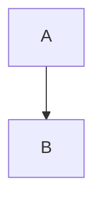

# Título del tema

> **Resumen de material de clase.** Viene de un PDF que aportó la estudiante.
> No es una ficha de un solo concepto: es una vista de un tema entero.

## 1. De qué va (resumen en cinco líneas)

1. Idea principal.
2. Segunda idea.
3. Tercera idea.
4. Cuarta idea.
5. Para qué sirve esto en DAW.

## 2. Explicación paso a paso

1. Primer paso.
2. Segundo paso.
3. Tercer paso.

## 3. Ideas clave del tema

- **Idea**: qué significa y por qué importa.

## 4. Ejemplo práctico relacionado con DAW

Ejemplo pequeño (5-10 líneas) con contexto de una web o una app.

## 5. Código o comandos pequeños comentados

```text
# Solo si el tema lo necesita
```

## 6. Diagrama (Mermaid)

Al menos un diagrama del tema. Si de verdad ninguno aporta claridad, explica por
qué en esta sección.



## 7. Conceptos con los que se suele confundir

- **Término parecido**: en qué se diferencian.

## 8. Errores frecuentes

- Error 1: por qué pasa y cómo evitarlo.

## 9. Tres preguntas de repaso

1. Pregunta.
2. Pregunta.
3. Pregunta.

### Respuestas

1. Respuesta.
2. Respuesta.
3. Respuesta.

## 10. Términos relacionados

- [Otro término](../Terminos/otro-termino.md)

## 11. Fuentes y límites del resumen

- Fuente: PDF `nombre-del-archivo.pdf` (páginas 1-12), aportado por la estudiante.
- Fuentes externas: enlaces consultados, o «no consultadas».
- Límites: qué no se ha leído, comprobado o verificado.

## 12. Mis notas

<!-- Sección reservada para la estudiante. No borrar ni sobrescribir. -->