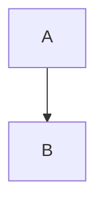

# Nombre del término

## 1. Definición breve

Una o dos frases, con palabras sencillas.

## 2. Explicación paso a paso

1. Primer paso.
2. Segundo paso.
3. Tercer paso.

## 3. Para qué sirve y cuándo se utiliza

- Sirve para…
- Se usa cuando…

## 4. Ejemplo práctico relacionado con DAW

Ejemplo pequeño (5-10 líneas) con contexto de una web o una app.

## 5. Código pequeño comentado

```text
# Solo si el término lo necesita
```

## 6. Diagrama (Mermaid)

Incluye al menos un diagrama que aporte claridad. Si de verdad ninguno encaja,
explica por qué en esta sección.



## 7. Conceptos con los que se suele confundir

- **Término parecido**: en qué se diferencian.

## 8. Errores frecuentes

- Error 1: por qué pasa y cómo evitarlo.

## 9. Tres preguntas de repaso

1. Pregunta.
2. Pregunta.
3. Pregunta.

### Respuestas

1. Respuesta.
2. Respuesta.
3. Respuesta.

## 10. Términos relacionados

- [Otro término](Terminos/otro-termino.md)

## 11. Fuentes y límites de la explicación

- Fuentes: enlaces consultados, o «no consultadas».
- Límites: qué no se ha verificado.

## 12. Mis notas

<!-- reserving esta sección para la estudiante. No borrar ni sobrescribir. -->
