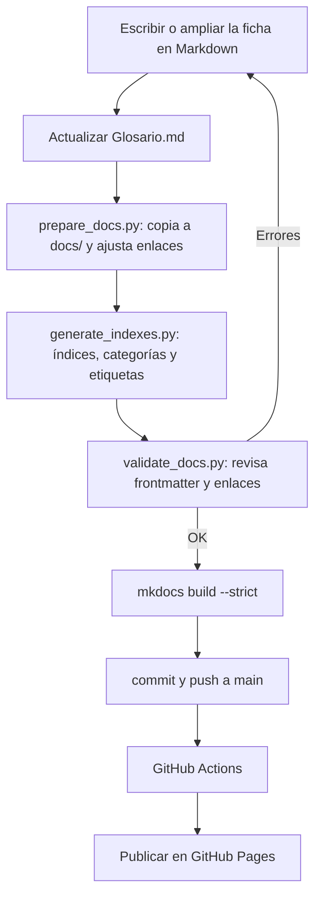

# Glosario personal de DAW

Documentación de un **glosario de Desarrollo de Aplicaciones Web** para nivel
principiante. El contenido son fichas en Markdown y el repositorio incluye las
herramientas para generarlo y publicarlo como sitio web.

- **Fuente:** archivos de texto plano (Markdown), legibles en Obsidian, en GitHub
  o con cualquier editor.
- **Sitio publicado:** generado con MkDocs y publicado con GitHub Actions.
- **Criterio de diseño:** elegir cada herramienta por el contenido que hay que
  mantener y por quién lo va a consultar.

## 1. Qué documenta y para quién

Una documentación útil explica **qué hace** el proyecto, **cómo está hecho** y
**cómo se usa o se mantiene**, adaptándose a quien la consulta. En este glosario
conviven tres audiencias:

| Audiencia | Qué necesita | Dónde lo encuentra |
|---|---|---|
| Estudia o consulta los términos | Entender un concepto y repasarlo | Sitio web, fichas de `Terminos/`, `Glosario.md` |
| Añade términos nuevos | Crear una ficha correcta sin duplicar | Comandos `/glosario` y `/repasar`, `Plantillas/termino.md` |
| Mantiene el proyecto | Regenerar y publicar el sitio | `scripts/`, `mkdocs.yml`, `.github/workflows/` |

## 2. Tipos de documentación en el proyecto

| Tipo | Ejemplos en este repositorio | Para qué sirve |
|---|---|---|
| Externa (fuera del código) | `README.md`, `Glosario.md`, `Terminos/*.md`, sitio en `docs/` | Explicar el uso, la instalación y los términos |
| Interna (junto a los datos) | *frontmatter* YAML de cada ficha y comentarios de los scripts | Aportar metadatos y permitir que los scripts generen índices |
| Generada | `docs/` y `site/` (creadas por los scripts y por MkDocs) | Publicar el sitio sin editar los originales |

Este proyecto documenta contenidos escritos, no una API de código: por eso usa un
generador de sitios (MkDocs) y no herramientas de extracción de código como
KDoc, Javadoc o Doxygen.

## 3. Formatos y herramientas

| Formato o herramienta | Qué es | Uso en este proyecto |
|---|---|---|
| **Markdown** | Formato de texto ligero | Todas las fichas y guías |
| **YAML** | Formato de metadatos | *Frontmatter* de las fichas y `mkdocs.yml` |
| **Mermaid** | Diagramas descritos con texto | Diagramas dentro de las fichas (ver apartado 4) |
| **MkDocs Material** | Generador de sitios estáticos | Crea el sitio HTML con búsqueda y tema |
| **Python** | Lenguaje de los scripts | Preparar `docs/`, generar índices y validar |
| **Git / GitHub** | Control de versiones | Historial y trabajo colaborativo |
| **GitHub Actions** | Integración continua | Compila y publica en cada `push` |
| **GitHub Pages** | Alojamiento web | Publica el sitio generado |
| **Obsidian** | Visor de notas Markdown | Lectura local y edición de las fichas |

Conviene no confundir el **formato** con el **generador**: Markdown es la forma de
escribir; MkDocs transforma esos archivos en un sitio. Otras alternativas
posibles serían Pandoc (conversión de formatos) o Docusaurus (otro generador).

## 4. Flujo de la documentación



Los diagramas se escriben en Mermaid para poder revisarlos y versionarlos junto al
texto, en lugar de depender de una imagen que cuesta actualizar.

## 5. Estructura del repositorio

```text
GlosarioDAW/
├── AGENTS.md              reglas permanentes (pedagogía, organización, seguridad)
├── README.md              este archivo: puerta de entrada
├── Glosario.md            índice de fichas, en orden alfabético (para Obsidian)
├── Entrada/pendientes.md  bandeja opcional para apuntar términos en clase
├── Plantillas/termino.md  plantilla de cada ficha
├── Terminos/              una ficha por término (una ficha, un concepto)
├── mkdocs.yml             configuración del sitio (navegación, tema, extensiones)
├── requirements.txt       dependencias del generador (MkDocs Material, Mermaid…)
├── scripts/               prepare_docs.py, generate_indexes.py, validate_docs.py
├── docs/                  copia generada para publicar (no se edita a mano)
├── site/                  sitio HTML generado (no se versiona)
└── .github/workflows/     flujo de integración continua y publicación
```

`docs/` y `site/` se generan y están en `.gitignore`: la fuente de verdad son las
fichas de `Terminos/`.

## 6. Requisitos

- **Python 3** (probado con 3.13) y `pip`.
- **Git**.
- **Obsidian** (opcional) para leer y editar las fichas.

## 7. Uso: crear términos y repasar

Un comando para aprender, uno para repasar:

```text
/glosario Cookie
```

El asistente explica el término, lo dibuja y guarda la ficha. Puedes añadir contexto:

```text
/glosario Cookie — contexto: el servidor manda una cookie al iniciar sesión
— duda: por qué hace falta si HTTP es sin estado
```

`/glosario` comprueba que el término no exista, crea o amplía
`Terminos/<termino>.md` con las 12 secciones y **al menos un diagrama Mermaid**,
actualiza `Glosario.md` y deja la ficha con `estado: revisado`.

```text
/repasar                     → repaso global de todos los términos, uno a uno
/repaso <término>            → solo ese término
/repaso AAAA-MM-DD           → los términos de ese día
```

`/repasar` hace una pregunta y espera la respuesta; después indica qué acertaste,
qué fallaste y qué sección releer. **No modifica las fichas.**

`Entrada/pendientes.md` es opcional: sirve para apuntar términos en clase y
pasarlos luego al chat.

## 8. Previsualizar y publicar

Instalar dependencias y previsualizar en local:

```bash
python3 -m venv .venv
source .venv/bin/activate
pip install -r requirements.txt
python3 -m mkdocs serve        # previsualiza en http://127.0.0.1:8000
```

Generar y validar todo antes de publicar:

```bash
bash scripts/build_local.sh    # prepare + generate + validate + mkdocs build --strict
```

`mkdocs build --strict` genera el sitio en `site/` y **falla si hay avisos**: así se
detectan enlaces rotos o fichas mal formadas antes de publicar.

Publicar: al hacer `commit` y `push` a la rama `main`, el workflow
`.github/workflows/deploy-docs.yml` reconstruye el sitio y lo publica en GitHub
Pages. La primera vez hay que activar el alojamiento en **Settings → Pages →
Source: GitHub Actions**. La URL esperada es
<https://ifonlob.github.io/GlosarioDAW/>.

## 9. Buenas prácticas aplicadas

- **Escribir para una audiencia concreta:** lenguaje de principiante y un concepto
  por ficha.
- **Mantener la documentación junto al proyecto:** las fichas se versionan con Git
  y se revisan en cada cambio.
- **Usar ejemplos verificables:** `validate_docs.py` y `mkdocs build --strict`
  comprueban frontmatter, enlaces y construcción.
- **Estructurar y facilitar la búsqueda:** navegación en `mkdocs.yml`, buscador del
  tema e índice alfabético generado.
- **Proteger la información:** `.gitignore` excluye lo generado y no se guardan
  credenciales ni datos personales.
- **Automatizar lo que aporta valor:** GitHub Actions evita publicar a mano, aunque
  no sustituye la revisión del contenido.

## 10. Estado de las fichas

Todas las fichas usan `estado: revisado`. No hay un flujo de revisión pendiente:
una ficha se considera lista al crearse. Lo único reservado a la autora es la
sección **«Mis notas»**, que nunca se borra ni se sobrescribe.

## 11. Comprobaciones y límites

- El flujo `prepare → generate → validate → mkdocs build --strict` se ha ejecutado
  en local y termina **sin avisos** con 19 términos.
- **Los diagramas Mermaid no se validan solos:** compruébalos visualmente en
  Obsidian, en GitHub o en <https://mermaid.live>.
- Publicar en GitHub Pages **requiere activarlo** una vez (Settings → Pages).
- Los comandos `/glosario` y `/repaso` **no se han ejecutado** desde aquí: una
  sesión no lanza OpenCode. Pruébalos con un término pequeño la primera vez.

## Fuentes

- [Markdown Guide](https://www.markdownguide.org/)
- [MkDocs](https://www.mkdocs.org/) y [MkDocs Material](https://squidfunk.github.io/mkdocs-material/)
- [Mermaid](https://mermaid.js.org/)
- [GitHub Actions](https://docs.github.com/actions) y [GitHub Pages](https://pages.github.com/)
- [Obsidian](https://obsidian.md/)
- [Pandoc](https://pandoc.org/) y [Docusaurus](https://docusaurus.io/) (alternativas)
