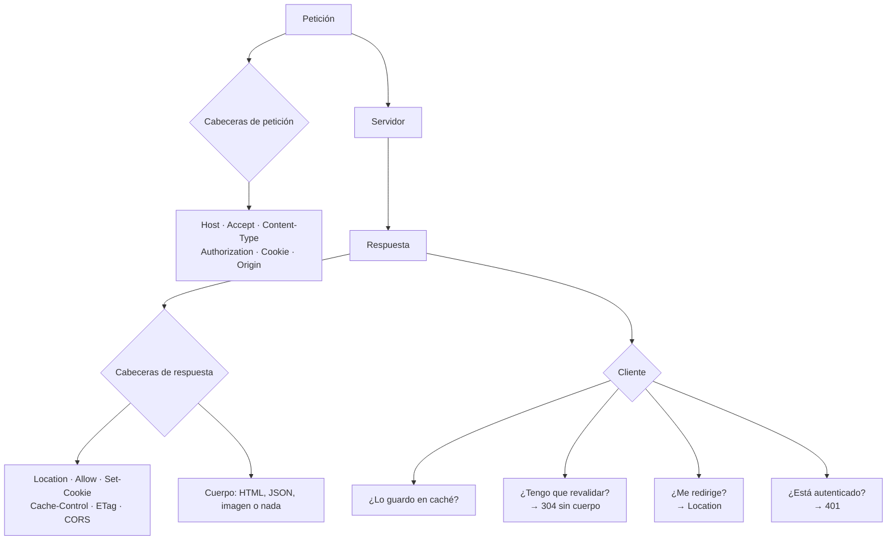

# Cabeceras HTTP, contenido, caché y negociación

> **Resumen de material de clase.** Viene de un PDF que aportó la estudiante
> (`08-cabeceras-http-contenido-y-cache.pdf`, 7 páginas).
> Lo marcado como **material de clase** es lo que dice el PDF; el resto es
> explicación propia.

## 1. De qué va (resumen en cinco líneas)

1. Las cabeceras son **metadatos**: no son el contenido, dicen **cómo tratar** el
   contenido.
2. Para entender una respuesta hay que leer **tres piezas juntas**: estado,
   cabeceras y cuerpo.
3. `Accept` es lo que **quieres recibir**; `Content-Type` es lo que **estás
   enviando**.
4. `Cache-Control` + `ETag` permiten no descargar lo que ya tienes.
5. Sirve para que la API no dé solo JSON, sino una respuesta completa y coherente.

## 2. Explicación paso a paso

1. Llega la petición con sus cabeceras: `Host`, `Accept`, `Authorization`…
2. El servidor decide qué ha ocurrido y responde con **estado + cabeceras + cuerpo**.
3. Las cabeceras de la respuesta **describen** ese cuerpo: de qué tipo es, cuánto
   ocupa, si se puede guardar en caché, dónde está el recurso nuevo.
4. El cliente lee primero el código, luego las cabeceras, luego el cuerpo.
5. Según lo que digan esas cabeceras, el cliente guarda, revalida, redirige o pide
   autenticación.

La regla práctica del PDF:

> El cuerpo contiene los datos; las cabeceras dicen **cómo debe tratarse** ese
> intercambio.

## 3. Ideas clave del tema

**Lectura rápida de las cabeceras clave:**

| Cabecera | Petición / Respuesta | Para qué |
|---|---|---|
| `Host` | Petición | Servidor lógico solicitado |
| `Accept` | Petición | Formatos que el cliente puede procesar |
| `Content-Type` | Ambas | Tipo del cuerpo **enviado** |
| `Content-Length` | Ambas | Tamaño del cuerpo en bytes |
| `Authorization` | Petición | Token o credenciales |
| `Cookie` | Petición | Cookies que manda el navegador |
| `Set-Cookie` | Respuesta | Crear o modificar cookies en el cliente |
| `Location` | Respuesta | URI del recurso creado o destino del 3xx |
| `Allow` | Respuesta | Métodos permitidos en ese recurso |
| `Cache-Control` | Ambas | Directivas de caché |
| `ETag` | Respuesta | Versión concreta de una representación |
| `If-None-Match` | Petición | Revalidar caché por `ETag` |
| `If-Match` | Petición | Evitar sobrescrituras |
| `Origin` | Petición | Origen en peticiones CORS |
| `Access-Control-Allow-Origin` | Respuesta | Orígenes autorizados en CORS |

**`Accept` frente a `Content-Type`**, que el PDF lo marca como distinción
FUNDAMENTAL:

```text
Accept: application/json        → "si puedes, respóndeme con JSON"
Content-Type: application/json  → "el cuerpo que te envío es JSON"
```

**Los tipos de contenido habituales**: `text/html`, `text/plain`,
`application/json`, `application/xml`, `application/x-www-form-urlencoded` (formularios
tradicionales), `multipart/form-data` (formularios con archivos) y
`application/problem+json` (errores estructurados). Ojo: que la ruta sea `/api` **no** significa que devuelva JSON. Lo confirma `Content-Type`.

**Caché: las directivas de `Cache-Control`:**

| Directiva | Significado |
|---|---|
| `no-store` | No guardar en caché (datos sensibles) |
| `no-cache` | Se guarda, pero hay que **revalidar** antes de reutilizar |
| `max-age=60` | Reutilizable durante 60 segundos |
| `public` | Puede estar en cachés compartidas |
| `private` | Solo en la caché privada del usuario |
| `must-revalidate` | Si caduca, hay que revalidar antes de usarlo |

**CORS, la idea mínima**: aparece cuando una página de un origen llama a una API de
otro. Un origen es la combinación de **esquema + host + puerto**. Una app en
`http://localhost:5173` que llama a `http://localhost:8080` son orígenes distintos
para el navegador. Y el PDF avisa de algo clave: **CORS no es autenticación**. Es una
política del navegador para decidir si una página puede leer la respuesta.

## 4. Ejemplo práctico relacionado con DAW

El ciclo de caché completo, del PDF:

```text
1ª petición:                      Petición siguiente:
                                   GET /api/tasks/7
HTTP/1.1 200 OK                    If-None-Match: "task-7-v3"
ETag: "task-7-v3"                  (el cliente ya tiene esa versión)
                                    
{"id":7,"title":"Repasar"}         Si no ha cambiado:
                                   HTTP/1.1 304 Not Modified
                                   ETag: "task-7-v3"
                                   → sin cuerpo: reutiliza lo que ya tenía
```

Y el error de cabecera que más cuesta dinero:

```text
POST /api/tasks HTTP/1.1
Content-Type: text/plain           ← dice "esto es texto plano"

{"title":"Esto parece JSON"}       ← pero parece JSON

El servidor puede responder 415 Unsupported Media Type.
El cuerpo "parece" JSON; la cabecera dice que no.
```

## 5. Código o comandos_small comentados

```text
Petición con credenciales:
POST /api/tasks HTTP/1.1
Host: localhost:8080
Accept: application/json          ← lo que quiero recibir
Content-Type: application/json    ← lo que estoy enviando
Authorization: Bearer <REDACTED>   ← nunca el token de verdad

Respuesta completa:
HTTP/1.1 201 Created
Location: /api/tasks/7            ← dónde está lo nuevo
Content-Type: application/json
Cache-Control: no-store           ← no lo guardes

{"id":7,"title":"Repasar HTTP"}
```

Y los comandos de exploración del PDF:

```bash
http --headers GET http://localhost:8080/            # solo cabeceras
http --body    GET http://localhost:8080/api/hello   # solo cuerpo
# Compara el Content-Type de / y de /api/hello
```

Cookies con los flags que importan:

```text
Set-Cookie: JSESSIONID=abc123; HttpOnly; Secure; SameSite=Lax
                          ↑        ↑        ↑
              evita JS     solo HTTPS  reduce CSRF
```

## 6. Diagrama (Mermaid)



## 7. Conceptos con los que se suele confundir

- **`Accept` ≠ `Content-Type`**: uno expresa lo que quieres recibir; el otro
  describe lo que envías. El PDF lo llama distinción **fundamental**.
- **Ruta `/api` ≠ JSON**: lo confirma el `Content-Type`, no el nombre de la ruta.
- **`no-cache` ≠ `no-store`**: `no-cache` sí guarda, pero obliga a revalidar antes de
  usar.
- **CORS ≠ autenticación**: CORS limita al navegador. La API sigue necesitando
  autenticación y autorización.
- **`ETag` ≠ `Last-Modified`**: los dos sirven para revalidar, pero el `ETag` suele
  ser más preciso; una fecha puede no capturar todos los cambios.
- **`ETag` + `If-None-Match` ≠ `ETag` + `If-Match`**: el primero es para caché; el
  segundo, para evitar que dos clientes se pisen.
- **`204` + cuerpo ≠ éxito**: un 204 no lleva cuerpo.

## 8. Errores frecuentes

Los seis que lista el PDF:

- **Confundir `Accept` con `Content-Type`**.
- **Pensar que `/api` siempre devuelve JSON**.
- **Compartir `Authorization` o cookies reales**: equivale a filtrar credenciales.
- **Usar caché sin pensar en datos sensibles**: puede exponer información privada.
- **Creer que CORS protege la API**: solo limita al navegador.
- **Ignorar `Location` en un `201 Created`**: el cliente pierde la forma clara de
  localizar lo que se acaba de crear.

Y uno más, muy de clase: **subir capturas de peticiones autenticadas a un foro o una
entrega**. Si tienes que enseñarlas, se redactan con `<REDACTED>`.

## 9. Tres preguntas de repaso

1. ¿Qué diferencia hay entre `Accept` y `Content-Type`?
2. ¿Cómo evita el navegador descargar dos veces lo mismo que no ha cambiado?
3. ¿Qué diferencia hay entre `no-store` y `no-cache`?

### Respuestas

1. `Accept` la envía el cliente para expresar **qué formatos sabe procesar o
   prefiere** («si puedes, respóndeme con JSON»). `Content-Type` describe **el cuerpo
   que viaja** en esa petición o respuesta («esto que te mando es JSON»).
2. Con el sistema de `ETag`: la primera respuesta incluye un identificador de versión
   (`ETag: "task-7-v3"`). La siguiente petición manda `If-None-Match: "task-7-v3"`. Si
   no ha cambiado, el servidor responde `304 Not Modified` **sin cuerpo** y el
   cliente reutiliza lo que ya tenía.
3. `no-store` dice que **no se guarde** la respuesta en ninguna caché. `no-cache` sí
   permite guardarla, pero **hay que revalidar** con el servidor antes de reutilizarla.
   Es la diferencia entre «no la guardes» y «guárdala pero pregúntale antes».

## 10. Términos relacionados

- [Versiones y estructura de los mensajes HTTP](versiones-y-mensajes-http.md) —
  dónde van las cabeceras respecto al cuerpo.
- [Códigos de estado HTTP](../Terminos/codigos-estado.md) — 304, 401, 405, 415 y 201.
- [Métodos HTTP](metodos-http.md) — qué método usas con cada cabecera.
- [Sniffing](../Terminos/sniffing.md) — observar cabeceras con HTTPie o el navegador.
- [Glosario](../Glosario.md) — índice general.

*(Aparecen en el PDF pero aún no tienen ficha: `ETag` como concepto suelto, CORS,
`Cache-Control`, cookie, token JWT, Problem Details, CSRF.)*

## 11. Fuentes y límites del resumen

- Fuente: PDF `08-cabeceras-http-contenido-y-cache.pdf` (páginas 1-7, leídas las 7),
  aportado por la estudiante.
- Fuentes externas: **no consultadas** para este resumen. El PDF **no cita ningún
  RFC**, así que el comportamiento de las cabeceras es el del material.
- Límites:
  - El PDF se ha leído **extrayendo el texto** con `pdftotext`, sin mirar las
    páginas: diagramas o imágenes, si los hay, **no los he visto**.
  - El PDF **advierte de que «Hello Server» no implementa todas esas cabeceras**: las
    que aquí aparecen como ejemplos (caché, cookies, CORS, `Authorization`) **no se
    han observado** en ningún servidor real en esta sesión.
  - Las fechas de la cabecera `Last-Modified` que pone el PDF (`Tue, 06 Oct 2026`)
    son un **ejemplo del material**, no una medición.
  - Los comandos `http --headers` / `http --body` requieren **HTTPie** instalado.
    **No he comprobado** que la tengas.
  - En la comprobación final el PDF pide explicar qué problema resuelve cada cabecera;
    esa explicación está repartida por las secciones 3 a 7, pero **no es una
    respuesta literal a los siete casos**.
  - Los diagramas Mermaid no se han validado automáticamente: requieren
    comprobación visual.

## 12. Mis notas

<!-- Sección reservada para la estudiante. No borrar ni sobrescribir. -->