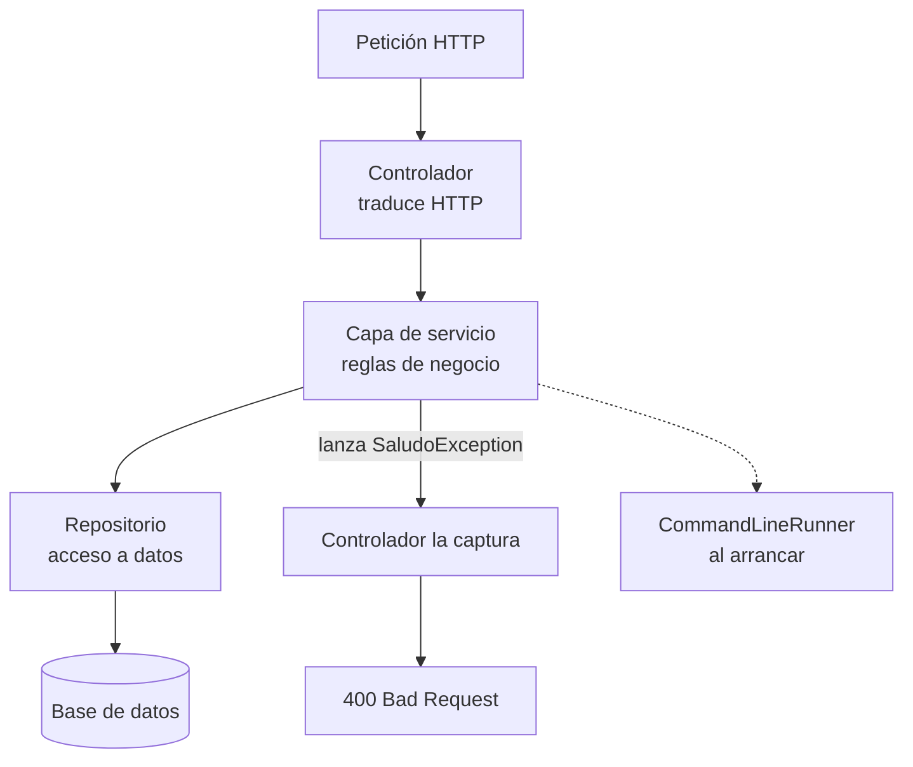
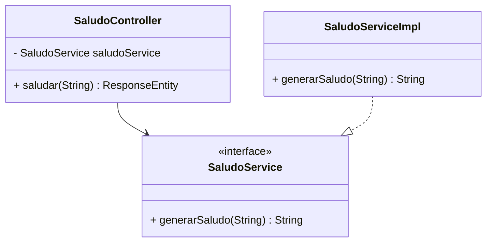

# Capa de servicio

> **Resumen de material de clase.** Viene del PDF `04-capa-servicios.pdf`
> (3 páginas, capítulo 4), que aportó la estudiante. Lo marcado como **material de
> clase** es lo que dice el PDF; el resto es explicación propia.

## 1. De qué va (resumen en cinco líneas)

1. La **capa de servicio** está entre los controladores (que atienden el HTTP) y los
   repositorios (que hablan con la base de datos).
2. Su trabajo es **encapsular la lógica de negocio**: las reglas de la aplicación.
3. Con ella, el mismo código sirve para varios controladores y se puede probar sin
   levantar la web.
4. El PDF muestra además cómo lanzar **excepciones personalizadas**, cómo declarar el
   servicio con **interfaz + implementación**, y cómo usar `CommandLineRunner` para
   ejecutar algo al arrancar.
5. Sirve para separar responsabilidades, que es lo que pide el RA5 del módulo.

## 2. Explicación paso a paso

**Las tres responsabilidades que da el material:**

1. **Implementar la lógica de negocio.** Validar datos, calcular valores, hacer
   operaciones complejas.
2. **Coordinar acciones entre componentes.** Hablar con los repositorios y procesar los
   datos antes de devolverlos al controlador.
3. **Mejorar la modularidad.** Reutilizar la lógica en distintas partes y poder hacer
   pruebas unitarias aislando esa lógica.

**El recorrido del PDF, apartado por apartado:**

1. `SaludoService` como ejemplo mínimo: valida el nombre y genera el saludo.
2. **Gestión de errores**: una excepción propia, `SaludoException`, y un controlador que
   la captura con `try`/`catch` y devuelve `400`.
3. **Interfaz + implementación**: `SaludoService` (interfaz) y `SaludoServiceImpl`
   (implementación con `@Service`), para poder cambiar la implementación sin tocar el
   controlador.
4. **`CommandLineRunner`**: un componente que ejecuta su método `run` al arrancar la
   aplicación, útil para datos iniciales o tareas de configuración.

**Los ejercicios de ampliación que propone el PDF**, para practicar:

1. Un servicio que calcule el área de un círculo y maneje radios negativos.
2. Excepciones personalizadas para validar datos de usuario.
3. Un `CommandLineRunner` que inicialice una lista de usuarios en memoria al arrancar.

## 3. Ideas clave del tema

- **La capa de servicio es un intermediario.** Si una regla de negocio acaba dentro del
  controlador, se mezcla el «tráfico HTTP» con las reglas de la aplicación.
- **`@Service` marca la clase como componente.** Spring la crea y la inyecta, igual que
  hace con los beans.
- **Excepción propia para cada regla.** `SaludoException` comunica mejor que un
  `IllegalArgumentException` genérico qué ha fallado y por qué.
- **El controlador decide el código HTTP; el servicio lanza la excepción.** El servicio
  no debería saber de `ResponseEntity`: esa traducción se hace en la capa web.
- **Interfaz + implementación = modularidad.** El controlador depende de la interfaz, así
  que puedes cambiar la implementación (o ponerla falsa en un test) sin tocarlo.
- **`CommandLineRunner` se ejecuta al arrancar**, una vez, antes de atender peticiones.
  Es el sitio típico para datos de ejemplo en desarrollo.
- **Facilita las pruebas unitarias**: como la lógica no depende del HTTP ni de la base de
  datos, se puede probar sola.

## 4. Ejemplo práctico relacionado con DAW

El ejemplo mínimo del PDF, con los comentarios puestos:

```java
@Service
public class SaludoService {

  public String generarSaludo(String nombre) {
      if (nombre == null || nombre.isEmpty()) {       // regla de negocio
          throw new SaludoException("El nombre no puede estar vacío");
      }
      return "¡Hola, " + nombre + "!";               // resultado
  }
}
```

Y el controlador que traduce esa excepción a una respuesta HTTP:

```java
@GetMapping("/saludo/{nombre}")
public ResponseEntity<String> saludar(@PathVariable String nombre) {
    try {
        return ResponseEntity.ok(saludoService.generarSaludo(nombre));
    } catch (SaludoException e) {
        return ResponseEntity.badRequest().body(e.getMessage());  // 400
    }
}
```

## 5. Código o comandos pequeños comentados

```java
// 1) Excepción propia del dominio
public class SaludoException extends RuntimeException {
    public SaludoException(String mensaje) {
        super(mensaje);
    }
}
```

```java
// 2) Interfaz + implementación: el controlador depende de la interfaz
public interface SaludoService {
    String generarSaludo(String nombre);
}

@Service
public class SaludoServiceImpl implements SaludoService {
    @Override
    public String generarSaludo(String nombre) { ... }
}
```

```java
// 3) CommandLineRunner: se ejecuta al arrancar la aplicación
@Component
public class InicializadorDatos implements CommandLineRunner {

    @Override
    public void run(String... args) {
        System.out.println(saludoService.generarSaludo("Mundo"));
    }
}
```

```bash
# Probar el endpoint del ejemplo
curl -i http://localhost:8080/api/saludo/Mundo
```

## 6. Diagrama (Mermaid)



Y el esquema de clases del PDF, interfaz e implementación:



## 7. Conceptos con los que se suele confundir

- **Capa de servicio ≠ repositorio**: el servicio decide *qué* hay que hacer; el
  repositorio *cómo* se guardan los datos.
- **Lógica de negocio ≠ validación de entrada**: la validación de forma la hace el
  controlador con `@Valid`; la regla de negocio, el servicio.
- **Servicio ≠ bean**: un bean es cualquier objeto que Spring gestiona; un servicio es un
  bean con una responsabilidad concreta.
- **Excepción personalizada ≠ error HTTP**: lanzar `SaludoException` no devuelve un 400
  por sí solo; hay que traducirla en la capa web.
- **Interfaz ≠ clase abstracta**: aquí la interfaz solo declara el contrato; la
  implementación lleva la lógica.

## 8. Errores frecuentes

- **Poner reglas de negocio en el controlador**: se repite el código y no se puede
  reutilizar.
- **Que el servicio devuelva ya un `ResponseEntity`**: mezcla las dos capas y ata el
  servicio al HTTP.
- **Usar siempre `IllegalArgumentException`**: funciona, pero no dice qué regla falló.
- **Capturar la excepción con `try`/`catch` en todas partes**: para unificar el formato
  de error conviene un `@ControllerAdvice`, como se ve en
  [los tests de errores](tdd-manejo-errores.md).
- **Confiar en que `CommandLineRunner` se ejecuta en cada petición**: se ejecuta **solo al
  arrancar**.
- **Meter datos iniciales «de prueba» sin protegerlos**: pueden acabar en producción si
  no se condicionan al perfil de desarrollo.

## 9. Tres preguntas de repaso

1. ¿Qué problemas resuelve poner la lógica de negocio en una capa de servicio en lugar
   de dejarla en el controlador?
2. ¿Qué ventaja tiene declarar el servicio como interfaz y su implementación como
   `SaludoServiceImpl`?
3. ¿Cuándo se ejecuta el método `run` de un `CommandLineRunner`?

### Respuestas

1. Separa responsabilidades: el controlador se limita a traducir HTTP (rutas, parámetros,
   códigos y cabeceras) y el servicio guarda las reglas de la aplicación. Así la lógica
   se puede reutilizar desde varios controladores o trabajos programados, y se puede
   probar de forma aislada, sin levantar la web ni la base de datos. También evita
   duplicar la misma comprobación en tres sitios.
2. El controlador pasa a depender del contrato, no de la implementación. Eso permite
   cambiar la lógica (o sustituirlas por una versión falsa en un test) sin tocar el
   controlador, y facilita la inyección de dependencias, que es justo lo que el material
   destaca como ventaja.
3. Se ejecuta **una sola vez, al arrancar la aplicación**, antes de que empiece a atender
   peticiones. Por eso sirve para inicializar datos o registrar logs, y no para tareas
   que tengan que ejecutarse en cada petición.

## 10. Términos relacionados

- [Bean (Spring Boot)](../Terminos/beans-spring.md) — qué gestiona Spring con `@Service` y
  por qué el servicio es un bean.
- [Introducción a Spring Boot](introduccion-spring-boot.md) — la separación
  controlador → servicio → repositorio en el proyecto Tasks.
- [Controladores REST](controladores-rest.md) — la capa que queda *encima* del servicio.
- [Tests de errores y respuestas coherentes](tdd-manejo-errores.md) — cómo un
  `@ControllerAdvice` unifica los errores que lanza el servicio.
- [TDD mínimo](tdd-minimo.md) — el ciclo con el que se probarían los servicios.
- [Refactorización](../Terminos/refactorizacion.md) — extraer la lógica del controlador
  a un servicio es, en el fondo, un refactor.

*(Aparecen en el PDF pero aún no tienen ficha: capa de servicio, lógica de negocio,
`@Service`, inyección de dependencias, excepción personalizada, `RuntimeException`,
interfaz e implementación, `CommandLineRunner`, modularidad.)*

## 11. Fuentes y límites del resumen

- Fuente: PDF `04-capa-servicios.pdf`, «Capítulo 4. Capa de Servicio» (páginas 1-3, leídas
  las 3), aportado por la estudiante.
- Fuentes externas: **no consultadas** para este resumen.
- Límites:
  - El PDF se ha leído **extrayendo el texto** con `pdftotext`, sin ver las páginas
    originales: si hay capturas o diagramas, **no los he visto**.
  - **No he ejecutado** nada: ni los ejemplos ni los ejercicios de ampliación. Los
    fragmentos son transcripciones del PDF.
  - El documento es **breve** (3 páginas) y usa un ejemplo de saludo muy simple: aquí no
    hay `@Transactional`, ni conexión con repositorios, ni pruebas, aunque el texto los
    menciona de pasada.
  - El material usa `try`/`catch` en el controlador para la excepción; el propio PDF
    reconoce más adelante que lo ideal es un `@ControllerAdvice`. No lo he inventado: lo
    indico en la sección 7 y lo enlazo con su resumen.
  - El diagrama Mermaid **no se ha validado automáticamente**: requiere comprobación
    visual.

## 12. Mis notas

<!-- Sección reservada para la estudiante. No borrar ni sobrescribir. -->