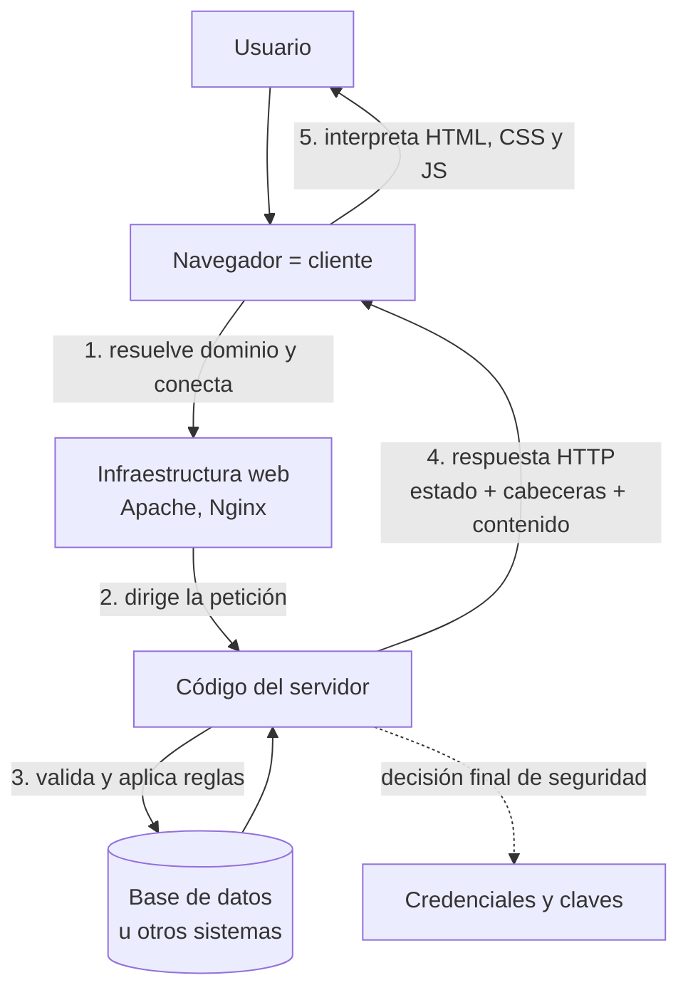

# Cliente, servidor y contenido dinámico

> **Resumen de material de clase.** Viene de un PDF que aportó la estudiante
> (`01-cliente-servidor-y-contenido-dinamico.pdf`, 2 páginas).
> No es una ficha de un solo concepto: es una vista de un tema entero.
>
> Lo que aparece marcado como **material de clase** es lo que dice el PDF. Todo lo
> demás es explicación propia.

## 1. De qué va (resumen en cinco líneas)

1. La web reparte el trabajo: el **cliente** pinta la interfaz, el **servidor** protege
   datos y aplica reglas.
2. Toda conversación web es un intercambio de **petición** y **respuesta**, con estado,
   cabeceras y contenido.
3. Lo que decide es **dónde** se ejecuta el código, no si la pantalla se mueve.
4. El contenido **estático** es un archivo guardado; el **dinámico** se genera al
   procesar cada petición.
5. Sirve para no meter la pata en dos sitios: validar solo en el navegador, y creer
   que cualquier cosa que descarga la página es «backend».

## 2. Explicación paso a paso

1. El navegador **resuelve el nombre de dominio** (convierte `ejemplo.com` en una
   dirección IP) y abre la conexión.
2. Envía una **petición HTTP** al servidor.
3. La **infraestructura** (Apache, Nginx…) dirige esa petición a la aplicación
   correcta, que puede no ser la única que hay en esa máquina.
4. El **código del servidor** valida lo que llega, aplica las reglas y, si hace falta,
   pregunta a otros sistemas (una base de datos, por ejemplo).
5. El servidor devuelve una **respuesta HTTP**: puede ser HTML completo, JSON, una
   imagen, un archivo o nada.
6. El navegador interpreta HTML, CSS y JavaScript y dibuja la interfaz.

Punto clave del material de clase: **HTTP no obliga a construir una API REST**.
Puedes devolver una página HTML entera, que es lo más clásico.

## 3. Ideas clave del tema

- **HTTP es un contrato, no solo una dirección**: cada intercambio tiene petición,
  respuesta, cabeceras (metadatos) y contenido.
- **La primera línea manda**: en `GET /api/hello HTTP/1.1` van el método, el destino
  y la versión. Después vienen las cabeceras, y una línea en blanco las separa del
  contenido opcional.
- **El cliente no es una frontera de confianza**: el usuario controla su navegador y
  puede modificar el HTML, el JavaScript y las peticiones que envía. Por eso una
  validación hecha **solo** en cliente no protege nada.
- **Estático no significa inerte**: un HTML guardado en el disco puede ejecutar
  JavaScript y ser muy interactivo. Lo que decide es si el servidor lo genera o no.
- **Ejecutar en servidor tiene un precio**: también significa infraestructura,
  latencia, concurrencia, observabilidad y una superficie de ataque que hay que
  gestionar.

La tabla que más conviene memorizar del PDF es esta:

| Cliente | Servidor |
|---|---|
| Renderiza la interfaz | Aplica reglas de negocio |
| Gestiona la interacción inmediata | Autoriza operaciones |
| Puede validar **para mejorar la experiencia** | **Valida siempre** los datos recibidos |
| Solo guarda secretos **públicos** para ese usuario | Protege credenciales y claves privadas |
| No es una frontera de confianza | Es responsable de la decisión final |

## 4. Ejemplo práctico relacionado con DAW

Un campo «edad» en un formulario de alta:

```text
Cliente (HTML):   <input type="number" min="18">   → mejora la experiencia
                  Si escribes "abc", ni te deja enviarlo.

Servidor (PHP):   if ($edad < 18) { http_response_code(400); }
                  → aquí está la validación que de verdad protege.

Si solo validas en el cliente, alguien abre las DevTools, quita el min="18"
y envía la petición a mano: entra con edad 3.
```

## 5. Código o comandos pequeños comentados

Lo que el PDF llama «petición HTTP mínima» y la respuesta del servidor:

```text
GET /api/hello HTTP/1.1        # método + destino + versión
Host: localhost:8080           # a qué servidor se lo pido
Accept: application/json       # lo quiero en JSON
                               # (línea en blanco: aquí acaban las cabeceras)

HTTP/1.1 200 OK                # el resultado
Content-Type: application/json # cómo interpreto lo que viene

{"message":"Hola desde el servidor"}
```

El material de clase recomienda mirar este intercambio directamente con **HTTPie**
o con la pestaña **Red** de las herramientas de desarrollo, porque el navegador lo
esconde al pintar la página.

## 6. Diagrama (Mermaid)



## 7. Conceptos con los que se suele confundir

- **Cliente ≠ navegador necesariamente**: un móvil, un `curl` o un programa que
  llama a una API también son clientes.
- **Contenido estático ≠ página aburrida**: lo estático puede ser totalmente
  interactivo; lo dinámico es una cuestión de **cuándo se genera**.
- **Backend ≠ «lo que descarga la página»**: una imagen o una hoja de estilos es un
  recurso del servidor, pero no es el backend. El backend es la lógica que decide.
- **Validar ≠ validar en el navegador**: validar de verdad es validar en el servidor.

## 8. Errores frecuentes

- **Confiar en la validación del cliente**: el usuario manda la petición, no tu
  formulario. Es el error más caro de esta lista.
- **Meter una clave privada en el JavaScript del navegador**: cualquiera que abra
  las DevTools la lee. Va en el servidor, siempre.
- **Devolver 200 con un JSON de error**: si el cliente decide por el código de
  estado, un 200 lo esconde.
- **Pensar que contenido dinámico significa «más lento»**: el coste está, pero el
  HTML servido de forma dinámica es lo normal en cualquier web con base de datos.
- **Confundir la primera línea de la petición con la URL completa**: en la petición
  va la ruta (`/api/hello`), no el `http://` ni el dominio; eso va en `Host`.

## 9. Tres preguntas de repaso

1. ¿Por qué una validación hecha solo en el cliente no protege el sistema?
2. ¿Qué diferencia real hay entre contenido estático y dinámico?
3. ¿Qué separa la línea en blanco de un mensaje HTTP?

### Respuestas

1. Porque el usuario controla su navegador: puede modificar el HTML, el JavaScript y
   la petición que envía. Si el servidor no comprueba los datos, ese cambio pasa
   desapercibido. Solo el servidor es responsable de la decisión final.
2. No es si la pantalla se mueve. Estático es que el servidor entrega el mismo
   archivo guardado, sin generarlo para esa petición. Dinámico es que la respuesta
   se genera o se adapta al procesar la petición. Un HTML estático con JavaScript
   sigue siendo estático.
3. Separa las cabeceras del contenido opcional. Todo lo que va por encima de esa
   línea son metadatos (método, destino, versión, `Content-Type`…); lo que va por
   debajo es el cuerpo: HTML, JSON, una imagen o nada.

## 10. Términos relacionados

- [HTTP](../Terminos/http.md) — el protocolo que estructura esta conversación.
- [Códigos de estado HTTP](../Terminos/codigos-estado.md) — el `200 OK` de la
  respuesta y qué significan los demás.
- [Evolución del protocolo HTTP](../Terminos/versiones-http.md) — cómo cambian los mensajes en
  HTTP/2 y HTTP/3 manteniendo este contrato.
- [ORM](../Terminos/orm.md) — una de las piezas típicas del lado servidor.
- [Glosario](../Glosario.md) — índice general.

*(Aparecen en el PDF pero aún no tienen ficha: API REST, infraestructura web,
herramientas de desarrollo del navegador, HTTPie.)*

## 11. Fuentes y límites del resumen

- Fuente: PDF `01-cliente-servidor-y-contenido-dinamico.pdf` (páginas 1-2, leídas
  las 2), aportado por la estudiante.
- Fuentes externas: **no consultadas** para este resumen. Las definiciones de HTTP
  que se repiten aquí ya están en las fichas [HTTP](../Terminos/http.md) y
  [Códigos de estado HTTP](../Terminos/codigos-estado.md), con sus fuentes.
- Límites:
  - El PDF se ha leído **extrayendo el texto** con `pdftotext`, no mirando las
    páginas. Si hubiera imágenes, diagramas o formatos, **no los he visto**.
  - El PDF menciona el ejemplo «Hello Server» con las rutas `/`, `/api/hello` y
    `/health`: **no he ejecutado** ese ejemplo ni sé qué devuelve.
  - El PDF menciona que el trabajo «trabaja RA1.a y RA1.b»: **no sé qué son** esos
    códigos de resultados de aprendizaje, no están explicados en el material.
  - Lo del «RA1.a y RA1.b» se ha copiado tal cual, sin interpretarlo.
  - Los diagramas Mermaid no se han validado automáticamente: requieren
    comprobación visual.

## 12. Mis notas

<!-- Sección reservada para la estudiante. No borrar ni sobrescribir. -->