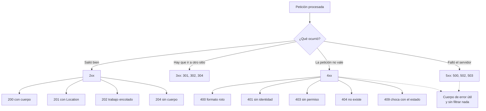

# Estados de respuesta HTTP: interpretar lo que devuelve una API

> **Resumen de material de clase.** Viene de un PDF que aportó la estudiante
> (`07-estados-http.pdf`, 6 páginas).
> Lo marcado como **material de clase** es lo que dice el PDF; el resto es
> explicación propia.

## 1. De qué va (resumen en cinco líneas)

1. El estado HTTP **resume el resultado**: éxito, redirección, error de la petición o
   fallo del servidor.
2. **No sustituye al cuerpo**, pero es lo primero que interpretan el cliente, las
   pruebas y los proxies.
3. En una API bien hecha, estado, cabeceras y cuerpo **cuentan la misma historia**.
4. Los 4xx son culpa de la petición; los 5xx, del servidor. Esa regla orienta, pero
   el contrato manda.
5. Sirve para elegir el código correcto **y justificárlo**, no para memorizar la lista.

## 2. Explicación paso a paso

1. Llega una petición y el servidor la procesa.
2. Decide **qué ha ocurrido** y lo expresa con un código de tres cifras.
3. Añade las cabeceras que apliquen (`Location`, `Allow`, `Retry-After`).
4. Escribe un **cuerpo de error** que ayude al cliente a corregir, **sin filtrar**
   trazas ni datos internos.
5. El cliente lee primero el código, luego las cabeceras y luego el cuerpo.

La regla práctica que da el PDF:

> Si el cliente **puede corregir** la petición, suele ser 4xx; si **no puede
> arreglarlo** y debe esperar o avisar, suele ser 5xx.

## 3. Ideas clave del tema

**Lectura rápida de las cinco clases:**

| Clase | Qué significa | Ejemplos |
|---|---|---|
| **1xx** | El servidor sigue procesando | — |
| **2xx** | La petición se acepta o se completa | 200, 201, 202, 204, 206 |
| **3xx** | Redirección o caché | 301, 302, 304 |
| **4xx** | La petición no puede atenderse tal como llega | 400, 401, 403, 404, 405, 409, 410, 412, 415, 422, 429 |
| **5xx** | El servidor o una dependencia han fallado | 500, 502, 503 |

**De éxito, no todo es 200:**

- **200 OK**: operación correcta **con cuerpo**.
- **201 Created**: se ha creado un recurso. Si conoces su URI, manda `Location`.
- **202 Accepted**: acepto el trabajo, pero se procesará **después** (importar un
  CSV, generar un informe). No significa «todo ha salido bien».
- **204 No Content**: correcto y **sin cuerpo**. Si mandas un JSON después, algo está
  mal planteado.
- **206 Partial Content**: se entrega un **rango de bytes** de un archivo.

**De caché: el 304 no es un error.** El cliente pregunta si algo ha cambiado con
`If-None-Match`, y si no ha cambiado el servidor responde `304` sin reenviar el cuerpo.

**Y el punto que más se olvida: el cuerpo de error.**

```text
RAZONABLE:  {"status":400,"error":"Bad Request",
             "message":"title must not be blank","path":"/api/tasks"}

PELIGROSO:  {"exception":"java.sql.SQLSyntaxErrorException",
             "trace":"...", "sql":"select * from users where ..."}
```

El cliente necesita saber **que falló y cómo corregirlo**. No necesita trazas,
secretos, rutas internas ni detalles de base de datos.

**Y 206 no es paginación.** Pide bytes con `Range: bytes=0-999` y devuelve
`Content-Range: bytes 0-999/5000000`. Una página de resultados
(`?page=0&size=20`) sigue siendo una representación completa, así que devuelve
`200 OK`.

## 4. Ejemplo práctico relacionado con DAW

Los dos casos que el PDF usa para separar 401 de 403:

```text
No mando token a /api/admin/users          → 401 Unauthorized
                                               "identifícate"

Mando un token de ALUMNO a esa ruta         → 403 Forbidden
                                               "sé quién eres, pero no puedes"
```

Y un par más, del mismo PDF:

```text
POST con {"title":           → 400 Bad Request   (ni siquiera es JSON)
POST con {"title":"", "dueDate":"2020-01-01"}   → 400 o 422, según tu contrato
                                                    (formato OK, reglas no)
POST con Content-Type: text/plain          → 415 Unsupported Media Type
DELETE correcto, sin nada que devolver     → 204 No Content
```

Ojo con ese `""` del título: el PDF dice que **puedes devolver 400 o 422 según el
contrato de tu API**, y lo importante es ser coherente. En Spring Boot sencillo se
usa 400 con `@Valid`; en APIs más expresivas se reserva 422 para reglas de negocio.

## 5. Código o comandos pequeños comentados

En Spring Boot, según el PDF:

```java
// 201 Created, indicating the new resource's URI
URI location = URI.create("/api/tasks/" + saved.id());
return ResponseEntity.created(location).body(saved);

// 204 No Content
return ResponseEntity.noContent().build();

// 404 Not Found
return repository.findById(id)
    .map(ResponseEntity::ok)
    .orElseGet(() -> ResponseEntity.notFound().build());
```

Y la exploración local que propone el PDF:

```bash
http --verbose GET  http://localhost:8080/api/hello
http --verbose GET  http://localhost:8080/no-existe
http --verbose POST http://localhost:8080/api/hello
# Compara: código · cabeceras relevantes (Content-Type, Allow, Location)
#          cuerpo · qué parte viene de HTTP y qué parte decide la aplicación
```

## 6. Diagrama (Mermaid)



## 7. Conceptos con los que se suele confundir

- **401 ≠ 403**: 401 es «no hay autenticación válida, identifícate»; 403 es «te he
  identificado pero no tienes permiso».
- **400 ≠ 422**: 400 es formato o coherencia; 422 es formato correcto pero reglas no
  cumplidas. El PDF advierte de que puedes usar 400 para ambos si tu contrato lo dice.
- **400 ≠ 415**: 415 es específicamente que el `Content-Type` no se acepta.
- **409 ≠ 400**: 409 es que la petición se entiende pero choca con el estado actual.
- **206 ≠ paginación**: 206 son rangos de bytes; una página de resultados es 200.
- **304 ≠ error**: es una respuesta de caché, no un fallo.
- **202 ≠ «todo bien»**: significa «aceptado, se hará después».
- **404 ≠ «no existe»**: también puede ser que la aplicación decida no revelar que
  existe.

## 8. Errores frecuentes

- **Devolver siempre 200 y meter el error dentro del JSON**: el cliente, las
  pruebas, los navegadores y los proxies interpretan **primero el código**.
- **Pensar que 200 significa que la operación de negocio salió bien**: el 200 dice que
  la petición se atendió, no que el negocio sea correcto.
- **Filtrar detalles internos en el error**: trazas, secretos, nombres de tablas.
- **Usar 500 para un error de validación**: eso es un 400 o un 422; el 5xx es para
  fallos del servidor.
- **Tratar la tabla método-estado como una receta mecánica**: el PDF lo dice
  explícitamente; el estado correcto depende del contrato y de lo que pasó de verdad.
- **Querer memorizar todos los códigos**: el PDF dice que no hace falta. Hay que saber
  **elegir y justificar**.

## 9. Tres preguntas de repaso

1. ¿Cuándo es más razonable un 4xx y cuándo un 5xx?
2. ¿Qué debe llevar el cuerpo de un error y qué no?
3. ¿Por qué 206 Partial Content no es lo mismo que una página de resultados?

### Respuestas

1. Un 4xx cuando el cliente **puede corregir la petición**: le falta autenticación, la
   ruta no existe, el formato está roto. Un 5xx cuando la petición era válida pero el
   servidor o una dependencia han fallado: el cliente no puede arreglarlo, solo esperar
   o avisar.
2. Debe explicar **qué falló y cómo corregirlo**: el estado, un mensaje legible y la
   ruta. No debe filtrar trazas, secretos, nombres internos de tablas, SQL ni detalles
   de infraestructura.
3. Porque 206 describe **rangos de bytes de una representación**: lo pides con
   `Range: bytes=0-999` y recibes `Content-Range`. Una página de resultados
   (`?page=0&size=20`) es una representación completa de esa consulta, así que
   devuelve 200 OK.

## 10. Términos relacionados

- [Códigos de estado HTTP](../Terminos/codigos-estado.md) — la ficha de referencia
  con todos los códigos y sus fuentes (RFC 9110).
- [Métodos HTTP](metodos-http.md) — el método orienta el estado esperado.
- [Versiones y estructura de los mensajes HTTP](versiones-y-mensajes-http.md) —
  dónde va el estado dentro del mensaje.
- [DTO (Data Transfer Object)](../Terminos/dtos.md) — el cuerpo que se devuelve.
- [Bean (Spring Boot)](../Terminos/beans-spring.md) — el código Java del PDF.
- [Glosario](../Glosario.md) — índice general.

*(Aparecen en el PDF pero aún no tienen ficha: `ETag`, `If-Match`, `If-None-Match`,
`Retry-After`, `Range`, `Content-Range`, validación con `@Valid`, API REST.)*

## 11. Fuentes y límites del resumen

- Fuente: PDF `07-estados-http.pdf` (páginas 1-6, leídas las 6), aportado por la
  estudiante.
- Fuentes externas: **no consultadas** para este resumen. Las definiciones de los
  códigos están documentadas con el RFC 9110 en la ficha
  [Códigos de estado HTTP](../Terminos/codigos-estado.md).
- Límites:
  - El PDF se ha leído **extrayendo el texto** con `pdftotext`, sin mirar las
    páginas: diagramas o imágenes, si los hay, **no los he visto**.
  - El PDF da **códigos de Spring Boot** (`ResponseEntity`, `repository.findById`):
    **no los he compilado ni ejecutado**. Son fragmentos tal cual del material.
  - El PDF **no cita ningún RFC**, así que la semántica de cada código es la del
    material. Para la definición oficial, ver la ficha de códigos de estado.
  - Los comandos `http --verbose` requieren **HTTPie**. **No he comprobado** que la
    tengas ni que el servidor de ejemplo esté disponible.
  - El PDF afirma que en la comprobación hay que justificar 8 casos: esa justificación
    aparece repartida en las secciones 4 y 7, pero **no es una respuesta literal a los
    ocho casos**.
  - Los diagramas Mermaid no se han validado automáticamente: requieren
    comprobación visual.

## 12. Mis notas

<!-- Sección reservada para la estudiante. No borrar ni sobrescribir. -->