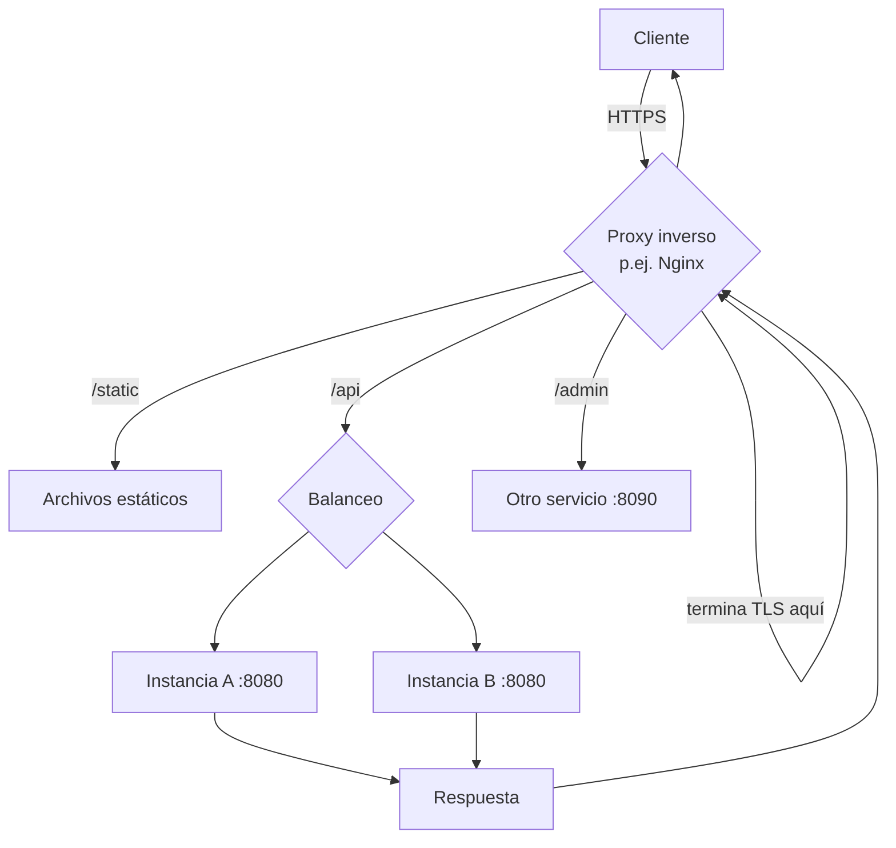

# Servidores web, proxies y contenedores

> **Resumen de material de clase.** Viene de un PDF que aportó la estudiante
> (`03-infraestructura-web.pdf`, 3 páginas).
> Lo marcado como **material de clase** es lo que dice el PDF; el resto es
> explicación propia.

## 1. De qué va (resumen en cinco líneas)

1. Varios componentes se parecen por el nombre pero **no son sinónimos**.
2. La forma segura de distinguirlos es preguntar **qué responsabilidad asumen** y **con
   qué protocolo hablan** con el siguiente.
3. En desarrollo tu aplicación puede accederse directamente; en producción lo normal es
   un proxy inverso delante.
4. Decir «el servidor» para todo impide saber dónde mirar cuando algo falla.
5. Sirve para dibujar un despliegue entendible y para no fiarse de cabeceras como
   `Server`.

## 2. Explicación paso a paso

1. Una petición **entra** por algún sitio. Puede llegar directamente a tu aplicación
   (desarrollo) o a un proxy inverso (producción).
2. Si hay proxy, este **recibe la petición pública** y decide a qué servicio interno
   la dirige según la ruta: `/static` a archivos, `/api` a la aplicación, `/admin` a
   otro servicio.
3. El servicio elegido **ejecuta el código** (Java, PHP, Python…) y genera el cuerpo.
4. La respuesta **regresa** por el mismo camino: del servicio al proxy y del proxy al
   cliente.
5. El proxy puede terminar TLS, añadir cabeceras, registrar accesos y **ocultar la
   topología interna** (qué servicios hay detrás no se ve desde fuera).

Ese punto 5 es el que más se olvida: lo que hay detrás del proxy es
exactamente lo que hay que simplifying en la documentación, pero también lo que no
dejas ver a nadie de fuera.

## 3. Ideas clave del tema

La tabla de responsabilidades del PDF:

| Componente | Responsabilidad principal | Ejemplos |
|---|---|---|
| **Servidor web** | Recibir HTTP, servir archivos y aplicar configuración web | Nginx, Apache HTTP Server, Caddy |
| **Proxy inverso** | Recibir peticiones públicas y dirigirlas a servicios internos | Nginx, HAProxy, Traefik |
| **Balanceador** | Repartir tráfico entre varias instancias | HAProxy, balanceadores cloud |
| **Contenedor servlet** | Ejecutar aplicaciones Java basadas en el contrato Servlet | Tomcat, Jetty |
| **Servidor embebido** | Vivir dentro del proceso de la aplicación | Tomcat embebido en Spring Boot |
| **Servidor de aplicaciones** | Añadir servicios empresariales estandarizados | WildFly, Payara |

Dos advertencias que el PDF repite y que son la clave del tema:

- **Un producto puede asumir varias funciones.** Nginx puede servir archivos *y* actuar
  como proxy. La tabla clasifica responsabilidades, no limita productos.
- **«Contenedor» significa dos cosas distintas**: Tomcat es un contenedor web (Servlet);
  un contenedor Docker empaqueta y ejecuta procesos. Puedes meter Spring Boot con
  Tomcat embebido dentro de Docker, pero no son la misma pieza.

Y el detalle técnico que más se confunde: en Nginx, `proxy_pass` (reenvía HTTP a otra
aplicación) y `fastcgi_pass` (habla FastCGI con `fcgiwrap`) son **mecanismos
distintos**, aunque los dos estén detrás de Nginx.

## 4. Ejemplo práctico relacionado con DAW

```text
Internet
   |  HTTPS
   v
proxy inverso (Nginx)  -- puede terminar aquí el TLS
   |-- /static  ->  archivos estáticos (ni entra Java)
   |-- /api     ->  elige UNA instancia: Spring Boot A :8080
   `-- /admin   ->  otro servicio :8090

Si A se cae, Nginx manda el tráfico a B. Tú no te enteras: /api sigue respondiendo.
Pero para arreglarlo hay que mirar dos máquinas, no una.
```

El reparto es por rutas: **una** instancia por petición, no todas a la vez.

## 5. Código o comandos pequeños comentados

Del PDF, los dos recorridos que hay que saber dibujar:

```text
DESARROLLO (sin proxy):
navegador/HTTPie --HTTP--> localhost:8080
                             |
                             v
                     Tomcat embebido + aplicación Java
                             |
                             v
                 controlador -> respuesta HTML o JSON

PRODUCCIÓN (con proxy y dos instancias):
cliente --HTTPS--> Nginx (termina TLS)
                   |-- /static --> archivos
                   `-- /api ----> elige una instancia
                                     |-- Spring Boot A :8080
                                     `-- Spring Boot B :8080
```

Y el aviso sobre las cabeceras, que vale por sí solo:

```text
Server: nginx       → NO demuestra que Nginx generase el JSON.
                       Puede haberlo reenviado desde un proceso Java detrás.
localhost:8080       → Es una dirección y un puerto, no el nombre de la tecnología.
```

## 6. Diagrama (Mermaid)



## 7. Conceptos con los que se suele confundir

- **Servidor web ≠ proxy inverso**: el primero sirve archivos y aplica configuración;
  el segundo recibe peticiones públicas y las dirige a servicios internos.
- **Proxy inverso ≠ balanceador**: el balanceador reparte entre instancias. Puede ser
  el mismo producto o uno distinto. No copia la petición a todas las instancias.
- **Contenedor servlet ≠ contenedor Docker**: el primero ejecuta Servlet; el segundo
  empaqueta procesos. No son la misma cosa.
- **Tomcat ≠ Spring Boot**: Tomcat da la infraestructura web; los controladores
  Spring aportan el código de aplicación.
- **Proxy inverso ≠ proxy de la demo CGI**: uno usa `proxy_pass` (HTTP), el otro
  `fastcgi_pass` (FastCGI). Se parecen en el dibujo y son mecanismos distintos.
- **Tomcat externo ≠ Tomcat en otra máquina**: la diferencia es **quién arranca y
  gestiona** el contenedor.

## 8. Errores frecuentes

- **Fiarse de la cabecera `Server` o `X-Powered-By`**: pueden faltar, estar
  modificadas o describir solo el primer intermediario. Una CDN puede ocultarlo todo.
- **Llamar «el servidor» a todo**: cuando algo falla, no sabes si mirar Nginx, Java o
  la base de datos. Los nombres se parecen y no son sinónimos.
- **Creer que terminar TLS en el proxy cifra todo lo de detrás**: el tramo interno
  puede ir en HTTP claro o protegerse también, según el despliegue.
- **Suponer que el acceso directo es solo de desarrollo**: es cómodo para observar
  HTTP, pero no sustituye al proxy en producción.
- **Pensar que añadir un balanceador es gratis**: añade configuración, salud de
  instancias y registros que gestionar.

## 9. Tres preguntas de repaso

1. ¿Qué dos preguntas sirven para distinguir un servidor web de un proxy inverso?
2. ¿Por qué una cabecera `Server: nginx` no demuestra nada sobre el lenguaje usado?
3. ¿Qué diferencia hay entre un contenedor servlet y un contenedor Docker?

### Respuestas

1. **Qué responsabilidad asume** (servir archivos y aplicar configuración web frente a
   recibir peticiones públicas y dirigirlas a servicios internos) y **con qué
   protocolo habla** con el siguiente (`proxy_pass` hacia otra aplicación, o
   `fastcgi_pass` hacia un proceso FastCGI).
2. Porque esa cabecera puede faltar, estar modificada a propósito o describir solo el
   primer intermediario de la cadena. Un `Server: nginx` con un JSON detrás puede ser
   un proceso Java reenviado por Nginx. Para saberlo hay que mirar el código, la
   configuración y los procesos, no la cabecera.
3. Un contenedor **servlet** (Tomcat, Jetty) es un componente de software que
   proporciona la infraestructura web para ejecutar aplicaciones Java con el
   contrato Servlet. Un contenedor **Docker** empaqueta y ejecuta procesos. Puedes
   meter Spring Boot con Tomcat embebido dentro de Docker, pero eso no los convierte
   en la misma pieza.

## 10. Términos relacionados

- [Mecanismos de ejecución del servidor](mecanismos-ejecucion-servidor.md) — qué
  proceso queda vivo en cada caso.
- [Bean (Spring Boot)](../Terminos/beans-spring.md) — el lado Java del dibujo.
- [CI/CD](../Terminos/ci-cd.md) — lo que automatiza el paso de desarrollo a producción.
- [Glosario](../Glosario.md) — índice general.

*(Aparecen en el PDF pero aún no tienen ficha: Nginx, Tomcat, proxy inverso,
balanceador, WildFly, HAProxy, CDN, TLS.)*

## 11. Fuentes y límites del resumen

- Fuente: PDF `03-infraestructura-web.pdf` (páginas 1-3, leídas las 3), aportado por
  la estudiante.
- Fuentes externas: **no consultadas** para este resumen.
- Límites:
  - El PDF se ha leído **extrayendo el texto** con `pdftotext`, sin mirar las
    páginas: diagramas o imágenes, si los hay, **no los he visto**.
  - El PDF menciona una «instalación de producción» con dos instancias de Spring Boot
    y una demo con Docker: **no he montado ni ejecutado ninguna**. Los diagramas
    reproducen la descripción textual del PDF.
  - El PDF pide en su comprobación dibujar dos despliegues: ese dibujo es el de la
    sección 5, hecho a partir del texto; **no es una captura** de los despliegues
    reales.
  - El PDF indica que su evidencia trabaja «RA1.d» (y «RA1.a/b» y «RA1.c» en los
    PDF 01 y 02): **no sé qué significan** esos códigos, no están explicados.
  - Los diagramas Mermaid no se han validado automáticamente: requieren
    comprobación visual.

## 12. Mis notas

<!-- Sección reservada para la estudiante. No borrar ni sobrescribir. -->