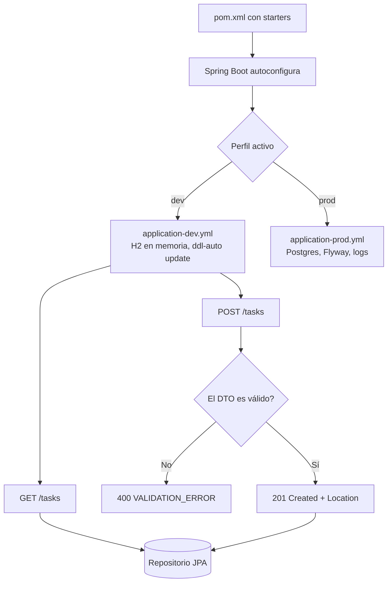
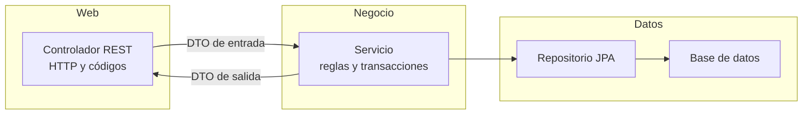

# Introducción a Spring Boot

> **Resumen de material de clase.** Viene del PDF `01-introduccion-spring-boot.pdf`
> (9 páginas, Unidad 2 a) que aportó la estudiante. Lo marcado como
> **material de clase** es lo que dice el PDF; el resto es explicación propia.

## 1. De qué va (resumen en cinco líneas)

1. **Spring Boot** es una capa por encima de Spring Framework que crea aplicaciones web
   listas para producción con poco código.
2. Lo hace con cuatro piezas: **autoconfiguración**, **starters**, **servidor embebido**
   y **convención sobre configuración**.
3. No sustituye a Spring: sigue haber inyección de dependencias, beans y contextos.
4. El PDF monta una API REST de ejemplo llamada **Tasks**, por capas:
   controlador → servicio → repositorio.
5. Sirve para saber qué es cada pieza (starter, perfil, DTO, entidad) antes de tocar el
   proyecto grande de la unidad.

## 2. Explicación paso a paso

**Material de clase: qué promete Spring Boot.**

1. **Autoconfiguración**: mira qué dependencias hay en el proyecto y configura lo
   necesario por ti.
2. **Starters**: paquetes de dependencias listos. Por ejemplo
   `spring-boot-starter-web`.
3. **Servidor embebido**: Tomcat, Jetty o Undertow **dentro** del proceso, así que la
   aplicación se ejecuta con `java -jar`.
4. **Convención sobre configuración**: valores por defecto razonables que se cambian en
   `application.yml` o `application.properties`.

**Relación con Spring Framework.** Sigue existiendo IoC/DI, beans, contexto de
aplicación y perfiles. Spring Boot no elimina nada: quita configuración repetitiva.

**Capacidades que menciona el PDF** (cada una con su starter): APIs REST/web, datos con
JPA, validación, seguridad, documentación OpenAPI, tests, monitorización con Actuator,
mensajería, batch y cloud.

**El orden de montaje del proyecto Tasks**, que es el guion de la clase:

1. Crear el proyecto (Spring Initializr o `pom.xml` a mano) con web, validation, JPA, H2,
   Lombok opcional y Springdoc.
2. Configurar `application.yml` y el perfil `dev` con la base de datos H2 en memoria.
3. Crear la entidad JPA `Task`.
4. Crear el repositorio `TaskRepository` que extiende `JpaRepository`.
5. Crear el DTO de entrada `CreateTaskDTO` con `@NotBlank`.
6. Crear el servicio con la lógica de negocio (`list`, `create`, `toggle`, `delete`).
7. Crear el controlador REST con los verbos GET, POST, PATCH y DELETE.
8. Añadir `@ControllerAdvice` para que los errores salgan siempre con el mismo formato.
9. Probarlo con `curl`, Insomnia o Swagger UI.

## 3. Ideas clave del tema

- **Estarter = paquete de dependencias ya preparado.** Añadirlo al `pom.xml` es lo que
  dispara la autoconfiguración correspondiente.
- **Configuración por perfiles**: la misma aplicación se comporta distinto en desarrollo y
  en producción **sin tocar el código**. Se activa con `SPRING_PROFILES_ACTIVE=dev`.
- **Separación por capas**: controlador (HTTP) → servicio (reglas) → repositorio (datos).
  El PDF lo señala explícitamente al enseñar la estructura de carpetas.
- **Validación declarativa**: `@NotBlank` en el DTO y `@Valid` en el controlador. Si el
  dato no vale, Spring lanza `MethodArgumentNotValidException`.
- **Errores uniformes**: un `@ControllerAdvice` convierte excepciones en JSON con la
  misma forma.
- **`class` para entidades, `record` para DTOs.** Es la conclusión didáctica del
  apéndice: Hibernate necesita construir y modificar la entidad, así que las entidades son
  clases mutables; los DTOs solo transportan datos, así que un `record` inmutable es
  ideal.
- **Códigos correctos desde el principio**: `201 Created` con cabecera `Location` al
  crear y `204 No Content` al borrar.

## 4. Ejemplo práctico relacionado con DAW

El DTO de entrada del PDF, con el comentario puesto:

```java
// DTO de ENTRADA: solo transporta el dato y lo valida
public record CreateTaskDTO(@NotBlank String title) {}

// DTO de SALIDA: lo que ve el frontend
public record TaskDTO(Long id, String title, boolean done) {}
```

Y el controlador que devuelve `201` con su `Location`:

```java
@PostMapping
public ResponseEntity<TaskDTO> create(@Valid @RequestBody CreateTaskDTO dto) {
    Task saved = service.create(dto);
    URI loc = URI.create("/api/tasks/" + saved.getId());
    return ResponseEntity.created(loc).body(new TaskDTO(saved.getId(), saved.getTitle(), saved.isDone()));
}
```

Con eso el frontend ya sabe que la tarea se creó y **dónde** está para poder pedirla.

## 5. Código o comandos pequeños comentados

```bash
# Arrancar la API con el perfil de desarrollo
SPRING_PROFILES_ACTIVE=dev ./mvnw spring-boot:run

# Crear una tarea
curl -s -X POST http://localhost:8080/tasks \
  -H "Content-Type: application/json" \
  -d '{ "title": "Aprender Spring Boot" }'

# Invertir el estado de la tarea 1
curl -s -X PATCH http://localhost:8080/tasks/1/toggle

# Borrar la tarea 1 (responde 204, sin cuerpo)
curl -i -X DELETE http://localhost:8080/tasks/1
```

El fragmento de `pom.xml` mínimo del PDF:

```xml
<dependency>
  <groupId>org.springframework.boot</groupId>
  <artifactId>spring-boot-starter-web</artifactId>
</dependency>
<dependency>
  <groupId>com.h2database</groupId>
  <artifactId>h2</artifactId>
  <scope>runtime</scope>
</dependency>
```

Y el perfil `dev` (base de datos en memoria, solo para desarrollo):

```yaml
spring:
  datasource:
    url: jdbc:h2:mem:tasks;DB_CLOSE_DELAY=-1
    username: sa
    password: sa
  jpa:
    hibernate:
      ddl-auto: update
```

## 6. Diagrama (Mermaid)



Y el reparto de responsabilidades entre capas:



## 7. Conceptos con los que se suele confundir

- **Spring Boot ≠ Spring Framework**: Spring Boot es una capa que facilita Spring, no lo
  sustituye.
- **Starter ≠ librería**: un starter es un conjunto de dependencias ya elegidas y
  configuradas entre sí.
- **Autoconfiguración ≠ magia sin control**: Spring Boot decide por convención, y tú la
  cambias con propiedades o con un perfil.
- **Perfil ≠ variable de entorno**: el perfil es un archivo (`application-dev.yml`); la
  variable `SPRING_PROFILES_ACTIVE` solo indica cuál se carga.
- **Entidad ≠ DTO**: la entidad se guarda en la base de datos y es mutable; el DTO solo
  transporta datos y puede ser inmutable.
- **Servidor embebido ≠ servidor externo**: hay un servidor HTTP dentro del proceso de la
  aplicación.

## 8. Errores frecuentes

- **La aplicación no arranca y se cierra**: según el PDF, suele faltar el driver o la URL
  de la base de datos está mal.
- **400 Bad Request al crear**: falta un campo requerido; revisa `@Valid` y los mensajes
  de validación.
- **Swagger no carga**: la aplicación no está levantada o la ruta no es
  `/swagger-ui.html`.
- **CORS cuando el frontend va aparte**: hay que añadir configuración de CORS en un
  `SecurityConfig`.
- **Usar `record` para una entidad JPA**: Hibernate no puede instanciarla y falla con
  `InstantiationException: No default constructor for entity`. El propio PDF marca ese
  ejemplo como `[X]`.
- **Activar Springdoc y un contrato OpenAPI propio a la vez**: el PDF avisa de que en el
  proyecto Battleship la generación automática está deshabilitada para no tener dos
  contratos distintos.

## 9. Tres preguntas de repaso

1. ¿Qué hace exactamente un starter de Spring Boot?
2. ¿Qué ventaja tiene `ResponseEntity.created(...)` frente a devolver un `200` en un POST?
3. ¿Por qué el PDF recomienda `class` para las entidades JPA y `record` para los DTOs?

### Respuestas

1. Un starter es un conjunto de dependencias ya elegidas y configuradas entre sí. Al
   añadirlo al `pom.xml`, Spring Boot detecta qué hay y autoconfigura lo necesario: con
   `spring-boot-starter-web` expone el servidor embebido, mapea controladores y configura
   Jackson para el JSON.
2. Devolver `200` solo dice «todo bien». `ResponseEntity.created(...)` devuelve `201
   Created` **y además la cabecera `Location`**, que indica la URL del recurso recién
   creado. Así el cliente no tiene que construir esa URL a mano y la respuesta respeta el
   contrato REST.
3. Porque Hibernate necesita **construir** la entidad (constructor sin argumentos) y
   **modificar** sus campos al guardar o actualizar. Un `record` tiene campos `final` y no
   tiene constructor vacío, así que Hibernate no puede trabajar con él. El DTO, en cambio,
   solo transporta datos y nunca se persiste, así que el `record` le aporta inmutabilidad y
   menos código.

## 10. Términos relacionados

- [Bean (Spring Boot)](../Terminos/beans-spring.md) — qué son los beans que Spring crea y
  gestiona, y el papel de `@SpringBootApplication`.
- [DTO (Data Transfer Object)](../Terminos/dtos.md) — la clase que solo transporta datos, la
  clave del apéndice sobre `class` frente a `record`.
- [ORM](../Terminos/orm.md) — la capa que Hibernate usa por detrás de los repositorios JPA.
- [Códigos de estado HTTP](../Terminos/codigos-estado.md) — el 201, el 204 y el 400 que usa
  el ejemplo.
- [HTTP](../Terminos/http.md) — el protocolo detrás de cada petición del controlador.
- [Refactorización](../Terminos/refactorizacion.md) — lo que hace Lombok y los records por
  el código repetitivo.
- [TDD mínimo](tdd-minimo.md) — el vocabulario de pruebas que presupone este PDF.
- [Controladores REST](controladores-rest.md) — el mismo tema, ampliado por el PDF del
  capítulo 3.

*(Aparecen en el PDF pero aún no tienen ficha: Spring Boot, starter, autoconfiguración,
servidor embebido, perfil de configuración, `ResponseEntity`, `@ControllerAdvice`,
`@Transactional`, OpenAPI/Swagger, Spring Initializr, Maven.)*

## 11. Fuentes y límites del resumen

- Fuente: PDF `01-introduccion-spring-boot.pdf` (páginas 1-9, leídas las 9), aportado por
  la estudiante. Documento de la Unidad 2 a (DWES).
- Fuentes externas: **no consultadas** para este resumen.
- Límites:
  - El PDF se ha leído **extrayendo el texto** con `pdftotext`, sin ver las páginas
    originales: si hay diagramas o imágenes, **no los he visto**.
  - **No he ejecutado** nada: ni `./mvnw spring-boot:run`, ni los `curl`, ni los tests. Los
    fragmentos de código y de YAML son transcripciones del PDF.
  - El código del servicio en la página 5 aparece **cortado en el propio PDF**: la línea
    `orElseThrow(() -> new IllegalArgumentException("Task not found` se queda sin cerrar.
    Lo he transcrito tal cual y no he inventado el cierre.
  - El PDF menciona **Java 25** y **springdoc 3.0.3**. No he verificado que esas versiones
    sean las del entorno actual.
  - Los diagramas Mermaid **no se han validado automáticamente**: requieren comprobación
    visual (por ejemplo en mermaid.live).

## 12. Mis notas

<!-- Sección reservada para la estudiante. No borrar ni sobrescribir. -->