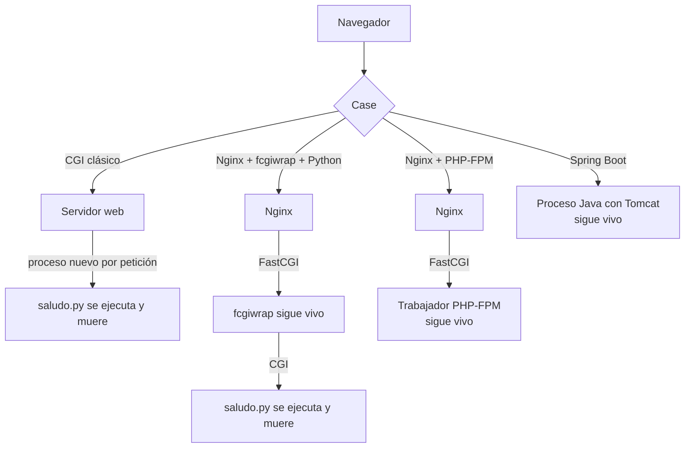

# Cómo llega HTTP al código servidor

> **Resumen de material de clase.** Viene de un PDF que aportó la estudiante
> (`02-mecanismos-ejecucion-servidor.pdf`, 4 páginas).
> Lo que está marcado como **material de clase** es lo que dice el PDF; el resto es
> explicación propia.

## 1. De qué va (resumen en cinco líneas)

1. Un servidor web sabe recibir HTTP, pero **no ejecuta por sí mismo** ningún lenguaje:
   hace falta un mecanismo que conecte la petición con el código.
2. Existen cinco mecanismos, de menos a más persistente: CGI, FastCGI, módulo del
   servidor, proceso persistente y contenedor de aplicaciones.
3. La diferencia clave: **¿se crea un proceso nuevo por cada petición o el código
   sigue vivo entre peticiones?**
4. Comparar los mecanismos importa porque ahí está el rendimiento y la concurrencia.
5. Sirve para no confundirte con el **backend** y para entender por qué a veces
   PHP va rápido.

## 2. Explicación paso a paso

1. Llega la petición HTTP al servidor web (Nginx, Apache).
2. El servidor web necesita **alguien** que sepa ejecutar el código: PHP, Python, Java…
3. Ese alguien es el **mecanismo de ejecución**. El modelo general del PDF es:
   `cliente -> servidor web o proxy -> runtime/contenedor -> aplicación -> datos`.
4. Las piezas pueden vivir en el mismo proceso, en procesos separados o en máquinas
   distintas.
5. El **modelo general** funciona en los cuatro casos del material: CGI clásico,
   Nginx + fcgiwrap + Python, Nginx + PHP-FPM y Spring Boot con Tomcat embebido.

Lo que cambia entre ellos no es quién recibe el HTTP (siempre el servidor web), sino
**quién ejecuta el código y cuánto tiempo vive ese proceso**.

## 3. Ideas clave del tema

Los cinco mecanismos, con su Ventaja y su Coste según el PDF:

| Mecanismo | Cómo funciona | Ventaja | Coste o riesgo |
|---|---|---|---|
| **CGI** | Ejecuta un proceso por petición | Simple y aislado | Crear procesos limita el rendimiento |
| **FastCGI** | Mantiene procesos preparados y reutilizables | Evita arrancar el runtime en cada petición | Hay que gestionar procesos y comunicación |
| **Módulo del servidor** | El runtime se carga dentro del servidor web | Comunicación directa | Menor aislamiento entre servidor y aplicación |
| **Proceso persistente** | La aplicación escucha peticiones continuamente | Buen control de concurrencia y estado | Hay que gestionar ciclo de vida y recursos |
| **Contenedor de aplicaciones** | Un runtime aloja componentes bajo un contrato común | Despliegue, configuración y servicios compartidos | Añade convenciones y complejidad |

La tabla que resume los cuatro recorridos del material:

| Caso | Proceso que sigue activo | ¿Proceso nuevo por petición? |
|---|---|---|
| CGI clásico | Servidor web | **Sí**, para el programa CGI |
| Nginx + fcgiwrap + Python | Nginx y fcgiwrap | **Sí**, para `saludo.py` |
| Nginx + PHP-FPM | Nginx y trabajadores PHP-FPM | **No** en el despliegue habitual |
| Hello Server (Spring Boot) | Aplicación Java con Tomcat | **No**: la JVM ya está en marcha |

Y una advertencia que viene del propio PDF: **esto describe mecanismos, no una
escala de tecnologías «mejores» y «peores»**. También puede haber límites de
trabajadores, conexiones y memoria en cualquiera de los modelos.

## 4. Ejemplo práctico relacionado con DAW

La diferencia PHP-FPM frente a un script CGI, en bytes:

```text
CGI clásico:   cada visita → arranca un proceso Python → lee query → muere.
               Con 1000 visitas → 1000 procesos.

PHP-FPM:       arranca 5–10 trabajadores PHP una vez.
               Cada visita → un trabajador ya listo la atiende.
               Con 1000 visitas → 1000 visitas, 0 procesos nuevos.

El PHP se evalúa en cada petición (el código corre siempre),
pero el intérprete no se ARRANCA cada vez.
```

## 5. Código o comandos pequeños comentados

```text
# Las cuatro cadenas del PDF, tal cual:

cliente --HTTP--> servidor web --datos CGI--> proceso nuevo del script
cliente <--HTTP-- servidor web <--cabeceras + cuerpo-- script finalizado

navegador --HTTP--> Nginx --FastCGI--> fcgiwrap (persistente)
                                        | CGI
                                        v
                              script Python (por petición)

navegador --HTTP--> Nginx --FastCGI--> trabajador PHP-FPM
                                       (continúa tras la respuesta)

navegador --HTTP--> proceso Java: Tomcat --> controlador --> HTML/JSON
              <-- respuesta HTTP por el mismo servidor activo --
```

Un detalle técnico del PDF: **FastCGI describe el enlace Nginx–fcgiwrap, no la
duración del script Python**. Que haya un tramo FastCGI no significa que el script
sobreviva entre peticiones.

## 6. Diagrama (Mermaid)



## 7. Conceptos con los que se suele confundir

- **Mecanismo de ejecución ≠ arquitectura**: el mecanismo es **cómo se invoca** el
  código; la arquitectura es **cómo se organizan** las responsabilidades. Son
  decisiones independientes.
- **Mecanismo ≠ topología**: la topología es en qué procesos y máquinas corre cada
  cosa. Una app monolítica puede ir detrás de un proxy con la base de datos remota.
- **FastCGI ≠ «el script no muere»**: FastCGI solo define el enlace. Si hay un
  script CGI detrás, muere igualmente.
- **Proceso persistente ≠ ejecución secuencial**: que el proceso siga vivo no
  significa que atienda de uno en uno. El servidor gestiona la concurrencia.
- **Añadir un proxy ≠ microservicios**: poner Nginx delante no convierte una
  aplicación monolítica en microservicios.

## 8. Errores frecuentes

- **Concluir el mecanismo por la cabecera `Server`**: el PDF avisa de que esa
  cabecera puede corresponder al primer intermediario, no al que ejecuta tu código.
- **Creer que ver un PID demuestra que el proceso se reutilizó**: un PID se puede
  reutilizar. No es una prueba aislada.
- **Guardar estado de usuario en variables globales** porque «el proceso vive»:
  con dos navegadores a la vez, las respuestas se mezclan.
- **Confundir «PHP se evalúa cada vez» con «arranca un intérprete cada vez»**: en
  PHP-FPM lo primero es verdad y lo segundo no.
- **Ignorar los límites**: un proceso persistente también se queda sin memoria, sin
  conexiones de base de datos o con un bloqueo.

## 9. Tres preguntas de repaso

1. ¿En qué se diferencia FastCGI de un proceso persistente?
2. En Nginx + fcgiwrap + Python, ¿qué proceso sigue vivo después de responder?
3. ¿Por qué tener un proceso persistente obliga a cuidar el estado?

### Respuestas

1. FastCGI mantiene **preparados y reutilizables** una serie de procesos, para no
   arrancar el runtime en cada petición. Un proceso persistente es la **aplicación
   completa** escuchando continuamente. FastCGI es un mecanismo de transporte entre
   dos programas; el proceso persistente es el que ejecuta tu lógica.
2. Siguen vivos **Nginx y fcgiwrap**. El script `saludo.py` se lanza como proceso
   nuevo para esa petición y muere al terminar. FastCGI describe el enlace
   Nginx–fcgiwrap, no la vida del script.
3. Porque al atender muchas peticiones sobre el mismo proceso hay datos
   compartidos entre hilos, pools de conexiones limitados, fugas de memoria y
   bloqueos. Y si dos usuarios llegan a la vez, no se deben mezclar sus respuestas.
   El estado de un usuario va en sesiones o bases de datos, no en variables
   globales.

## 10. Términos relacionados

- [Bean (Spring Boot)](../Terminos/beans-spring.md) — el lado Spring de uno de los
  recorridos del PDF.
- [ORM](../Terminos/orm.md) — el «datos o servicios» del final de la cadena.
- [HTTP](../Terminos/http.md) — el protocolo que llega al servidor web.
- [Glosario](../Glosario.md) — índice general.

*(Aparecen en el PDF pero aún no tienen ficha: CGI, FastCGI, PHP-FPM, fcgiwrap,
Nginx, Tomcat, proxy, concurrencia, microservicios.)*

## 11. Fuentes y límites del resumen

- Fuente: PDF `02-mecanismos-ejecucion-servidor.pdf` (páginas 1-4, leídas las 4),
  aportado por la estudiante.
- Fuentes externas: **no consultadas** para este resumen. Las afirmaciones sobre
  CGI/FastCGI proceden del PDF.
- Límites:
  - El PDF se ha leído **extrayendo el texto** con `pdftotext`, sin mirar las
    páginas: diagramas o imágenes, si los hay, **no los he visto**.
  - El PDF menciona una **demo con Docker** (Nginx + fcgiwrap + Python) y el
    proyecto «Hello Server» de Spring Boot: **no he ejecutado ninguna de las dos**.
    Los diagramas de este resumen reproducen lo que el PDF describe por texto.
  - El PDF dice que su evidencia trabaja «RA1.c» (y el PDF 01, «RA1.a y RA1.b»):
    **no sé qué significan** esos códigos, no están explicados.
  - Las versiones concretas de PHP, Nginx o Java que se usan en esas demos **no
    constan** en el PDF.
  - Los diagramas Mermaid no se han validado automáticamente: requieren
    comprobación visual.

## 12. Mis notas

<!-- Sección reservada para la estudiante. No borrar ni sobrescribir. -->