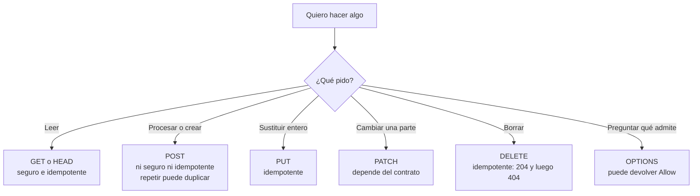

# Métodos HTTP: GET, POST, PUT, PATCH, DELETE, HEAD y OPTIONS

> **Resumen de material de clase.** Viene de un PDF que aportó la estudiante
> (`06-metodos-http.pdf`, 2 páginas).
> Lo marcado como **material de clase** es lo que dice el PDF; el resto es
> explicación propia.

## 1. De qué va (resumen en cinco líneas)

1. La **URL** dice dónde vas; el **método** dice qué pides en ese sitio.
2. `GET /productos/42` y `DELETE /productos/42` van al mismo sitio, pero piden cosas
   distintas.
3. Dos propiedades que hay que distinguir: **seguro** (no pide modificar) e
   **idempotente** (repetirlo tiene el mismo efecto).
4. Esas propiedades describen un **contrato**, no una lista de códigos de respuesta
   fijos.
5. Sirve para elegir bien el método y para no hacer trampas como `/eliminar/42` con
   GET.

## 2. Explicación paso a paso

1. Eliges **dónde**: la URI (`/productos/42`).
2. Eliges **qué**: el método (pedirlo, cambiarlo, borrarlo).
3. El servidor **decide** qué recursos y métodos admite, respetando el significado
   de cada método.
4. El método **no garantiza** el resultado: un GET puede acabar en `404`, y un POST
   puede crear o no crear nada.
5. Al repetir la misma operación, compruebas si es **idempotente**: ¿el estado
   final es el mismo que si la hubieras enviado una vez?

La tabla del PDF, que es lo que hay que saberse:

| Método | Seguro | Idempotente | Intención habitual |
|---|---|---|---|
| **GET** | Sí | Sí | Solicitar una representación |
| **HEAD** | Sí | Sí | Pedir los campos de un GET, **sin cuerpo** |
| **POST** | No necesariamente | No necesariamente | Pedir que el recurso procese el contenido |
| **PUT** | No | Sí | Crear o **sustituir** el estado del recurso |
| **PATCH** | No | No necesariamente | Aplicar una modificación **parcial** |
| **DELETE** | No | Sí | Solicitar que se elimine el recurso |
| **OPTIONS** | Sí | Sí | Consultar opciones de comunicación |

## 3. Ideas clave del tema

**Seguro** no significa «no hace nada». Un servidor puede registrar la visita o
contar accesos al atender un GET. Lo que significa es que el cliente **no está
pidiendo** modificar el estado.

**Idempotente** no significa «devuelve siempre lo mismo». El PDF lo aclara con un
ejemplo: el primer `DELETE` puede devolver `204` y el segundo `404`. Después de
ambos, el recurso sigue eliminado: el **efecto** es el mismo.

Y ahí está la razón de no hacer esto:

```text
GET /eliminar/42        ← MAL: un robot, una caché o el propio
                          botón "recargar" podrían ejecutar el borrado.
DELETE /productos/42    ← BIEN: el método dice lo que va a pasar.
```

Tres matices que el PDF enfatiza y que suelen pasarse por alto:

- **«No necesariamente» es «no necesariamente»**: no significa «POST siempre
  cambia algo». La semántica de POST depende del recurso. `/consultas` podría ser
  un POST que solo calcula.
- **PATCH puede ser idempotente o no**, según lo que signifique el cuerpo. Un
  contrato que dice «fijar el precio en 20» sí lo es; otro que dice «incrementar el
  precio en 1» acumula.
- **`Accept` es una preferencia, `Content-Type` es una descripción**: uno pide lo que
  quieres; el otro dice lo que hay. Por eso un GET no te garantiza JSON.

## 4. Ejemplo práctico relacionado con DAW

Las cuatro peticiones del PDF y cómo se interpretan:

```text
GET /productos/42         → "dame este producto"    → 200 con JSON o 404
POST /pedidos {"productoId":42,"cantidad":1}
                          → "procesa esto"          → 201 + Location: /pedidos/9
PUT /productos/42         → "deja el producto en    → 201 la primera vez,
                             este estado"              200 o 204 después
PATCH /productos/42 {"precio":20}
                          → "cambia esto"           → depende del contrato
DELETE /productos/42      → "elimínalo"             → 204, y 404 si repites
```

Fíjate en que el `POST` de crear un pedido **repetido puede crear dos pedidos**. Si
eso rompe tu negocio, la idempotencia la tienes que garantizar tú, no el método.

## 5. Código o comandos pequeños comentados

```bash
# Desde otra terminal, con la aplicación arrancada (comprobación del PDF):
http --verbose GET     http://localhost:8080/api/hello
http --verbose HEAD    http://localhost:8080/api/hello
http --verbose OPTIONS http://localhost:8080/api/hello

# En cuál se ve un cuerpo? GET sí. HEAD no. OPTIONS depende del servidor.
```

Y las peticiones tal como aparecen en el PDF:

```text
GET /productos/42 HTTP/1.1
Host: tienda.example
Accept: application/json        ← preferencia del cliente, no una garantía

POST /pedidos HTTP/1.1
Host: tienda.example
Content-Type: application/json ← lo que realmente envío

{"productoId":42,"cantidad":1}
```

## 6. Diagrama (Mermaid)



## 7. Conceptos con los que se suele confundir

- **URL ≠ método**: la URL es el sitio; el método, la intención.
- **Seguro ≠ idempotente**: son propiedades distintas. POST no es seguro; GET es las
  dos. No se pueden derivar una de otra.
- **Idempotente ≠ misma respuesta**: es el mismo **efecto**, no el mismo código de
  estado.
- **`Accept` ≠ `Content-Type`**: el primero expresa preferencia del cliente; el
  segundo describe lo que se envía.
- **`Content-Type` ≠ `Accept` en el ejemplo de un GET**: pedir JSON no obliga a
  recibirlo.
- **Método ≠ lo que hace tu API**: el PDF avisa de que `/pedidos` podría calcular en
  vez de crear. «POST = crear» se queda corto.

## 8. Errores frecuentes

- **Crear URLs que borran**: `/eliminar/42` con GET. Un robot, una caché o un
  precargador la visitarían sin querer.
- **Suponer que POST es seguro porque «no borra»**: seguro significa que no pides
  modificar el estado, no que la operación sea inocua.
- **Suponer idempotencia en POST**: si reintenta una compra, puedes crear dos
  pedidos.
- **Suponer que cualquier PATCH es idempotente**: depende de lo que signifique el
  cuerpo.
- **Suponer que OPTIONS siempre trae `Allow`**: no todos los servidores lo incluyen,
  y no todos los endpoints se comportan igual.
- **Asumir que HEAD existe en todas las rutas**: no todas las aplicaciones lo ofrecen
  en todos sus endpoints.

## 9. Tres preguntas de repaso

1. ¿Qué diferencia hay entre «seguro» e «idempotente»?
2. ¿Por qué el primer DELETE puede devolver 204 y el segundo 404, si DELETE es
   idempotente?
3. ¿Por qué es peligroso tener un `GET /eliminar/42`?

### Respuestas

1. «Seguro» significa que el cliente no está pidiendo modificar el estado del
   recurso. Un GET puede registrar la visita, pero eso no lo convierte en un método
   de cambio. «Idempotente» significa que repetir la misma petición tiene el mismo
   efecto previsto sobre el recurso. Son propiedades independientes: POST no es
   seguro ni idempotente necesariamente.
2. Porque la idempotencia habla del **efecto solicitado**, no de la respuesta. Tras el
   primer DELETE el recurso ya no existe; el segundo no hace falta, y el servidor
   responde honestamente con 404. El estado final es el mismo en ambos casos: el
   recurso está eliminado.
3. Porque GET es un método seguro: se puede ejecutar sin esperar consecuencias. Un
   navegador, una caché o un robot podrían visitarla sin querer y borrar datos. Para
   borrar hay que usar DELETE, que dice explícitamente lo que va a pasar.

## 10. Términos relacionados

- [Códigos de estado HTTP](../Terminos/codigos-estado.md) — los 204, 404, 200 y 201
  que salen en los ejemplos.
- [HTTP](../Terminos/http.md) — qué es la petición y la respuesta.
- [Sniffing](../Terminos/sniffing.md) — cómo observar estas peticiones con la
  terminal o las herramientas del navegador.
- [Glosario](../Glosario.md) — índice general.

*(Aparecen en el PDF pero aún no tienen ficha: API REST, idempotencia, cabecera
`Allow`, cabecera `Location`.)*

## 11. Fuentes y límites del resumen

- Fuente: PDF `06-metodos-http.pdf` (páginas 1-2, leídas las 2), aportado por la
  estudiante.
- Fuentes externas: **no consultadas** para este resumen.
- Límites:
  - El PDF se ha leído **extrayendo el texto** con `pdftotext`, sin mirar las
    páginas: diagramas o imágenes, si los hay, **no los he visto**.
  - Los ejemplos `/productos/42` y `/pedidos` son **hipotéticos**: el PDF dice
    expresamente que no son endpoints de «Hello Server». **No he ejecutado** esas
    peticiones contra ningún servidor.
  - Los comandos `http --verbose` requieren la herramienta **HTTPie** instalada. El
    PDF no indica si la tienes; **no he comprobado** que funcione en tu equipo.
  - El PDF **no cita ningún RFC**, así que las definiciones de «seguro» e
    «idempotente» son las del material, sin contrastar con la especificación
    oficial.
  - Los diagramas Mermaid no se han validado automáticamente: requieren
    comprobación visual.

## 12. Mis notas

<!-- Sección reservada para la estudiante. No borrar ni sobrescribir. -->