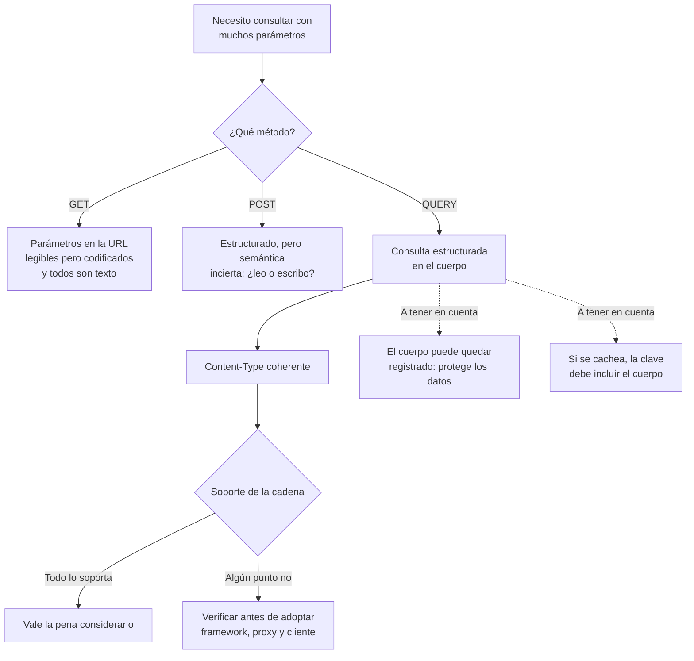

# Método HTTP QUERY y consultas con contenido

> **Resumen de material de clase.** Viene de un PDF que aportó la estudiante
> (`09-query-http.pdf`, **1 página**).
> Lo marcado como **material de clase** es lo que dice el PDF; el resto es
> explicación propia.

## 1. De qué va (resumen en cinco líneas)

1. **QUERY** manda en el **cuerpo** de la petición una consulta que no cabe bien en la
   URL.
2. El PDF cita el **RFC 10008**, que lo define como método **seguro** e
   **idempotente**.
3. Frente a GET, permite una descripción **estructurada**; frente a POST, conserva la
   semántica segura de consulta.
4. **No elimina** la necesidad de proteger los datos: el cuerpo puede quedar
   registrado.
5. Sirve para entender un método nuevo, pero **no** para asumir que tu cadena de
   herramientas lo soporta.

## 2. Explicación paso a paso

1. Necesitas consultar algo con **muchos parámetros**: precio máximo, etiquetas,
   ordenación, rango de fechas…
2. Metido todo en la URL, se vuelve ilegible y hay que **codificar** cada valor.
3. `QUERY` manda esa consulta **en el cuerpo**, con su `Content-Type`.
4. El servidor responde como siempre, con estado, cabeceras y cuerpo.
5. Si la respuesta se puede cachear, la **clave de caché** debe tener en cuenta el
   cuerpo y los metadatos relevantes, no solo la URL.

El ejemplo del PDF:

```text
QUERY /productos HTTP/1.1
Host: example.org
Content-Type: application/json

{"precioMaximo":50,"etiquetas":["local","eco"]}
```

## 3. Ideas clave del tema

- **Qué aporta frente a GET**: una descripción **estructurada** en el contenido, en
  lugar de parámetros sueltos en la URL.
- **Qué aporta frente a POST**: mantiene la **semántica segura e idempotente** de una
  consulta. Con POST no sabes si estás leyendo o modificando.
- **`Content-Type` debe ser coherente** con el cuerpo: si mandas JSON, va
  `application/json`.
- **El contenido puede quedar registrado**: por eso los datos sensibles que metas
  ahí **siguen necesitando protección**.
- **`Accept-Query`**: anuncia los formatos aceptados mediante *Structured Fields*.
  Por ejemplo `Accept-Query: "application/json"`.
- **Caché**: las respuestas «pueden» ser cacheables, pero la clave debe considerar el
  **cuerpo**, no solo la URL.

Y la advertencia más importante del PDF, textual:

> Que el método esté estandarizado no implica que todos los frameworks, proxies y
> clientes lo soporten.

## 4. Ejemplo práctico relacionado con DAW

Un buscador con tres filtros, comparando las dos formas:

```text
GET /productos?precioMaximo=50&etiqueta=local&etiqueta=eco&orden=precio_asc
                      ↑ todo va en la URL, codificado carácter a carácter

QUERY /productos
Content-Type: application/json

{"precioMaximo":50,"etiquetas":["local","eco"],"orden":"precio_asc"}
                      ↑ viaja estructurado, con sus tipos
```

Con `GET`, `precioMaximo=50` es una **cadena de texto**: el servidor tiene que
convertirla y decidir qué pasa si alguien escribe `precioMaximo=abc`. Con `QUERY` el
`50` llega con su **tipo**, porque va en JSON.

## 5. Código o comandos pequeños comentados

Lo único que el PDF da literally, es la petición:

```text
QUERY /productos HTTP/1.1
Host: example.org
Content-Type: application/json      ← debe ser coherente con el cuerpo

{"precioMaximo":50,"etiquetas":["local","eco"]}

# Y la cabecera opcional que anuncia el formato aceptado:
Accept-Query: "application/json"
```

Lo que **no** hay en el PDF: un ejemplo de respuesta, un comando para probarlo, o el
nombre del framework que lo implementa. Ese hueco es real y conviene reconocerlo.

## 6. Diagrama (Mermaid)



## 7. Conceptos con los que se suele confundir

- **`QUERY` ≠ `POST`**: POST no promete ser seguro ni idempotente; QUERY sí.
- **`QUERY` ≠ `GET`**: GET lleva los parámetros en la URL y como texto; QUERY los
  lleva en el cuerpo y puede tiparlos.
- **`QUERY` ≠ `GET` con cuerpo**: que un método lleve cuerpo no significa que pueda
  cambiar nada. La seguridad es una propiedad declarada del método.
- **Estándar ≠ compatibilidad**: que exista un RFC no significa que tu framework, tu
  proxy o tu cliente lo implementen.

## 8. Errores frecuentes

- **Suponer que todo el mundo lo soporta**: el PDF avisa en contra. Antes de
  Adoptarlo hay que verificar **toda** la cadena.
- **Meter datos sensibles en el cuerpo pensando que es más seguro**: el cuerpo puede
  quedar registrado en logs, proxies y herramientas. Sigue necesitando protección.
- **Cachear por URL solamente**: si el cuerpo cambia el resultado, la clave de caché
  tiene que reflejarlo.
- **Usar `Content-Type` que no cuadre con el cuerpo**: el PDF lo dice explícitamente.
- **Confundir «seguro» con «inofensivo»**: como en cualquier otro método, un servidor
  puede registrar la consulta. Seguro significa que no pides modificar el estado.

## 9. Tres preguntas de repaso

1. ¿Qué problema resuelve QUERY que no resuelven ni GET ni POST por sí solos?
2. ¿Por qué el contenido de una petición QUERY sigue necesitando protección?
3. ¿Por qué el PDF desaconseja adoptarlo sin más?

### Respuestas

1. Frente a **GET**, QUERY permite una descripción **estructurada en el cuerpo** en
   lugar de parámetros sueltos y codificados en la URL, y esos valores conservan su
   tipo. Frente a **POST**, conserva la **semántica segura e idempotente** de una
   consulta, que en POST es ambigua.
2. Porque el cuerpo **puede quedar registrado**: en logs del servidor, en proxies, en
   herramientas de diagnóstico. Meter algo ahí no lo protege, solo cambia de sitio.
   Sigo necesitando cifrado, control de acceso y no mandar secretos.
3. Porque, aunque el método esté **estandarizado por un RFC**, eso no implica que
   todos los frameworks, proxies y clientes lo soporten. Antes de adoptarlo hay que
   verificar toda la cadena.

## 10. Términos relacionados

- [Métodos HTTP](metodos-http.md) — GET, POST, PUT, PATCH, DELETE, HEAD y OPTIONS,
  y las propiedades de seguridad e idempotencia.
- [Códigos de estado HTTP](../Terminos/codigos-estado.md) — lo que devuelve la
  consulta.
- [Cabeceras, contenido y caché](cabeceras-http-contenido-y-cache.md) — por qué la
  clave de caché debe tener en cuenta el cuerpo.
- [HTTP](../Terminos/http.md) — qué es el protocolo.
- [Glosario](../Glosario.md) — índice general.

*(Aparecen en el PDF pero aún no tienen ficha: `Accept-Query`, Structured Fields,
RFC 10008, clave de caché.)*

## 11. Fuentes y límites del resumen

- Fuente: PDF `09-query-http.pdf` (**página 1, la única que tiene**), aportado por la
  estudiante.
- Fuentes externas: **no consultadas** para este resumen. El PDF menciona el
  **RFC 10008**, pero **no he ido a leerlo** ni he verificado su texto.
- Límites:
  - El PDF se ha leído **extrayendo el texto** con `pdftotext`, sin mirar la página.
  - **Es un PDF de una sola página**: hay apartados que pueden haberse quedado fuera
    de lo que el material recoge aquí. Cualquier duda sobre QUERY que no aparezca en
    esa página, aquí no está.
  - El PDF **no da ningún ejemplo de respuesta**, ni un comando para probarlo, ni
    menciona qué frameworks lo soportan. La sección 3 refleja lo que el PDF dice, y
    **no lo completo con lo que yo sepa**.
  - El PDF dice que en UD1 se estudia su semántica y **no se ejecuta contra «Hello
    Server»**. No lo he ejecutado.
  - El PDF usa la palabra inglesa «literally» al decir que el ejemplo va «literalmente»
    tal cual; se ha traducido.
  - El diagrama Mermaid no se ha validado automáticamente: requiere comprobación
    visual.

## 12. Mis notas

<!-- Sección reservada para la estudiante. No borrar ni sobrescribir. -->