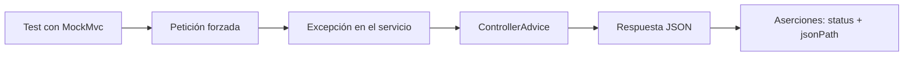

# Tests de errores y respuestas HTTP coherentes

> **Resumen de material de clase.** Viene del PDF `05-tdd-manejo-errores.pdf`
> («Tests de errores y respuestas HTTP coherentes», 3 páginas), que aportó la
> estudiante. Lo marcado como **material de clase** es lo que dice el PDF; el resto es
> explicación propia.

## 1. De qué va (resumen en cinco líneas)

1. Una API no solo tiene que funcionar cuando todo va bien: **los errores también forman
   parte del contrato**.
2. Con `@ControllerAdvice` + `@ExceptionHandler` se centraliza la traducción de
   excepciones a respuestas HTTP.
3. El PDF usa siempre el mismo cuerpo de error: `{ error, message, timestamp }`.
4. Con MockMvc se comprueban los 400 de validación, los 400 de lógica, el 415 y el 405.
5. Sirve para que el frontend siempre reciba el mismo formato y para poder depurar
   incidencias sin adivinar.

## 2. Explicación paso a paso

**El flujo completo, según el material:**

1. Se define un **payload de error único**: `{ error, message, timestamp }`.
2. Se crea `GlobalExceptionHandler` con `@ControllerAdvice`, que **intercepta las
   excepciones de toda la aplicación**.
3. Cada método `@ExceptionHandler` decide el código y el cuerpo de un tipo de excepción.
4. Se provocan errores a propósito en los endpoints (por ejemplo, `title` en blanco o un
   id inexistente).
5. Se escriben los tests con MockMvc comprobando **código y forma del cuerpo**.

**Los tres manejadores del PDF y qué responden:**

| Excepción | Código | `error` |
|---|---|---|
| `MethodArgumentNotValidException` | 400 | `VALIDATION_ERROR` |
| `IllegalArgumentException` | 400 | `BAD_REQUEST` |
| `Exception` (cualquier otra) | 500 | `INTERNAL_ERROR` |

**Los tests que trae el PDF**, y esto es lo que hay que saber hacer:

- `create_shouldReturnValidationError_whenTitleBlank` → 400 con `error=VALIDATION_ERROR`,
  `message` que contiene `must not be blank` y `timestamp` no vacío.
- `get_shouldReturnBadRequestPayload_whenIllegalArgument` → 400 con `error=BAD_REQUEST` y
  `message` con `Task not found`.
- `create_shouldReturn415_whenWrongContentType` → envía `text/plain` y espera 415.
- `tasks_shouldReturn405_whenMethodNotAllowed` → envía un `PUT` que no existe y espera 405.

Un detalle importante del material: en `@WebMvcTest` hay que **incluir también el
handler**, con `@WebMvcTest({ TaskController.class, GlobalExceptionHandler.class })`. Si
no, la excepción sale por la página de error genérica en vez de por tu JSON.

## 3. Ideas clave del tema

- **Un error es parte de la API.** Si cada fallo devuelve una forma distinta, el
  frontend tiene que escribir un caso por cada una.
- **`@ControllerAdvice` centraliza.** Sin él, cada controlador repite su propio
  `try`/`catch`.
- **Tres errores distintos con el mismo cuerpo.** Lo que cambia es el valor de `error` y
  el código HTTP, no la forma del JSON.
- **`timestamp` sirve para correlacionar.** Con él se puede buscar la petición en los logs
  del servidor.
- **415 y 405 los pone Spring MVC solo.** El material lo aclara: no hace falta escribirlos
  a mano, solo probarlos.
- **No filtrar detalles internos.** El PDF lo dice en el checklist: información a los logs
  sí, a la respuesta no.
- **Probar los errores es tan importante como probar los aciertos.** Si solo pruebas el
  camino feliz, el contrato de error puede romperse sin enterarte.

## 4. Ejemplo práctico relacionado con DAW

El test de validación del PDF, que es el ejemplo mínimo del tema:

```java
@Test
void create_shouldReturnValidationError_whenTitleBlank() throws Exception {
  mvc.perform(post("/api/tasks")                              // envío un title en blanco
      .contentType(MediaType.APPLICATION_JSON)
      .content("""{ "title": "        " }"""))
    .andExpect(status().isBadRequest())                       // espero 400
    .andExpect(jsonPath("$.error").value("VALIDATION_ERROR")) // y el error concreto
    .andExpect(jsonPath("$.message", containsString("must not be blank")))
    .andExpect(jsonPath("$.timestamp", not(emptyOrNullString())));  // y fecha no vacía
}
```

Y el manejador que hace que eso sea posible:

```java
@ExceptionHandler(MethodArgumentNotValidException.class)
public ResponseEntity<?> validation(MethodArgumentNotValidException ex) {
  String msg = ex.getBindingResult().getAllErrors().get(0).getDefaultMessage();
  return ResponseEntity.badRequest().body(Map.of(
      "error", "VALIDATION_ERROR", "message", msg, "timestamp", Instant.now().toString()));
}
```

## 5. Código o comandos pequeños comentados

```java
// Sin esto, el @ControllerAdvice no se carga en un @WebMvcTest
@WebMvcTest({ TaskController.class, GlobalExceptionHandler.class })
class TaskErrorsTest {
    @Autowired MockMvc mvc;
}
```

```java
// Provocar un 400 de lógica: lanzar excepción en vez de devolver notFound()
@GetMapping("/{id}")
public ResponseEntity<Task> get(@PathVariable Long id) {
  return tasks.stream()
      .filter(t -> t.getId().equals(id))
      .findFirst()
      .map(ResponseEntity::ok)
      .orElseThrow(() -> new IllegalArgumentException("Task not found"));
}
```

```java
// 415 y 405: los genera Spring MVC, solo se comprueban
mvc.perform(post("/api/tasks").contentType(MediaType.TEXT_PLAIN).content("title=texto"))
   .andExpect(status().isUnsupportedMediaType());   // 415

mvc.perform(put("/api/tasks"))                       // no hay PUT definido
   .andExpect(status().isMethodNotAllowed());        // 405
```

**Checklist de calidad del error (el del PDF):**

- Siempre JSON con `{ error, message, timestamp }`.
- 400 de validación → `error = VALIDATION_ERROR`.
- 400 de lógica → `error = BAD_REQUEST` con mensaje entendible.
- No filtrar detalles internos en producción (log sí, respuesta no).
- Añadir `traceId` o `correlationId` más adelante, cuando haga falta.

## 6. Diagrama (Mermaid)

```mermaid
flowchart TD
  A[Petición con datos inválidos] --> B{Dónde falla}
  B -->|Validación @Valid| C[MethodArgumentNotValidException]
  B -->|Regla de negocio| D[IllegalArgumentException]
  B -->|Otro error| E[Exception]
  C --> F[@ControllerAdvice<br/>GlobalExceptionHandler]
  D --> F
  E --> F
  F --> G{Excepción}
  G -->|Validación| H[400 VALIDATION_ERROR]
  G -->|Lógica| I[400 BAD_REQUEST]
  G -->|Desconocida| J[500 INTERNAL_ERROR]
  H --> K[JSON: error, message, timestamp]
  I --> K
  J --> K
```

Y quién prueba a quién, en el flujo de trabajo:



## 7. Conceptos con los que se suele confundir

- **`@ControllerAdvice` ≠ `@Controller`**: el primero no atiende peticiones, sino que
  **intercepta excepciones** de toda la aplicación.
- **`@ExceptionHandler` ≠ `try`/`catch`**: el primero es declarativo y centralizado; el
  segundo, manual y repetido.
- **400 ≠ 500**: 400 es culpa de quien envía la petición; 500 es culpa del servidor. No se
  tapa un fallo propio devolviendo 500.
- **415 ≠ 400**: 415 es «el formato que envías no lo acepto»; 400 es «el formato vale pero
  el contenido no».
- **405 ≠ 404**: 405 es «la ruta existe, pero no con ese verbo»; 404 es «la ruta no
  existe».
- **Mensaje de error ≠ traza técnica**: el body va para el cliente, el log va para ti.

## 8. Errores frecuentes

- **Olvidar el handler en el `@WebMvcTest`**: la prueba falla con una página de error en
  lugar de tu JSON, y parece un fallo del controlador.
- **Probar solo el código y no el `error`**: la API puede devolver 400 con un cuerpo
  cualquiera y la prueba pasaría igual.
- **Devolver la excepción completa** en la respuesta: filtra nombres de clases y trazas.
- **Escribir un `@ExceptionHandler(Exception.class)` sin un código fijo**: acabarías
  devolviendo 500 para errores que son 400.
- **Confundir el 404 con el 400**: el PDF lo reconoce explícitamente y ofrece las dos
  opciones; lo que no puede ser es no decidirlo.
- **No comprobar el `timestamp`**: si el campo se queda vacío, el cliente pierde la
  trazabilidad.

## 9. Tres preguntas de repaso

1. ¿Para qué sirve `@ControllerAdvice` y por qué hay que incluirlo en el `@WebMvcTest`?
2. ¿Qué diferencia hay entre responder 400 y 404 cuando pides una tarea que no existe?
3. ¿Por qué el PDF recomienda no mandar detalles internos en la respuesta de error?

### Respuestas

1. `@ControllerAdvice` centraliza el manejo de excepciones de toda la aplicación: en vez
   de repetir un `try`/`catch` en cada controlador, cada tipo de excepción se traduce una
   vez a una respuesta HTTP con el mismo formato. En un `@WebMvcTest` solo se carga la
   capa MVC indicada en la anotación, así que hay que escribir
   `@WebMvcTest({ TaskController.class, GlobalExceptionHandler.class })`. Si no, el
   controlador lanza la excepción pero no hay nadie que la convierta en tu JSON.
2. Son dos responsabilidades distintas. El **404** dice que el recurso no existe: es el
   código natural y el que usa el material en su versión sin excepciones. El **400**
   dice que lo que enviaste no es válido. El PDF ofrece las dos para el id inexistente:
   devolver `notFound()` directamente (404) o lanzar una excepción (400). Lo importante
   es **elegir una y mantenerla**, porque si el frontend ve las dos para el mismo caso no
   sabe qué hacer.
3. Porque el cuerpo de la respuesta lo lee el cliente, no tú. Los nombres de clases, las
   trazas o los mensajes de la base de datos dan información de cómo está construido el
   servidor y pueden ayudar a alguien a atacar la aplicación. La regla del checklist es
   «log sí, respuesta no»: el detalle completo se escribe en el log del servidor, y al
   cliente se le manda un mensaje entendible.

## 10. Términos relacionados

- [TDD y MockMvc en la mini API Tasks](tdd-primeros-pasos.md) — el PDF anterior del
  mismo tema: los tests del camino feliz.
- [Códigos de estado HTTP](../Terminos/codigos-estado.md) — el significado real de 400,
  404, 405, 415 y 500.
- [HTTP](../Terminos/http.md) — la respuesta de error es, al fin y al cabo, una respuesta
  HTTP.
- [DTO (Data Transfer Object)](../Terminos/dtos.md) — el `CreateTaskDTO` con `@NotBlank`
  que dispara la validación.
- [Capa de servicio](capa-servicios.md) — de dónde vienen las excepciones que el
  handler traduce.
- [Controladores REST](controladores-rest.md) — los controladores donde vive el
  `@ControllerAdvice`.
- [TDD mínimo](tdd-minimo.md) — el ciclo red/green/refactor que da contexto a estos tests.

*(Aparecen en el PDF pero aún no tienen ficha: `@ControllerAdvice`, `@ExceptionHandler`,
`MethodArgumentNotValidException`, MockMvc, JSONPath, payload de error, contrato de API,
415 Unsupported Media Type, 405 Method Not Allowed.)*

## 11. Fuentes y límites del resumen

- Fuente: PDF `05-tdd-manejo-errores.pdf`, «Tests de errores y respuestas HTTP
  coherentes», autor «José MSA» (páginas 1-3, leídas las 3), aportado por la estudiante.
  Módulo DWES, capítulo 2 bis.
- Fuentes externas: **no consultadas** para este resumen.
- Límites:
  - El PDF se ha leído **extrayendo el texto** con `pdftotext`, sin ver las páginas
    originales: si hay capturas o diagramas, **no los he visto**.
  - **No he ejecutado** ningún test: los fragmentos son transcripciones del PDF y no he
    comprobado que compilen ni que pasen.
  - El PDF remite a un archivo de apoyo, `docs/Cap02bis_Tests_Tasks_Errores.md`, que
    **no está en este repositorio**: no lo he leído.
  - El propio PDF es deliberadamente corto (3 páginas) y deja fuera el manejo de
    excepciones con `@ResponseStatus`, el manejo de errores de base de datos y el
    `traceId` que solo menciona como mejora futura. No lo he ampliado por mi cuenta.
  - Hay una decisión **deliberadamente dudosa** en el material: convertir un «id
    inexistente» en un 400 `BAD_REQUEST`. La he dejado como está y la he señalado en la
    sección 7 y en las preguntas, porque es una elección discutible pero es la del
    material de clase.
  - El diagrama Mermaid **no se ha validado automáticamente**: requiere comprobación
    visual.

## 12. Mis notas

<!-- Sección reservada para la estudiante. No borrar ni sobrescribir. -->