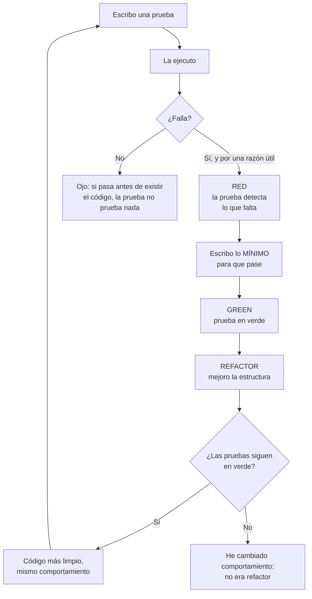

# TDD mínimo para el cuestionario de entorno

> **Resumen de material de clase.** Viene de un PDF que aportó la estudiante
> (`11-tdd-minimo-para-entorno.pdf`, 3 páginas). El PDF es un documento corto del
> **Departamento de Informática** cuyo objetivo declarado es responder a un
> cuestionario.
> Lo marcado como **material de clase** es lo que dice el PDF; el resto es
> explicación propia.

## 1. De qué va (resumen en cinco líneas)

1. **TDD** es escribir primero una prueba que describe el comportamiento esperado y
   después el código que la hace pasar.
2. El ciclo tiene tres fases: **red**, **green** y **refactor**.
3. Un **fixture** es el estado inicial que una prueba necesita para ejecutarse de
   forma controlada.
4. **JUnit** es la herramienta para escribir y ejecutar pruebas en Java; Maven Wrapper
   las lanza con la versión fijada por el proyecto.
5. Sirve para tener el vocabulario mínimo para el cuestionario, no para aprender TDD
   a fondo.

## 2. Explicación paso a paso

1. Escribes una **prueba** que describe lo que quieres que ocurra.
2. La ejecutas y compruebas que **falla** (fase red). Si falla por una razón útil,
   está bien: significa que detecta la diferencia entre lo esperado y lo que hay.
3. Escribes la **implementación mínima** para que pase (fase green). No la aplicación
   perfecta.
4. **Refactorizas**: ordenas el código sin cambiar lo que hace, y las pruebas deben
   seguir en verde.

El ciclo, con el ejemplo del PDF:

```text
RED      → escribo la prueba de GET /health
           falla con 404 Not Found
           (ese 404 ES el éxito de la fase roja: falta lo que esperaba)

GREEN    → escribo lo mínimo para que /health responda
           la prueba pasa

REFACTOR → limpio el código
           la prueba sigue pasando
```

## 3. Ideas clave del tema

**Lo que TDD NO es**, según el PDF: escribir pruebas al final para justificar que el
código funciona. Eso puede ser útil, pero no es TDD.

**Qué es un fixture**, con los cinco ejemplos que da el material:

- objetos preparados,
- datos de ejemplo,
- configuración concreta,
- una base de datos en un estado conocido,
- un servidor arrancado para pruebas.

La idea importante: **cada prueba debe poder ejecutarse de forma independiente**.
Compartir y mutar el mismo fixture global entre pruebas suele ser mala idea, porque
una prueba deja restos que afectan a la otra.

**El resumen para el cuestionario**, que es la parte que hay que saberse:

| Término | Definición |
|---|---|
| **Maven Wrapper** | Ejecuta Maven con la versión fijada por el proyecto |
| **Spring Boot** | Simplifica la configuración y el arranque de una aplicación Spring |
| **JUnit** | Permite escribir y ejecutar pruebas automatizadas en Java |
| **Fixture** | Prepara datos y condiciones iniciales conocidas para una prueba |
| **Red** | La prueba falla porque falta el comportamiento esperado |
| **Green** | Se implementa lo mínimo para que la prueba pase |
| **Refactor** | Se mejora el código manteniendo las pruebas en verde |
| **`@Test`** | Marca un método como prueba en JUnit 5 |
| **`assertEquals(expected, actual)`** | Comprueba que el valor real coincide con el esperado |
| **`./mvnw test`** | Ejecuta las pruebas del proyecto en Linux/macOS |
| **`@SpringBootApplication`** | Identifica la clase principal de una aplicación Spring Boot |
| **`GET /health`** | Endpoint de salud del servidor mínimo de UD1 |

## 4. Ejemplo práctico relacionado con DAW

El fragmento de JUnit del PDF, con sus comentarios puestos:

```java
import org.junit.jupiter.api.Test;

class ExampleTest {
  @Test
  void shouldAddTwoNumbers() {
    assertEquals(5, 2 + 3);   // expected, actual
  }                            // si no coinciden, la prueba falla
}
```

Y el orden de los dos argumentos es la trampa clásica: `assertEquals(expected, actual)`.
Al revés, el mensaje de error sale en espejo y te lía al leerlo.

## 5. Código o comandos pequeños comentados

```bash
# Ejecutar las pruebas del proyecto (Linux o macOS)
./mvnw test

# En Windows
mvnw.cmd test

# Y la comprobación de salud del servidor mínimo de UD1
GET /health
```

El PDF explica por qué `./mvnw test` y no `mvn test`: porque el Wrapper **usa la
versión de Maven fijada por el proyecto**, así que el entorno es reproducible aunque
el equipo tenga otra versión instalada en el sistema. Y dice que el proyecto debe
fijar también la versión de Java; en esta unidad se trabaja con **Java 25**.

## 6. Diagrama (Mermaid)



## 7. Conceptos con los que se suele confundir

- **TDD ≠ pruebas al final**: el orden es lo que define el método, no tener pruebas.
- **Refactor ≠ cambiar comportamiento**: si al refactorizar cambian los resultados,
  ya no estás ordenando el código.
- **Fixture ≠ prueba**: el fixture es el **estado inicial**; la prueba es la
  comprobación.
- **Fixture global compartido ≠ fixture independiente**: compartir estado mutable
  entre pruebas las acopla y falla «al azar».
- **`./mvnw` ≠ `mvn`**: la diferencia es la reproducibilidad de la versión.
- **Fase red ≠ prueba mala**: un 404 inesperado es exactamente el fallo que querías
  ver.
- **Servidor embebido ≠ no usar servidor**: en Spring Boot hay un servidor HTTP
  (Tomcat) **dentro** del proceso de la aplicación.

## 8. Errores frecuentes

- **Escribir primero toda la implementación y luego las pruebas**: eso no es TDD.
- **Quedarse en la fase green**: si nunca se refactoriza, el ciclo se queda a medias.
- **Refactorizar y cambiar el comportamiento a la vez**: si la prueba falla, no sabes
    si has roto algo o la prueba estaba mal.
- **Compartir un fixture global mutable**: una prueba deja restos y la siguiente falla.
- **Usar el Maven global del sistema**: cada equipo puede tener una versión distinta y
  los resultados dejan de ser comparables.
- **Creer que en verde la fase roja era un momento perdido**: el 404 es la
  información más valiosa del ciclo.

## 9. Tres preguntas de repaso

1. ¿Por qué en TDD no se escribe primero toda la implementación?
2. ¿Qué significa que una prueba esté en rojo?
3. ¿Qué se puede cambiar durante la refactorización y qué no?

### Respuestas

1. Porque el ciclo consiste en describir el comportamiento esperado **antes** de
   construirlo. Así el diseño nace de lo que debe hacer el código y no de lo que
   casualmente se ha escrito. Además, escribir la prueba primero da un objetivo
   concreto al cambio.
2. Que la prueba **falla**, y falla por una razón útil: el comportamiento esperado
   todavía no existe. Si la prueba de `/health` devuelve 404 porque el endpoint no
   está creado, ese 404 **es el resultado esperado de la fase roja**, no un problema.
3. Durante la refactorización se puede cambiar la **estructura interna**: nombres,
   extracción de métodos, organización. Lo que **no** puede cambiar es el
   **comportamiento observable**. Si las pruebas empiezan a fallar, se ha cambiado
   comportamiento y eso no era refactorización.

## 10. Términos relacionados

- [Refactorización](../Terminos/refactorizacion.md) — la tercera fase del ciclo, con
  su ficha completa.
- [Códigos de estado HTTP](../Terminos/codigos-estado.md) — el 404 que se ve en la
  fase roja y el 200 cuando pasa.
- [Mecanismos de ejecución del servidor](mecanismos-ejecucion-servidor.md) — el
  servidor embebido que menciona el PDF.
- [Bean (Spring Boot)](../Terminos/beans-spring.md) — `@SpringBootApplication` y el
  arranque.
- [Glosario](../Glosario.md) — índice general.

*(Aparecen en el PDF pero aún no tienen ficha: TDD, JUnit, fixture, Maven Wrapper,
aserciones, `@Test`, `@SpringBootApplication`.)*

## 11. Fuentes y límites del resumen

- Fuente: PDF `11-tdd-minimo-para-entorno.pdf` (páginas 1-3, leídas las 3),
  aportado por la estudiante. El PDF es un documento del Departamento de Informática
  para el cuestionario UD1 / Semana 02.
- Fuentes externas: **no consultadas** para este resumen.
- Límites:
  - El PDF se ha leído **extrayendo el texto** con `pdftotext`, sin mirar las
    páginas: diagramas o imágenes, si los hay, **no los he visto**.
  - El PDF dice que explica **«solo lo necesario»** para el cuestionario y que TDD se
    verá «con más profundidad» más adelante. Por eso aquí **no** hay nada de
    doble ciclo, TDD legacy, pruebas de integración o de aceptación.
  - **No he ejecutado** `./mvnw test` ni ningún test de JUnit: el fragmento de código
    es una transcripción del PDF.
  - El PDF menciona **Java 25** para esta unidad. No lo he verificado ni comprobado
    que sea la versión instalada en el equipo.
  - El índice del PDF menciona secciones de «Spring Boot y servidor embebido» que el
    texto cubre solo en tres párrafos; **el resumen refleja ese poco detalle**, no lo
    amplía.
  - Los diagramas Mermaid no se han validado automáticamente: requieren
    comprobación visual.

## 12. Mis notas

<!-- Sección reservada para la estudiante. No borrar ni sobrescribir. -->