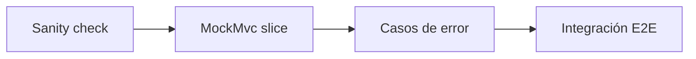

# TDD y MockMvc en la mini API Tasks

> **Resumen de material de clase.** Viene del PDF `02-tdd-primeros-pasos.pdf`
> («Tests para la mini API Tasks: TDD y MockMvc», 5 páginas), que aportó la estudiante.
> Lo marcado como **material de clase** es lo que dice el PDF; el resto es explicación
> propia.

## 1. De qué va (resumen en cinco líneas)

1. Cómo **probar una API REST en Spring Boot** de forma incremental.
2. Primero un *sanity check* (`contextLoads`), luego la capa web con **MockMvc** y al
   final, si quieres, un servidor real.
3. **MockMvc** simula las peticiones HTTP **sin levantar un servidor**: rápido y aislado.
4. Cada prueba se monta con AAA (**Arrange, Act, Assert**), un solo comportamiento y sin
   depender del estado de otra prueba.
5. Sirve para poder comprobar rutas, códigos HTTP, cabeceras y cuerpo sin depender de que
   la aplicación esté funcionando «a mano».

## 2. Explicación paso a paso

**Punto de partida (material de clase).** Un controlador `@RestController` en
`/api/tasks` con `GET /api/tasks`, `GET /api/tasks/{id}` y `POST /api/tasks`, sin
servicios ni base de datos. Se añade un DTO mínimo para poder probar también la
validación:

```java
public record CreateTaskDTO(@NotBlank String title) {}
```

**Los cinco pasos del PDF:**

1. **Test 0 — sanity check.** Un test con `@SpringBootTest` que solo comprueba que el
   contexto de Spring Boot carga sin fallos. Si algo está mal configurado, aquí falla
   temprano.
2. **Tests de capa web con MockMvc.** Con `@WebMvcTest(TaskController.class)` se levanta
   solo la capa MVC, sin base de datos ni servidor real.
3. **Casos felices y errores típicos.** Lista vacía, creación correcta, 404 y 400 de
   validación.
4. **Flujo dentro de un mismo test.** Crear y luego listar, en el mismo método, porque
   `@WebMvcTest` crea un controlador nuevo por test.
5. **Test de integración (opcional).** `@SpringBootTest(webEnvironment = RANDOM_PORT)` con
   `TestRestTemplate` para llamar a la aplicación de verdad.

**Lo que se comprueba en cada test del PDF**, y es la parte que hay que retener:

| Petición | Qué se espera |
|---|---|
| `GET /api/tasks` al principio | `200 OK`, JSON `[]` |
| `POST /api/tasks` válido | `201 Created`, cabecera `Location` con `/api/tasks/{id}`, cuerpo con `id`, `title`, `done:false` |
| `GET /api/tasks/9999` | `404 Not Found` |
| `POST /api/tasks` con `title` en blanco | `400 Bad Request` |

## 3. Ideas clave del tema

- **Prueba de contexto antes que nada.** Si el contexto de Spring no carga, todas las
  demás pruebas fallarán por el motivo equivocado.
- **MockMvc = HTTP simulado, sin red.** No hay puerto ni hilo HTTP real: tú construyes la
  petición (`get(...)`, `post(...)`) y compruebas la respuesta.
- **`@WebMvcTest` es un «slice test»** (prueba de una porción): solo carga los
  controladores, es mucho más rápido que levantar todo.
- **`@SpringBootTest` es la prueba grande**: carga la aplicación entera.
- **Instancia nueva por test.** Con `@WebMvcTest` el controlador se reinicia en cada
  método, así que la lista interna empieza vacía. De ahí la nota del PDF: si quieres
  comprobar que lo creado aparece en la lista, hazlo **en el mismo test**.
- **Verifica estado + cabeceras + cuerpo**, no solo el cuerpo. El PDF insiste: el `Location`
  del 201 es parte del contrato.
- **AAA** (`Arrange`, `Act`, `Assert`) para que cada test se lea en tres bloques claros.
- **Nombres expresivos**: `create_shouldReturn201AndLocationAndBody` se entiende solo.
- **Velocidad**: `@WebMvcTest` para la mayoría, `@SpringBootTest` para unos pocos de
  principio a fin.

## 4. Ejemplo práctico relacionado con DAW

El test de creación del PDF, que es el ejemplo mínimo del tema:

```java
@Test
void create_shouldReturn201AndLocationAndBody() throws Exception {
  mvc.perform(post("/api/tasks")            // ACT: hago la petición
      .contentType(MediaType.APPLICATION_JSON)
      .content("""{ "title": "Aprender Spring Boot" }"""))
    .andExpect(status().isCreated())        // ASSERT: 201
    .andExpect(header().string("Location", matchesPattern("/api/tasks/\\d+")))  // y su Location
    .andExpect(jsonPath("$.title").value("Aprender Spring Boot"));             // y el cuerpo
}
```

Dos detalles que se ven aquí: se usa `"""..."""` (text block de Java) para el JSON en
lugar de escapar comillas, y `jsonPath("$.campo")` apunta directamente a una parte del
JSON, como si fuera una ruta.

## 5. Código o comandos pequeños comentados

```java
// 1) Sanity check: ¿arranca el contexto?
@SpringBootTest
class ContextLoadTest {
  @Test void contextLoads() { /* si no explota, OK */ }
}

// 2) Capa web aislada: solo el controlador, sin servidor real
@WebMvcTest(TaskController.class)
class TaskControllerTest {
  @Autowired MockMvc mvc;
}

// 3) Integración con servidor real en un puerto aleatorio
@SpringBootTest(webEnvironment = SpringBootTest.WebEnvironment.RANDOM_PORT)
class TaskIntegrationTest {
  @LocalServerPort int port;         // el puerto que ha asignado Spring
  @Autowired TestRestTemplate rest;  // cliente HTTP de pruebas
}
```

```bash
# Ejecutar todas las pruebas del proyecto
./mvnw test

# Ejecutar solo las que quieras, en silencio
./mvnw -q -Dtest='*' test
```

El PDF dice que el stack de pruebas es `spring-boot-starter-test`, que trae JUnit 5,
AssertJ/Hamcrest, MockMvc y las utilidades de test de Jackson.

## 6. Diagrama (Mermaid)

```mermaid
flowchart TD
  A[Escribo el test] --> B[Elijo el nivel de test]
  B --> C{¿Qué quiero comprobar?}
  C -->|Que la app arranca| D[@SpringBootTest<br/>contextLoads]
  C -->|Rutas y códigos HTTP| E[@WebMvcTest<br/>MockMvc, sin servidor]
  C -->|Todo el sistema| F[@SpringBootTest RANDOM_PORT<br/>TestRestTemplate]
  D --> G[Verde: la app carga]
  E --> H[perform peticion<br/>+ expect status, headers y body]
  F --> I[POST y luego GET de verdad]
  H --> J{¿Independentiente?<br/>el estado empieza vacio}
  J -->|Sí| G
```

Y el orden recommended por el propio PDF, que va de menos a más:



## 7. Conceptos con los que se suele confundir

- **MockMvc ≠ servidor real**: simula el MVC, no hay socket ni puerto. Para eso está
  `TestRestTemplate`.
- **Prueba unitaria ≠ prueba de integración**: la unitaria prueba una pieza; la de
  integración prueba que las piezas encajan.
- **`@WebMvcTest` ≠ `@SpringBootTest`**: el primero recorta la aplicación a la capa web; el
  segundo la carga entera.
- **Test de flujo ≠ test dependiente**: hacer POST y luego GET en el mismo método **no**
  es depender de otro test, es un único escenario.
- **JSONPath ≠ camino del sistema de archivos**: `$.title` es una consulta al JSON de la
  respuesta.

## 8. Errores frecuentes

- **Escribir la prueba cuando la aplicación ni arranca**: sin el sanity check te enters
  de otros fallos much después.
- **Verificar solo el cuerpo** y olvidar el código o la cabecera `Location`: el contrato
  REST se rompe aunque el JSON sea correcto.
- **Repartir un flujo entre dos tests** y esperar que el segundo vea lo del primero: con
  `@WebMvcTest` el estado se reinicia.
- **Usar `@SpringBootTest` para todo**: funciona, pero es lento y falla por motivos que no
  tienen que ver con lo que estás probando.
- **Pruebas que dependen del orden de ejecución**: si al ejecutarlos uno a uno fallan,
  están acopladas.
- **Probar con datos de sobra**: el PDF pide datos mínimos, lo justo para el caso.

## 9. Tres preguntas de repaso

1. ¿Qué diferencia hay entre una prueba con `@WebMvcTest` y una con `@SpringBootTest`?
2. ¿Por qué, si quieres comprobar que una tarea creada aparece en la lista, debes hacerlo
   en el mismo test?
3. ¿Por qué en una prueba de un `POST` hay que comprobar también la cabecera `Location` y
   no solo el código y el cuerpo?

### Respuestas

1. `@WebMvcTest` es un *slice test*: levanta solo la capa MVC (controladores y
   validación), así que es rápido y aísla los fallos de esa capa. `@SpringBootTest` carga
   la aplicación entera; con `webEnvironment = RANDOM_PORT` además arranca un servidor
   HTTP de verdad. Por eso el PDF reserva `@SpringBootTest` para unos pocos tests de
   principio a fin.
2. Porque `@WebMvcTest` crea **una instancia nueva del controlador en cada test**: la lista
   interna de tareas empieza vacía en cada método. Si el POST está en un test y el GET en
   otro, en el segundo no habrá nada que ver. Si el flujo se quiere comprobar, se hace
   dentro del mismo método, que entonces es un único escenario coherente.
3. Porque en una API REST el 201 no solo dice «creado»: además apunta con `Location` a la
   URL del recurso nuevo. Si la prueba no comprueba esa cabecera, la API podría devolver
   201 sin ubicación y el cliente se quedaría sin saber dónde está lo que acaba de crear.
   El PDF lo resume: verifica estado + cabeceras + cuerpo.

## 10. Términos relacionados

- [TDD mínimo](tdd-minimo.md) — red, green, refactor y fixtures: el marco teórico de este
  PDF.
- [Refactorización](../Terminos/refactorizacion.md) — reorganizar el código sin cambiar el
  comportamiento, con las pruebas en verde.
- [Códigos de estado HTTP](../Terminos/codigos-estado.md) — los 200, 201, 400, 404, 405 y
  415 que aparecen en las expectativas.
- [HTTP](../Terminos/http.md) — las peticiones que MockMvc simula.
- [DTO (Data Transfer Object)](../Terminos/dtos.md) — el `CreateTaskDTO` que hace posible
  probar la validación.
- [Tests de errores y respuestas coherentes](tdd-manejo-errores.md) — el paso siguiente:
  probar el payload de error con `@ControllerAdvice`.
- [Introducción a Spring Boot](introduccion-spring-boot.md) — la API Tasks completa, con
  servicio y repositorio.

*(Aparecen en el PDF pero aún no tienen ficha: MockMvc, `@WebMvcTest`, `@SpringBootTest`,
JUnit 5, AAA, JSONPath, Hamcrest, AssertJ, `TestRestTemplate`, prueba unitaria, prueba de
integración, slice test, TDD.)*

## 11. Fuentes y límites del resumen

- Fuente: PDF `02-tdd-primeros-pasos.pdf`, «Tests para la mini API Tasks: TDD y MockMvc»,
  autor «José MSA» (páginas 1-5, leídas las 5), aportado por la estudiante. Módulo DWES,
  capítulo 2 bis.
- Fuentes externas: **no consultadas** para este resumen.
- Límites:
  - El PDF se ha leído **extrayendo el texto** con `pdftotext`, sin ver las páginas
    originales: si hay capturas o diagramas, **no los he visto**.
  - **No he ejecutado** ningún test: los fragmentos son transcripciones del PDF y no
    comprobé que compilen ni que pasen.
  - El código del controlador ajustado y el método `create` del PDF aparecen **sin llaves
    ni punto y coma en algunos puntos** al extraer el texto (el ajuste del punto 0 y el
    `toggle` del capítulo 3). Puede ser un problema del PDF o del formato de la columna.
    No he inventado lo que faltaba.
  - El PDF remite a un archivo de apoyo, `docs/Cap02bis_Tests_Tasks_Errores.md`, que
    **no está en este repositorio**: no lo he leído.
  - El PDF anuncia que el capítulo 3 añadirá `@ControllerAdvice`; ese contenido está en
  otro PDF (`05-tdd-manejo-errores.pdf`), resumido aparte.
  - Los diagramas Mermaid **no se han validado automáticamente**: requieren comprobación
    visual.

## 12. Mis notas

<!-- Sección reservada para la estudiante. No borrar ni sobrescribir. -->