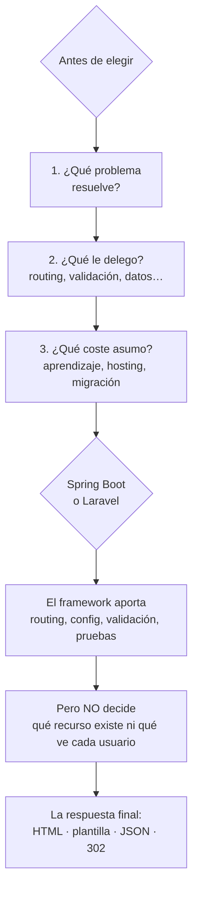

# Elegir tecnologías e integrar respuestas

> **Resumen de material de clase.** Viene de un PDF que aportó la estudiante
> (`04-tecnologias-e-integracion.pdf`, 4 páginas).
> Lo marcado como **material de clase** es lo que dice el PDF; el resto es
> explicación propia.

## 1. De qué va (resumen en cinco líneas)

1. Elegir backend **no es buscar «el mejor lenguaje»**: es elegir según un contexto.
2. Antes de elegir hay que responder tres preguntas: qué problema resuelve, qué le
   delegas y qué coste asumes.
3. **Lenguaje, runtime, biblioteca y framework no son lo mismo**, aunque se confundan
   a diario.
4. Un framework te da enrutamiento, validación, configuración y pruebas, pero **no
   decide por ti** qué recurso existe ni qué puede ver cada usuario.
5. Sirve para justificar una elección con argumentos, no con la autoridad de un nombre.

## 2. Explicación paso a paso

1. **Define el problema**: servir páginas HTML y exponer una API REST para varios
   clientes **no es lo mismo**. El problema condiciona todo lo demás.
2. **Decide qué le delegas**: enrutamiento, validación, seguridad, plantillas, acceso
   a datos, pruebas, despliegue.
3. **Calcula el coste**: aprendizaje, mantenimiento, actualizaciones, dependencias,
   hosting, rendimiento y migración futura.
4. **Elige** con esos tres datos delante, no con una lista de nombres de moda.
5. **Integra la respuesta**: el servidor puede devolver HTML estático, una plantilla
   combinada con datos, JSON o una redirección. Y cada opción tiene su momento.

La frase que resume el proyecto entero, del PDF: la decisión madura *«no suena a
«Spring Boot es mejor que Laravel»; suena a «para este proyecto, con este equipo y
estos requisitos, Spring Boot nos conviene por estas razones y nos obliga a cuidar
estos costes»»*.

## 3. Ideas clave del tema

**Vocabulario mínimo**, tal como lo define el material:

| Término | Qué es | Ejemplos del PDF |
|---|---|---|
| **Lenguaje** | Sintaxis y semántica para escribir programas | Java, PHP, JavaScript, C# |
| **Runtime** | Entorno que ejecuta el programa y gestiona recursos | JVM, intérprete PHP, Node.js, CLR |
| **Biblioteca** | Código reutilizable que la aplicación invoca cuando lo necesita | validar emails, generar PDFs |
| **Framework** | Define un flujo de trabajo y llama a tu código en puntos previstos | Spring Boot, Laravel, ASP.NET Core |
| **SDK** | Herramientas, APIs y documentación para una plataforma | SDK de AWS, pasarela de pago |
| **CMS** | Producto para gestionar y publicar contenido | WordPress, Drupal |

La comparación orientativa del módulo, del PDF:

| Opción | Fortalezas | Costes | Papel en DWES |
|---|---|---|---|
| **Java + Spring Boot** | Tipado estático, refactorización, ecosistema empresarial maduro, buenas pruebas y observabilidad | Más estructura inicial, más conceptos (contenedor, beans, inyección, DTOs), puede parecer «magia» si no entiendes HTTP | Backend principal |
| **PHP + Laravel** | Alta productividad web, ciclo petición-respuesta directo, buen ecosistema MVC y formularios | Muchas convenciones, comportamiento más dinámico que exige disciplina | Segundo framework completo |
| **.NET** | Plataforma sólida, tipada, herramientas integradas | Solapa conceptos ya cubiertos con Java | Demostración opcional |
| **Node.js** | Un solo lenguaje en cliente y servidor, ecosistema enorme | Modelo asíncrono y variedad de frameworks | Fuera del recorrido (aparece en MERN) |

**Las cuatro formas de integrar** una respuesta:

- **HTML estático**: el servidor entrega un archivo ya existente.
- **Plantilla**: el servidor combina una plantilla con un modelo ya preparado.
- **JSON**: serializa objetos o DTOs para que otro cliente los consuma.
- **Redirección**: no devuelve el contenido final, sino una indicación (`302` +
  `Location: /login`).

Y dos avisos que conviene tener presentes: **devolver JSON no convierte un endpoint
en REST**, y una plantilla **no debe llevar consultas ni reglas de negocio**.

## 4. Ejemplo práctico relacionado con DAW

Un endpoint de login que devuelve JSON y versión web del mismo:

```text
Plantilla:  "Hola, ${nombre}"      ← la plantilla solorepresenta
Modelo:     nombre = "Ada"             ← el modelo ya está preparado
Resultado:  "Hola, Ada"

Versión API: {"id":7,"title":"Repasar HTTP"}
             ↑ DTO: solo los campos que el cliente necesita

Si metes la consulta a la base de datos DENTRO de la plantilla,
ya no es una plantilla: es lógica de negocio escondida.
```

## 5. Código o comandos pequeños comentados

Las cuatro respuestas del PDF, tal cual:

```text
# 1. HTML estático
GET /about.html HTTP/1.1
HTTP/1.1 200 OK
Content-Type: text/html

# 2. Plantilla
Plantilla: "Hola, ${nombre}"
Modelo:    nombre = "Ada"
Resultado: "Hola, Ada"

# 3. JSON
HTTP/1.1 200 OK
Content-Type: application/json

{"id":7,"title":"Repasar HTTP"}

# 4. Redirección
HTTP/1.1 302 Found
Location: /login
```

El recorrido completo de una petición real, según el PDF:

```text
1. El cliente envía una petición HTTP
2. El servidor web o contenedor la recibe
3. El framework decide qué controlador la atiende
4. El controlador valida la entrada básica y llama a servicios
5. La capa de servicio aplica las reglas de negocio
6. La capa de datos consulta o modifica la persistencia
7. Se construye la respuesta: HTML, JSON, redirección o error
```

## 6. Diagrama (Mermaid)



## 7. Conceptos con los que se suele confundir

- **Lenguaje ≠ framework**: decir «Spring Boot es Java» o «Laravel es PHP» mezcla
  niveles. Son piezas relacionadas, no equivalentes.
- **Biblioteca ≠ framework**: la biblioteca espera a que la llames; el framework
  marca el flujo y te llama a ti.
- **Runtime ≠ lenguaje**: Node.js suele presentarse como runtime, pero alrededor
  tiene ecosistema, herramientas y frameworks.
- **JSON ≠ REST**: devolver JSON no convierte un endpoint en REST. REST exige pensar
  en recursos, métodos, estados, cabeceras y representaciones.
- **Plantilla ≠ vista con lógica**: la plantilla representa un modelo ya preparado.
- **Plantilla JSON ≠ entidad interna**: lo que se expone al cliente es un DTO,
  no tu modelo de la base de datos tal cual.

## 8. Errores frecuentes

- **Elegir por moda y no por requisitos** (los seis errores que lista el PDF).
- **Creer que un framework evita aprender HTTP**.
- **Meter lógica de negocio en las plantillas**.
- **Exponer entidades internas como JSON sin pensar en DTOs**.
- **Pensar que «más moderno» significa «mejor»**.
- **Ignorar despliegue, logs, configuración y actualizaciones**.
- **Usar un framework sin entender su modelo**: el precio es depender de
  comportamiento que no comprendes, y eso se nota al depurar.

## 9. Tres preguntas de repaso

1. ¿Cuáles son las tres preguntas que hay que responder antes de elegir tecnología?
2. ¿Qué diferencia hay entre una biblioteca y un framework?
3. ¿Por qué no basta con devolver JSON para decir que un endpoint es REST?

### Respuestas

1. Qué problema resuelve (servir HTML no es exponer una API), qué le delegas
   (enrutamiento, validación, seguridad, plantillas, datos, pruebas, despliegue) y
   qué coste asumes (aprendizaje, mantenimiento, actualizaciones, dependencias,
   hosting, rendimiento y migración futura).
2. La biblioteca es código reutilizable que **tu** aplicación invoca cuando lo
   necesita. El framework define un flujo de trabajo y **llama a tu código** en
   puntos previstos. Tú controlas cuándo usar la biblioteca; el framework marca el
   orden.
3. Porque REST no es solo el formato de la respuesta. Hay que pensar en recursos,
   métodos, estados, cabeceras y representaciones. Puedes devolver JSON y seguir sin
   ser REST; y al revés, una API REST puede devolver HTML.

## 10. Términos relacionados

- [Cliente, servidor y contenido dinámico](cliente-servidor-contenido-dinamico.md) —
  el reparto de responsabilidades que va antes de elegir framework.
- [DTO (Data Transfer Object)](../Terminos/dtos.md) — lo que se expone en las respuestas
  JSON.
- [Bean (Spring Boot)](../Terminos/beans-spring.md) — uno de los conceptos que el PDF
  cita como coste de Spring Boot.
- [ORM](../Terminos/orm.md) — la capa de datos del recorrido de 7 pasos.
- [Glosario](../Glosario.md) — índice general.

*(Aparecen en el PDF pero aún no tienen ficha: framework, runtime, biblioteca, SDK,
CMS, API REST, plantilla Blade, Eloquent, middleware, inyección de dependencias.)*

## 11. Fuentes y límites del resumen

- Fuente: PDF `04-tecnologias-e-integracion.pdf` (páginas 1-4, leídas las 4),
  aportado por la estudiante.
- Fuentes externas: **no consultadas** para este resumen. Las fortalezas y costes de
  cada tecnología son los del PDF; **no son una medición ni una comparación
  actualizada por mí**.
- Límites:
  - El PDF se ha leído **extrayendo el texto** con `pdftotext`, sin mirar las
    páginas: diagramas o imágenes, si los hay, **no los he visto**.
  - La comparación del PDF es **orientativa** y el propio material lo dice: «no
    asigna una calidad absoluta». Las versiones de Spring Boot, Laravel o .NET que
    aparecen **no constan** en el PDF, y aquí no se citan.
  - El PDF pide justificar por qué el módulo usa Spring Boot como backend principal y
    Laravel como segundo: esa justificación es la sección de la tabla, pero **no
    he consultado ofertas de empleo ni nada externo** para apoyarla.
  - El PDF indica que su evidencia trabaja «RA1.e, RA1.f y RA1.g» (y RA1.a-d en los
    PDF anteriores): **no sé qué significan** esos códigos, no están explicados.
  - Los diagramas Mermaid no se han validado automáticamente: requieren
    comprobación visual.

## 12. Mis notas

<!-- Sección reservada para la estudiante. No borrar ni sobrescribir. -->