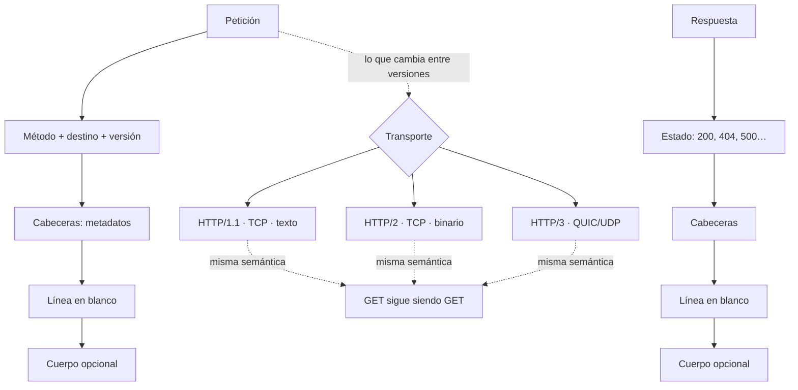

# Versiones y estructura de los mensajes HTTP

> **Resumen de material de clase.** Viene de un PDF que aportó la estudiante
> (`05-versiones-y-mensajes-http.pdf`, 4 páginas).
> Lo marcado como **material de clase** es lo que dice el PDF; el resto es
> explicación propia.

## 1. De qué va (resumen en cinco líneas)

1. Una **petición** pregunta; una **respuesta** cuenta qué pasó.
2. Todo mensaje tiene la misma anatomía: método, destino, estado, cabeceras y cuerpo.
3. Las versiones de HTTP cambian **cómo viaja** el mensaje, no **qué significa**.
4. HTTP/1.1 se explica con texto legible; HTTP/2 usa frames binarios; HTTP/3 va sobre
   QUIC.
5. Sirve para leer una traza HTTP sin perderse y para no pensar que HTTP/3 es
   «poco fiable» por usar UDP.

## 2. Explicación paso a paso

1. El **cliente** envía una petición: método, destino, versión y cabeceras.
2. La **línea en blanco** separa las cabeceras del cuerpo opcional. Es un separador
   real, no un adorno.
3. El **servidor** responde: línea de estado, cabeceras, línea en blanco y cuerpo
   opcional.
4. Las **cabeceras** son metadatos: `Host`, `Accept`, `Content-Type`, `Location`.
5. La versión cambia el **formato del mensaje**, pero la semántica se queda:
   el método sigue siendo GET y el estado sigue siendo 200.

Las siete piezas que el PDF dice que hay que distinguir antes de nada:

**Petición · Respuesta · Método · Destino · Estado · Cabeceras · Cuerpo**

Con eso dominado, lo demás (métodos, estados, caché, JSON, APIs) encaja mucho mejor.

## 3. Ideas clave del tema

Las tres versiones, según el PDF:

| Versión | Transporte | Mensaje | Para qué |
|---|---|---|---|
| **HTTP/1.1** | TCP | Líneas de texto legibles | Ideal para aprender: se ve la estructura |
| **HTTP/2** | TCP | **Frames binarios** | Multiplexar y comprimir cabeceras |
| **HTTP/3** | QUIC sobre UDP | Frames binarios | Flujos independientes, mejor con redes móviles |

Las tres ideas clave de HTTP/2:

- **Multiplexar** varias peticiones y respuestas sobre una conexión, sin esperar a
  terminar una para empezar otra.
- **Evitar bloqueos a nivel HTTP** entre intercambios, aunque una pérdida en TCP
  todavía puede retrasar todos los flujos de esa conexión.
- **Comprimir campos de cabecera** repetidos (`Host`, `Content-Type`, `Accept`).

El vocabulario de transporte del PDF, resumido:

| Término | Qué es |
|---|---|
| **TCP** | Transporta bytes de forma **fiable y en orden** entre dos extremos |
| **UDP** | Envía datagramas; por sí solo **no garantiza** entrega, orden ni retransmisión |
| **QUIC** | Se construye sobre UDP y añade conexión segura, control de entrega, congestión y varios flujos |
| **Frame binario** | Pieza estructurada del mensaje, con campos; no es texto legible |
| **Multiplexación** | Alternar varias conversaciones lógicas en la misma conexión |
| **Compresión de campos** | Codificar cabeceras repetidas de forma compacta (distinta de comprimir el cuerpo) |

Y el matiz que más se malinterpreta: **HTTP/3 no es «poco fiable»**. UDP a secas no
garantiza entrega, pero QUIC añade exactamente las garantías que HTTP necesita.

## 4. Ejemplo práctico relacionado con DAW

Una página que carga HTML, CSS, JS y cuatro imágenes. Qué cambia:

```text
HTTP/1.1  → pido el HTML, espero, pido el CSS, espero, pido el JS...
            Cada respuesta tiene que terminar antes de empezar la siguiente.

HTTP/2    → pido los 6 recursos a la vez por la misma conexión.
            No espero a que termine uno para pedir el siguiente.

HTTP/3    → igual, y si se pierde un paquete por una interferencia,
            solo se retiene el flujo afectado. Los otros siguen.
```

En los tres casos el resultado es el mismo: la página aparece. Cambia el transporte.

## 5. Código o comandos pequeños comentados

```text
Petición sin cuerpo:
GET /api/hello HTTP/1.1
Host: localhost:8080
Accept: application/json
                            ← línea en blanco: acaban las cabeceras

Petición con cuerpo (POST):
POST /api/tasks HTTP/1.1
Host: localhost:8080
Content-Type: application/json   ← describe lo que ENVÍO
Accept: application/json         ← expresa lo que QUIERO recibir
                                  ← línea en blanco
{"title":"Repasar HTTP"}

Respuesta con cuerpo:
HTTP/1.1 200 OK
Content-Type: application/json   ← ahora describe lo que RECIBO

{"message":"Hola desde el servidor"}

Respuesta sin cuerpo:
HTTP/1.1 204 No Content          ← si después hay un JSON, algo está mal

Respuesta de recurso creado:
HTTP/1.1 201 Created
Location: /api/tasks/7           ← dónde está lo nuevo
Content-Type: application/json

{"id":7,"title":"Repasar HTTP"}
```

Y la exploración local que propone el PDF:

```bash
http --verbose GET http://localhost:8080/api/hello
# Localiza: método · destino · cabeceras enviadas · estado
#           cabeceras recibidas · cuerpo de respuesta
# Luego abre la misma ruta en el navegador: F12 → Red
```

## 6. Diagrama (Mermaid)



## 7. Conceptos con los que se suele confundir

- **`Accept` ≠ `Content-Type`**: `Content-Type` describe lo que envías; `Accept`
  expresa qué respuesta prefieres.
- **Compresión de cabeceras ≠ comprimir el cuerpo**: una codifica `Host` repetido; la
  otra comprime el HTML o el JSON.
- **Multiplexar ≠ «no hay límites»**: todos los flujos comparten red, CPU y memoria.
- **HTTP/3 «poco fiable» ≠ UDP**: QUIC es quien aporta las garantías.
- **HTTP/2 ≠ cambio de significado**: el método y el estado son los mismos.
- **Cuerpo obligatorio ≠ obligatorio**: GET suele ir sin cuerpo, y un 204 vuelve sin
  contenido.

## 8. Errores frecuentes

Los seis que lista el PDF:

- **Mirar solo el cuerpo y olvidar el estado**.
- **Pensar que 200 siempre significa que la operación de negocio salió bien**.
- **Confundir `Accept` con `Content-Type`**.
- **Creer que HTTP/2 o HTTP/3 cambian el significado de métodos y estados**.
- **Pensar que HTTP es siempre «texto»**, porque HTTP/1.1 se explica así.
- **No localizar la línea en blanco** que separa cabeceras y cuerpo.

Y uno que el PDF no lista pero que conviene añadir: **esperar que QUIC sea
inmediato**. La criptografía suele ir en la conexión, así que hay un pequeño coste
de establishment que no existía en HTTP/2.

## 9. Tres preguntas de repaso

1. ¿Qué cinco cosas conserva HTTP de una versión a otra?
2. ¿Por qué HTTP/3 no es «poco fiable» aunque use UDP?
3. ¿Qué diferencia hay entre `Accept` y `Content-Type`?

### Respuestas

1. El método, el destino, el estado, las cabeceras y el contenido. Lo que cambia es
   cómo viaja el mensaje: frames binarios en HTTP/2 y 3, texto en HTTP/1.1.
2. Porque UDP por sí solo no garantiza entrega ni orden, pero HTTP/3 no usa UDP a
   secas: usa **QUIC**, que se construye sobre UDP y añade conexión segura, control
   de entrega, control de congestión y varios flujos independientes.
3. `Content-Type` describe el contenido que **envías**: en un POST con JSON, es
   `application/json`. `Accept` expresa la respuesta que **prefieres recibir**: en un
   GET con `Accept: application/json`, le estás pidiendo JSON al servidor, pero no
   tienes garantizado recibirlo.

## 10. Términos relacionados

- [Evolución del protocolo HTTP](../Terminos/versiones-http.md) — la misma historia
  de versiones, con los años y los RFC.
- [HTTP](../Terminos/http.md) — qué es el protocolo.
- [Métodos HTTP](metodos-http.md) — GET, POST, PUT, PATCH, DELETE, HEAD y OPTIONS.
- [Códigos de estado HTTP](../Terminos/codigos-estado.md) — 200, 204, 201 y compañía.
- [Sniffing](../Terminos/sniffing.md) — observar estas peticiones con HTTPie o las
  herramientas del navegador.
- [Glosario](../Glosario.md) — índice general.

*(Aparecen en el PDF pero aún no tienen ficha: TCP, UDP, QUIC, multiplexación,
frame binario, cabecera `Location`.)*

## 11. Fuentes y límites del resumen

- Fuente: PDF `05-versiones-y-mensajes-http.pdf` (páginas 1-4, leídas las 4),
  aportado por la estudiante.
- Fuentes externas: **no consultadas** para este resumen.
- Límites:
  - El PDF se ha leído **extrayendo el texto** con `pdftotext`, sin mirar las
    páginas: diagramas o imágenes, si los hay, **no los he visto**.
  - El PDF **no cita ningún RFC ni fecha**, así que aquí no aparecen años ni
    números de versión de HTTP: para eso está la ficha
    [Evolución del protocolo HTTP](../Terminos/versiones-http.md), que sí está
    documentada con fuentes.
  - Los comandos `http --verbose` requieren **HTTPie** instalado. **No he comprobado**
    que la tengas ni que el servidor «Hello Server» esté disponible.
  - La idea de que QUIC mete la criptografía en la conexión (y su coste) es
    **explicación propia**, no está en el PDF.
  - Los diagramas Mermaid no se han validado automáticamente: requieren
    comprobación visual.

## 12. Mis notas

<!-- Sección reservada para la estudiante. No borrar ni sobrescribir. -->