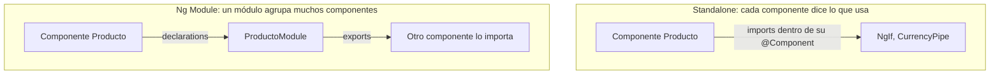
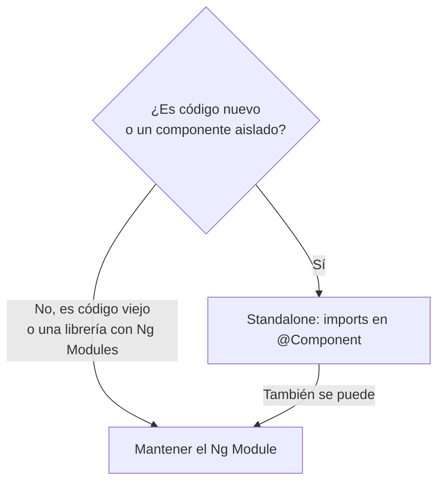

# Angular standalone vs Ng Module

## 1. Definición breve

Son **dos formas de organizar el código** de una aplicación Angular:

- **Ng Module** (se escribe `@NgModule`): una clase-contenedor que **agrupa**
  componentes, directivas y pipes.
- **Standalone** (independiente): cada componente **declara él mismo** lo que
  necesita, sin depender de un módulo que lo agrupe.

Las dos **siguen funcionando**. La documentación de Angular recomienda usar
standalone **para código nuevo** y explica Ng Modules para entender el código que
ya existe.

## 2. Explicación paso a paso

1. Un componente de Angular (un trozo de pantalla con su HTML) necesita saber
   **qué otros elementos usa** en su plantilla: otros componentes, directivas
   (`*ngIf`) o pipes (formato de fecha, de moneda…).
2. **Con Ng Module** esa lista no está en el componente. Está en un módulo:
   `declarations` dice «estos elementos son míos», `imports` dice «uso estos» y
   `exports` dice «otros pueden usar los míos». Quien quiera usar el componente
   tiene que importar el módulo entero.
3. **Con standalone** la lista sí está en el componente, dentro de su propio
   decorador `@Component`, en la propiedad `imports`.
4. Desde **Angular 19** los componentes se crean **standalone por defecto**
   (antes había que escribir `standalone: true`, y por defecto era `false`).
   Al revés: para meter un componente en un `declarations` hay que marcarlo
   **`standalone: false`**.
5. **Se pueden mezclar**: un componente standalone puede ir en el `imports` de un
   Ng Module. Y la arranque de la app también tiene dos versiones:
   `bootstrapApplication(App)` frente a `platformBrowser().bootstrapModule(AppModule)`.

## 3. Para qué sirve y cuándo se utiliza

- **Standalone**: para código nuevo. Cada componente enseña de un vistazo qué
  necesita, así que no hay que saltar a otro archivo para saber de dónde viene
  una directiva.
- **Ng Module**: cuando tocas código viejo, o cuando una **librería** te obliga
  (muchas siguen publicándose como Ng Modules).
- Los dos casos se pueden dar **en el mismo proyecto**: no son «todo o nada».
- Consejo de la documentación oficial: **standalone para lo nuevo**.

## 4. Ejemplo práctico relacionado con DAW

Web de una tienda online, mostrando el precio de un producto:

```text
1. Necesitas el precio con el formato de moneda de España
2. Con standalone: en el componente Producto copias "imports: [CurrencyPipe]"
   y ya está. Solo ese componente usa el pipe.
3. Con Ng Module: el componente Producto no dice nada
4. Lo declaras en ProductoModule (declarations) y lo exportas (exports)
5. Cada componente que quiera mostrar precios importa ProductoModule entero
6. Resultado: 5 archivos para pintar un precio, o 1
```

## 5. Código pequeño comentado

El **mismo componente** escrito de las dos formas:

```ts
// FORMA STANDALONE: el componente dice lo que usa
@Component({
  selector: 'app-producto',
  standalone: true,           // en Angular 19+ ya no hace falta ponerlo
  imports: [CurrencyPipe],    // esta es la clave: sus dependencias
  template: `<p>{{ precio | currency:'EUR' }}</p>`,
})
export class Producto {}
```

```ts
// FORMA NG MODULE: las dependencias viven en otro archivo
@NgModule({
  declarations: [Producto],  // «este componente es mío»
  exports: [Producto],        // «otros pueden usarlo»
})
export class ProductoModule {}

@Component({
  selector: 'app-producto',
  standalone: false,          // obligatorio para poder declararlo en un módulo
  template: `<p>{{ precio | currency:'EUR' }}</p>`,
})
export class Producto {}
```

Y el arranque de la aplicación:

```ts
bootstrapApplication(App);                          // standalone
platformBrowser().bootstrapModule(AppModule);       // Ng Module
```

## 6. Diagrama (Mermaid)

Dónde se declara cada dependencia, que es la diferencia de verdad:



Y cuál de las dos me conviene:



> Estos diagramas **no se han validado automáticamente**: ábrelos en Obsidian,
> en GitHub o en mermaid.live para comprobar que se ven bien.

## 7. Conceptos con los que se suele confundir

- **Standalone ≠ «sin imports»**. Standalone significa «sin módulo que lo
  agrupe», no «sin dependencias». El array `imports` sigue siendo obligatorio.
- **El `imports` del componente ≠ el `imports` del Ng Module**. En un componente
  son las dependencias de su plantilla. En un Ng Module son módulos (o pieces
  standalone) que se usan y se vuelven a exportar.
- **`declarations` ≠ `imports`**. `declarations` = «esto es mío»;
  `imports` = «esto uso yo». Confundirlos es el error número uno.
- **`standalone: false` ≠ «desactivar»**. Solo significa «este componente
  quiero declararlo dentro de un Ng Module».
- **`CommonModule`**: es un Ng Module que reagrupa directivas y pipes comunes.
  Con standalone no hace falta: se importan sueltas (`NgIf`, `DatePipe`…).
- **No es lo mismo que *lazy loading*** (cargar rutas bajo demanda). Son cosas
  independientes, aunque los dos hablen de «qué se descarga y cuándo».

## 8. Errores frecuentes

- **Declarar un componente que ya es standalone** en un `declarations`:
  Angular da error y no compila. Hay que quitarlo de `declarations`.
- **Declarar el mismo componente en dos Ng Modules**: la documentación avisa de
  que Angular informa de error si encuentra el mismo componente en más de un módulo.
- **Actualizar a Angular 19+ sin revisar**: los componentes nuevos salen
  standalone. Si un archivo nuevo se rompe, mira primero si le falta su
  `imports`.
- **Migrar un proyecto con tests sin precaución**: la propia guía de migración
  dice que los `imports` que añade a los tests unitarios **pueden no ser
  correctos**, porque los tests no se compilan por adelantado.
- **Empezar una migración sin ramas limpias**: la guía pide una rama de Git
  limpia y trabajo guardado antes de ejecutar el comando.
- **Borrar todos los Ng Modules a lo bruto**: la migración solo borra los que
  no tienen `declarations`, `providers`, `bootstrap` ni miembros de clase. Los
  demás se quitan a mano.

## 9. Tres preguntas de repaso

1. ¿Qué significa exactamente que un componente sea «standalone»? ¿Significa
   que no necesita nada?
2. ¿En qué propiedad se declara cada cosa: lo que el componente **usa**, lo que
   el componente **es** y lo que el módulo **deja ver**?
3. ¿Por qué la documentación de Angular recomienda standalone, y en qué
   situación conviene quedarse con un Ng Module?

### Respuestas

1. Significa que el componente **no depende de un Ng Module** que lo agrupe:
   se declara solo y lista sus propias dependencias en el array `imports` de su
   decorador `@Component`. Desde Angular 19 es el comportamiento por defecto;
   para declararlo en un módulo hay que poner `standalone: false`.
2. En un **Ng Module**: `declarations` = lo que el módulo es (sus componentes,
   directivas y pipes), `imports` = lo que usa, `exports` = lo que deja ver a
   quien lo importe. En un **componente standalone**: todo eso se reduce al
   array `imports` del propio `@Component`.
3. Porque para código nuevo es más sencillo: cada componente muestra de un
   vistazo qué necesita, sin archivos extra ni carpetas de módulos, y se puede
   migrar **por partes, sin romper nada**. Aun así, se mantiene el Ng Module
   para leer y mantener código existente, y porque muchas librerías siguen
   distribuyéndose así.

## 10. Términos relacionados

- [HTTP](http.md) — el protocolo detrás de los datos que pide esta web.
- [ORM](orm.md) — la capa de datos del lado servidor que sirve esos datos.
- [Backlog](backlog.md) — dónde apuntar las tareas de esta comparación.
- [CI/CD](ci-cd.md) — cómo se comprueba y publica una app Angular.
- [Glosario](../Glosario.md) — índice general.

*(Pendiente de crear ficha propia para: componente de Angular,Ng Module,
inyección de dependencias, `CommonModule` y enrutado con el Router.)*

## 11. Fuentes y límites de la explicación

- Fuentes consultadas (documentación oficial, escrita en inglés):
  - [Anatomy of a component — angular.dev](https://angular.dev/guide/components)
    («By default, Angular components are *standalone*… In Angular versions
    before 19.0.0, the `standalone` option defaults to `false`»).
  - [NgModules — angular.dev](https://angular.dev/guide/ngmodules/overview)
    (recomienda standalone para código nuevo; `declarations`, `imports`,
    `exports`, `providers`, `forRoot`/`forChild`, y `bootstrapApplication` frente
    a `bootstrapModule`).
  - [Migrate an existing Angular project to standalone — angular.dev](https://angular.dev/reference/migrations/standalone)
    (comando `ng generate @angular/core:standalone`, sus tres pasos, los casos en
    que no puede borrar un Ng Module y las limitaciones con los tests).
- Límites:
  - Documentación leída en su versión **v22**. El comportamiento «standalone por
    defecto desde la 19» procede de la nota de la guía de componentes, no de una
    prueba hecha aquí.
  - **No se ha creado ni ejecutado ningún proyecto Angular en esta sesión**: los
    fragmentos de código son ejemplos escritos a mano a partir de la
    documentación, no ficheros compilados.
  - La mención al «lazy loading» de la sección 7 es una aclaración para evitar
    confusiones; no se explica en detalle porque sería otro término con ficha
    propia.
  - Los diagramas Mermaid **no se han validado automáticamente**.

## 12. Mis notas

<!-- reserving esta sección para la estudiante. No borrar ni sobrescribir. -->