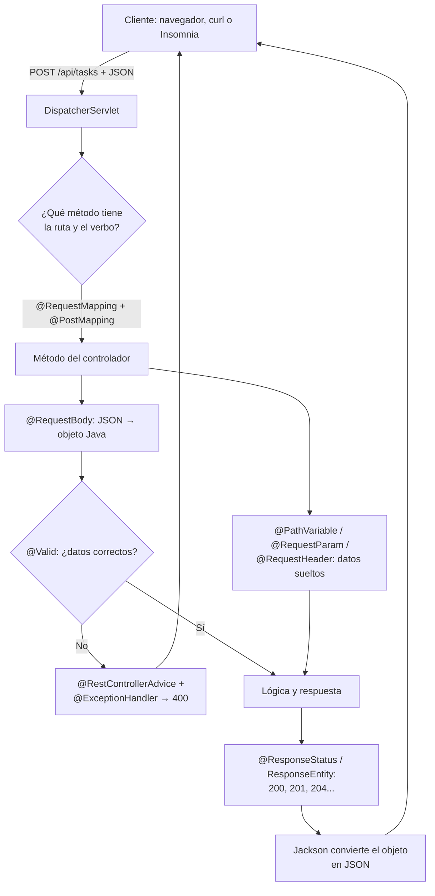

# Anotaciones de Spring Boot para una API REST

> En el material de clase se les llama «etiquetas». En el código y en la
> documentación oficial se llaman **anotaciones**: empiezan por `@` y se escriben
> delante de una clase, un método o un parámetro.

## 1. Definición breve

Una **anotación** es una marca que le dice a Spring qué hacer con la clase, el
método o el parámetro que tiene debajo. En una API REST, un grupo pequeño de
anotaciones conecta una URL y un verbo HTTP con un método Java, recoge los datos
de la petición y devuelve la respuesta en JSON.

## 2. Explicación paso a paso

1. **Arrancar la aplicación.** `@SpringBootApplication` marca la clase principal y
   activa el escaneo de componentes.
2. **Declarar el controlador.** `@RestController` convierte una clase normal en un
   bean web que devuelve datos, no vistas HTML.
3. **Asignar ruta y verbo.** `@RequestMapping` fija la ruta base y
   `@GetMapping`, `@PostMapping`, etc. deciden qué verbo HTTP atiende cada método.
4. **Leer la petición.** `@PathVariable`, `@RequestParam`, `@RequestHeader` y
   `@RequestBody` colocan cada dato de la petición en el parámetro correcto.
5. **Validar y responder.** `@Valid` comprueba los datos, `@ResponseStatus` elige
   el código y `@RestControllerAdvice` con `@ExceptionHandler` unifica los errores.

### Las anotaciones, una a una

| Anotación | Dónde va | Qué hace |
|---|---|---|
| `@SpringBootApplication` | Clase principal | Arranca Spring Boot y activa la autoconfiguración y el escaneo de componentes. |
| `@RestController` | Clase | Marca la clase como controlador REST. Es `@Controller` + `@ResponseBody`: todo método devuelve el cuerpo de la respuesta, normalmente JSON. |
| `@RequestMapping` | Clase o método | Asigna una ruta. En la clase se usa como prefijo común, por ejemplo `/api/tasks`. |
| `@GetMapping` | Método | Atiende peticiones **GET**. Es un atajo de `@RequestMapping(method = GET)`. |
| `@PostMapping` | Método | Atiende peticiones **POST**, las que suelen crear un recurso. |
| `@PutMapping` | Método | Atiende peticiones **PUT**, que sustituyen un recurso completo. |
| `@PatchMapping` | Método | Atiende peticiones **PATCH**, que cambian solo una parte del recurso. |
| `@DeleteMapping` | Método | Atiende peticiones **DELETE**, que borran un recurso. |
| `@PathVariable` | Parámetro | Recoge un valor que forma parte de la ruta: en `/tasks/{id}`, el `id`. |
| `@RequestParam` | Parámetro | Recoge un parámetro de la query o de un formulario: en `?page=1`, `page`. |
| `@RequestHeader` | Parámetro | Recoge una cabecera HTTP, por ejemplo `Authorization` o `User-Agent`. |
| `@RequestBody` | Parámetro | Lee el cuerpo de la petición y lo convierte de JSON a un objeto Java. |
| `@ResponseStatus` | Método o método de error | Fija el código HTTP de la respuesta, por ejemplo `201 Created` o `404 Not Found`. |
| `@Valid` | Parámetro | Activa las reglas de validación (`@NotBlank`, `@Min`…) sobre el objeto recibido. |
| `@RestControllerAdvice` | Clase | Hace que sus manejadores de errores se apliquen a todos los controladores y devuelvan JSON. |
| `@ExceptionHandler` | Método | Indica qué excepción atiende ese método y qué respuesta devuelve. |

### Las que no son de la capa web

`@Service`, `@Repository`, `@Component`, `@Configuration` y `@Bean` declaran
**beans** (objetos que Spring crea y gestiona), pero no conectan URLs con métodos.
`@Autowired` tampoco es obligatoria si usas inyección por constructor.

## 3. Para qué sirve y cuándo se utiliza

- Sirve para **unir el mundo HTTP con Java**: una URL y un verbo pasan a ser una
  llamada a un método.
- Se usa al crear **controladores REST**, endpoints de una API, validación de
  entrada y manejo común de errores.
- Evita escribir a mano el análisis de la URL, la conversión de JSON y la
  elección del código de respuesta.
- Es la base del proyecto Tasks del material de clase: listar, crear y buscar
  tareas desde Insomnia, Postman o el navegador.

## 4. Ejemplo práctico relacionado con DAW

Una API de tareas con dos endpoints: buscar una tarea y crear una nueva.

```java
@RestController
@RequestMapping("/api/tasks")
public class TaskController {

    @GetMapping("/{id}")
    public Task get(@PathVariable Long id) { ... }

    @PostMapping
    @ResponseStatus(HttpStatus.CREATED)
    public Task create(@Valid @RequestBody Task task) { ... }
}
```

`GET /api/tasks/7` llama a `get(7)`. `POST /api/tasks` con un JSON en el cuerpo
llama a `create(...)` y responde `201 Created`.

## 5. Código pequeño comentado

```java
@RestController                  // 1. esta clase devuelve JSON
@RequestMapping("/api/tasks")    // 2. prefijo común de todas las rutas
public class TaskController {

    @GetMapping("/{id}")         // 3. GET /api/tasks/7
    public Task get(@PathVariable Long id) {
        return servicio.buscar(id);          // 200 OK si existe
    }

    @PostMapping                 // 4. POST /api/tasks
    @ResponseStatus(HttpStatus.CREATED)      // 5. responde 201
    public Task create(@Valid @RequestBody Task task) {
        return servicio.guardar(task);       // el JSON ya es un objeto Task
    }
}
```

Un error común se puede centralizar así:

```java
@RestControllerAdvice
public class ErrorController {

    @ExceptionHandler(TaskNoEncontrada.class)
    @ResponseStatus(HttpStatus.NOT_FOUND)
    public ErrorResponse noEncontrada(TaskNoEncontrada e) {
        return new ErrorResponse("No existe la tarea");  // JSON + 404
    }
}
```

## 6. Diagrama (Mermaid)



> Este diagrama **no se ha validado automáticamente**: ábrelo en Obsidian, en
> GitHub o en mermaid.live para comprobar que se ve bien.

## 7. Conceptos con los que se suele confundir

- **Anotación ≠ comentario**: un comentario explica; una anotación configura.
  Spring la lee y cambia el comportamiento de la aplicación.
- **`@RestController` ≠ `@Controller`**: el primero devuelve JSON; el segundo
  devuelve el nombre de una vista HTML (por ejemplo, Thymeleaf).
- **`@RequestMapping` ≠ `@GetMapping`**: `@RequestMapping` puede atender varios
  verbos; `@GetMapping` solo atiende GET.
- **`@PathVariable` ≠ `@RequestParam`**: el primero va dentro de la ruta
  (`/tasks/7`); el segundo va en la query (`?page=1`).
- **`@RequestBody` ≠ `@RequestParam`**: el primero lee el cuerpo JSON completo;
  el segundo, un valor suelto de la query o de un formulario.
- **`ResponseEntity` ≠ `@ResponseStatus`**: `ResponseEntity` es una **clase** que
  permite estado, cabeceras y cuerpo; `@ResponseStatus` es una **anotación** que
  solo fija el código.
- **`@Valid` ≠ `@NotNull`**: `@Valid` activa la validación; `@NotNull`,
  `@NotBlank` o `@Min` son las reglas concretas.
- **`@Service` ≠ `@RestController`**: `@Service` crea un bean de lógica de
  negocio; `@RestController` crea un bean web que atiende peticiones.

## 8. Errores frecuentes

- **Usar `@Controller` pensando que devuelve JSON**: devuelve una vista y la
  respuesta no es la esperada. Para una API REST se usa `@RestController`.
- **Olvidar `@RequestBody` al crear**: el JSON de entrada no se convierte en
  objeto y el parámetro llega vacío o falla.
- **Poner `@RequestBody` en un GET**: el cuerpo no suele usarse en GET y el
  diseño deja de ser REST claro.
- **Marcar un parámetro obligatorio y no enviarlo**: `@RequestParam` y
  `@RequestHeader` son obligatorios por defecto y responden `400`.
- **Creer que `@Valid` valida solo**: sin las reglas (`@NotBlank`, `@Min`) y sin
  `spring-boot-starter-validation`, no hay nada que comprobar.
- **Usar `@ControllerAdvice` en una API**: el método de error puede intentar
  devolver una vista. Para JSON se usa `@RestControllerAdvice`.
- **Devolver la entidad con todos sus campos**: expone datos internos. Es mejor
  devolver un DTO.
- **Repetir la ruta con y sin barra**: `/api/tasks` y `/api/tasks/` no siempre se
  tratan igual; conviene ser constante.

## 9. Tres preguntas de repaso

1. ¿Qué dos anotaciones se usan para declarar un controlador REST y su ruta base?
2. ¿Cuál es la diferencia entre `@PathVariable` y `@RequestParam`?
3. ¿Qué hace `@RequestBody` y qué añade `@Valid`?

### Respuestas

1. `@RestController` en la clase y `@RequestMapping("/api/tasks")` para el prefijo
   común. Cada método añade su verbo con `@GetMapping`, `@PostMapping`, etc.
2. `@PathVariable` recoge un valor que forma parte de la ruta, como el `7` de
   `/tasks/7`. `@RequestParam` recoge un valor de la query, como `page` en
   `/tasks?page=1`.
3. `@RequestBody` lee el cuerpo de la petición y lo convierte de JSON a objeto
   Java. `@Valid` activa las reglas de validación sobre ese objeto; si no se
   cumplen, Spring responde `400 Bad Request` por defecto.

## 10. Términos relacionados

- [Bean (Spring Boot)](beans-spring.md) — los controladores y servicios son beans.
- [DTO (Data Transfer Object)](dtos.md) — objeto recomendado para devolver datos.
- [Códigos de estado HTTP](codigos-estado.md) — qué significa cada código que
  devuelve el controlador.
- [Controladores REST](../Resumenes/controladores-rest.md) — el resumen de clase
  con el mismo grupo de anotaciones.
- [Introducción a Spring Boot](../Resumenes/introduccion-spring-boot.md) — el
  proyecto Tasks completo.
- [Capa de servicio](../Resumenes/capa-servicios.md) — dónde va la lógica que
  llama el controlador.
- [Tests de errores y respuestas coherentes](../Resumenes/tdd-manejo-errores.md) —
  pruebas de `@RestControllerAdvice`.
- [Glosario](../Glosario.md) — índice general.

## 11. Fuentes y límites de la explicación

- Fuentes consultadas (documentación oficial):
  - [Spring Boot — Using the @SpringBootApplication Annotation](https://docs.spring.io/spring-boot/reference/using/using-the-springbootapplication-annotation.html)
  - [Spring Framework — Mapping Requests](https://docs.spring.io/spring-framework/reference/web/webmvc/mvc-controller/ann-requestmapping.html)
  - [Spring Framework — Declaration](https://docs.spring.io/spring-framework/reference/web/webmvc/mvc-controller/ann.html)
  - [Spring Framework — @RequestBody](https://docs.spring.io/spring-framework/reference/web/webmvc/mvc-controller/ann-methods/requestbody.html)
  - [Spring Framework — Controller Advice](https://docs.spring.io/spring-framework/reference/web/webmvc/mvc-controller/ann-advice.html)
  - [Spring Framework — Validation](https://docs.spring.io/spring-framework/reference/web/webmvc/mvc-controller/ann-validation.html)
- Límites:
  - La documentación consultada es de Spring Framework 7.0.9 y Spring Boot 4.1.1.
    Las anotaciones explicadas existen también en versiones 3.x, pero no se ha
    comprobado el proyecto concreto de clase.
  - **No se ha creado ni ejecutado** ningún proyecto: los fragmentos no se han
    compilado.
  - La lista no es exhaustiva: hay más anotaciones (`@RequestPart`,
    `@CookieValue`, `@CrossOrigin`, etc.) que no se explican aquí.
  - El diagrama Mermaid no se ha validado automáticamente.

## 12. Mis notas

<!-- Sección reservada para la estudiante. No borrar ni sobrescribir. -->
