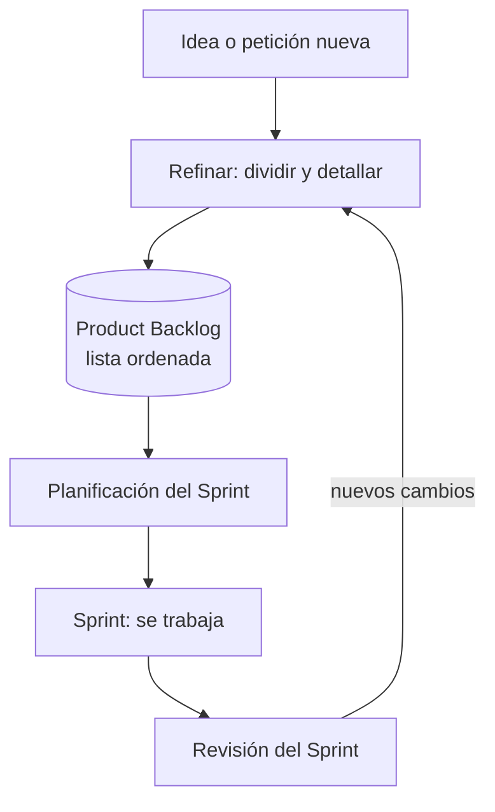

# Backlog

## 1. Definición breve

El **backlog** es la lista ordenada de todo lo que falta por hacer en un proyecto.

En Scrum (un marco de trabajo para organizar el trabajo en equipo) se llama
**Product Backlog**: la lista de lo que hace falta para mejorar el producto.
Nunca está terminada: va creciendo y cambiando.

## 2. Explicación paso a paso

1. Alguien (normalmente el *Product Owner*, la persona que decide qué se hace)
   escribe una idea o petición en la lista: «que el usuario pueda filtrar los
   productos por precio».
2. Esa idea se coloca **ordenada**: lo más importante arriba, lo menos importante
   abajo. El orden lo decide el Product Owner, no el equipo de desarrollo.
3. El equipo coge unas cuantas tareas de la lista para el **Sprint** (un periodo
   corto de trabajo, de una o dos semanas). Eso es el *Sprint Backlog*.
4. Con el tiempo, la lista se **detalla**: cada tarea se divide en otras más
   pequeñas y se le añade una descripción. Este proceso se llama *refinement*.
5. Al terminar el Sprint se mira lo hecho y la lista puede cambiar: se añaden
   tareas nuevas, se borran otras o se reordenan.

## 3. Para qué sirve y cuándo se utiliza

- Sirve para **no olvidarse de nada** que se le haya pedido al producto.
- Sirve para **decidir qué se hace primero** cuando no hay tiempo para todo.
- Sirve para que todo el equipo vea el mismo estado del proyecto.
- Se usa en el día a día: al planificar el Sprint, al preparar la reunión de
  revisión y al añadir peticiones nuevas del cliente.
- En proyectos pequeños de clase, la misma idea sirve como lista de «cosas que
  quedan por hacer» antes de programar.

## 4. Ejemplo práctico relacionado con DAW

Backlog de una web de una pizzería:

```text
1. Como cliente, quiero registrarme con correo y contraseña.      (prioridad alta)
2. Como cliente, quiero ver el menú con fotos.                    (prioridad alta)
3. Como cliente, quiero pedir y pagar en el carrito.              (prioridad media)
4. Como cliente, quiero filtrar pedidos por fecha.                (prioridad baja)
```

En el Sprint 1 el equipo se lleva solo los puntos 1 y 2. Los puntos 3 y 4 siguen
en el backlog para más adelante.

## 5. Código pequeño comentado

El backlog se puede guardar como un archivo de texto o Markdown, sin ninguna
herramienta especial:

```text
# Backlog — web pizzeria

- [ ] 1. Registro de usuarios            (alta)   # formulario + guardado
- [ ] 2. Ver el menú con fotos           (alta)   # listado
- [ ] 3. Carrito y pago                   (media)  # pendiente
- [ ] 4. Filtrar pedidos por fecha        (baja)   # pendiente
```

## 6. Diagrama (Mermaid)



## 7. Conceptos con los que se suele confundir

- **Backlog vs. Sprint Backlog**: el backlog tiene *todo* lo pendiente; el
  Sprint Backlog solo lo que el equipo se ha comprometido a hacer en ese Sprint.
- **Backlog vs. lista de tareas (To Do)**: un *To Do* es personal y se borra al
  terminarlo; el backlog es del proyecto, es visible para todos y no se vacía.
- **Backlog vs. «retraso»**: en español la palabra también significa «lo que se ha
  dejado para después», pero aquí es una herramienta de gestión, no un retraso.

## 8. Errores frecuentes

- **Meterlo todo sin ordenar**: un backlog con 200 tareas sin prioridad no sirve
  para decidir nada. Se ordena por valor para el usuario.
- **Escribir tareas demasiado grandes**: «hacer la tienda» no se puede empezar.
  Se divide hasta cosas de un día o menos.
- **Cambiar el orden a diario sin motivo**: quien ordena es el Product Owner.
  El equipo puede consultar, pero no reordena por su cuenta.
- **No borrar lo ya hecho ni lo cancelado**: el backlog debe reflejar la
  realidad; si no, deja de ser fiable.

## 9. Tres preguntas de repaso

1. ¿Quién decide el orden de los elementos del backlog y por qué no el equipo
   de desarrollo?
2. ¿Cuál es la diferencia entre el backlog y el Sprint Backlog?
3. ¿Qué significa «refinar» un elemento del backlog y para qué se hace?

### Respuestas

1. El Product Owner, porque es quien representa las necesidades del cliente y
   ordena el trabajo según el valor que aporta.
2. El backlog contiene todo lo pendiente del producto; el Sprint Backlog
   contiene solo lo que el equipo se ha comprometido a entregar en ese Sprint.
3. Romperlo en tareas más pequeñas y añadirle detalles (descripción, orden,
   tamaño) para que se pueda empezar a trabajar en ella.

## 10. Términos relacionados

- [CI/CD](ci-cd.md) — se activa al terminar cada Sprint, al publicar el
  código.
- [HTTP](http.md) — las historias del backlog suelen acabar en
  peticiones HTTP.
- [ORM](orm.md) — aparece en las tareas del backlog que guardan datos.
- [Glosario](../Glosario.md) — índice general.

## 11. Fuentes y límites de la explicación

- Fuentes: [Scrum Guide 2020 (scrumguides.org)](https://scrumguides.org/scrum-guide.html),
  consultado el 2026-10-02. La definición de Product Backlog y el proceso de
  refinamiento están tomados de ahí.
- Límites: la ficha explica el backlog dentro de Scrum. No se han comprobado
  herramientas concretas (Jira, Trello, GitHub Projects) ni cómo lo aplica tu
  profesor. El término «detailing» es anglicismo; en español se dice
  «detallar» o «afinar» las tareas.

## 12. Mis notas

<!-- reserving esta sección para la estudiante. No borrar ni sobrescribir. -->