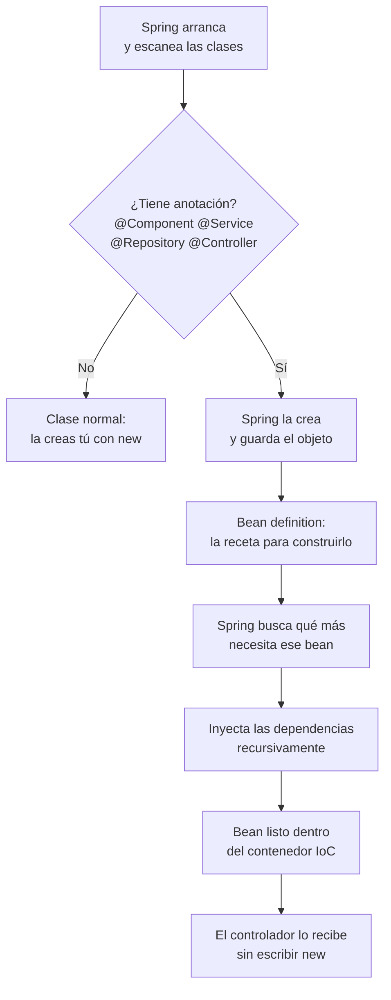

# Bean (Spring Boot)

## 1. Definición breve

Un **bean** es un objeto de Java que **Spring crea, configura y gestiona por ti**
en lugar de hacerlo tú con `new`. Si tú no lo creas a mano, es un bean.

La documentación oficial lo define así: *"A bean is an object that is
instantiated, assembled, and managed by a Spring IoC container"*, es decir, un
objeto instanciado, ensamblado y gestionado por el contenedor de Spring
([docs](https://docs.spring.io/spring-framework/reference/core/beans/introduction.html)).

## 2. Explicación paso a paso

1. **Spring escanea tus clases.** Busca las que llevan anotaciones como
   `@Component`, `@Service`, `@Repository` o `@Controller`.
2. **Crea el objeto.** Spring hace el `new` por ti y guarda el objeto. La receta
   que usa para saber cómo crearlo se llama **bean definition** («receta»).
3. **Le inyecta las dependencias.** Si el bean necesita otro objeto, Spring se lo
   pasa ya construido: eso es la **inyección de dependencias** (el bean declara
   lo que necesita y no busca quién se lo da).
4. **Te lo entrega cuando lo pides.** Otherrás la misma instancia siempre, no una
   nueva cada vez. Por eso puede guardar estado.
5. **Lo devuelve al final.** Al cerrar la aplicación, Spring llama a
   `@PreDestroy` si lo has puesto.

**Resumen:** sin Spring, tú haces `new ClienteDao()`, `new ClienteService(...)`
y te acuerdas de construirlos. Con Spring, solo anotas y el contenedor lo
monta.

## 3. Para qué sirve y cuándo se utiliza

- Sirve para **no tener que crear y conectar objetos a mano**.
- Sirve para poder **cambiar una implementación sin tocar el resto**: si el
  servicio pide una interfaz, mañana puedes darle otra clase que la implemente.
- Se usa en **servicios, repositorios y controladores** de una aplicación Spring
  Boot.
- Casi todos los beans se declaran con `@Service` y `@Repository` en vez de
  `@Component` directo: es lo mismo, pero con un nombre que dice para qué sirve.

## 4. Ejemplo práctico relacionado con DAW

En una web de pedidos, el controlador pide un servicio y el servicio pide el
repositorio. Los tres son beans:

```java
@Service
public class PedidoService {
    private final PedidoRepository repo;   // Spring lo rellena por mí

    public PedidoService(PedidoRepository repo) {
        this.repo = repo;
    }
}
```

Lo usa el controlador así, sin `new PedidoService(...)`:

```java
@RestController
public class PedidoController {
    private final PedidoService servicio;

    public PedidoController(PedidoService servicio) {
        this.servicio = servicio;
    }
}
```

## 5. Código pequeño comentado

```java
@Component                       // (1) esta clase es un bean
public class Configuracion {

    private final EnvioEnvios envio;   // (2) no lo creo yo: lo pide

    public Configuracion(EnvioEnvios envio) {
        this.envio = envio;           // (3) Spring me lo pasa ya hecho
    }
}

// (4) Alternativa: crear el bean a mano con @Bean en una clase @Configuration
// @Bean
// public EnvioEnvios enviarCorreo() { return new CorreoEnvio(); }
```

## 6. Diagrama (Mermaid)



> Este diagrama **no se ha validado automáticamente**: ábrelo en Obsidian, en
> GitHub o en mermaid.live para comprobar que se ve bien.

## 7. Conceptos con los que se suele confundir

- **Bean de Spring ≠ JavaBean**: un JavaBean es solo una clase Java con getters,
  setters, constructor sin argumentos e interfaz `Serializable` (norma antigua de
  Java). Un bean de Spring es cualquier objeto gestionado por el contenedor, con o
  sin getters.
- **Bean ≠ contenedor IoC**: el contenedor (el *contenedor IoC*, `ApplicationContext`)
  es el que **crea y guarda** los beans; el bean es solo el objeto.
- **Bean ≠ dependencia**: la dependencia es lo que el bean necesita; el bean es el
  que la recibe ya montada.

## 8. Errores frecuentes

- **Usar `new` dentro de un bean**: si haces `new PedidoRepository()` dentro del
  servicio, Spring deja de gestionar ese objeto y pierdes inyección, avisos y
  transacciones. Usa el constructor.
- **Marcar la clase con `@Component` pero dejarla fuera del paquete escaneado**:
  el contenedor solo mira desde el paquete de la clase principal hacia abajo.
- **Inyectar una clase concreta en vez de una interfaz**: ata tu código a una
  implementación y complica las pruebas.
- **Confundir `@Component` con `@Configuration`**: `@Configuration` sirve para
  escribir.beans con métodos `@Bean`; `@Component` para marcar tu clase de
  negocio.
- **Esperar una instancia nueva en cada petición**: el bean se crea una vez y se
  reutiliza. Si guarda estado entre peticiones, hay que declararlo con
  `@RequestScope` o `@SessionScope`.

## 9. Tres preguntas de repaso

1. ¿Qué tiene que tener una clase para que Spring la trate como bean?
2. ¿Qué diferencia hay entre un bean de Spring y un JavaBean?
3. ¿Por qué no es buena idea hacer `new` de una dependencia dentro de un bean?

### Respuestas

1. Spring la tiene que escanear y tiene que estar marcada con una anotación
   como `@Component`, `@Service`, `@Repository` o `@Controller` (o registrada
   con un método `@Bean`). Si no, es una clase normal y la creas tú.
2. Un JavaBean es solo una convención antigua de Java: getters, setters,
   constructor sin argumentos y `Serializable`. Un bean de Spring es cualquier
   objeto que el contenedor de Spring crea y gestiona, sin importar si tiene
   getters o setters.
3. Si haces `new`, ese objeto queda fuera del contenedor: Spring no lo controla,
   no le inyecta nada y no le aplica nada de lo que depende de ser gestionado
   (como las transacciones). Lo correcto es declararlo en el constructor y dejar
   que Spring lo proportione.

## 10. Términos relacionados

- [ORM](orm.md) — los repositorios que suelen ser beans usan esa capa para hablar
  con la base de datos.
- [CI/CD](ci-cd.md) — la aplicación se empaqueta y se despliega con la
  configuración de beans ya resuelta.
- [Glosario](../Glosario.md) — índice general.

*(Pendiente de crear ficha propia para: contenedor IoC, inyección de dependencias,
`@Autowired`, ámbito o scope de un bean.)*

## 11. Fuentes y límites de la explicación

- Fuentes consultadas:
  - [Spring Framework — Introduction to the Spring IoC Container and Beans](https://docs.spring.io/spring-framework/reference/core/beans/introduction.html)
    (definición de bean, bean definition y contenedor IoC).
  - Se consultó también el índice de [The IoC Container](https://docs.spring.io/spring-framework/reference/core/beans.html)
    para confirmar la estructura de la documentación.
- Límites:
  - La definición de la sección 1 es una cita de la documentación oficial en
    inglés, traducida al principio y citada en el original después.
  - No se ha creado ni ejecutado ningún proyecto de Spring Boot en esta sesión:
    el código de las secciones 4 y 5 es un ejemplo de cómo se escribe, sin
    comprobar que compile.
  - La lista de anotaciones no es exhaustiva: hay más formas de declarar beans.
  - El diagrama Mermaid no se ha validado automáticamente.

## 12. Mis notas

<!-- Sección reservada para la estudiante. No borrar ni sobrescribir. -->