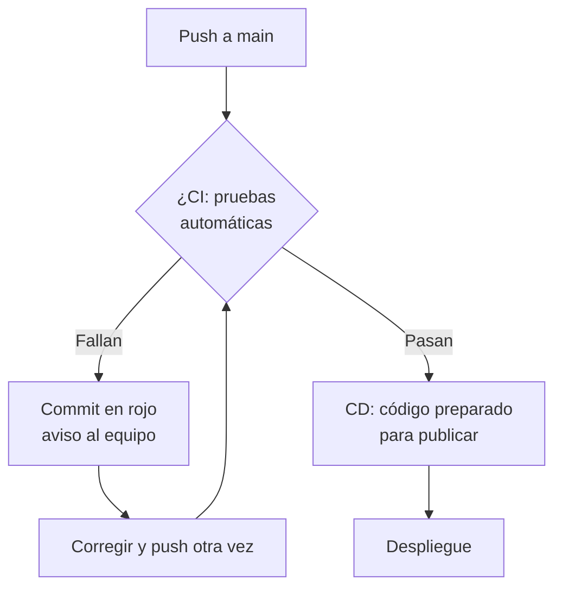
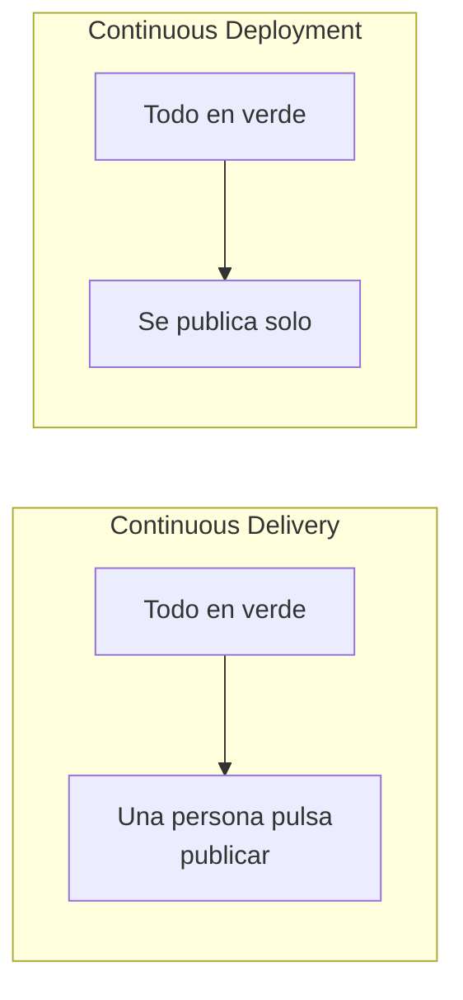

# CI/CD

## 1. Definición breve

CI/CD son las siglas de dos prácticas que se usan juntas:

- **CI** = *Continuous Integration* (integración continua).
- **CD** = *Continuous Delivery* (entrega continua).

Sirven para **comprobar y publicar el código automáticamente** cada vez que
alguien lo sube al repositorio, en lugar de hacerlo a mano cada cierto tiempo.

> **Ojo con la sigla CD:** también se usa para *Continuous Deployment*
> (despliegue continuo). La diferencia está en el punto 4 de la sección 2:
> en *Delivery* la publicación la decide una persona; en *Deployment* es
> automática. Muchas personas usan «CI/CD» para las dos cosas.

## 2. Explicación paso a paso

1. El equipo trabaja en **ramas** (copias paralelas del proyecto) y sube sus
   cambios a un repositorio Git con frecuencia.
2. Alguien hace un `push` a la rama principal (`main`). Eso **dispara** la
   parte de **CI**: un servidor automático descarga el código, lo monta y
   ejecuta las **pruebas** (los tests).
3. Si las pruebas fallan, la persona recibe un aviso rojo en el commit y
   arregla el error antes de seguir. Si todo está en verde, el código se
   considera sano.
4. La parte de **CD** va más allá: deja el código **listo para publicar**
   (empaquetado, con la configuración de producción) en cualquier momento.
   Con *Delivery* hay una persona que pulsa «publicar». Con *Deployment*,
   esa publicación ocurre sola en cuanto pasan todas las pruebas.
5. El resultado es que pasar de «funciona en mi ordenador» a «está en la web»
   deja de ser un trámite lento y arriesgado.

**Idea clave:** la automatización da **respuesta rápida**. Cuanto antes ves
el fallo, más barato es arreglarlo.

## 3. Para qué sirve y cuándo se utiliza

- Sirve para **detectar errores pronto**, antes de llegar a producción.
- Sirve para **no romper lo que ya funciona**: cada cambio se prueba contra
  todo el proyecto.
- Sirve para **publicar con menos riesgo y más rápido**.
- Se usa en proyectos con varios desarrolladores que necesitan entregar
  cambios con frecuencia.
- Herramientas habituales: **GitHub Actions**, **GitLab CI/CD**, **Jenkins**,
  **CircleCI**.
- En trabajos de DAW es útil aunque trabajes sola/o: te avisa si has roto
  algo sin darte cuenta.

## 4. Ejemplo práctico relacionado con DAW

Una web de una tienda online con un carrito de compra:

```text
1. Cambias el cálculo del IVA en total.php y haces push
2. CI arranca solo: instala dependencias y lanza los tests
3. Un test falla porque esperaba 121,00 € y ahora receives 120,00 €
4. Ves el aviso rojo en GitHub y localizas el error
5. Lo corriges, haces push otra vez: CI pasa en verde
6. CD deja la versión nueva preparada; tú (o el sistema) la publicas
```

## 5. Código pequeño comentado

No hace falta código de aplicación: CI/CD se define en un archivo de
configuración. Este es un ejemplo de **GitHub Actions**, simplificado:

```yaml
name: CI
on: [push]                 # se dispara en cada push
jobs:
  probar:
    runs-on: ubuntu-latest # máquina que ejecuta las pruebas
    steps:
      - uses: actions/checkout@v6      # descarga tu código
      - run: composer install          # instala dependencias
      - run: vendor/bin/phpunit        # ejecuta los tests
```

Si los tests fallan, el paso falla y el commit queda en rojo.

## 6. Diagrama (Mermaid)



Y la diferencia entre las dos formas de CD:



> Estos diagramas **no se han validado automáticamente**: ábrelos en
> Obsidian, en GitHub o en mermaid.live para comprobar que se ven bien.

## 7. Conceptos con los que se suele confundir

- **CI y CD no son sinónimos.** CI es comprobar que el código combined bien;
  CD es dejarlo listo para publicar. La barra «CI/CD» suele cubrir las dos.
- **Continuous Deployment ≠ Continuous Delivery**: en *Deployment* se publica
  sin intervención humana; en *Delivery* alguien autoriza la publicación.
- **Git ≠ CI/CD**: Git es el sistema de versionado. CI/CD es lo que se hace
  *encima* de Git con la automatización.
- **Un pipeline (tubería) ≠ un servidor**: el pipeline es la secuencia de
  pasos (compilar → probar → publicar). El servidor es quien la ejecuta.
- **Un test ≠ CI**: un test es una comprobación concreta. CI es el proceso
  completo que lanza todos los tests en cada cambio.

## 8. Errores frecuentes

- **Subir código directamente a producción a mano**: si hay CI, el código
  debería pasar primero por las pruebas. Saltarse el proceso elimina su
  sentido.
- **Arreglar primero los tests y luego el código**: si el test es incorrecto,
  cambiarlo «para que pase» oculta el error real.
- **No correr CI en la rama principal**: si las pruebas no vigilan `main`,
  la rama principal se puede romper sin que nadie se entere.
- **Deploy desde un ordenador personal**: si cada uno publica desde su
  máquina, nadie sabe qué versión está en producción. El despliegue debe
  salir siempre del mismo sitio.
- **Esperar a tener la web «terminada» para automatizar**: CI/CD vale desde el
  primer día, no solo al final del proyecto.

## 9. Tres preguntas de repaso

1. ¿Qué diferencia hay entre Continuous Integration y Continuous Delivery?
2. ¿Qué significa exactamente la «C» y la «D» en el nombre de una
   herramienta como GitHub Actions?
3. ¿Por qué se dice que con CI/CD hay menos errores en producción?

### Respuestas

1. CI es integrar el código de todos en la rama principal y comprobarlo con
   pruebas automáticas en cada cambio. CD es dejar ese código preparado para
   ir a producción, de forma que publicarlo sea rápido y sin sorpresas.
2. C de «Continua» y D de «Delivery» (entrega continua). La documentación de
   GitHub lo llama «plataforma de integración y despliegue continuos (IC/DC)».
3. Porque los errores se detectan en el momento en que se introducen, cuando
   son barato arreglarlos, en lugar de aparecer semanas después en la web ya
   publicada. Además, nada llega a producción sin haber pasado las pruebas.

## 10. Términos relacionados

- [HTTP](http.md) — el protocolo que usa la web que se publica con CI/CD.
- [ORM](orm.md) — capa de datos típica del lado servidor de estas webs.
- [Glosario](../Glosario.md) — índice general.

*(Pendiente de crear fichas propias para: Git, repositorio, pruebas
automáticas, pipeline, despliegue.)*

## 11. Fuentes y límites de la explicación

- Fuentes consultadas:
  - [Martin Fowler — Continuous Integration](https://martinfowler.com/articles/continuousIntegration.html)
    (incluye la FAQ que distingue Integration, Delivery y Deployment).
  - [GitHub Docs — Inicio rápido para Acciones de GitHub](https://docs.github.com/es/actions/writing-workflows/quickstart)
    («GitHub Actions es una plataforma de integración y despliegue continuos
    (IC/DC)… automatizar tu mapa de compilación, pruebas y despliegue»).
- Límites:
  - No se ha ejecutado ni configurado ningún flujo de trabajo en esta
    sesión: el YAML es un ejemplo recortado de la guía enlazada, no un
    fichero probado.
  - El fichero YAML usa la sintaxis actual que muestra la documentación; las
      versiones de acciones cambian con frecuencia.
  - Se explica solo GitHub Actions como ejemplo. GitLab CI/CD y Jenkins
      merecen ficha propia si los necesitas.
  - Los diagramas Mermaid no se han validado automáticamente.

## 12. Mis notas

<!-- Sección reservada para la estudiante. No borrar ni sobrescribir. -->