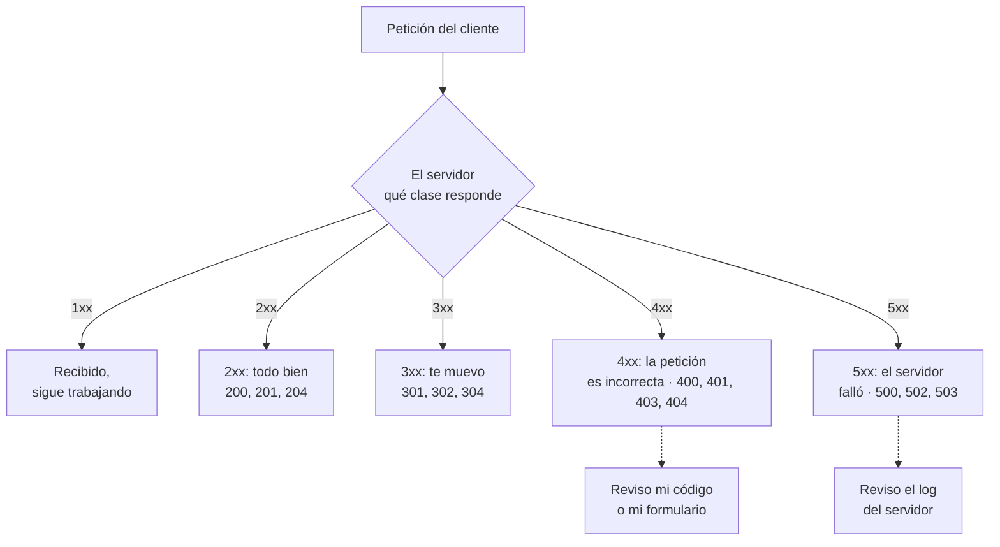

# Códigos de estado HTTP

## 1. Definición breve

El **código de estado** es el número de tres cifras que va en la primera línea de
la respuesta y dice si la petición se atendió, se redirigió o falló.

```text
HTTP/1.1 404 Not Found
        ^^^ el código
```

MDN: *«Los códigos de estado de respuesta HTTP indican si se ha completado
satisfactoriamente una solicitud HTTP específica»*.

## 2. Explicación paso a paso

1. El servidor recibe tu petición y decide cómo ha ido.
2. Elige un **código de tres cifras** y una frase corta que lo explica
   (`404` + `Not Found`).
3. El **primer dígito** dice la **clase** de la respuesta. El RFC 9110 lo explica
   así: *«The first digit of the status code defines the class of response. The
   last two digits do not have any categorization role»*.
4. Lo que hay **detrás** del código (el cuerpo) es independiente: puede ser un
   HTML, un JSON o nada.

Las cinco clases, según el RFC 9110:

| Clase | Significado (traducción del RFC) |
|---|---|
| **1xx** | «The request was received, continuing process» → recibido, sigue en curso |
| **2xx** | «successfully received, understood, and accepted» → todo bien |
| **3xx** | «Further action needs to be taken» → falta un paso (redirección) |
| **4xx** | «The request contains bad syntax or cannot be fulfilled» → culpa de la petición |
| **5xx** | «The server failed to fulfill an apparently valid request» → culpa del servidor |

**Idea clave:** un 4xx significa «el cliente ha pedido algo mal»; un 5xx, «la
petición era válida pero el servidor se ha roto». Esa distinción es la que te
dice dónde mirar el fallo.

## 3. Para qué sirve y cuándo se utiliza

- Sirve para que el **navegador** sepa qué hacer: recargar, redirigir, mostrar un
  error o descargar un PDF.
- Sirve para que tu **JavaScript o PHP** reaccione: `fetch` devuelve la
  respuesta con su código y decides qué pintar.
- Sirve para **depurar**: si sale 500, el problema está en tu servidor; si sale
  404, has escrito mal la ruta.
- En un **API REST** es lo más importante: el cliente y el servidor se comunican
  solo por el código.

Los que más vas a ver:

| Código | Qué significa en la práctica |
|---|---|
| **200** | Ok: la petición se atendió |
| **201** | Creado: se generó un recurso nuevo (va en la cabecera `Location`) |
| **204** | Sin contenido: todo bien, pero no hay nada que devolver |
| **301** | Movido **permanentemente**: la URL nueva ya es la buena |
| **302** | Movido **temporalmente**: sigue usando la URL antigua |
| **304** | No modificado: revalida y no reenvía el contenido |
| **400** | Petición mal formada |
| **401** | Faltan credenciales o no son válidas |
| **403** | Credenciales correctas, pero **no tiene permiso** |
| **404** | No se encuentra ese recurso |
| **409** | Conflicto con el estado actual (email ya registrado) |
| **418** | Broma de 1998: el servidor se niega a hacer café |
| **429** | Demasiadas peticiones: hay que esperar |
| **500** | Error interno del servidor |
| **502** | Puerta de enlace recibió una respuesta inválida de otro servidor |
| **503** | Servidor sobrecargado o en mantenimiento |

## 4. Ejemplo práctico relacionado con DAW

Un registro de usuario que avisa bien de qué ha pasado:

```text
1. Envío el formulario con el email ya registrado  → 409 Conflict
   "Ese email ya existe" (el usuario puede corregirlo)
2. Envío el email bien y el usuario se crea          → 201 Created
3. El JSON con el id del usuario vuelve en el cuerpo
4. Si el PHP falla por una variable mal escrita      → 500 Internal Server Error
```

Los dos primeros son **respuestas honestas**: el 409 permite al formulario
mostrar el mensaje; el 500 esconde el detalle y obliga a mirar el log del servidor.

## 5. Código pequeño comentado

En PHP, con la función oficial `http_response_code()`
([manual de PHP](https://www.php.net/manual/es/function.http-response-code.php)):

```php
// Así se informa del error: primero el código, luego el mensaje
http_response_code(404);
echo 'No hemos encontrado ese producto';

// Y se comprueba el resultado de un alta
if (!empty($_POST['email'])) {
    // ... guardo el usuario ...
    http_response_code(201);           // 201 = creado
    header('Location: /usuarios/1');   // dónde está lo nuevo
}
```

La función es **doble**: sin argumento devuelve el código actual; con argumento
lo establece.

## 6. Diagrama (Mermaid)



> Este diagrama **no se ha validado automáticamente**: ábrelo en Obsidian, en
> GitHub o en mermaid.live para comprobar que se ve bien.

## 7. Conceptos con los que se suele confundir

- **401 ≠ 403**: el 401 dice «no sé quién eres, identifícate» (re-autenticarse
  puede servir); el 403 dice «sé quién eres, pero no puedes» (re-autenticarse no
  cambia nada).
- **404 ≠ 500**: 404 es que el recurso no existe; 500 es que el servidor se
  rompió al procesar algo que sí existía.
- **301 ≠ 302**: 301 es definitivo (el navegador lo cachea); 302 es temporal.
- **Código de estado ≠ página de error**: el 404 es un número; la «página 404» es
  el HTML que tú enseñas cuando lo recibes.
- **Código de estado ≠ método**: el 404 no dice *cómo* pediste algo, solo que no
  se pudo atender.
- **«Unauthorized» es mal nombre**: el 401 trata de **autenticación** (quién eres),
  no de autorización (qué puedes hacer). Es el que aparece en el 403.

## 8. Errores frecuentes

- **Devolver siempre 200 y meter el error dentro del JSON**: rompe las
  herramientas que usan el código para decidir, y los clientes no detectan el fallo.
- **Poner 403 cuando debería ser 401** (o al revés): quien esté programando
  enfrente no sabrá si tiene que pedir login o rendirse.
- **Usar 500 para un error del formulario**: si el email está vacío, es un 400 o
  un 422, no un 500. Reservar el 5xx para fallos del servidor.
- **Redirigir con 302 cuando el cambio es definitivo**: obliga al navegador a
  pedir la URL vieja cada vez.
- **Escribir 404 en vez de 403 para ocultar un recurso privado**: el RFC 9110 lo
  permite como medida de seguridad (así nadie comprueba qué existe).
- **Crear códigos propios tipo `999`**: el RFC 9110 dice que ante un código
  desconocido hay que tratarlo como el `x00` de su clase. Usa los estándar.

## 9. Tres preguntas de repaso

1. ¿Qué diferencia hay entre un error 4xx y un 5xx a la hora de depurar?
2. ¿Qué diferencia real hay entre 401 y 403?
3. ¿Por qué no es buena idea inventar un código como 999?

### Respuestas

1. El 4xx significa que la petición está mal (la has hecho tú: ruta equivocada,
   faltan campos, JSON roto), así que hay que corregir el cliente o los datos que
   manda. El 5xx significa que la petición era válida pero el servidor falló al
   procesarla, así que hay que mirar el log del servidor, no el formulario.
2. El 401 es «no sé quién eres»: faltan credenciales o no son válidas, y volver a
   identificarse puede resolverlo (el servidor debe mandar además `WWW-Authenticate`).
   El 403 es «sé quién eres, pero no tienes permiso»: identificarse otra vez no va
   a cambiar nada. De ahí que 401 trate de autenticación y 403 de autorización, pese
   a que el primero se llame «Unauthorized».
3. Porque el RFC 9110 dice que el cliente debe entender la **clase** (el primer
   dígito) y tratar un código desconocido como si fuera el `x00` de esa clase.
   Un 999 empezaría por 9, así que un cliente bien escrito lo leería como «5xx», y
   eso no es lo que dice quien lo inventó. Además, las herramientas y los
   intermediarios solo distinguen las clases que conocen.

## 10. Términos relacionados

- [HTTP](http.md) — qué es HTTP y qué es una respuesta.
- [Evolución del protocolo HTTP](versiones-http.md) — desde qué versión existen
  los códigos de estado.
- [Glosario](../Glosario.md) — índice general.

**Nota:** si lo que querías eran los **métodos** (GET, POST, PUT…), dímelo y
creo esa ficha aparte.

*(Pendiente de crear fichas propias para: API, REST, métodos HTTP, HTTPS,
cabeceras.)*

## 11. Fuentes y límites de la explicación

- Fuentes consultadas (comprobadas, responden 200):
  - [MDN — Códigos de estado HTTP](https://developer.mozilla.org/es/docs/Web/HTTP/Reference/Status)
    (la ruta antigua `/Status` redirige aquí).
  - [RFC 9110 — HTTP Semantics](https://www.rfc-editor.org/rfc/rfc9110.html)
    (clases en la sección 15, significado de cada código).
  - [RFC 6585](https://www.rfc-editor.org/rfc/rfc6585.html) (el 429 no está en el
    RFC 9110, está aquí).
  - [PHP — http_response_code()](https://www.php.net/manual/es/function.http-response-code.php).
- Límites:
  - El RFC 9110 define el significado de cada **clase**, pero los códigos concretos
    son **extensiones registradas en el registro del IANA**: el RFC obliga a registrar
    cada uno con su descripción. Esta ficha usa las extensiones registradas, no
    definiciones del RFC.
  - Varias páginas de MDN en español **existen solo en inglés** (204, 301, 409, 429):
    no se enlazan. Para esos cuatro, la fuente es el RFC.
  - Sobre el 999: el RFC 9110 dice que ante un código desconocido hay que tratarlo
    como el `x00` de su clase. Como 999 empieza por 9, un cliente bien escrito lo
    leería como «5xx». La expresión «rompe las herramientas» del apartado 9 es la
    intención práctica, **no una cita** del RFC.
  - **No se ha ejecutado** ninguna llamada con `http_response_code()`: el ejemplo es
    una transcripción del ejemplo del manual de PHP.
  - El 418 es una broma intencionada (broma de 1998), no un código de verdad.
  - Los diagramas Mermaid no se han validado automáticamente.

## 12. Mis notas

<!-- Sección reservada para la estudiante. No borrar ni sobrescribir. -->