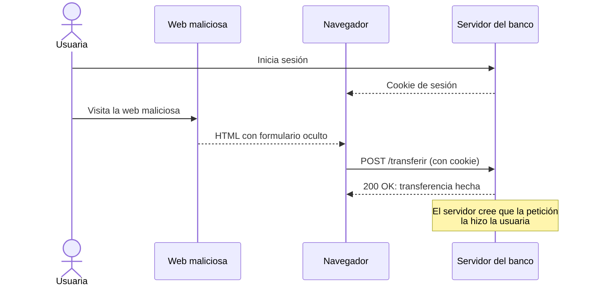

# CSRF

## 1. Definición breve

**CSRF** (*Cross-Site Request Forgery*, «falsificación de petición en sitios
cruzados») es un ataque en el que una web maliciosa hace que **tu navegador**
envíe una petición a otra web donde tienes la sesión abierta, sin que tú lo
quieras.

## 2. Explicación paso a paso

1. Entras en una web de confianza, por ejemplo tu banco, y el servidor te da una
   **cookie de sesión** para reconocerte.
2. Sin cerrar sesión, visitas otra web controlada por el atacante.
3. Esa web esconde un formulario o un script que apunta al banco. Los datos
   (destinatario, cantidad) los elige el atacante.
4. Tu navegador envía la petición al banco y **añade la cookie automáticamente**,
   aunque la petición haya nacido en otra web.
5. El banco ve una cookie válida, cree que la petición la has hecho tú y ejecuta
   la acción: una transferencia, un cambio de contraseña, un borrado.

La clave: el atacante **no roba tu contraseña ni tu cookie**. Usa tu sesión como
mensajero. Para que funcione suelen darse tres condiciones: la acción cambia
datos en el servidor, la autenticación se basa solo en cookies y los parámetros
son predecibles.

## 3. Para qué sirve y cuándo se utiliza

- El término sirve para **nombrar el ataque** y para hablar de las defensas.
- Se estudia en cualquier web con **sesión y formularios**: banca, tiendas,
  campus virtual, paneles de administración.
- La defensa más habitual es el **token CSRF**: un valor impredecible que el
  servidor mete en la página y comprueba en cada petición que cambia datos.
- También ayudan las cookies `SameSite`, la cabecera `Sec-Fetch-Site` y no usar
  `GET` para acciones que modifican información.
- En Spring Boot, Spring Security activa la protección CSRF por defecto en
  aplicaciones con sesión. En un API sin sesión, que autentica con un token en la
  cabecera `Authorization`, suele desactivarse a propósito.

## 4. Ejemplo práctico relacionado con DAW

El campus virtual tiene una acción `POST /cambiar-email`. Si la sesión se
identifica solo con una cookie, una web maliciosa puede incluir este formulario
oculto:

```html
<form action="https://campus.example.org/cambiar-email" method="POST">
  <input type="hidden" name="email" value="atacante@ejemplo.com">
</form>
<script>document.forms[0].submit();</script>
```

Al cargar la página, el navegador manda la petición con tu cookie y el correo de
tu cuenta cambia sin que hayas escrito nada.

## 5. Código pequeño comentado

El formulario legítimo incluye un **token CSRF**, distinto en cada sesión:

```html
<!-- Formulario real del campus -->
<form action="/cambiar-email" method="POST">
  <input type="hidden" name="csrf_token" value="8f3a9c1e...">
  <input type="email" name="email">
  <button>Guardar</button>
</form>
```

El servidor compara el token recibido con el guardado en tu sesión. Si no
coincide, responde con un error (normalmente `403 Forbidden`) y no cambia nada.
El atacante no puede leer ese token porque pertenece a otra página.

## 6. Diagrama (Mermaid)



> Este diagrama **no se ha validado automáticamente**: ábrelo en Obsidian, en
> GitHub o en mermaid.live para comprobar que se ve bien.

## 7. Conceptos con los que se suele confundir

- **CSRF ≠ XSS**: en XSS el atacante ejecuta su JavaScript *dentro* de tu web;
  en CSRF solo consigue que tu navegador envíe una petición desde otra web. Un
  XSS puede leer el token CSRF y anular esa defensa.
- **CSRF ≠ CORS**: CORS decide si JavaScript puede *leer* respuestas de otro
  origen. No impide que un formulario envíe una petición cross-site, así que no
  es una defensa CSRF por sí solo.
- **Token CSRF ≠ cookie de sesión**: la cookie dice *quién eres*; el token
  demuestra que la petición salió de tu página y no de un formulario ajeno.

## 8. Errores frecuentes

- **Usar `GET` para cambiar datos**: un enlace o una etiqueta `` pueden
  disparar la acción sin formulario. Las acciones que modifican algo van con
  `POST`, `PUT`, `PATCH` o `DELETE`.
- **Confiar solo en `SameSite`**: `Lax` no cubre todos los casos y `SameSite`
  protege entre sitios, no entre orígenes del mismo sitio.
- **Poner el token en la URL**: acaba en el historial, en los registros y en la
  cabecera `Referer`. Va en un campo oculto o en una cabecera.
- **Desactivar la protección CSRF porque da `403`**: primero hay que enviar el
  token correctamente, no apagar la defensa en una web con sesión.
- **Creer que el token protege de todo**: no evita XSS ni sustituye a validar
  permisos en el servidor.

## 9. Tres preguntas de repaso

1. ¿Qué tres condiciones suelen hacer posible un ataque CSRF?
2. ¿Por qué el navegador envía tu cookie aunque la petición salga de otra web?
3. ¿Qué comprueba el servidor cuando recibe un token CSRF?

### Respuestas

1. Que la acción cambie datos, que la sesión se identifique solo con cookies y
   que los parámetros sean predecibles para el atacante.
2. Porque las cookies se envían automáticamente al dominio al que pertenecen; el
   navegador no distingue si la petición nació en una página legítima o en una
   maliciosa.
3. Que el token recibido existe y coincide con el token asociado a tu sesión. Si
   falta o no coincide, rechaza la petición.

## 10. Términos relacionados

- [HTTP](http.md) — protocolo donde viajan la petición, la cookie y el token.
- [Códigos de estado HTTP](codigos-estado.md) — el `403` que suele devolver una
  petición rechazada por CSRF.
- [Glosario](../Glosario.md) — índice general.

*(Pendiente de crear fichas propias para: cookie de sesión, XSS, CORS,
SameSite, token CSRF.)*

## 11. Fuentes y límites de la explicación

- Fuentes consultadas:
  - [MDN — Cross-site request forgery (CSRF)](https://developer.mozilla.org/en-US/docs/Web/Security/Attacks/CSRF)
    (funcionamiento del ataque, tokens, `SameSite` y `Sec-Fetch-Site`).
  - [OWASP — Cross-Site Request Forgery Prevention Cheat Sheet](https://cheatsheetseries.owasp.org/cheatsheets/Cross-Site_Request_Forgery_Prevention_Cheat_Sheet.html)
    (patrón de token sincronizado y defensas).
- Límites:
  - No se ha ejecutado ni probado ningún ataque ni ningún código en esta sesión:
    los ejemplos son ilustrativos.
  - La nota sobre Spring Security es explicación propia y no se ha comprobado en
    un proyecto real durante esta sesión.
  - No se han detallado variantes avanzadas (double-submit cookie, CSRF del lado
    del cliente) para no alargar la ficha.
  - Los diagramas Mermaid no se han validado automáticamente.

## 12. Mis notas

<!-- Sección reservada para la estudiante. No borrar ni sobrescribir. -->
