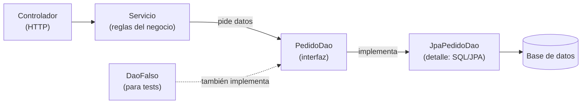

# DAO (Data Access Object)

## 1. Definición breve

**DAO** son las siglas de *Data Access Object* («objeto de acceso a datos»).
Es una clase (o un grupo de clases) cuya única tarea es **hablar con la base de
datos**: guardar, buscar, modificar y borrar datos.

El resto de la aplicación le pide cosas al DAO y **no escribe SQL**.

## 2. Explicación paso a paso

1. **Decides qué operaciones necesitas**, con palabras del negocio: «guardar un
   pedido», «buscar un pedido por id», «listar los pedidos de un cliente».
2. **Creas una interfaz** con esos métodos: `PedidoDao`.
3. **Escribes una implementación** que sí sabe el detalle técnico: SQL, JPA,
   un fichero o una API. Por ejemplo, `JpaPedidoDao`.
4. **El servicio usa la interfaz**, no la implementación. Así no sabe si los
   datos están en MySQL, en PostgreSQL o en memoria.
5. **Si cambia la base de datos**, cambias el DAO. El servicio y el controlador
   no se tocan.

La idea clave: **separar «qué datos necesito» de «cómo se guardan»**.

## 3. Para qué sirve y cuándo se utiliza

- Sirve para **no repartir SQL** por controladores, servicios y plantillas.
- Sirve para **cambiar de base de datos** (o de tecnología) con menos cambios.
- Sirve para **probar sin base de datos**: se usa un DAO falso en memoria.
- Se usa en aplicaciones por capas: controlador → servicio → DAO → base de datos.
- En Spring Boot, los repositorios de Spring Data (`JpaRepository`) hacen este
  papel: tú declaras la interfaz y el framework escribe la implementación.
- **No** hace falta en un script de 20 líneas que lee un fichero una vez.

## 4. Ejemplo práctico relacionado con DAW

Una web de pedidos quiere mostrar el pedido número 7.

```text
1. El navegador pide GET /pedidos/7
2. El controlador llama a PedidoService.buscar(7)
3. El servicio llama a pedidoDao.buscarPorId(7)
4. El DAO ejecuta: SELECT * FROM pedidos WHERE id = 7
5. El DAO devuelve un objeto Pedido
6. El controlador responde con ese pedido en JSON
```

Ni el controlador ni el servicio saben cómo se ha escrito ese `SELECT`.

## 5. Código pequeño comentado

```java
// (1) La interfaz habla el idioma del negocio, no el de SQL
public interface PedidoDao {
    Pedido buscarPorId(int id);
    void guardar(Pedido pedido);
}

// (2) La implementación es la que conoce la base de datos
public class JpaPedidoDao implements PedidoDao {
    public Pedido buscarPorId(int id) {
        return entityManager.find(Pedido.class, id); // detalle técnico
    }
    public void guardar(Pedido pedido) {
        entityManager.persist(pedido);
    }
}
```

El servicio solo vería `PedidoDao`. El `entityManager` es la pieza de JPA que
habla con la base de datos.

## 6. Diagrama (Mermaid)



> El servicio solo conoce la interfaz `PedidoDao`. La base de datos queda
> escondida detrás de ella, y en un test se puede cambiar por `DaoFalso`.
>
> Este diagrama **no se ha validado automáticamente**: ábrelo en Obsidian, en
> GitHub o en mermaid.live para comprobar que se ve bien.

## 7. Conceptos con los que se suele confundir

- **DAO ≠ ORM**: el ORM es la herramienta que traduce objetos a tablas
  ([ORM](orm.md)); el DAO es la clase que organiza el acceso a los datos. Un DAO
  puede usar un ORM por dentro, o escribir SQL a mano.
- **DAO ≠ repositorio**: se parecen mucho y a menudo se usan como sinónimos. El
  repositorio suele hablar de objetos del dominio («guarda este pedido»); el DAO
  está más pegado al almacén («inserta esta fila»).
- **DAO ≠ DTO**: el [DTO](dtos.md) transporta datos hacia fuera; el DAO los
  guarda y los recupera.
- **DAO ≠ entidad**: la entidad es el dato (`Pedido`); el DAO es quien lo lee y
  lo escribe.
- **DAO ≠ «DAO descentralizada»**: en el mundo de las criptomonedas, DAO
  significa *Decentralized Autonomous Organization*. Aquí solo se explica el
  sentido de programación.

## 8. Errores frecuentes

- **Poner SQL en el controlador o en el servicio**: cuando cambia una tabla hay
  que buscar el SQL por todo el proyecto.
- **Devolver filas sueltas o `ResultSet`**: el resto del código se llena de
  detalles de la base de datos. Mejor devolver objetos (`Pedido`).
- **Meter reglas de negocio en el DAO**: el DAO guarda y busca; las reglas van
  en el servicio.
- **No cerrar la conexión ni controlar la transacción**: la aplicación se queda
  sin conexiones o guarda datos a medias.
- **Crear un DAO para todo aunque Spring Data ya lo resuelva**: en Spring Boot,
  muchas veces basta con extender `JpaRepository`.
- **Nombrar el DAO como la tabla** (`PedidosTableDao`): mejor usar el nombre del
  concepto (`PedidoDao`).

## 9. Tres preguntas de repaso

1. ¿Qué significa DAO y cuál es su única responsabilidad?
2. ¿Por qué el servicio debería usar la interfaz `PedidoDao` y no
   `JpaPedidoDao`?
3. ¿En qué se diferencia un DAO de un ORM?

### Respuestas

1. *Data Access Object*, «objeto de acceso a datos». Su responsabilidad es
   guardar, buscar, modificar y borrar datos en el almacén; no decide reglas del
   negocio ni prepara respuestas HTTP.
2. Porque así el servicio no depende de la tecnología. Se puede cambiar la
   implementación (MySQL, memoria, un fichero) o usar un DAO falso en los tests
   sin tocar el servicio. Es la idea que explica el [DIP](dip.md).
3. El ORM es una herramienta que traduce objetos a tablas y genera SQL. El DAO
   es una forma de organizar el código para que el acceso a datos esté en un
   solo sitio. Un DAO puede usar un ORM, pero no son lo mismo.

## 10. Términos relacionados

- [ORM](orm.md) — la capa que traduce objetos y tablas; el DAO puede apoyarse en
  ella.
- [DIP (Dependency Inversion Principle)](dip.md) — por qué el servicio depende de
  la interfaz y no de la implementación.
- [DTO (Data Transfer Object)](dtos.md) — objeto que transporta datos, frente al
  DAO, que los guarda.
- [Bean (Spring Boot)](beans-spring.md) — un DAO anotado con `@Repository` es un
  bean que Spring crea y conecta.
- [Glosario](../Glosario.md) — índice general.

*(Pendiente de crear ficha propia para: repositorio, capa de persistencia,
transacción y conexión a base de datos.)*

## 11. Fuentes y límites de la explicación

- Fuentes consultadas:
  - [Baeldung — The DAO Pattern in Java](https://www.baeldung.com/java-dao-pattern):
    el DAO como patrón que aísla la lógica de negocio de la persistencia mediante
    una API abstracta, y su implementación con JPA.
  - [Spring Data JPA — Core concepts](https://docs.spring.io/spring-data/jpa/reference/repositories/core-concepts.html):
    `Repository`/`CrudRepository` y los métodos CRUD (`save`, `findById`,
    `findAll`, `delete`).
- Se intentó abrir la página clásica del patrón DAO en Oracle
  (`oracle.com/java/technologies/dataaccessobject.html`), pero respondió **403**;
  no se usa como fuente.
- Límites:
  - **No se ha creado ni ejecutado ningún proyecto** en esta sesión: el código es
    un ejemplo de cómo se escribe, sin comprobar que compile.
  - La diferencia entre «DAO» y «repositorio» depende del autor y del proyecto;
    aquí se explica de forma sencilla.
  - El diagrama Mermaid no se ha validado automáticamente.

## 12. Mis notas

<!-- Sección reservada para la estudiante. No borrar ni sobrescribir. -->
