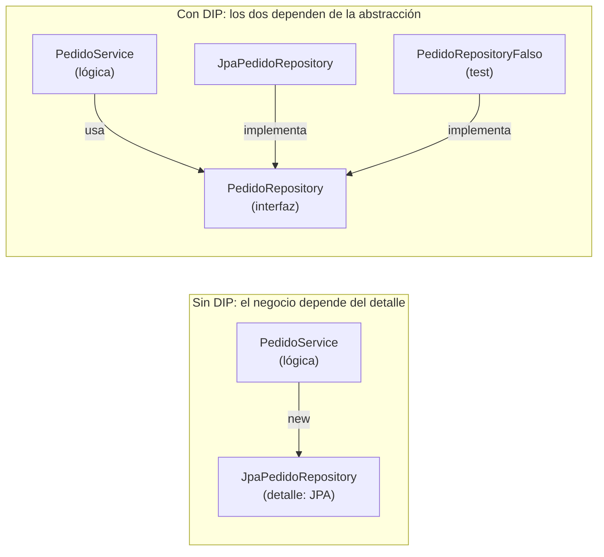

# DIP (Dependency Inversion Principle)

## 1. Definición breve

**DIP** significa *Dependency Inversion Principle* («principio de inversión de
dependencias»). Es el quinto principio de **SOLID** (el conjunto de cinco reglas
para escribir código fácil de cambiar). Dice dos cosas:

1. El código de **alto nivel** (la lógica de negocio: pedidos, usuarios, correos)
   no debe depender del código de **bajo nivel** (los detalles técnicos: SQL,
   Hibernate, servidor de correo).
2. Los dos lados deben depender de una **abstracción** (normalmente una interfaz)
   que declara el **qué** se necesita, no el **cómo** se hace.

Robert C. Martin lo resume así: *«Los módulos de alto nivel no deben depender de
los módulos de bajo nivel. Ambos deben depender de abstracciones. Las
abstracciones no deben depender de los detalles; los detalles deben depender de
las abstracciones»*.

## 2. Explicación paso a paso

1. **Separas el dominio del detalle.** El servicio habla de pedidos; el
   repositorio habla de tablas y SQL.
2. **El servicio declara qué necesita** con una interfaz propia, colocada cerca
   de la lógica de negocio (por ejemplo `PedidoRepository` dentro del paquete del
   servicio).
3. **La clase técnica implementa esa interfaz.** `JpaPedidoRepository` (la que
   usa Hibernate) la implementa, pero es la parte "baja" del dibujo.
4. **Spring conecta las piezas.** El contenedor IoC (el que crea los
   [beans](beans-spring.md)) inyecta la implementación correcta en el servicio.
5. **Puedes cambiar la implementación sin tocar el servicio.** Hoy guardas en
   MySQL; mañana en memoria para un test. El servicio ni se entera.

La flecha importante: **los detalles dependen de la abstracción**, nunca al revés.

## 3. Para qué sirve y cuándo se utiliza

- Sirve para que la lógica de negocio **no dependa de la tecnología** que usa por
  debajo (base de datos, API externa, sistema de correos).
- Sirve para poder **cambiar o sustituir** una implementación sin reescribir el
  código que la usa.
- Sirve para poder **probar sin levantar la base de datos**: en un test le pasas
  un repositorio falso (un *mock* o *stub*).
- Se usa en la capa de servicio y en la capa de repositorio, que son justo las
  fronteras entre «reglas del negocio» y «detalles técnicos».

## 4. Ejemplo práctico relacionado con DAW

En una API de pedidos, el servicio **quiere** «guardar un pedido» y el
repositorio **es** quien escribe en la tabla. Sin DIP, el servicio importaría la
clase de Hibernate. Con DIP, solo pide la interfaz:

```java
@Service
public class PedidoService {          // (1) lógica de negocio: nivel alto
    private final PedidoRepository repo;

    public PedidoService(PedidoRepository repo) {   // (2) pide la abstracción
        this.repo = repo;                          //     Spring se la inyecta
    }

    public Pedido nuevoPedido(int id) {
        Pedido p = new Pedido(id);
        repo.guardar(p);              // (3) no sabe si es MySQL o memoria
        return p;
    }
}
```

Para cambiar de base de datos, o para testear, solo escribes otra clase que
implemente `PedidoRepository`: el servicio no cambia.

## 5. Código pequeño comentado

```java
// (1) La abstracción: la define el que la necesita, no el framework
public interface PedidoRepository {
    void guardar(Pedido pedido);
    Pedido buscarPorId(int id);
}

// (2) El detalle: una implementación con Hibernate (nivel bajo)
@Repository
public class JpaPedidoRepository implements PedidoRepository {
    // usa JPA, anotaciones, la entidad...
}

// (3) Otra implementación para tests: sin base de datos, en memoria
public class PedidoRepositoryFalso implements PedidoRepository {
    // guardo el pedido en un Map
}

// Error típico: el servicio pide la clase concreta y el DIP desaparece
// private final JpaPedidoRepository repo;   <-- NO hagas esto
```

## 6. Diagrama (Mermaid)



> Las flechas muestran a quién depende cada pieza. Arriba, la lógica está atada a
> la tecnología. Abajo, la dependencia está **invertida**: el detalle obedece a la
> abstracción.
>
> Este diagrama **no se ha validado automáticamente**: ábrelo en Obsidian, en
> GitHub o en mermaid.live para comprobar que se ve bien.

## 7. Conceptos con los que se suele confundir

- **DIP ≠ inyección de dependencias (DI)**: la DI es el *mecanismo* por el que
  Spring pasa el objeto al constructor; el DIP es el *criterio de diseño* que
  decides dónde poner la interfaz. Puedes usar DI sin DIP (inyectando una clase
  concreta) y cumplir el DIP sin Spring, pasando la implementación a mano.
- **DIP ≠ IoC (inversión de control)**: IoC es quién lleva el control (el
  contenedor). DIP es hacia qué depende tu código (una abstracción).
- **Poner una interfaz no cumple el DIP por sí solo**: la interfaz debe
  pertenecer al lado que la necesita y estar cerca de su dominio, no ser una copia
  de la firma del detalle. Si la interfaz vive en el paquete del repositorio, la
  abstracción sigue dependiendo del detalle.

## 8. Errores frecuentes

- **Crear la interfaz «por si acaso»**, sin ninguna segunda implementación
  posible: queda una capa vacía que no aporta nada.
- **Colocar la interfaz junto a la implementación** (por ejemplo, dentro del
  paquete `repository`): entonces la abstracción ya depende del detalle.
- **Inyectar la clase concreta** en el constructor: `PedidoService(JpaPedidoRepository)`.
  Funciona, pero ata el negocio a JPA y rompe el DIP.
- **Abstracción demasiado amplia**: pedir `Connection` o `EntityManager` en vez de
  `PedidoRepository` baja el nivel del detalle hasta el dominio y hace la interfaz
  inútil.
- **Confundir DIP con «poner interfaces por todos lados»**: el principio se
  aplica donde hay un cambio probable o una frontera técnica, no en cada clase.

## 9. Tres preguntas de repaso

1. ¿Qué dos reglas escribe el DIP sobre módulos de alto y bajo nivel?
2. ¿Basta con crear una interfaz e inyectarla para estar cumpliendo el DIP?
3. ¿Por qué el DIP ayuda a hacer tests?

### Respuestas

1. Que los módulos de alto nivel no dependan de los de bajo nivel, y que ambos
   dependan de abstracciones; y que las abstracciones no dependan de los
   detalles, sino al revés.
2. No. La interfaz debe pertenecer al lado que la necesita (el dominio, cerca de
   la lógica de negocio) y tener un nivel de abstracción cercano a ese dominio.
   Si la interfaz vive en el paquete del detalle o solo copia su firma, la
   dependencia sigue yendo hacia el detalle.
3. Porque el servicio se puede probar con una implementación falsa (mock o stub)
   que devuelve lo que quieras, sin levantar la base de datos ni el contenedor.

## 10. Términos relacionados

- [Bean (Spring Boot)](beans-spring.md) — el contenedor IoC que crea los beans e
  inyecta las dependencias que declara el servicio.
- [ORM](orm.md) — la capa de detalle que el repositorio esconde detrás de la
  interfaz.
- [DTO (Data Transfer Object)](dtos.md) — otra abstracción (de transporte) usada
  en la capa de servicio.
- [Glosario](../Glosario.md) — índice general.

*(Pendiente de crear ficha propia para: SOLID completo, inyección de
dependencias y contenedor IoC.)*

## 11. Fuentes y límites de la explicación

- Fuentes consultadas:
  - [Spring Framework — Dependency Injection](https://docs.spring.io/spring-framework/reference/core/beans/dependencies/factory-collaborators.html):
    qué es la inyección de dependencias, sus dos variantes (constructor y
    setter) y que se apoya en las interfaces para poder probar con dobles.
  - [Baeldung — The Dependency Inversion Principle in Java](https://www.baeldung.com/java-dependency-inversion-principle):
    que el DIP es el quinto principio de SOLID, que no es lo mismo que DI ni que
    IoC, y las dos formas de colocar la abstracción (junto al componente de alto
    nivel o en una capa aparte).
  - Definición original de Robert C. Martin citada en esa página, de su libro
    *Agile Software Development: Principles, Patterns, and Practices*.
- Límites:
  - No se ha creado ni ejecutado ningún proyecto de Spring Boot en esta sesión:
    el código de las secciones 4 y 5 es un ejemplo de cómo se escribe, sin
    comprobar que compile.
  - La frase de Robert C. Martin es una cita literal en inglés de la fuente
    citada, traducida al principio.
  - El término «alto nivel / bajo nivel» es una simplificación: en un proyecto
    real la frontera exacta depende del diseño.
  - El diagrama Mermaid no se ha validado automáticamente.

## 12. Mis notas

<!-- Sección reservada para la estudiante. No borrar ni sobrescribir. -->