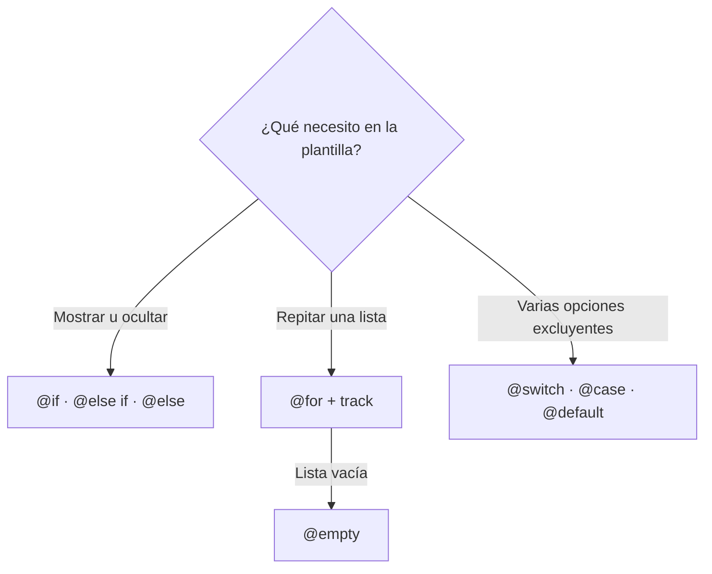
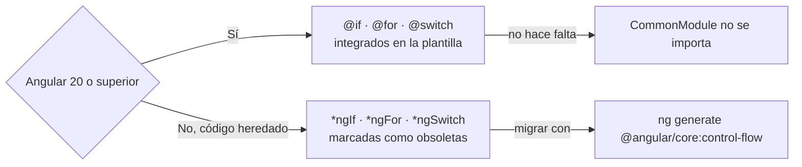

# Directivas de Angular (resumen)

## 1. Definición breve

Las **directivas** son las piezas que dan comportamiento a los elementos de una
plantilla de Angular, sin necesidad de escribir tu propia clase.

Hay dos familias, y solo dos, según la documentación:

- **De atributo**: cambian el aspecto o el comportamiento del elemento. Ejemplo:
  `[ngClass]`.
- **Estructurales**: añaden o quitan elementos del DOM (la pantalla). Ejemplo
  antiguo: `*ngIf`.

> **Resumen pedido en clase:** las directivas de uso diario, y en especial las
> **nuevas desde Angular 17**, los bloques de control de flujo: `@if`, `@for` y
> `@switch`.

## 2. Explicación paso a paso

1. La plantilla de un componente es HTML con extras de Angular: `{{ }}`, `[ ]`,
   `( )`. Las directivas son una de esas extras.
2. **Directivas de atributo**: se escriben como un atributo más y cambian el
   elemento, sin añadir nada nuevo a la pantalla. Ejemplo: `[ngClass]="{error:
   mal}"` añade la clase CSS `error` si `mal` es verdadero.
3. **Directivas estructurales**: la documentación las define como directivas que
   se aplican a un `<ng-template>` y **crean o borran elementos del DOM**. La
   forma corta es el asterisco: `<div *ngIf="x">`.
4. Desde la **versión 17** existen los **bloques de control de flujo**:
   `@if`, `@for` y `@switch`. La documentación dice que para el uso diario de
   condiciones y repeticiones **usa estos bloques**, no las directivas
   estructurales clásicas.
5. Los bloques `@` vienen **integrados en la plantilla**: ya no hace falta
   importar `CommonModule` para usarlos.

**Dato clave:** `*ngIf`, `*ngFor` y `*ngSwitch` están marcadas como
**obsoletas (deprecated) desde la versión 20** en la documentación oficial de la
API, con la nota «use el bloque `@if` en su lugar».

## 3. Para qué sirve y cuándo se utiliza

- **`@if` / `@else if` / `@else`**: mostrar o esconder contenido según una
  condición. Ejemplo: mostrar un formulario solo si el usuario ha iniciado sesión.
- **`@for`**: repetir un trozo de plantilla una vez por cada elemento de una
  lista. Ejemplo: pintar las filas de una tabla de productos.
- **`@empty`**: qué mostrar cuando la lista está vacía (muy típico: «No hay
  resultados»).
- **`@switch` / `@case` / `@default`**: cuando hay varias opciones excluyentes.
  Ejemplo: según el rol del usuario mostrar un panel u otro.
- **`[ngClass]` / `[ngStyle]`**: cambiar clases CSS o estilos según datos.
- **`[(ngModel)]`** (de formularios, no viene con el resto): unir un `<input>` a
  una propiedad del componente en los dos sentidos.

## 4. Ejemplo práctico relacionado con DAW

Web de una tienda online que lista productos y avisa si no hay ninguno:

```text
1. La API devuelve un array de productos (una lista de objetos)
2. Con @for recorres la lista y pintas un <article> por cada producto
3. Con @empty controlas el caso "no hay productos" con un mensaje
4. Con @if ocultas el botón "Comprar" si el producto está agotado
5. Con [class.agotado] marcas el artículo cuando stock === 0
```

## 5. Código pequeño comentado

Los bloques de control de flujo, en una lista de productos:

```html
@for (p of productos; track p.id) {
  <article [class.agotado]="p.stock === 0">
    {{ p.nombre }}
  </article>
} @empty {
  <p>No hay productos.</p>
}
```

Y su equivalente con la sintaxis antigua, que sigue funcionando:

```html
<div *ngFor="let p of productos; trackBy: trackId">
  <article [ngClass]="{agotado: p.stock === 0}">{{ p.nombre }}</article>
</div>
```

El `track` **no es opcional**: la documentación insiste en que permite a Angular
saber qué elemento de la lista corresponde a cada nodo del DOM, y por eso el
rendimiento mejora. Usa algo único (un `id`).

## 6. Diagrama (Mermaid)

Los tres bloques de control de flujo y qué resuelve cada uno:



Cómo se decide entre la sintaxis antigua y la nueva:



> Estos diagramas **no se han validado automáticamente**: ábrelos en Obsidian,
> en GitHub o en mermaid.live para comprobar que se ven bien.

## 7. Conceptos con los que se suele confundir

- **Directiva ≠ pipe**. La directiva cambia el DOM o el comportamiento de un
  elemento; el pipe transforma un valor (`{{ precio | currency }}`). Se
  escriben parecido (`*ngIf`, `| currency`) pero hacen cosas distintas.
- **Directiva estructural ≠ componente**. Un componente tiene **su propia
  plantilla**; una directiva estructural solo decide si el `<ng-template>` se
  pinta o no.
- **`*ngIf` (directiva) ≠ `@if` (bloque)**. La documentación dice que `*ngIf`,
  `*ngFor` y `*ngSwitch` están obsoletas desde la versión 20. Los bloques `@`
  vienen ya en la plantilla.
- **`@for` ≠ `[ngFor]` + `trackBy`**, aunque hacen lo mismo: `track` va dentro del
  `@for` y `trackBy` va en el `*ngFor`.
- **`ngClass` no está marcada como obsoleta** en la API oficial, pero la propia
  documentación recomienda los *bindings* nativos (`[class]`, `[class.error]`)
  para los casos sencillos, y ofrece una migración automática.
- **Una sola directiva estructural por elemento** con la sintaxis `*`: si
  necesitas dos, usa `<ng-container>` para anidar.

## 8. Errores frecuentes

- **Olvidar `track` en el `@for`**: Angular lanza un error de compilación
  pidiendo la expresión. Además, sin `track` bien elegido el rendimiento se
  resiente.
- **Usar `track item` (el objeto entero) por comodidad**: la documentación
  desaconseja esa opción porque compara por identidad (`===`) y ralentiza
  bastante. Mejor `track item.id`.
- **`@for` sobre un número** pensando que hace un bucle `for` clásico: recorre
  los elementos del array, no cuenta hasta N.
- **Meter dos `*ngIf` en el mismo `<div>`** sin `<ng-container>`: la sintaxis `*`
  solo admite una por elemento.
- **Quedarse en `*ngFor`/`*ngIf` por costumbre**: si tu versión es 20 o superior,
  lo lógico es usar los bloques `@`, porque la documentación marca las
  directivas antiguas como obsoletas.
- **Comparar mal en `@switch`**: la comparación se hace con `===` (igualdad
  estricta), así que `'1'` y `1` no son lo mismo.

## 9. Tres preguntas de repaso

1. ¿Cuál es la diferencia entre una directiva de atributo y una estructural?
2. ¿Por qué `track` es obligatorio dentro de `@for`, y qué valor conviene
   ponerle?
3. Si una plantilla usa `*ngIf` en un proyecto con Angular 20, ¿qué problema
   tienes y con qué comando oficial se arregla?

### Respuestas

1. La directiva **de atributo** cambia el aspecto o el comportamiento del
   elemento sin añadir nada al DOM (por ejemplo `[ngClass]`). La **estructural**
   decide si el contenido se pinta o no, añadiendo o quitando elementos del DOM
   (la antigua `*ngIf`, y por debajo un `<ng-template>`).
2. Porque es lo que permite a Angular saber qué elemento de la lista
   corresponde a cada nodo del DOM y así tocar lo mínimo al actualizar. Lo
   ideal es algo único por elemento, normalmente `item.id`; la propia
   documentación desaconseja usar el objeto entero (`track item`) porque
   compara por identidad y va más lento.
3. `*ngIf` está marcada como obsoleta desde Angular 20 en la documentación
   oficial («use el bloque `@if` en su lugar», con intención de eliminarla en
   una versión mayor futura). La corrección oficial es el comando
   `ng generate @angular/core:control-flow`, que convierte las plantillas a
   `@if` / `@for` / `@switch`.

## 10. Términos relacionados

- [Angular standalone vs Ng Module](angular-standalone-vs-ngmodule.md) — por qué
  los bloques `@` ya no necesitan `CommonModule`.
- [HTTP](http.md) — de dónde vienen los datos que recorres con `@for`.
- [ORM](orm.md) — la capa que trae esa lista desde la base de datos.
- [Glosario](../Glosario.md) — índice general.

*(Pendiente de crear ficha propia para: componente de Angular, plantilla,
enlazado (*binding*), pipe, `ng-template`, `ng-container` y formularios.)*

## 11. Fuentes y límites de la explicación

- Fuentes consultadas (documentación oficial, en inglés):
  - [Directives — angular.dev](https://angular.dev/guide/directives) (los tres
    tipos: componentes, de atributo y estructurales; ejemplo de `appHighlight`).
  - [Structural directives — angular.dev](https://angular.dev/guide/directives/structural-directives)
    (definición de estructural, sintaxis del asterisco, el «una por elemento»).
  - [Control flow — angular.dev](https://angular.dev/guide/templates/control-flow)
    (`@if`, `@else if`, `@else`, `@for`, `track`, `@empty`, `@switch`,
    `@case`, `@default`, las variables `$index`, `$first`… y la comparación con
    `===`).
  - [Migration to Control Flow syntax — angular.dev](https://angular.dev/reference/migrations/control-flow)
    (disponible desde la v17, ya no hace falta `CommonModule`, comando
    `ng generate @angular/core:control-flow`, cambio de comportamiento en el
    reciclaje de vistas de `@for`).
  - [NgIf — API — angular.dev](https://angular.dev/api/common/NgIf)
    («deprecated since v20.0. Use the `@if` block instead»).
  - [NgClass — API — angular.dev](https://angular.dev/api/common/NgClass)
    (aparece como *stable*, y remite a los *bindings* de clase nativos).
  - [Common Module to Standalone — angular.dev](https://angular.dev/reference/migrations/common-to-standalone)
    (importar `NgIf`, `NgFor`… sueltos en vez de `CommonModule`).
- Límites:
  - Documentación leída en su versión **v22**. Lo de «obsoletas desde la v20» es
    lo que dice la página de la API de `NgIf`, no una prueba hecha aquí.
  - **No se ha creado ni ejecutado ningún proyecto Angular en esta sesión**: los
    fragmentos son ejemplos escritos a partir de la documentación, no plantillas
    compiladas. No se ha comprobado que den error los avisos de la sección 8.
  - `@defer` (carga diferida) y `@boundary` aparecen ya en la documentación pero
    quedan fuera: son temas con ficha propia.
  - `[(ngModel)]` se menciona en la sección 3 sin explicar; pertenece al tema de
    formularios, que es otra ficha.
  - La deprecación de `NgClass`/`NgStyle` se consultó en discussions del
    repositorio y aparece como *soft-deprecation* (cambio de recomendación en la
    documentación), **no** como aviso de obsolescencia en la API. No se ha
    verificado en la versión 22 con más detalle.
  - Los diagramas Mermaid **no se han validado automáticamente**.

## 12. Mis notas

<!-- Sección reservada para la estudiante. No borrar ni sobrescribir. -->