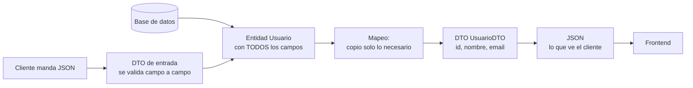

# DTO (Data Transfer Object)

## 1. Definición breve

Un **DTO** es una clase simple que existe solo para **transportar datos** entre
el servidor y el cliente: no tiene lógica de negocio, solo campos.

Se llama así por su función: *Data Transfer Object*, «objeto de transferencia de
datos».

## 2. Explicación paso a paso

1. **Tu entidad tiene más de lo que quieres enseñar.** Una entidad `Usuario` de
   una web puede tener contraseña, saldo, fechas internas y datos de la tabla.
2. **Eliges qué campos salen.** Creas una clase `UsuarioDTO` con solo `id`,
   `nombre` y `email`.
3. **Mapeas de una a otra.** El controlador convierte la entidad en DTO y
   devuelve el DTO, no la entidad.
4. **Se serializa a JSON** (el formato habitual en las APIs web) y se envía al
   cliente.
5. **Al revés también**: cuando el cliente manda datos para crear o cambiar algo,
   esos datos llegan en un DTO y el servidor lo convierte en entidad.

**Resumen:** la entidad sirve para la base de datos; el DTO sirve para hablar con
el exterior.

## 3. Para qué sirve y cuándo se utiliza

- Sirve para **no filtrar datos internos** por accidente (por ejemplo, la
  contraseña o el hash).
- Sirve para **elegir la forma de los datos** según quien los consume: el DTO de
  la web no tiene por qué ser el mismo que el de la API pública.
- Sirve para **validar la entrada** de forma sencilla, campo a campo.
- Se usa en **APIs REST** y en el intercambio entre **backend y frontend**.

## 4. Ejemplo práctico relacionado con DAW

Una web de pedidos: la entidad `Usuario` tiene también `passwordHash`, y eso no
debe salir nunca en un JSON.

```java
public class UsuarioDTO {
    private Long id;
    private String nombre;
    private String email;
    // getters y setters
}
```

El controlador devuelve el DTO:

```java
@GetMapping("/usuarios/{id}")
public UsuarioDTO ver(@PathVariable Long id) {
    Usuario u = repo.findById(id).orElseThrow();
    return new UsuarioDTO(u.getId(), u.getNombre(), u.getEmail());
}
```

El JSON que ve el frontend es `{"id":1,"nombre":"Ana","email":"ana@ejemplo.com"}`:
sin contraseña y sin campos internos.

## 5. Código pequeño comentado

```java
@Entity                 // entidad: tabla "usuarios" con todos los campos
class Usuario {         // ← esto NO se devuelve directamente
    Long id;
    String nombre;
    String email;
    String passwordHash;   // sensible: nunca sale
}

// DTO: solo lo que se envía o se recibe
record PedidoEntrada(String producto, int cantidad) { }

// Uso: el cliente manda esto -> se convierte en entidad
Pedido p = new Pedido(entrada.producto(), entrada.cantidad());
```

## 6. Diagrama (Mermaid)



> Este diagrama **no se ha validado automáticamente**: ábrelo en Obsidian, en
> GitHub o en mermaid.live para comprobar que se ve bien.

## 7. Conceptos con los que se suele confundir

- **DTO ≠ entidad**: la entidad representa la fila de la tabla; el DTO es solo un
  transporte. Puedes tener muchos DTO para una entidad.
- **DTO ≠ JSON**: el JSON es el **texto**; el DTO es el **objeto de Java** que
  se convierte en ese texto (serialización).
- **DTO ≠ [bean de Spring](beans-spring.md)**: un bean es cualquier objeto que
  Spring gestiona; un DTO es un objeto con una función concreta (transportar
  datos). Un DTO puede ser bean o no según cómo lo declares.

## 8. Errores frecuentes

- **Devolver la entidad directamente**: el JSON acaba filtrando `passwordHash`,
  `id` interno o campos que luego da vergüenza ver en las herramientas de
  desarrollo del navegador.
- **Olvidar el mapeo al revés**: si recibes JSON y guardas el DTO tal cual en la
  base de datos, te faltarán campos obligatorios de la entidad.
- **Meter lógica de negocio en el DTO**: un DTO con métodos que consultan la
  base de datos deja de ser un DTO.
- **Usar la misma clase para entrada y salida**: a veces quieres aceptar más
  campos al crear (por ejemplo `password`) que al leer.
- **Confundir DTO con entidad en un proyecto pequeño**: no siempre hace falta un
  DTO; pero en cuanto la entidad sale por una API, suele hacerlo falta.

## 9. Tres preguntas de repaso

1. ¿Para qué sirve un DTO y qué pasaría si devolvieras la entidad directamente?
2. ¿Cuál es la diferencia entre el DTO y el JSON que ve el cliente?
3. ¿Un DTO es siempre lo mismo que un bean de Spring?

### Respuestas

1. Un DTO sirve para decidir qué datos salen del servidor: se elige qué campos
   exponer y se puede cambiar la forma según el consumidor. Si devuelves la
   entidad directamente, todo lo que tenga (incluidos campos sensibles como el
   hash de la contraseña o datos internos de la tabla) acaba en la respuesta.
2. El JSON es el texto que viaja por la red. El DTO es el objeto de Java que
   Spring transforma en ese texto al serializarlo, y del texto en un objeto
   cuando llega una petición.
3. No. Son cosas de familias distintas: «bean» describe quién gestiona el
   objeto (el contenedor de Spring), y «DTO» describe para qué sirve (transportar
   datos). Un DTO podría ser un bean si lo declaras con una anotación
   adecuada, o un objeto normal si solo lo usas dentro de un método.

## 10. Términos relacionados

- [Bean (Spring Boot)](beans-spring.md) — todo objeto que Spring gestiona; el DTO
  puede serlo o no.
- [ORM](orm.md) — las entidades que suelen mapearse a DTO.
- [HTTP](http.md) — el DTO es lo que se convierte en el cuerpo de la respuesta.
- [Glosario](../Glosario.md) — índice general.

*(Pendiente de crear ficha propia para: entidad, serialización, mapeo de objetos,
API REST.)*

## 11. Fuentes y límites de la explicación

- Fuentes: **no consultadas**; la explicación está redactada a partir de
  conocimiento general y de las fichas [Bean (Spring Boot)](beans-spring.md) y
  [ORM](orm.md) de este glosario.
- Límites:
  - **No se ha ejecutado ningún proyecto en esta sesión**: el código de las
    secciones 4 y 5 es un ejemplo de cómo se escribe, sin comprobar que compile.
  - El uso de `record` como clase DTO depende de la versión de Java; con
    versiones anteriores se usaría una clase normal con getters y setters.
  - El diagrama Mermaid no se ha validado automáticamente.

## 12. Mis notas

<!-- Sección reservada para la estudiante. No borrar ni sobrescribir. -->