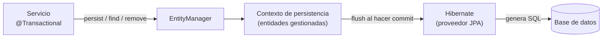
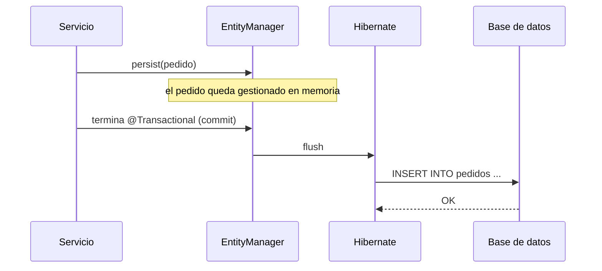

# EntityManager

## 1. Definición breve

**EntityManager** es el objeto de JPA que **gestiona las entidades** de tu
aplicación: las guarda, las busca, las modifica y las borra. Él no escribe el SQL
a mano; se lo pide al proveedor de JPA (normalmente **Hibernate**, que Spring Boot
incluye) cuando toca hablar con la base de datos.

> EntityManager no es exclusivo de Spring Boot: pertenece al estándar **JPA**
> (Jakarta Persistence). Spring Boot solo lo configura y te lo inyecta.

## 2. Explicación paso a paso

1. **Tienes una entidad.** Una clase Java con `@Entity` representa una tabla.
   Por ejemplo, `Pedido` representa la tabla `pedidos`.
2. **El EntityManager abre un contexto de persistencia.** Es una «caja» en
   memoria donde viven las entidades que está controlando. Para un mismo id hay
   una sola instancia dentro de la caja.
3. **Le pides operaciones.** `persist` añade una entidad nueva, `find` busca por
   id, `remove` la marca para borrar y `merge` vuelve a conectar una entidad que
   se había quedado fuera.
4. **Los cambios se acumulan.** Si cambias un campo de una entidad gestionada,
   el EntityManager lo detecta. Todavía no ha tocado la base de datos.
5. **Al hacer `flush` o `commit` se genera el SQL.** Hibernate escribe los
   `INSERT`, `UPDATE` o `DELETE` y los envía. En Spring Boot, el `commit` lo
   provoca el final de un método `@Transactional`.

La idea clave: **tú trabajas con objetos; el SQL sale al final**.

## 3. Para qué sirve y cuándo se utiliza

- Sirve para **guardar y recuperar datos sin escribir SQL** en el día a día.
- Sirve para **agrupar cambios en una transacción**: o se guardan todos, o
  ninguno.
- Sirve para lanzar consultas **JPQL** (`createQuery`) o **SQL nativo**
  (`createNativeQuery`) cuando hace falta.
- Se usa en la capa de persistencia: dentro de un repositorio o un DAO.
- En Spring Boot aparece cuando usas **Spring Data JPA** o JPA directamente.
- **No** hace falta usarlo a mano si un repositorio de Spring Data ya te da
  `save`, `findById` y `delete`: por dentro lo sigue usando.

## 4. Ejemplo práctico relacionado con DAW

Una web de pedidos recibe un pedido nuevo:

```text
1. El navegador envía POST /pedidos con los datos
2. El controlador llama a PedidoService.crear(...)
3. El servicio crea un objeto Pedido y llama a em.persist(pedido)
4. El pedido queda "gestionado" en el contexto de persistencia
5. Al terminar @Transactional, Hibernate hace flush
6. Se ejecuta: INSERT INTO pedidos (cliente, total) VALUES (?, ?)
7. La base de datos confirma y el controlador responde 201 Created
```

El servicio nunca escribió el `INSERT`.

## 5. Código pequeño comentado

```java
@Service
public class PedidoService {

    @PersistenceContext
    private EntityManager em;          // (1) Spring Boot lo inyecta

    @Transactional                     // (2) abre transacción
    public void crear(Pedido pedido) {
        em.persist(pedido);            // (3) lo apunta, aún no hay INSERT
    }                                  // (4) al salir: flush + commit + INSERT
}
```

1. `@PersistenceContext` es la forma estándar de pedir un EntityManager.
2. `@Transactional` hace que Spring abra y cierre la transacción por ti.
3. `persist` pasa la entidad a estado **gestionado**.
4. El SQL se genera al hacer `flush`/`commit`, no en la línea del `persist`.

## 6. Diagrama (Mermaid)



Y el orden temporal de un `persist`:



> Estos diagramas **no se han validado automáticamente**: ábrelos en Obsidian, en
> GitHub o en mermaid.live para comprobar que se ven bien.

## 7. Conceptos con los que se suele confundir

- **EntityManager ≠ EntityManagerFactory**: la *factory* se crea una vez y sirve
  para fabricar EntityManagers; el EntityManager es el que usas en cada
  operación.
- **EntityManager ≠ repositorio de Spring Data**: el repositorio es la interfaz
  cómoda (`save`, `findById`); por dentro usa un EntityManager.
- **EntityManager ≠ conexión JDBC**: la conexión es el cable con la base de
  datos; el EntityManager trabaja con objetos y pide conexiones cuando las
  necesita.
- **EntityManager ≠ Hibernate Session**: `Session` es la API propia de
  Hibernate; `EntityManager` es la API estándar de JPA. En Hibernate están
  conectados, pero no son la misma interface.
- **EntityManager ≠ SQL**: no ejecuta tus frases SQL directamente; genera SQL a
  partir de entidades y consultas JPQL.

## 8. Errores frecuentes

- **Usarlo fuera de una transacción**: al guardar puede saltar
  `TransactionRequiredException`. Solución: poner `@Transactional` en el
  servicio.
- **Creer que el `INSERT` sale en la línea de `persist`**: sale al hacer
  `flush`/`commit`. Si miras la base de datos antes, no está.
- **Usar `persist` con una entidad que ya tiene id**: puede fallar o intentar
  insertar de nuevo. Para actualizar se usa `merge` o se modifica una entidad
  gestionada.
- **Tocar una entidad fuera del contexto** (por ejemplo, una relación `LAZY`
  después de cerrar la transacción): aparece `LazyInitializationException`.
- **Compartir un EntityManager entre hilos**: no es seguro para concurrencia.
  Spring te da uno adecuado por transacción; no lo guardes en un `static`.
- **Crearlo con `new`**: pierdes la configuración de Spring. Se inyecta, no se
  construye a mano.

## 9. Tres preguntas de repaso

1. ¿Qué hace `em.persist(pedido)` y en qué momento aparece el `INSERT`?
2. ¿Qué diferencia hay entre `EntityManager` y `EntityManagerFactory`?
3. ¿Por qué `find` puede no lanzar ninguna consulta a la base de datos?

### Respuestas

1. Pasa el objeto a estado **gestionado** dentro del contexto de persistencia.
   El `INSERT` no sale en esa línea: Hibernate lo genera al hacer `flush`, que
   en Spring Boot suele ocurrir al terminar el método `@Transactional`.
2. La factory se crea una vez para la aplicación y fabrica EntityManagers. El
   EntityManager es el objeto de trabajo que gestiona las entidades de una
   operación o transacción.
3. Porque si esa entidad ya está en el contexto de persistencia, el
   EntityManager la devuelve de memoria y no necesita consultar la base de
   datos. Es una de las ventajas del contexto de persistencia.

## 10. Términos relacionados

- [ORM](orm.md) — la capa general que traduce objetos y tablas; JPA/Hibernate es
  un ORM de Java.
- [DAO (Data Access Object)](dao.md) — la clase que organiza el acceso a datos y
  que puede usar el EntityManager por dentro.
- [Bean (Spring Boot)](beans-spring.md) — el EntityManager que Spring te inyecta
  está gestionado por el contenedor.
- [GenerationType: estrategias de generación de IDs](generationtype-estrategias-ids.md)
  — quién decide el id de una entidad nueva.
- [Anotaciones de Spring Boot para una API REST](anotaciones-api-rest-spring.md)
  — cómo llega la petición HTTP hasta el servicio que usa el EntityManager.
- [Glosario](../Glosario.md) — índice general.

*(Pendiente de crear ficha propia para: entidad JPA, contexto de persistencia,
transacción, JPQL y `@Transactional`.)*

## 11. Fuentes y límites de la explicación

- Fuentes consultadas (documentación oficial):
  - [Jakarta Persistence 3.1 — `EntityManager`](https://jakarta.ee/specifications/persistence/3.1/apidocs/jakarta.persistence/jakarta/persistence/EntityManager.html):
    define el EntityManager como la interface para interactuar con el contexto
    de persistencia, y documenta `persist`, `find`, `merge`, `remove` y `flush`.
  - [Spring Data JPA — Persisting Entities](https://docs.spring.io/spring-data/jpa/reference/jpa/entity-persistence.html):
    `save` usa el `EntityManager` de JPA y llama a `persist` o `merge` según si
    la entidad es nueva.
  - [Hibernate ORM User Guide — Persistence Context](https://docs.jboss.org/hibernate/orm/6.6/userguide/html_single/Hibernate_User_Guide.html#pc):
    el contexto de persistencia y las operaciones sobre entidades.
- Límites:
  - **No se ha creado ni ejecutado ningún proyecto** de Spring Boot en esta
    sesión: el código es un ejemplo de cómo se escribe, sin comprobar que
    compile.
  - Los ejemplos usan `jakarta.persistence` (Spring Boot 3 y posterior). En
    Spring Boot 2 el paquete era `javax.persistence`.
  - No se ha comprobado el comportamiento de una versión concreta de Hibernate:
    los detalles pueden cambiar entre versiones.
  - Los diagramas Mermaid no se han validado automáticamente.

## 12. Mis notas

<!-- Sección reservada para la estudiante. No borrar ni sobrescribir. -->
