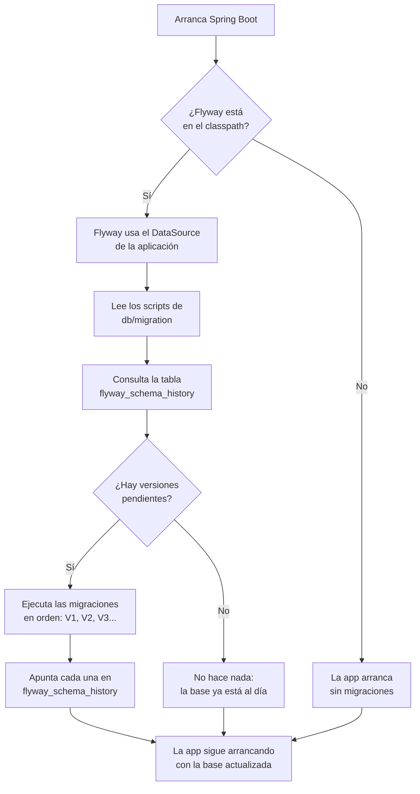

# Flyway Spring Boot

## 1. Definición breve

**Flyway** es una herramienta que aplica cambios a la base de datos con scripts
numerados y en orden. **Flyway Spring Boot** es ese mismo Flyway integrado en
Spring Boot: al arrancar la aplicación, Spring lo detecta y ejecuta solo los
scripts que faltan.

## 2. Explicación paso a paso

1. **Añades la dependencia.** Spring Boot solo activa Flyway si lo encuentra en
   el proyecto. En Spring Boot 4 se usa `spring-boot-starter-flyway`; en
   versiones anteriores se añade `org.flywaydb:flyway-core` (y, según la base de
   datos, un módulo extra como `flyway-database-postgresql`).
2. **Escribes los scripts de migración.** Van en `src/main/resources/db/migration`
   y siguen un nombre concreto: `V1__crear_tabla_pedidos.sql`,
   `V2__anadir_columna_estado.sql`, etc. La `V` es de *versioned* (versionado) y
   los dos guiones bajos `__` separan la versión del nombre.
3. **Spring Boot arranca y llama a `Flyway.migrate()`.** Flyway usa el
   `DataSource` principal (la conexión a la base de datos que ya configuraste).
4. **Flyway compara los scripts con su historial.** Tiene una tabla propia,
   `flyway_schema_history`, donde apunta qué migraciones ya se aplicaron. Si ve
   versiones pendientes, las ejecuta en orden.
5. **La próxima vez no repite trabajo.** Las migraciones ya aplicadas se
   saltan. Si alguien modificó un script antiguo, Flyway avisa de que la
   *checksum* (la huella del archivo) no coincide.

## 3. Para qué sirve y cuándo se utiliza

- Sirve para **crear y cambiar las tablas de forma repetible**: el mismo script
  se ejecuta igual en tu portátil, en el servidor de pruebas y en producción.
- Sirve para **saber qué cambios se han aplicado ya** y en qué orden.
- Se usa cuando el esquema de la base de datos **evoluciona con el proyecto**:
  nuevas columnas, tablas, índices o datos iniciales.
- Es la alternativa recomendada en lugar de dejar que Hibernate cree las tablas
  con `spring.jpa.hibernate.ddl-auto: update` en producción.
- También se puede usar Flyway sin Spring Boot; aquí nos centramos en la
  integración.

## 4. Ejemplo práctico relacionado con DAW

En una API de pedidos, quieres guardar los pedidos en PostgreSQL. Creas dos
migraciones:

```sql
-- db/migration/V1__crear_tabla_pedidos.sql
CREATE TABLE pedidos (
    id BIGSERIAL PRIMARY KEY,
    cliente VARCHAR(100) NOT NULL,
    total NUMERIC(10, 2) NOT NULL
);

-- db/migration/V2__anadir_estado.sql
ALTER TABLE pedidos ADD COLUMN estado VARCHAR(20) NOT NULL DEFAULT 'PENDIENTE';
```

La primera vez, Flyway ejecuta `V1` y `V2`. Si mañana añades `V3`, solo se
ejecutará `V3`: las anteriores ya están apuntadas en el historial.

## 5. Código pequeño comentado

Configuración mínima en `application.yml`:

```yaml
spring:
  datasource:
    url: jdbc:postgresql://localhost:5432/tienda
    username: daw
    password: daw
  jpa:
    hibernate:
      ddl-auto: validate   # (1) Hibernate solo comprueba, no crea tablas
  flyway:
    enabled: true          # (2) Spring ejecuta Flyway al arrancar
    locations: classpath:db/migration  # (3) carpeta de los scripts
```

1. `validate` hace que Hibernate compruebe que las tablas existen, pero no las
   modifica. Los cambios los hace Flyway.
2. Si no pones `enabled`, Spring Boot lo activa igualmente al detectar Flyway.
   Se pone `false` solo si quieres desactivarlo.
3. Es la ruta por defecto; solo hace falta cambiarla si guardas los scripts en
   otro sitio.

## 6. Diagrama (Mermaid)



> Este diagrama **no se ha validado automáticamente**: ábrelo en Obsidian, en
> GitHub o en mermaid.live para comprobar que se ve bien.

## 7. Conceptos con los que se suele confundir

- **Flyway ≠ Hibernate `ddl-auto`**: Hibernate puede crear o modificar tablas
  adivinando el esquema a partir de las clases; Flyway ejecuta scripts SQL
  escritos por ti, en un orden fijo y con historial.
- **Flyway ≠ `schema.sql` / `data.sql`**: esos scripts de Spring Boot se ejecutan
  al inicio, pero no llevan versiones ni un historial de lo aplicado. Se pueden
  pisar o repetir sin control.
- **Flyway ≠ Liquibase**: los dos son herramientas de migración. Flyway trabaja
  sobre todo con scripts SQL versionados; Liquibase usa *changelogs* en XML,
  YAML, JSON o SQL.
- **Migración ≠ copia de seguridad**: una migración cambia el esquema; no guarda
  una copia de los datos. Si algo sale mal, necesitas además tus *backups*.
- **Flyway ≠ ORM**: Flyway no traduce objetos Java a tablas; solo aplica cambios
  en la base de datos. El ORM (por ejemplo, Hibernate) es otra pieza.

## 8. Errores frecuentes

- **Editar una migración ya aplicada**: Flyway detecta que la *checksum* cambió
  y falla. Lo correcto es crear una migración nueva (`V3__corregir_algo.sql`).
- **Repetir un número de versión**: dos archivos `V2__...` provocan un error de
  versión duplicada. Cada migración debe tener un número distinto.
- **Mezclar Flyway con `ddl-auto: update`**: hay dos mecanismos intentando
  cambiar el esquema. Deja `ddl-auto` en `validate` o `none` y que mande Flyway.
- **Nombre de archivo mal escrito**: faltan los dos guiones bajos, o la `V` no
  está en mayúscula. El archivo se ignora o Flyway no lo reconoce.
- **No añadir el módulo de la base de datos**: con versiones recientes de Flyway,
  PostgreSQL o MySQL pueden necesitar su módulo aparte. Si falta, aparece un
  error de base de datos no soportada.
- **Borrar `flyway_schema_history` a mano**: Flyway cree que la base está vacía
  e intenta aplicar todo otra vez. Esa tabla es su memoria.
- **Usar `flyway clean` en producción**: `clean` borra los objetos de la base de
  datos. Es una orden destructiva; no se usa en un entorno real.

## 9. Tres preguntas de repaso

1. ¿Dónde se guardan por defecto los scripts de migración y cómo se llaman?
2. ¿Qué hace Flyway con una migración que ya se aplicó en un arranque anterior?
3. ¿Por qué no se debe cambiar un script `V1` que ya está en producción?

### Respuestas

1. Por defecto, en `src/main/resources/db/migration` (en el *classpath*,
   `classpath:db/migration`). Los archivos siguen el patrón
   `V<número>__<nombre>.sql`, por ejemplo `V1__crear_tabla_pedidos.sql`.
2. La salta: ya está apuntada en la tabla `flyway_schema_history`. Solo ejecuta
   las versiones que aún no aparecen en ese historial.
3. Porque Flyway guarda una *checksum* del archivo. Si cambias su contenido,
   la comprobación falla y la aplicación no arranca. Para corregir algo se crea
   una migración nueva.
   (Si el script todavía no se ha aplicado en ningún entorno, sí se puede
   corregir antes de ejecutarlo.)

## 10. Términos relacionados

- [ORM](orm.md) — Hibernate y JPA se encargan de los objetos; Flyway se encarga
  del esquema.
- [Bean (Spring Boot)](beans-spring.md) — Spring Boot autoconfigura Flyway como
  un bean más y lo ejecuta al arrancar.
- [Anotaciones de Spring Boot para una API REST](anotaciones-api-rest-spring.md)
  — el resto de piezas de la API que se apoya en esas tablas.
- [Introducción a Spring Boot](../Resumenes/introduccion-spring-boot.md) —
  resumen de clase donde Flyway aparece en el perfil de producción.
- [Glosario](../Glosario.md) — índice general.

*(Pendiente de crear ficha propia para: migración de base de datos, Liquibase,
`ddl-auto`.)*

## 11. Fuentes y límites de la explicación

- Fuentes consultadas:
  - [Spring Boot — Database Initialization](https://docs.spring.io/spring-boot/how-to/data-initialization.html):
    dependencia, carpeta `classpath:db/migration`, nombre `V<VERSION>__<NAME>.sql`,
    `spring.flyway.locations` y ejecución con `Flyway.migrate()` al arrancar.
  - [Redgate Flyway — Migrations](https://documentation.red-gate.com/flyway/flyway-concepts/migrations):
    qué es una migración, orden de ejecución, tabla de historial y ejecución
    idempotente.
- Límites:
  - No se ha creado ni ejecutado ningún proyecto de Spring Boot en esta sesión:
    el código de las secciones 4 y 5 es un ejemplo, no una prueba real.
  - Los nombres de dependencias cambian entre versiones de Spring Boot y Flyway.
    Se indica la diferencia entre Spring Boot 4 y versiones anteriores, pero hay
    que comprobar la versión concreta del proyecto.
  - Flyway se comporta distinto según la base de datos (PostgreSQL, MySQL, H2…).
    Aquí se explica el caso general.
  - No se ha consultado el material de clase para esta ficha: no hay contexto de
    clase que citar.
  - El diagrama Mermaid no se ha validado automáticamente.

## 12. Mis notas

<!-- Sección reservada para la estudiante. No borrar ni sobrescribir. -->
