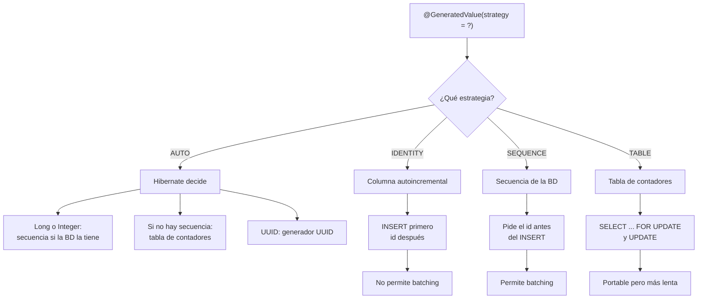
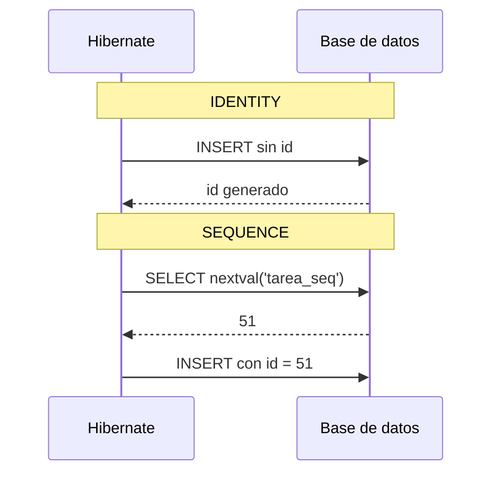

# GenerationType: estrategias de generación de IDs

> Ficha **comparativa** de las cuatro estrategias de `GenerationType` en JPA:
> `IDENTITY`, `SEQUENCE`, `TABLE` y `AUTO`. En Spring Boot se usan igual que en
> cualquier proyecto JPA, porque Spring Boot no las inventa: las pone Hibernate.

## 1. Definición breve

`GenerationType` es un **enum de JPA** que dice **quién genera el valor de la
clave primaria** de una entidad. Se escribe dentro de `@GeneratedValue`:

```java
@GeneratedValue(strategy = GenerationType.IDENTITY)
```

Las cuatro opciones son `IDENTITY`, `SEQUENCE`, `TABLE` y `AUTO`.

## 2. Explicación paso a paso

1. Marcas el campo con `@Id` para decir que es la clave primaria.
2. Añades `@GeneratedValue` para decir que ese id **no lo escribes tú**.
3. Eliges la estrategia. Cada una usa una pieza distinta de la base de datos.
4. Hibernate pide o calcula el id y lo pone en el objeto antes o después del
   `INSERT`, según la estrategia.
5. Al guardar, la base de datos debe tener la columna, la secuencia o la tabla
   que esa estrategia necesita.

Comparación rápida:

| Estrategia | ¿Quién genera el id? | ¿Cuándo se conoce? | ¿Permite lotes? | Base de datos típica |
|---|---|---|---|---|
| `IDENTITY` | La columna autoincremental | Después del `INSERT` | No | MySQL, SQL Server |
| `SEQUENCE` | Una secuencia de la base de datos | Antes del `INSERT` | Sí | PostgreSQL, Oracle, H2 |
| `TABLE` | Una tabla de contadores | Antes del `INSERT` | Sí, por bloques | Cualquiera |
| `AUTO` | Hibernate elige | Depende de lo que elija | Depende | Cualquiera |

**`AUTO` no significa «lo elige la base de datos»**: significa «lo elige el
proveedor JPA», que en Spring Boot es Hibernate.

## 3. Para qué sirve y cuándo se utiliza

- **`IDENTITY`**: para bases de datos con columna autoincremental. Es la opción
  más sencilla en MySQL y en SQL Server.
- **`SEQUENCE`**: para bases de datos con secuencias. Es la mejor opción si
  insertas muchos registros, porque permite agrupar `INSERT` en lotes.
- **`TABLE`**: cuando la base de datos no tiene secuencias ni columnas
  autoincrementales. Es portable, pero más lenta porque bloquea una fila de la
  tabla de contadores.
- **`AUTO`**: para prácticas y prototipos. Hibernate decide según el tipo del id
  y lo que soporte la base de datos.

En Spring Boot, la elección depende sobre todo de la base de datos y de si
necesitas insertar en lote.

## 4. Ejemplo práctico relacionado con DAW

Tienes una API de tareas con una entidad `Tarea`. En tu portátil usas MySQL; en
el servidor de clase, PostgreSQL.

- En MySQL eliges `IDENTITY`, porque MySQL no tiene secuencias.
- En PostgreSQL eliges `SEQUENCE`, porque sí las tiene y así puedes insertar
  varias tareas de golpe.
- En un ejercicio rápido usas `AUTO` y dejas que Hibernate decida.

Lo importante: **el código Java puede ser casi el mismo**, pero el esquema de la
base de datos cambia.

## 5. Código pequeño comentado

Ejemplo mínimo con `IDENTITY`:

```java
@Entity
public class Tarea {

    @Id
    @GeneratedValue(strategy = GenerationType.IDENTITY) // MySQL: AUTO_INCREMENT
    private Long id;

    private String titulo;
}
```

Variantes para el mismo campo:

```java
// PostgreSQL, Oracle o H2: secuencia propia
@GeneratedValue(strategy = GenerationType.SEQUENCE, generator = "tarea_seq")
@SequenceGenerator(name = "tarea_seq", sequenceName = "tarea_seq", allocationSize = 1)

// Cualquier base de datos: tabla de contadores
@GeneratedValue(strategy = GenerationType.TABLE, generator = "tarea_tabla")
@TableGenerator(name = "tarea_tabla", table = "contadores")

// Hibernate decide (es la opción por defecto si no pones strategy)
@GeneratedValue(strategy = GenerationType.AUTO)
```

`allocationSize = 1` significa «reserva un id cada vez». Si no lo pones, JPA
reserva bloques de **50** por defecto.

## 6. Diagrama (Mermaid)

Cómo se elige la estrategia:



Diferencia entre `IDENTITY` y `SEQUENCE` al guardar:



> Estos diagramas **no se han validado automáticamente**: ábrelos en Obsidian,
> en GitHub o en mermaid.live para comprobar que se ven bien.

## 7. Conceptos con los que se suele confundir

- **`AUTO` ≠ «lo decide la base de datos»**: lo decide Hibernate. En Hibernate
  6.6, un id numérico usa secuencia si la base de datos la soporta; si no, usa
  una tabla.
- **`@GeneratedValue` ≠ `AUTO_INCREMENT`**: la anotación es de JPA; el
  `AUTO_INCREMENT` es una característica de la columna en MySQL.
- **`IDENTITY` de JPA ≠ `IDENTITY` de SQL Server**: se llaman igual, pero uno es
  una estrategia de Java y el otro es un tipo de columna de SQL Server.
- **`SEQUENCE` ≠ `TABLE`**: las dos calculan el id antes del `INSERT`, pero una
  usa un objeto secuencia nativo y la otra una tabla con contadores.
- **`allocationSize` ≠ «salto de ids»**: Hibernate reserva un bloque de ids. Tú
  ves ids seguidos dentro del bloque; el salto aparece al pasar al siguiente
  bloque o al reiniciar.
- **JPA ≠ Hibernate**: JPA es la norma (las anotaciones); Hibernate es la
  implementación que las ejecuta.

## 8. Errores frecuentes

- **Usar `AUTO` sin saber qué hace y cambiar de base de datos**: el esquema
  generado puede cambiar de secuencia a tabla sin que toques el código.
- **Esperar ids 1, 2, 3 con `SEQUENCE` o `TABLE`**: con el valor por defecto de
  `allocationSize` (50), los ids se reparten por bloques. Si ves saltos, no está
  roto.
- **Usar `IDENTITY` y esperar inserciones por lote**: la base de datos necesita
  insertar primero para devolver el id, así que Hibernate no puede agrupar los
  `INSERT`.
- **Pedir `SEQUENCE` en MySQL creyendo que MySQL tiene secuencias**: no las
  tiene; Hibernate puede simularlas con una tabla.
- **Poner `@SequenceGenerator` con un nombre distinto al `generator`**: la
  anotación no encuentra la secuencia y falla al arrancar.
- **Confiar en `spring.jpa.hibernate.ddl-auto=update` en producción**: sirve
  para practicar, pero no sustituye a una migración controlada.

## 9. Tres preguntas de repaso

1. ¿Qué diferencia hay entre `IDENTITY` y `SEQUENCE` en el momento de conocer el
   id?
2. ¿Qué hace realmente `GenerationType.AUTO` en Hibernate?
3. ¿Por qué `TABLE` es más lenta que `SEQUENCE`?

### Respuestas

1. Con `IDENTITY` el id se conoce **después** del `INSERT`, porque lo genera la
   columna autoincremental. Con `SEQUENCE` se conoce **antes**, porque Hibernate
   pide el siguiente valor a la secuencia y luego inserta.
2. Deja que Hibernate elija. En Hibernate 6.6, un id numérico usa secuencia si
   la base de datos la soporta y, si no, una tabla de contadores. Un id `UUID`
   usa el generador de UUID.
3. Porque cada bloque de ids exige leer y actualizar una fila de la tabla de
   contadores, normalmente con un `SELECT ... FOR UPDATE` que bloquea esa fila.
   Una secuencia nativa está pensada para dar valores rápido y sin ese bloqueo.

## 10. Términos relacionados

- [ORM](orm.md) — capa que traduce objetos Java a tablas.
- [Bean (Spring Boot)](beans-spring.md) — objeto que Spring crea y gestiona.
- [Anotaciones de Spring Boot para una API REST](anotaciones-api-rest-spring.md)
  — las anotaciones `@` que ya usas en el controlador.
- [Flyway Spring Boot](flyway-spring-boot.md) — forma controlada de crear y
  cambiar las tablas, secuencias y columnas.
- [Glosario](../Glosario.md) — índice general.

*(Pendiente de crear fichas propias para: JPA, Hibernate, entidad, clave
primaria, secuencia y migración.)*

## 11. Fuentes y límites de la explicación

- Fuentes consultadas:
  - [Hibernate ORM 6.6 — Generated identifier values](https://docs.jboss.org/hibernate/orm/6.6/userguide/html_single/Hibernate_User_Guide.html#identifiers-generators),
    con sus apartados sobre `AUTO`, `SEQUENCE`, `IDENTITY` y `TABLE`.
  - [Hibernate ORM 6.6 — Using IDENTITY columns](https://docs.jboss.org/hibernate/orm/6.6/userguide/html_single/Hibernate_User_Guide.html#identifiers-generators-identity),
    donde se explica que el id se conoce después del `INSERT` y que no hay
    batching.
  - [Hibernate ORM 6.6 — Using sequences](https://docs.jboss.org/hibernate/orm/6.6/userguide/html_single/Hibernate_User_Guide.html#identifiers-generators-sequence),
    para `@SequenceGenerator` y `allocationSize`.
  - [Hibernate ORM 6.6 — Using the table identifier generator](https://docs.jboss.org/hibernate/orm/6.6/userguide/html_single/Hibernate_User_Guide.html#identifiers-generators-table),
    para la tabla de contadores y el `SELECT ... FOR UPDATE`.
- Límites:
  - No se ha ejecutado ningún proyecto Spring Boot ni ningún SQL en esta sesión:
    el código y las tablas son ejemplos, no resultados comprobados.
  - El comportamiento exacto depende de la versión de Spring Boot, de Hibernate
    y de la base de datos. Lo descrito sigue la documentación de Hibernate 6.6.
  - La página de javadoc de `GenerationType` no mostró su texto completo al
    consultarla en esta sesión; por eso la explicación se apoya en la guía de
    Hibernate.
  - Los diagramas Mermaid no se han validado automáticamente.

## 12. Mis notas

<!-- Sección reservada para la estudiante. No borrar ni sobrescribir. -->
