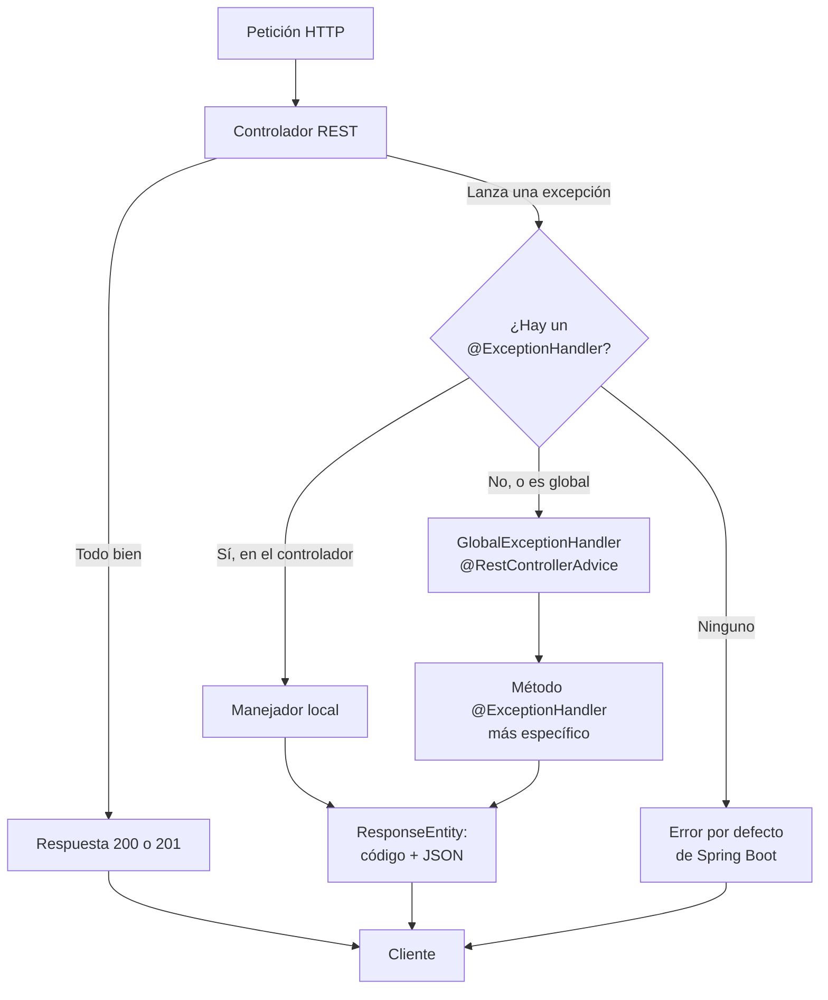

# GlobalExceptionHandler en Spring Boot

> **Aviso importante:** `GlobalExceptionHandler` **no es una anotación ni una clase
> de Spring**. Es un **nombre habitual** para una clase propia que se marca con
> `@RestControllerAdvice` y que contiene métodos con `@ExceptionHandler`.

## 1. Definición breve

`GlobalExceptionHandler` es el nombre que se le suele dar a una clase de Spring Boot
que **recoge las excepciones de todos los controladores** y las convierte en una
respuesta HTTP con un formato común, normalmente JSON.

## 2. Explicación paso a paso

1. Un controlador **lanza una excepción** en vez de resolver el error con `try`/`catch`.
   Por ejemplo: `throw new TaskNoEncontrada(id);`.
2. Spring MVC la captura y busca **quién sabe atenderla**.
3. Para eso revisa los beans marcados con `@ControllerAdvice` o
   `@RestControllerAdvice`, como `GlobalExceptionHandler`.
4. Dentro de esa clase elige el método `@ExceptionHandler` **más específico**: uno para
   `TaskNoEncontrada` gana sobre otro para `Exception`.
5. El método devuelve el **código HTTP y el cuerpo** del error. Si no hay ningún
   manejador, Spring Boot usa su respuesta de error por defecto.

Un detalle de orden: el manejador **local** del controlador se aplica antes que el
global de `GlobalExceptionHandler`.

## 3. Para qué sirve y cuándo se utiliza

- Sirve para que **todos los errores tengan la misma forma**:
  `{ "error": "...", "message": "...", "timestamp": "..." }`.
- Evita repetir el mismo `try`/`catch` en cada método de cada controlador.
- Se usa en **APIs REST** que devuelven JSON y necesitan códigos HTTP coherentes.
- También sirve para **no filtrar detalles internos**: el mensaje técnico va al log y
  al cliente le llega un mensaje entendible.

## 4. Ejemplo práctico relacionado con DAW

Una API de tareas. Si piden una tarea que no existe, el controlador no devuelve `null`:
lanza una excepción y deja que el manejador global decida la respuesta.

```java
@RestController
@RequestMapping("/api/tasks")
class TaskController {

    @GetMapping("/{id}")
    Task get(@PathVariable Long id) {
        return repo.findById(id)
            .orElseThrow(() -> new TaskNoEncontrada(id));
    }
}
```

El cliente recibe un `404 Not Found` con JSON, no una traza de Java.

## 5. Código pequeño comentado

```java
@RestControllerAdvice                 // 1. atiende errores de todos los controladores
public class GlobalExceptionHandler {

    @ExceptionHandler(TaskNoEncontrada.class)   // 2. qué excepción atiende
    @ResponseStatus(HttpStatus.NOT_FOUND)       // 3. qué código devuelve
    public ErrorResponse noEncontrada(TaskNoEncontrada e) {
        return new ErrorResponse("TASK_NOT_FOUND", e.getMessage());
    }

    @ExceptionHandler(MethodArgumentNotValidException.class)
    public ResponseEntity<ErrorResponse> validacion(MethodArgumentNotValidException e) {
        String msg = e.getBindingResult().getAllErrors().get(0).getDefaultMessage();
        return ResponseEntity.badRequest()      // 4. 400 + cuerpo JSON
            .body(new ErrorResponse("VALIDATION_ERROR", msg));
    }
}
```

`ErrorResponse` es una clase simple (un DTO) con los campos del error. Se puede
devolver un objeto y Spring lo convierte a JSON con Jackson.

## 6. Diagrama (Mermaid)



> Este diagrama **no se ha validado automáticamente**: ábrelo en Obsidian, en GitHub
> o en mermaid.live para comprobar que se ve bien.

## 7. Conceptos con los que se suele confundir

- **`GlobalExceptionHandler` ≠ anotación**: es un nombre de clase. Las anotaciones son
  `@RestControllerAdvice` y `@ExceptionHandler`. La clase podría llamarse
  `ManejadorDeErrores` y funcionaría igual.
- **`@ControllerAdvice` ≠ `@RestControllerAdvice`**: la segunda añade `@ResponseBody`,
  así que devuelve el objeto como JSON. La primera puede intentar devolver una vista
  HTML, que no es lo que quieres en una API REST.
- **`@ExceptionHandler` ≠ `try`/`catch`**: el `try`/`catch` es manual y vive en cada
  método; el manejador es declarativo y está centralizado.
- **Manejador global ≠ `@ResponseStatus`**: `@ResponseStatus` solo fija el código de
  un método; el manejador decide además el cuerpo y a qué excepción responde.
- **Capturar excepciones ≠ interceptar peticiones**: `@ControllerAdvice` no atiende
  URLs; solo reacciona cuando algo falla.

## 8. Errores frecuentes

- **Dejar la clase fuera del paquete escaneado**: si no está por debajo del paquete
  principal, Spring no la encuentra y los errores salen por la respuesta por defecto.
- **Usar `@ControllerAdvice` en una API**: el método puede intentar devolver una vista.
  Para JSON se usa `@RestControllerAdvice`.
- **Capturar `Exception` y devolver siempre 500**: un dato inválido es un 400, no un
  fallo del servidor. Conviene tener manejadores específicos.
- **Devolver `e.getMessage()` o la traza completa al cliente**: puede revelar nombres
  de clases, consultas o rutas internas. El detalle va al log.
- **Olvidar el handler en un `@WebMvcTest`**: hay que incluir la clase, por ejemplo
  `@WebMvcTest({ TaskController.class, GlobalExceptionHandler.class })`.
- **Creer que el manejador global gana siempre**: si el controlador tiene uno local
  para ese tipo de excepción, se aplica antes.

## 9. Tres preguntas de repaso

1. ¿`GlobalExceptionHandler` es una anotación de Spring? ¿Qué es en realidad?
2. ¿Qué anotación se pone en la clase y por qué se prefiere `@RestControllerAdvice`
   en una API REST?
3. Si hay un `@ExceptionHandler` en el controlador y otro global para la misma
   excepción, ¿cuál se aplica primero?

### Respuestas

1. No. Es un **nombre de clase habitual**. Lo que hace que funcione son las
   anotaciones `@RestControllerAdvice` (o `@ControllerAdvice`) y `@ExceptionHandler`
   dentro de ella.
2. Se pone `@RestControllerAdvice`, porque combina `@ControllerAdvice` con
   `@ResponseBody` y devuelve el objeto del método como cuerpo JSON, no como vista.
3. Primero el **local del controlador**. Los manejadores globales de
   `GlobalExceptionHandler` se aplican después, como respaldo común.

## 10. Términos relacionados

- [Anotaciones de Spring Boot para una API REST](anotaciones-api-rest-spring.md) — dónde
  encajan `@RestControllerAdvice` y `@ExceptionHandler`.
- [Códigos de estado HTTP](codigos-estado.md) — qué significa 400, 404, 405, 415 y 500.
- [DTO (Data Transfer Object)](dtos.md) — clase simple para el cuerpo del error.
- [Bean (Spring Boot)](beans-spring.md) — `GlobalExceptionHandler` también es un bean.
- [Tests de errores y respuestas coherentes](../Resumenes/tdd-manejo-errores.md) — el
  material de clase con este mismo manejador y sus tests.
- [Controladores REST](../Resumenes/controladores-rest.md) — de dónde salen las
  excepciones que se capturan.
- [Glosario](../Glosario.md) — índice general.

## 11. Fuentes y límites de la explicación

- Fuentes consultadas (documentación oficial):
  - [Spring Framework — Controller Advice](https://docs.spring.io/spring-framework/reference/web/webmvc/mvc-controller/ann-advice.html)
  - [Spring Framework — Exceptions](https://docs.spring.io/spring-framework/reference/web/webmvc/mvc-controller/ann-exceptionhandler.html)
  - [Spring Framework — Error Responses](https://docs.spring.io/spring-framework/reference/web/webmvc/mvc-ann-rest-exceptions.html)
  - [Spring Boot — Servlet Web Applications](https://docs.spring.io/spring-boot/reference/web/servlet.html)
- Límites:
  - La documentación consultada es de Spring Framework 7.0.9 y Spring Boot 4.1.1.
    Las anotaciones existen también en versiones 3.x, pero no se ha comprobado el
    proyecto concreto de clase.
  - **No se ha creado ni ejecutado** ningún proyecto: los fragmentos no se han
    compilado.
  - `GlobalExceptionHandler` no aparece en la documentación oficial como clase de
    Spring: es una convención de nombre.
  - El diagrama Mermaid no se ha validado automáticamente.

## 12. Mis notas

<!-- Sección reservada para la estudiante. No borrar ni sobrescribir. -->
