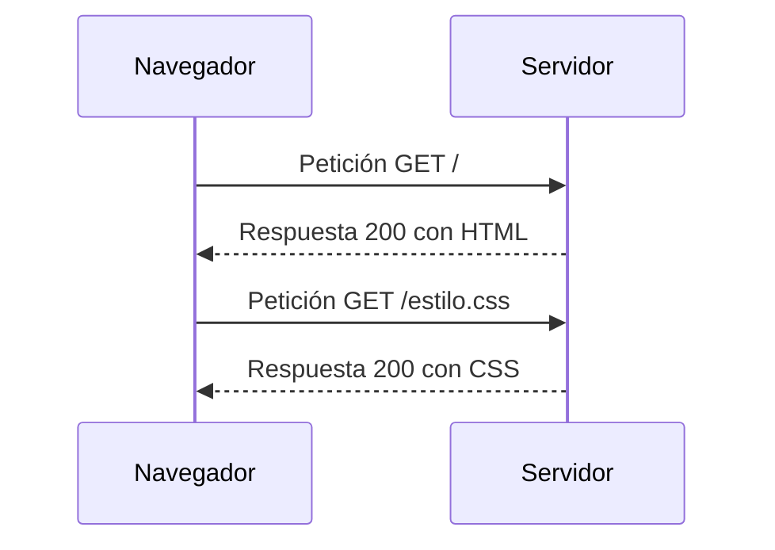

# HTTP

> **Ficha de demostración.** Sirve para mostrar cómo queda una ficha terminada.
> No procede de ninguna clase: es un ejemplo creado para probar el sistema.

## 1. Definición breve

HTTP es el protocolo (un conjunto de reglas para comunicarse) que usa la web
para pedir y enviar datos entre el navegador (el **cliente**) y el servidor.

## 2. Explicación paso a paso

1. Tú escribes una dirección en el navegador, por ejemplo `https://ejemplo.com`.
2. El navegador envía una **petición** (una petición formal) al servidor pidiendo
   esa página.
3. El servidor prepara la respuesta y la **envía**: normalmente una página HTML.
4. El navegador, al recibirla, pide también el CSS y las imágenes.
5. Al final, el navegador junta todo y te muestra la página.

Un protocolo sin estado (no recuerda nada entre petición y petición) significa que
cada petición va «sola»: si el servidor necesita saber quién eres, hay que decirlo
en cada petición (por ejemplo, con una cookie).

## 3. Para qué sirve y cuándo se utiliza

- Sirve para **cargar páginas** y para **enviar datos** (un formulario de contacto,
  un alta de usuario, una compra).
- Se utiliza **siempre** que el navegador habla con un servidor. También lo usa
  el código JavaScript cuando llama a una API (una forma programada de pedir
  datos a un servidor).

## 4. Ejemplo práctico relacionado con DAW

En una tienda online, cuando pulsas «Iniciar sesión»:

1. El formulario manda los datos con una petición `POST`.
2. El servidor comprueba la contraseña.
3. Responde con un código `200` si todo va bien, o `401` si la contraseña falla.
4. El navegador guarda una cookie y ya está «dentro».

## 5. Código pequeño comentado

Petición típica (texto plano en HTTP/1.1):

```text
GET / HTTP/1.1          # método: pedir; ruta: la página principal
Host: developer.mozilla.org   # a qué servidor se lo pido
Accept-Language: es    # lo quiero en español
```

Respuesta del servidor:

```text
HTTP/1.1 200 OK        # 200 = todo bien
Content-Type: text/html   # lo que viene es una página HTML
```

## 6. Diagrama



> Este diagrama **no se ha validado automáticamente**: ábrelo en Obsidian o en
> mermaid.live para comprobar que se ve bien.

## 7. Conceptos con los que se suele confundir

- **HTTPS**: es el mismo HTTP pero cifrado. La diferencia es la `S`.
- **HTML**: es el contenido de la página. HTML no es el protocolo que la transporta.
- **API**: es un «servidor con una puerta concreta» donde se piden datos, normalmente
  en JSON (un formato de datos de texto). API no significa protocolo.

## 8. Errores frecuentes

- **Confundir 404 con 500**: 404 es «no encontré esa página» (error del cliente);
  500 es «falló el servidor». No son lo mismo.
- **Creer que el navegador guarda datos por sí solo**: como HTTP no tiene estado,
  hace falta algo más (cookie o almacenamiento del navegador).
- **Poner datos sensibles en la URL**: la URL se puede ver y guardar en el
  historial; para contraseñas se usa el cuerpo de la petición.

## 9. Tres preguntas de repaso

1. ¿Quién inicia siempre la comunicación en HTTP?
2. ¿Qué significa que HTTP sea «sin estado»?
3. ¿Qué diferencia hay entre un código 404 y un código 500?

### Respuestas

1. El cliente (normalmente el navegador). El servidor espera y responde.
2. Que el servidor no recuerda nada de una petición a la siguiente: cada petición
   tiene que llevar toda la información que necesita.
3. 404 = el recurso pedido no existe. 500 = el servidor tuvo un error interno al
   procesarlo.

## 10. Términos relacionados

- [Evolución del protocolo HTTP](versiones-http.md) — qué cambió entre HTTP/0.9, 1.0, 1.1, 2 y 3.
- [Glosario](../Glosario.md) — índice general.

*(Pendiente de crear fichas propias para: API, JSON, HTML, HTTPS, cookie,
código de estado.)*

## 11. Fuentes y límites de la explicación

- Fuentes consultadas (documentación oficial):
  - [MDN — Generalidades del protocolo HTTP](https://developer.mozilla.org/es/docs/Web/HTTP/Guides/Overview)
  - [MDN — Mensajes HTTP](https://developer.mozilla.org/es/docs/Web/HTTP/Guides/Messages)
- Límites: no se ha comprobado el comportamiento en versiones concretas de
  HTTP/2 o HTTP/3 más allá de lo que dice MDN. Los diagramas Mermaid no se han
  validado automáticamente.

## 12. Mis notas

<!-- Sección reservada para la estudiante. No borrar ni sobrescribir. -->
