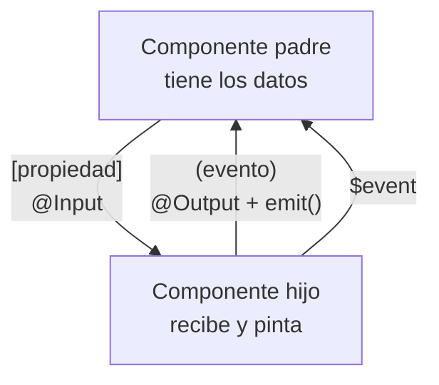
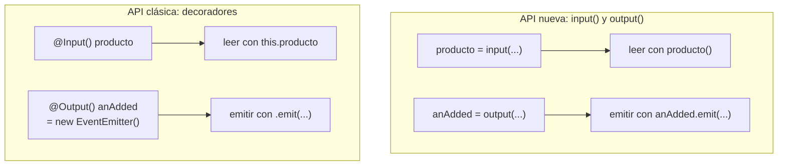

# @Input y @Output con EventEmitter en Angular

## 1. Definición breve

Son las dos direcciones en las que **un componente habla con su padre**:

- **`@Input`**: el padre **le pasa datos** al hijo.
- **`@Output`**: el hijo **le avisa** al padre de que algo ha pasado.

Un componente hijo (por ejemplo un botón) no debería saber nada de la pantalla
que lo contiene. Solo dice: «acepto estos datos» y «cuando pase esto, aviso».

## 2. Explicación paso a paso

1. **El padre declara qué le pasa**: en su plantilla, `<app-hijo [dato]="valor">`.
   Los **corchetes** significan «esto es un input del hijo». El padre **manda**.
2. **El hijo lo acepta**: con el decorador `@Input() dato: string;` sobre una
   propiedad. Dentro del hijo, ese valor ya se usa normal en la plantilla.
3. **El hijo avisa**: con `@Output() guardado = new EventEmitter<string>();`.
   Creas un `EventEmitter` y lo marcas como output.
4. **El hijo emite**: cuando ocurre algo, llama a
   `this.guardado.emit(valor)`. Aquí el hijo **manda**, y el padre escucha.
5. **El padre escucha**: en su plantilla, `<app-hijo (guardado)="recibir($event)">`.
   Los **paréntesis** significan «esto es un output». El dato emitido llega
   en la variable especial `$event`.

**Resumen visual:** `[propiedad]` = hacia abajo (padre → hijo).
`(evento)` = hacia arriba (hijo → padre).

## 3. Para qué sirve y cuándo se utiliza

- **`@Input`**: para pasar al hijo los datos que necesita (un texto, un
  producto, un tamaño, si está activo).
- **`@Output`**: para que el hijo comunique acciones o resultados: «han pulsed
  guardar», «ha cambiado el valor», «se ha terminado de cargar».
- **Cómo se decide la dirección**: pregúntate *quién tiene el dato*. Si lo tiene
  el padre, es input. Si lo produce el hijo, es output.
- **Sirve para que los componentes sean independientes**: si el botón de
  «Eliminar» guarda datos de la web entera, no es reutilizable. Con `@Output`
  solo avisa, y quien lo usa decide qué hacer.

## 4. Ejemplo práctico relacionado con DAW

Web de una tienda online con un componente hijo que es una ficha de producto:

```text
1. El componente padre tiene la lista de productos de la API
2. Pasa cada producto al hijo: [producto]="p"
3. El hijo pinta el nombre y el precio, y NO sabe de dónde viene el dato
4. Al pulsar "Añadir al carrito", el hijo emite el producto
5. El padre escucha (alAdded) y actualiza su signal del carrito
6. Si mañana el hijo se usa en otra web, funciona igual: solo avisa
```

## 5. Código pequeño comentado

El componente hijo (el que acepta y avisa):

```ts
import {Component, Input, Output, EventEmitter} from '@angular/core';

@Component({
  selector: 'app-producto',
  template: `
    <p>{{ producto.nombre }} — {{ producto.precio }} €</p>
    <button (click)="anadir()">Añadir al carrito</button>
  `,
})
export class Producto {
  @Input() producto!: {nombre: string; precio: number};   // recibe el dato
  @Output() anAdded = new EventEmitter<{nombre: string}>();  // avisa

  anadir() {
    this.anAdded.emit({nombre: this.producto.nombre});   // emite el evento
  }
}
```

El componente padre (el que manda y el que escucha):

```html
<app-producto
  [producto]="p"
  (anAdded)="sumarAlCarrito($event)"
/>
```

## 6. Diagrama (Mermaid)

Las dos direcciones entre padre e hijo:



El mismo componente escrito con la API nueva, para comparar:



> Estos diagramas **no se han validado automáticamente**: ábrelos en Obsidian,
> en GitHub o en mermaid.live para comprobar que se ven bien.

## 7. La API nueva: `input()` y `output()` (para proyectos nuevos)

La documentación **recomienda** estas funciones para código nuevo, aunque deja
los decoradores «totalmente soportados». Son la misma idea con signals:

```ts
export class Producto {
  producto = input.required<{nombre: string; precio: number}>();  // en vez de @Input()
  anAdded = output<{nombre: string}>();                             // en vez de @Output()

  anadir() {
    this.anAdded.emit({nombre: this.producto().nombre});  // se lee con paréntesis
  }
}
```

Diferencias que importan:

| Decorador (clásico) | Función (nueva) |
|---|---|
| `@Input() producto!: Tipo` | `producto = input<Tipo>()` |
| `@Output() evento = new EventEmitter<T>()` | `evento = output<T>()` |
| Se lee `this.producto` | Se lee `this.producto()` |
| `import {EventEmitter}` a mano | No hace falta importar nada |

En la **plantilla se usa igual**: los mismos corchetes y paréntesis. Por eso
muchos apuntes y cursos enseñan los decoradores y luego el profesor te pide la
versión con signals. Ver la ficha de [signals](signals-angular.md).

## 8. Conceptos con los que se suele confundir

- **Input ≠ Output**. El input **baja** (padre → hijo), el output **sube**
  (hijo → padre). Corchetes para abajo, paréntesis para arriba.
- **`@Input` ≠ variable normal del padre**. El hijo **no** puede modificar el
  valor del padre escribiendo en `producto`. Solo lo puede leer. Para que el
  padre se entere, el hijo necesita un `@Output`.
- **`EventEmitter` ≠ callback suelto**. `EventEmitter` es un objeto que Angular
  reconoce y conecta con la plantilla. Un callback normal no se enlaza así.
- **`EventEmitter` ≠ evento del DOM**. Los eventos personalizados de Angular
  **no suben por el DOM**: si el padre está en otro nivel del HTML, no lo
  recibe. Solo lo escucha quien lo pone en su plantilla.
- **`emit()` ≠ invocar al padre**. El hijo no llama al padre: **avisa**, y otro
  decide si hace caso.
- **`$event` ≠ la variable del hijo**. `$event` es la que crea Angular en la
  plantilla para darte el dato emitido.
- **`@Output` ≠ `(click)`**. El `(click)` es un evento nativo del navegador.
  Un `@Output` es un evento propio del componente.

## 9. Errores frecuentes

- **Usar paréntesis donde toca corchete**: `[guardado]="x"` es un input;
  `(guardado)="y()"` es un output. Cambiarlos rompe la comunicación en silencio.
- **Cambiar el `@Input` desde dentro del hijo**: funciona en el código, pero el
  padre no se entera y en el siguiente ciclo de detección Angular lo
  sobrescribe. Si el hijo necesita devolver un valor, eso es un `@Output`.
- **Olvidar el tipo en el `EventEmitter`**: `new EventEmitter()` sin `<string>`
  hace que `$event` llegue sin tipo y el editor no te avisa de nada.
- **Poner el decorador en el sitio equivocado**: el decorador va **encima** de
  la propiedad, no dentro del `@Component`.
- **Crear el `EventEmitter` como propiedad privada**: si es privado, la
  plantilla del padre no puede engancharse a él.
- **Nombrar el output como un evento del DOM** (por ejemplo `(change)`): la
  documentación recomienda evitar esas colisiones porque luego no sabes si el
  binding es tuyo o del navegador.
- **Prefijar con `on`**: la guía de la documentación recomienda nombres en
  `camelCase` y **evitar el prefijo `on`**.

## 10. Tres preguntas de repaso

1. En la línea `<app-hijo [producto]="p" (anAdded)="sumar($event)">`, ¿qué parte
   es input y cuál es output, y en qué dirección viaja cada una?
2. ¿Por qué el hijo no puede cambiar el valor del padre escribiendo directamente
   en su `@Input`? ¿Qué tiene que hacer en su lugar?
3. Un componente que he creado en otra web usa `@Input` y `@Output` con
   `EventEmitter`. ¿Funciona igual? ¿La documentación sugiere algo distinto para
   proyectos nuevos?

### Respuestas

1. `[producto]="p"` es el **input**: el padre `p` le pasa el dato al hijo, viaja
   **hacia abajo**. `(anAdded)="sumar($event)"` es el **output**: el hijo avisa y
   el padre reacciona, viaja **hacia arriba**; `$event` es el valor que el hijo
   emitió con `emit()`.
2. Porque el input es solo de **lectura para el hijo**: el padre es quien tiene
   la propiedad y la pasa hacia abajo. Si el hijo escribe en ella, el cambio no
   se propaga al padre y Angular lo vuelve a colocar en su sitio en el siguiente
   ciclo de detección. Para devolver un dato, el hijo necesita **emitir un
   `@Output`** con `EventEmitter`, y el padre escucharlo con `(nombre)="..."`.
3. Sí, funciona: la documentación dice que la API de decoradores «sigue
   totalmente soportada». Pero también dice que **recomienda la función `input()`**
   para proyectos nuevos, y la guía de outputs **recomienda `output()`** en lugar
   de `EventEmitter`. Esa API nueva usa signals y devuelve un
   `OutputEmitterRef`, sin tener que importar `EventEmitter` a mano.

## 11. Términos relacionados

- [Signals en Angular](signals-angular.md) — la API nueva: `input()` y `output()`
  devuelven signals en lugar de propiedades con decorador.
- [Angular standalone vs Ng Module](angular-standalone-vs-ngmodule.md) — por qué
  los componentes se declaran suyos sin módulo que los agrupe.
- [Directivas de Angular (resumen)](directivas-angular.md) — los bloques `@if` y
  `@for` que pintan los datos que llegan por `@Input`.
- [Pipes en Angular](pipes-angular.md) — formatean esos mismos datos.
- [HTTP](http.md) — de dónde vienen los datos que el padre pasa al hijo.
- [Glosario](../Glosario.md) — índice general.

*(Pendiente de crear ficha propia para: componente de Angular, plantilla,
`ng-content`, `ngModel` y enlace bidireccional con `bananaInBox`.)*

## 12. Fuentes y límites de la explicación

- Fuentes consultadas (documentación oficial, en inglés):
  - [Accepting data with input properties — angular.dev](https://angular.dev/guide/components/inputs)
    (declarar inputs con la función `input()`, inputs obligatorios,
    transformaciones, alias, inputs de modelo, y el apartado «Declaring inputs
    with the `@Input` decorator», que indica que la API sigue soportada).
  - [Custom events with outputs — angular.dev](https://angular.dev/guide/outputs)
    (declarar outputs con `output()`, `emit()`, `$event`, que los eventos
    personalizados **no suben por el DOM**, nombres en `camelCase` sin prefijo
    `on`, y el apartado «Declaring outputs with the `@Output` decorator» con
    `new EventEmitter()`).
- Límites:
  - Documentación leída en su versión **v22**.
  - **No se ha creado ni ejecutado ningún proyecto Angular en esta sesión**: los
    fragmentos son ejemplos escritos a partir de la documentación, no código
    compilado. En concreto, **no se ha comprobado** que el error descrito en la
    sección 8 sobre escribir en un `@Input` desde el hijo se manifested así en la
    práctica; es una explicación del comportamiento, no una prueba.
  - Los apartados finales de cada guía (suscripción a outputs desde código, *model
    inputs* de dos vías, `OnPush`) quedan fuera porque son temas con ficha
    propia.
  - Los diagramas Mermaid **no se han validado automáticamente**.

## 13. Mis notas

<!-- Sección reservada para la estudiante. No borrar ni sobrescribir. -->