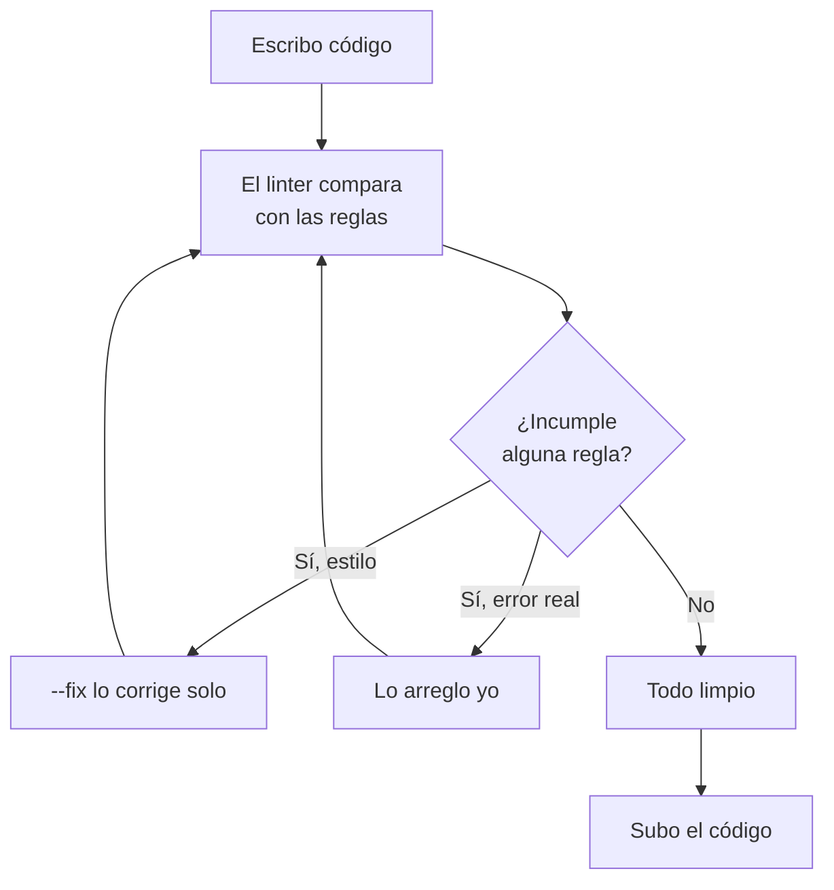

# Linter

## 1. Definición breve

Un **linter** es un programa que analiza tu código y te **avisa** de problemas:
errores que aún no han fallado, malas prácticas y cuestiones de estilo.

> La palabra viene del inglés *to lint*, que era lo que hacía la maquiladora de
> tela: quitar pelusa y hilos sueltos del Riot.

## 2. Explicación paso a paso

1. Instalas el linter del lenguaje en el que trabajas (ESLint para JavaScript,
   PHP_CodeSniffer para PHP, Ruff para Python…).
2. Escribes un archivo de configuración con las **reglas** que quieres comprobar.
3. Al guardar el archivo o al ejecutar el linter, recorre tu código y compara cada
   archivo con esas reglas.
4. Te enseña una lista: qué línea falla, qué regla incumple y cuál es el motivo.
5. Algunas reglas se **arreglan solas** con `--fix`: son las que cambian el estilo,
   nunca la lógica del programa.

**Idea clave:** el linter aplica **análisis estático** (lee el código sin
ejecutarlo) y aplica reglas una a una. ESLint lo define así: *«ESLint is a
configurable JavaScript linter. It helps you find and fix problems in your
JavaScript code. Problems can be anything from potential runtime bugs, to not
following best practices, to styling issues»* ([documentación de ESLint](https://eslint.org/docs/latest/use/core-concepts/)).

## 3. Para qué sirve y cuándo se utiliza

- Sirve para **pillar errores antes de ejecutarlos**: una variable mal escrita,
  una llave que no cierra.
- Sirve para que **todo el equipo escriba igual**, sin discutir por los estilos.
- Sirve como **red de seguridad automática**: muchos linters se ejecutan solos al
  subir el código.
- Se usa **siempre**, antes de dar por terminado un cambio.
- Se usa de dos formas: en el editor (subrayado en rojo mientras escribes) o en la
  terminal (`npx eslint .`).

Herramientas habituales:

| Lenguaje | Linter |
|---|---|
| JavaScript | [ESLint](https://eslint.org/docs/latest/use/) |
| CSS | [Stylelint](https://stylelint.io/) |
| PHP | [PHP_CodeSniffer](https://github.com/squizlabs/PHP_CodeSniffer) |
| Python | [Ruff](https://docs.astral.sh/ruff/) |

## 4. Ejemplo práctico relacionado con DAW

Un archivo `index.php` con cuatro problemas, y lo que avisa el linter:

```text
index.php:3  error    Variable "$conn" no está definida
index.php:7  warning  Falta espacio después de la coma
index.php:9  error    Falta punto y coma
index.php:12 warning  La función calcular() tiene más de 10 líneas

El primero y el tercero son fallos reales: el código no funciona como crees.
```

## 5. Código pequeño comentado

Configuración de ESLint, versión actual (`eslint.config.js`, configuración plana):

```javascript
export default [
  {
    files: ["**/*.js"],        // a qué archivos se aplica
    rules: {
      "no-undef": "error",     // avisar si usas algo no definido
      "no-unused-vars": "warn", // avisar si declaras y no usas
      eqeqeq: "error",         // obligar a usar === en vez de ==
    },
  },
];
```

Y cómo se ejecuta:

```bash
npx eslint .          # comprueba y lista los problemas
npx eslint . --fix    # arregla solo los que se pueden arreglar solos
```

## 6. Diagrama (Mermaid)



> Este diagrama **no se ha validado automáticamente**: ábrelo en Obsidian, en
> GitHub o en mermaid.live para comprobar que se ve bien.

## 7. Conceptos con los que se suele confundir

- **Linter ≠ [Refactorización](refactorizacion.md)**: el linter *avisa*, no cambia tu
  diseño. La refactorización es reorganizar el código que ya funciona.
- **Linter ≠ formateador**: el formateador (por ejemplo Prettier) **reescribe**
  el archivo con un estilo único y decide por ti; el linter comprueba reglas y te
  avisa. Los dos se complementan.
- **Linter ≠ compilador**: el compilador detecta errores que impiden compilar; el
  linter detecta cosas que compilan perfectamente pero están mal escritas.
- **Linter ≠ pruebas automáticas**: las pruebas comprueban si el programa hace lo
  que debe; el linter solo mira la forma del código.

## 8. Errores frecuentes

- **Activar todas las reglas sin filtrar**: si el linter avisa de 800 cosas de golpe,
  no lo miras nunca. Empieza con pocas reglas y ve añadiendo.
- **Ignorar los avisos que "son solo estilo"**: un aviso de estilo constante
  distrae de los errores de verdad.
- **Usar `--fix` sin revisar el diff**: corrige rápido, pero conviene mirar los
  cambios antes de guardarlos.
- **Confiar en que el linter garantiza que el código funciona**: no comprueba que
  la lógica sea correcta ni que haga lo que querías.
- **Poner reglas de una plantilla ajena a tu proyecto**: una configuración copiada
  de otra persona que ni compila.

## 9. Tres preguntas de repaso

1. ¿Qué diferencia hay entre un linter y un formateador?
2. ¿Qué tipo de problema NO puede detectar un linter?
3. ¿Por qué conviene empezar con pocas reglas en vez de activar todas?

### Respuestas

1. El linter comprueba tu código contra una lista de reglas y te avisa de lo que
   incumples. El formateador reescribe el archivo entero con un estilo único y
   decide por ti cómo queda.
2. Que la lógica haga lo correcto. El linter mira la forma del código, no si el
   resultado es el que esperabas; para eso están las pruebas automáticas.
3. Si el linter avisa de cientos de cosas a la vez, es fácil ignorarlo. Con pocas
   reglas te fijarías en lo importante y el ruido se va añadiendo después.

## 10. Términos relacionados

- [Refactorización](refactorizacion.md) — el cambio que haces para limpiar el
  código que el linter te ha señalado.
- [CI/CD](ci-cd.md) — muchos equipos ejecutan el linter automáticamente en cada
  cambio.
- [Glosario](../Glosario.md) — índice general.

*(Pendiente de crear ficha propia para: formateador, análisis estático,
pruebas automáticas.)*

## 11. Fuentes y límites de la explicación

- Fuentes consultadas:
  - [ESLint — Core Concepts](https://eslint.org/docs/latest/use/core-concepts/)
    (definición de linter y de regla).
  - [ESLint — Configure Rules](https://eslint.org/docs/latest/use/configure/rules).
  - [PHP_CodeSniffer](https://github.com/squizlabs/PHP_CodeSniffer),
    [Ruff](https://docs.astral.sh/ruff/), [Stylelint](https://stylelint.io/).
  - [Prettier — documentación](https://prettier.io/docs/index.html) para el
    contraste con el formateador.
- Límites:
  - **Qué NO detecta un linter** es **inferencia propia**: las páginas de ESLint
    explican qué sí detecta, pero no lo enumeran. La afirmación se deduce de que
    el linter trabaja con análisis estático y reglas, sin ejecutar el programa.
  - No se ha ejecutado ninguno de estos linters ni ningún archivo de configuración
    en esta sesión: son ejemplos tomados de la documentación enlazada.
  - La sintaxis de `eslint.config.js` corresponde a la configuración plana actual;
    las versiones antiguas usaban `.eslintrc.json`.
  - Los diagramas Mermaid no se han validado automáticamente.

## 12. Mis notas

<!-- Sección reservada para la estudiante. No borrar ni sobrescribir. -->