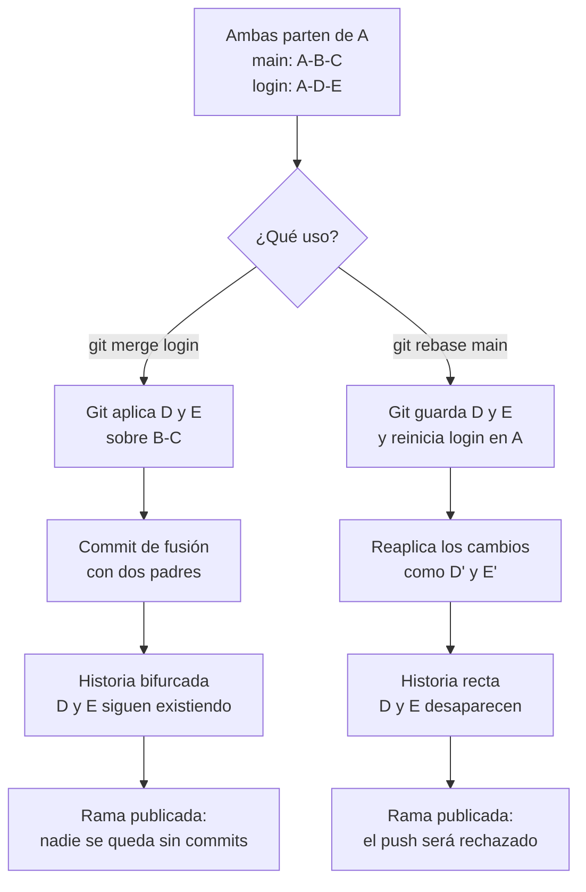

# Merge vs Rebase

> Ficha **comparativa**: resume las diferencias entre
> [Merge](merge.md) y [Rebase](rebase.md). Para el detalle de cada una, están
> sus propias fichas.

## 1. Definición breve

Las dos son formas de **juntar el trabajo de dos ramas** en Git, pero se
comportan distinto:

- **Merge**: **añade** un commit que une las dos historias. No toca lo ya
  escrito.
- **Rebase**: **reescribe** la historia de tu rama, copiando tus commits encima
  de la otra rama. Tu rama queda en línea recta.

## 2. Explicación paso a paso

Para entenderlo hace falta ver las dos con el **mismo ejemplo**: estás en `main`
con los commits A-B-C, y tu rama `login` tiene A-D-E (partió de A).

1. **Merge.** Te pones en `main` y haces `git merge login`. Git busca el ancestro
   común (A), aplica D y E encima y crea un commit con **dos padres**: uno en
   B-C y otro en D-E. La historia queda bifurcada.
2. **Rebase.** Te pones en `login` y haces `git rebase main`. Git guarda D y E
   aparte, reinicia `login` hasta A y vuelve a aplicarlos encima de C. Los
   commits son **nuevos** (D' y E'), con otro identificador.
3. **Resultado con merge.** La historia guarda los dos caminos: se ve de dónde
   vino cada cambio. El contenido final del código es el mismo.
4. **Resultado con rebase.** La historia es una línea recta. Pero los commits
   antiguos D y E **desaparecen** del historial: ahora son D' y E'.
5. **Consecuencia práctica.** Con merge, lo que ya habías subido sigue igual.
   Con rebase, si ya habías subido la rama, tu `git push` será rechazado porque
   los commits que el servidor tiene ya no coinciden con los tuyos.

Resumen en una frase: **merge conserva el historial, rebase lo reescribe**.

## 3. Para qué sirve y cuándo se utiliza

- **Merge** se usa cuando la rama **ya está publicada** (pusheada) o cuando
  trabajan varias personas en el mismo repositorio. Es la opción segura: no
  borra nada de lo que los demás ya tienen.
- **Rebase** se usa en ramas **propias y todavía sin publicar**, para:
  - mantener una historia lineal y fácil de leer antes de una pull request;
  - ponerse al día con `main` sin crear un commit de fusión;
  - limpiar commits con `git rebase -i` (`squash`, `reword`…).

Regla práctica de la documentación oficial: **no reorganices commits que ya
hayas enviado a un repositorio público**.

## 4. Ejemplo práctico relacionado con DAW

Tú trabajas en la rama `formulario-login` de una web. `main` ya trae un cambio
de otra persona.

```bash
# Opción A: tu rama es solo tuya y aún no la has subido
git checkout formulario-login
git rebase main          # historia recta, sin commit de fusión

# Opción B: la rama ya está subida y la usan otros
git checkout main
git merge formulario-login   # commit de fusión, no se rompe nada
```

## 5. Código pequeño comentado

```text
# ANTES:   main:  A─B─C        login:  A─D─E
#
# git merge login
# DESPUÉS: main:  A─B─C──M     login:  A─D─E
#                    ↑ M = commit de fusión (dos padres). D y E siguen ahí.
#
# git rebase main   (desde login)
# DESPUÉS: main:  A─B─C        login:  A─B─C─D'─E'
#                                           ↑ commits NUEVOS; D y E ya no existen
```

## 6. Diagrama (Mermaid)



> Este diagrama **no se ha validado automáticamente**: ábrelo en Obsidian, en
> GitHub o en mermaid.live para comprobar que se ve bien.

## 7. Conceptos con los que se suele confundir

- **[Merge](merge.md) ≠ [Rebase](rebase.md)**: el primero **añade** un commit de
  fusión y conserva la historia; el segundo **reescribe** la historia de tu rama
  y genera commits nuevos. El código final queda igual en ambos casos; cambia el
  historial y qué puedes subir al repositorio.
- **Merge vs Rebase ≠ pull**: `git pull --rebase` es solo una forma de elegir
  rebase al traer los cambios de la otra rama.
- **Rebase ≠ `git commit --amend`**: `--amend` cambia solo el último commit;
  rebase actúa sobre una lista.
- **Commit de fusión ≠ historial lineal**: son las dos resultado posibles de
  juntar ramas, no sinónimos de «rama».

## 8. Errores frecuentes

- **Rebasear una rama ya publicada**: es el error más grave. Los commits
  antiguos desaparecen de tu rama, y quien los tenía descargados se queda con
  trabajo huérfano. Si ocurre, la salida es `git push --force-with-lease`, y
  solo si eres la única persona trabajando en esa rama.
- **Pensar que el código acaba distinto con merge o con rebase**: no. Con los
  mismos cambios, el resultado del código es idéntico. Solo cambia el historial.
- **Mezclar las dos cosas**: hacer `git merge` y `git rebase` sobre la misma rama
  por rutina, sin saber cuál corresponde. Decide primero si la rama está
  publicada.
- **Querer «el gráfico más bonito» y rebasear sin querer**: un rebase hecho sin
  querer en `main` deja la rama en un estado que hay que reparar con
  `git reset`.
- **Confundir `git rebase -i HEAD~3` con «los tres últimos archivos»**: son
  **tres commits**, que pueden llevar muchos archivos cada uno.

## 9. Tres preguntas de repaso

1. ¿Cuál es la diferencia entre lo que hace merge y lo que hace rebase con el
   historial?
2. ¿Por qué la documentación desaconseja hacer rebase de una rama ya publicada?
3. ¿Cambia el código final del proyecto usar merge o usar rebase?

### Respuestas

1. Merge **no reescribe nada**: añade un commit con dos padres y la historia
   queda con una bifurcación. Rebase **reescribe**: guarda tus cambios, reinicia
   la rama hasta el ancestro común y los vuelve a aplicar como commits nuevos
   con otro identificador, dejando la historia recta.
2. Porque al reescribir, los commits antiguos dejan de estar en tu rama. Si
   otra persona ya los había descargado del repositorio, su copia queda con
   commits que no existen en ningún sitio, y su trabajo aparece huérfano. Por eso
   la propia documentación dice que nunca reorganices commits que ya hayas
   enviado a un repositorio público.
3. No. Con los mismos cambios, el código final es el mismo. Lo que cambia es el
   historial (bifurcado o recto), el identificador de los commits y qué puedes
   subir al repositorio con `git push`.

## 10. Términos relacionados

- [Merge](merge.md) — junta dos ramas conservando el historial.
- [Rebase](rebase.md) — reaplica tus commits sobre otra rama; reescribe la
  historia.
- [CI/CD](ci-cd.md) — los merges son el punto donde se comprueba el código unido.
- [Glosario](../Glosario.md) — índice general.

*(Pendiente de crear ficha propia para: rama, commit, ancestro común, historial.)*

## 11. Fuentes y límites de la explicación

- Fuentes:
  - [Pro Git (ES) — Procedimientos básicos para ramificar y fusionar](https://git-scm.com/book/es/v2/Ramificaciones-en-Git-Procedimientos-Básicos-para-Ramificar-y-Fusionar).
  - [Pro Git (ES) — Reorganizar el trabajo realizado](https://git-scm.com/book/es/v2/Ramificaciones-en-Git-Reorganizar-el-Trabajo-Realizado),
    donde está el aviso sobre no reorganizar commits ya enviados.
  - [Pro Git (ES) — Reescribiendo la historia](https://git-scm.com/book/es/v2/Herramientas-de-Git-Reescribiendo-la-Historia),
    para `git rebase -i`.
- Límites:
  - La redacción es propia, contrastada con las fichas [Merge](merge.md) y
    [Rebase](rebase.md) de este mismo glosario y con las páginas enlazadas.
  - Al intentar consultar la página de Pro Git en español en esta sesión, el
    texto no se ha extraído correctamente: la explicación se apoya en lo que ya
    documentan las dos fichas y en conocimiento general sobre Git.
  - **No se ha ejecutado ningún comando de Git en esta sesión**: los ejemplos de
    las secciones 4 y 5 son descripciones de lo que harían esos comandos, no
    salidas comprobadas.
  - El comportamiento de `git push --force-with-lease` no se ha probado aquí; se
    menciona como la salida documentada ante un rebase por error.
  - El diagrama Mermaid no se ha validado automáticamente.

## 12. Mis notas

<!-- Sección reservada para la estudiante. No borrar ni sobrescribir. -->