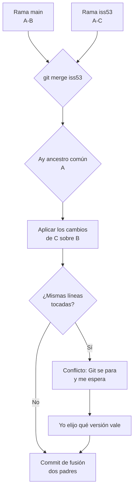

# Merge

## 1. Definición breve

`git merge` **junta** el trabajo de dos ramas en una sola, **conservando el
historial** de las dos: crea un commit con dos padres.

> Nota: aquí *merge* se explica siempre como `git merge` (la orden de Git). La
> palabra inglesa *merge* sola, en programación, puede significar "combinar" en
> general (por ejemplo, ordenar y unir dos listas).

## 2. Explicación paso a paso

1. Te situas en la rama que **recibe** el trabajo (por ejemplo `main`) y ejecutas
   `git merge iss53`.
2. Git busca el **ancestro común**: el último commit que ambas ramas tienen en común.
3. Git aplica los cambios de la otra rama encima de la tuya.
4. Si las dos ramas han tocado las mismas líneas, aparece un **conflicto**: Git se
   para y te espera. No fusiona nada hasta que tú decidas.
5. Si todo va bien, Git crea un **commit de fusión** (*merge commit*): un commit
   especial que tiene **dos padres**, y por eso la historia queda con una bifurcación.

**Idea clave:** la historia **no se reescribe**. Merge añade, nunca rehace.

Pro Git lo describe así: *"Git crea una nueva instantánea resultante de la fusión
a tres bandas; y crea automáticamente una nueva confirmación de cambios (commit)
que apunta a ella. Nos referimos a este proceso como «fusión confirmada» y su
particularidad es que tiene más de un padre"*
([Pro Git ES](https://git-scm.com/book/es/v2/Ramificaciones-en-Git-Procedimientos-Básicos-para-Ramificar-y-Fusionar)).

## 3. Para qué sirve y cuándo se utiliza

- Sirve para **incorporar el trabajo de una rama** en otra (la función principal).
- Sirve para **integrar cambios de varias personas** que trabajan en paralelo.
- Se usa cuando la rama ya está **publicada** (la has pusheado): merge es la
  opción segura porque no cambia lo que ya ven los demás.
- **Avance rápido** (*fast-forward*): si tu rama no ha avanzado nada, Git solo la
  avanza, sin crear commit de fusión. Se evita con `--no-ff`
  ([docs](https://git-scm.com/docs/git-merge)).

## 4. Ejemplo práctico relacionado con DAW

Tú en `main`; otra persona (o tú en otro momento) trabaja en `iss53` y arregla el
formulario de contacto:

```bash
git checkout main      # me pongo en la rama que recibe
git pull               # por si acaso
git merge iss53        # traigo el arreglo del formulario
# si hay conflicto:
git status             # me dice qué archivos están en conflicto
# edito el archivo, y luego:
git add index.php
git commit             # archivo del conflicto confirmado
```

## 5. Código pequeño comentado

Cómo se ve un conflicto dentro del archivo (marcas que mete Git):

```text
<<<<<<< HEAD:index.php      # lo que hay en mi rama (main)
$total = $precio;
=======                     # separador
$total = $precio * 1.21;    # lo que trae la otra rama (iss53)
>>>>>>> iss53:index.php     # fin de la otra rama
```

Tú borras las tres líneas de marca y dejas el contenido que quieres. Después
`git add` + `git commit`.

Y el caso "todo va bien":

```bash
git merge --no-ff iss53   # obliga a crear commit de fusión
```

## 6. Diagrama (Mermaid)



> Este diagrama **no se ha validado automáticamente**: ábrelo en Obsidian, en
> GitHub o en mermaid.live para comprobar que se ve bien.

## 7. Conceptos con los que se suele confundir

- **Merge ≠ [Rebase](rebase.md)**: merge **añade** un commit; rebase
  **reescribe** los commits para dejarlos en línea recta.
- **Merge ≠ pull**: `git pull` es `git fetch` + `git merge` (o rebase). Pull es el
  atajo, merge es la operación.
- **Commit de fusión ≠ commit normal**: el de fusión tiene **dos padres**; el
  normal, uno.
- **Conflicto ≠ error**: un conflicto es Git pidiéndote una decisión, no un fallo
  del código.
- **Merge en general ≠ `git merge`**: en programación, *merge* también es
  combinar dos listas ya ordenadas.

## 8. Errores frecuentes

- **Resolver el conflicto quedándose con el archivo entero de un lado**: eso
  borra el trabajo de la otra persona sin querer. Se edita a mano.
- **Hacer `git add .` sin revisar qué estaba en conflicto**: es el error más
  típico; primero `git status`, luego editar, luego `git add` lo justo.
- **Mezclar un merge con un cambio de código**: si además quieres añadir
  funcionalidad, hazlo en otro commit para poder deshacer.
- **Intentar «arreglar» un conflicto con `git reset --hard`**: tira tus cambios
  locales. Para empezar de cero está `git merge --abort`
  ([docs](https://git-scm.com/docs/git-merge)).
- **Olvidar el `git commit` tras resolver**: el merge se queda a medias.

## 9. Tres preguntas de repaso

1. ¿Qué diferencia hay entre un commit de fusión y un commit normal?
2. ¿Qué son esas tres líneas con `<<<<<<<` y `>>>>>>>` en un archivo con conflicto?
3. ¿Por qué el merge es la opción segura si la rama ya está publicada?

### Respuestas

1. El commit de fusión tiene dos padres: apunta a la punta de la rama que
   recibía y a la de la que traes. El normal solo tiene un padre. Por eso la
   historia queda con una bifurcación en el caso del merge.
2. Son marcas que pone Git para señalar los tres trozos: lo tuyo, el separador y
   lo de la otra rama. Tú decides qué contenido se queda, borras las marcas y
   haces `git add` + `git commit`.
3. Porque merge no reescribe nada: lo que ya ven los demás sigue ahí. Rebase, en
   cambio, crea commits nuevos y descarta los antiguos, así que si alguien ya
   había descargado tu rama, dejaría de tener esos commits.

## 10. Términos relacionados

- [Rebase](rebase.md) — la otra forma de juntar ramas: reescribe la historia.
- [CI/CD](ci-cd.md) — los merges son el punto donde se comprueba el código unido.
- [Glosario](../Glosario.md) — índice general.

*(Pendiente de crear ficha propia para: rama, commit, conflicto, fast-forward.)*

## 11. Fuentes y límites de la explicación

- Fuentes consultadas:
  - [Pro Git (ES) — Procedimientos básicos para ramificar y fusionar](https://git-scm.com/book/es/v2/Ramificaciones-en-Git-Procedimientos-Básicos-para-Ramificar-y-Fusionar)
    (commit de fusión, avance rápido, conflictos y marcadores).
  - [git-merge — documentación de referencia](https://git-scm.com/docs/git-merge)
    (commit con dos padres, `--no-ff`, `--abort`, `--no-commit`).
    **Esta página no tiene versión en español**: la cita está en inglés.
- Límites:
  - No se ha ejecutado ningún comando de Git en esta sesión: el ejemplo es una
    transcripción de los comandos que describe la documentación enlazada.
  - El detalle de los marcadores de conflicto se ha simplificado: en la práctica
    incluyen hash y rama en cada línea, y pueden aparecer varios bloques en un
    mismo archivo.
  - El diagrama Mermaid no se ha validado automáticamente.

## 12. Mis notas

<!-- Sección reservada para la estudiante. No borrar ni sobrescribir. -->