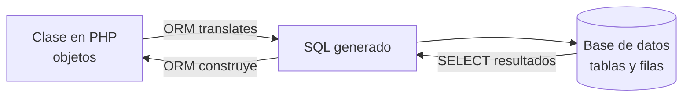
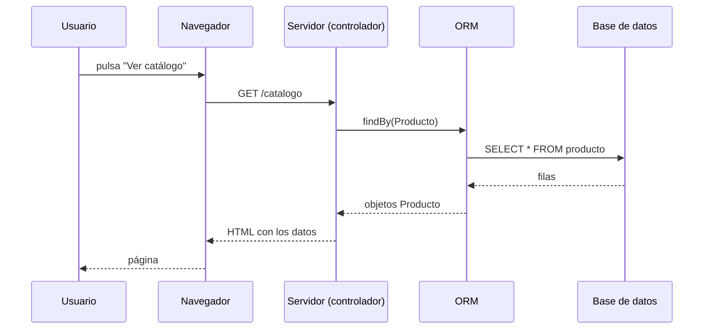

# ORM

## 1. Definición breve

ORM son las siglas de **Object-Relational Mapping** (mapeo entre objetos y
relaciones). Es una capa que sirve de translator: te permite trabajar con
**objetos** de tu lenguaje de programación y el ORM se encarga de convertir
eso en filas y columnas de una base de datos relacional (MySQL, PostgreSQL,
SQLite…).

> **Aviso de significado:** en marketing, «ORM» también quiere decir
> *Optimización de Ventas Relacionales* (gestión de clientes potenciales).
> En este glosario solo se explica el sentido técnico de programación.

## 2. Explicación paso a paso

1. En la base de datos los datos viven en **tablas**: filas y columnas.
   En PHP, Python o Java los datos viven en **objetos** (clases con
   propiedades y métodos).
2. Estas dos formas no se parecen. El ORM pone una pieza en medio que
   **traduce** una cosa en la otra.
3. Tú escribes algo como `$usuario->nombre = 'Ana'` (código de objetos).
4. El ORM mira los metadatos (la descripción de tus clases) y genera el
   `INSERT INTO usuarios ...` correspondiente (SQL).
5. A la inversa, cuando lees, el ORM ejecuta un `SELECT` y te devuelve
   **objetos** ya rellenos, sin que tengas que ir leyendo el resultado
   fila a fila.

**Dato importante:** un ORM **no reemplaza a SQL**. Está por encima y acaba
usando SQL. Por eso es importante seguir aprendiendo SQL.

## 3. Para qué sirve y cuándo se utiliza

- Sirve para **no escribir SQL a mano** en el día a día y trabajar con objetos
  que se parecen a tu dominio (un `Pedido`, un `Usuario`).
- Ahorra código repetitivo: crear la tabla, el `INSERT`, el `UPDATE` y
  convertir resultados.
- Se usa cuando quieres **mantener el código claro** y que el equipo no tenga
  SQL esparcido por todas las clases.
- Ejemplos reales: Doctrine ORM (PHP), Hibernate (Java), Django ORM (Python),
  Eloquent (Laravel), Sequelize / Prisma (Node.js).
- **No** se usa cuando necesitas un SQL muy complejo o un informe antiguo:
  muchos ORM permiten escribir SQL a mano de todos modos.

## 4. Ejemplo práctico relacionado con DAW

Web de una tienda: cada producto de la base de datos se convierte en un
objeto `Producto` que la plantilla usa directamente.

```text
1. El usuario pide /catalogo
2. La plantilla (controlador) pide al ORM: "dame los productos"
3. El ORM ejecuta SELECT y devuelve objetos Producto
4. La plantilla recorre los objetos y pinta nombre y precio
5. En el HTML no hay ni una sola fila de SQL
```

## 5. Código pequeño comentado

Comparación rápida: **sin ORM** (SQL directo) frente a **con ORM**.

```php
// SIN ORM: escribo el SQL a mano y leo fila a fila
$sql = "SELECT nombre, email FROM usuarios WHERE activo = 1";
foreach ($pdo->query($sql) as $fila) {
    echo $fila['nombre'] . ' - ' . $fila['email'] . "\n";
}

// CON ORM: pido objetos
$usuarios = $repo->findBy(['activo' => true]); // Doctrine ORM
foreach ($usuarios as $u) {
    echo $u->getNombre() . ' - ' . $u->getEmail() . "\n";
}
```

Ejemplo de **clase** que el ORM lee (aquí están los metadatos):

```php
#[ORM\Entity]
class Usuario {
    #[ORM\Id, ORM\GeneratedValue, ORM\Column]
    private ?int $id = null;

    #[ORM\Column]
    private string $nombre = '';
}
```

## 6. Diagrama (Mermaid)



Y el recorrido de una petición web:



> Estos diagramas **no se han validado automáticamente**: ábrelos en Obsidian,
> en GitHub o en mermaid.live para comprobar que se ven bien.

## 7. Conceptos con los que se suele confundir

- **SQL**: es el lenguaje que habla con la base de datos. El ORM lo genera
  por ti; no es lo mismo.
- **PDO** (PHP Data Objects): es la interfaz de PHP para acceder a la base
  datos. Según el manual de PHP, PDO da abstracción del **acceso a datos**,
  pero **no** reescribe el SQL: no es un ORM.
- **DAO / repositorio**: es el patrón (la forma de organizar el código) que
  suele acompañar al ORM. El ORM es la herramienta; el repositorio, el patrón.
- **HQL / DQL**: es el «SQL de los ORM», el lenguaje con el que a veces puedes
  pedirle cosas al ORM sin escribir SQL de verdad.

## 8. Errores frecuentes

- **Creer que no hace falta saber SQL**: si el ORM falla o va lento, sin SQL
  no sabrás qué está pasando. Se complementa, no sustituye.
- **N+1 consultas**: pedir un usuario y luego sus pedidos **uno a uno** genera
  muchísimas consultas lentas. Se resuelve cargando las relaciones por adelantado
  (en Doctrine, `fetch: 'EAGER'`).
- **Concatenar datos en el nombre de una relación**: el ORM no adivina, hay que
  declarar cómo se llama cada tabla y cada columna.
- **Cambiar de ORM a mitad de proyecto**: cada ORM tiene sus ficheros de
  configuración y sus mecanismos; migrar es costoso.
- **No controlar las transacciones**: si guardas muchos datos, usa
  transacciones para que no queden guardados a medias.

## 9. Tres preguntas de repaso

1. ¿Qué dos cosas traduce entre sí un ORM y por qué hace falta?
2. ¿PDO es un ORM? ¿Qué diferencia hay?
3. ¿Qué es el problema de las consultas N+1 y por qué aparece al usar un ORM?

### Respuestas

1. Traduce entre **objetos** del lenguaje de programación (filas y columnas con
   métodos) y **tablas** de la base de datos relacional. Hace falta porque las
   dos formas de representar los datos no se parecen.
2. No. PDO es una interfaz de acceso a datos: ejecuta el SQL que tú escribes.
   El ORM además genera el SQL y convierte filas en objetos. El manual de PHP
   lo dice así: PDO no da abstracción de base de datos, no reescribe el SQL.
3. Es hacer una consulta para el dato principal y, por cada resultado, otra
   consulta para sus datos relacionados. Con 100 productos son 101 consultas y
   la web va muy lenta. Se evita cargando las relaciones de golpe.

## 10. Términos relacionados

- [HTTP](http.md) — el protocolo con el que el navegador pide esas páginas.

*(Pendiente de crear fichas propias para: SQL, PDO, entidad, relación,
migraciones, transacción.)*

## 11. Fuentes y límites de la explicación

- Fuentes consultadas (documentación oficial):
  - [Doctrine ORM — Object Relational Mapper para PHP](https://www.doctrine-project.org/projects/orm.html)
  - [PHP — PDO (PHP Data Objects)](https://www.php.net/manual/es/book.pdo.php)
    («PDO no proporciona *ninguna* abstracción de base de datos: no reescribe el
    SQL, ni emula funcionalidades ausentes»).
  - [Django — Object-relational mapper](https://docs.djangoproject.com/en/stable/topics/db/models/)
    (enlazado desde la [página oficial de Django](https://www.djangoproject.com/))
- Límites:
  - No se ha ejecutado ningún código de ejemplo en esta sesión: están
    escritos a partir de la documentación citada.
  - Los fragmentos de Doctrine usan atributos de PHP 8; la forma exacta
    depende de la versión.
  - El detalle de las «migraciones» de Doctrine se explica solo en una frase:
    merece ficha propia.
  - Los diagramas Mermaid no se han validado automáticamente.

## 12. Mis notas

<!-- Sección reservada para la estudiante. No borrar ni sobrescribir. -->