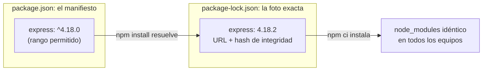

# Diferencia entre package.json y package-lock.json

## 1. Definición breve

**`package.json`** es la **lista de la compra**: dice qué es tu proyecto y qué
dependencias quiere, con rangos de versión.

**`package-lock.json`** es el **tique de compra**: guarda las versiones exactas
que se instalaron de verdad, con su origen y su huella de integridad.

## 2. Explicación paso a paso

1. Creas `package.json` con `npm init` (o a mano). Ahí pones el nombre, los
   scripts y las dependencias.
2. Al ejecutar `npm install express`, npm lee ese archivo, busca una versión que
   cumpla el rango pedido (por ejemplo `^4.18.0`) y la descarga.
3. npm también resuelve las dependencias de esas dependencias. El resultado
   exacto lo escribe en `package-lock.json`.
4. Guardas los dos archivos en el repositorio. El lock no se escribe a mano.
5. Otra persona ejecuta `npm ci` y obtiene **el mismo árbol** de paquetes, sin
   sorpresas de última hora.

**Regla mental:** `package.json` dice *«quiero esto»*; `package-lock.json` dice
*«esto es lo que se instaló exactamente»*.

## 3. Para qué sirve y cuándo se utiliza

- `package.json` sirve para **declarar** el proyecto: nombre, scripts,
  dependencias y versiones mínimas o compatibles.
- `package-lock.json` sirve para **repetir** una instalación idéntica en otro
  ordenador, en un servidor o en CI/CD.
- Se usan **juntos** en cualquier proyecto con npm.
- El lock se usa sobre todo cuando varias personas o máquinas instalan el mismo
  proyecto: evita que cada una acabe con versiones distintas.
- También ayuda a revisar cambios de dependencias en un *diff* y a detectar
  paquetes que cambian sin querer.

## 4. Ejemplo práctico relacionado con DAW

Una mini API de tareas con Express. El manifest pide una versión compatible:

```json
{
  "name": "tareas-daw",
  "version": "1.0.0",
  "scripts": { "dev": "node server.js" },
  "dependencies": { "express": "^4.18.0" }
}
```

El lock guarda la versión que se instaló de verdad (aquí resumido):

```json
{
  "name": "tareas-daw",
  "lockfileVersion": 3,
  "packages": {
    "node_modules/express": {
      "version": "4.18.2",
      "resolved": "https://registry.npmjs.org/express/-/express-4.18.2.tgz"
    }
  }
}
```

En el lock real también aparecen las dependencias de Express y un campo
`integrity` con un hash. Aquí se han omitido para que el ejemplo sea corto.

## 5. Código pequeño comentado

```bash
npm init -y                 # crea package.json con valores por defecto
npm install express         # añade express a package.json y crea/actualiza el lock
npm ci                      # instala exactamente lo que dice el lock (no lo modifica)
```

- `npm install` puede **cambiar** el lock si las versiones permitidas han
  cambiado.
- `npm ci` es más estricto: exige que exista el lock y que encaje con
  `package.json`. Si no encajan, falla en vez de actualizar el lock.

## 6. Diagrama (Mermaid)



> Este diagrama **no se ha validado automáticamente**: ábrelo en Obsidian, en
> GitHub o en mermaid.live para comprobar que se ve bien.

## 7. Conceptos con los que se suele confundir

- **`package.json` ≠ `package-lock.json`**: el primero pide con rangos; el
  segundo fija lo que se instaló exactamente.
- **`package-lock.json` ≠ `node_modules/`**: el lock es la receta; `node_modules`
  son los archivos ya instalados en tu disco (y no se sube al repositorio).
- **`package-lock.json` ≠ `npm-shrinkwrap.json`**: tienen el mismo formato, pero
  el shrinkwrap sí se puede publicar y tiene prioridad si están los dos.
- **Lock ≠ archivo de configuración**: no se edita a mano; lo genera npm.

## 8. Errores frecuentes

- **Añadir `package-lock.json` al `.gitignore`**: cada persona instala versiones
  distintas y aparecen fallos que solo pasan en una máquina.
- **Editar el lock a mano**: se rompe la coherencia con `package.json`; usa npm.
- **Borrar el lock para «arreglar» un conflicto de Git**: antes prueba
  `npm install`, revisa el resultado y ejecuta las pruebas.
- **Usar `npm install` en CI en vez de `npm ci`**: `npm install` puede
  actualizar dependencias; `npm ci` busca una instalación repetible.
- **Pensar que el lock también instala**: el lock describe; quien instala es
  `npm ci` o `npm install`.

## 9. Tres preguntas de repaso

1. ¿Cuál de los dos archivos pide versiones con rangos y cuál guarda la versión
   exacta?
2. ¿Por qué conviene subir `package-lock.json` al repositorio?
3. ¿Qué hace `npm ci` si `package.json` y el lock no están de acuerdo?

### Respuestas

1. `package.json` pide con rangos (por ejemplo `^4.18.0`);
   `package-lock.json` guarda la versión exacta que se instaló (por ejemplo
   `4.18.2`), además del origen y el hash.
2. Para que todas las personas y servidores instalen el mismo árbol de
   dependencias. Sin el lock, cada instalación puede resolver versiones
   distintas dentro del rango permitido.
3. Falla con un error y no modifica el lock. `npm install`, en cambio, puede
   actualizarlo; por eso `npm ci` se usa cuando se quiere una instalación
   repetible.

## 10. Términos relacionados

- [CI/CD](ci-cd.md) — muchos flujos usan el lock y `npm ci` para instalar siempre
  lo mismo.
- [Linter](linter.md) — otra herramienta automática que se apoya en la
  configuración del proyecto.
- [Glosario](../Glosario.md) — índice general.

*(Pendiente de crear ficha propia para: npm, Node.js, dependencia transitiva,
semver.)*

## 11. Fuentes y límites de la explicación

- Fuentes consultadas:
  - [npm Docs — package.json](https://docs.npmjs.com/cli/v10/configuring-npm/package-json)
    (campos, dependencias y rangos de versión).
  - [npm Docs — package-lock.json](https://docs.npmjs.com/cli/v10/configuring-npm/package-lock-json)
    (árbol exacto, propósito del lock, diferencia con `npm-shrinkwrap.json`).
  - [npm Docs — npm ci](https://docs.npmjs.com/cli/v10/commands/npm-ci)
    (requiere un lock existente y falla si no encaja con `package.json`).
- Límites:
  - No se ha ejecutado `npm` en esta sesión: los comandos y archivos son
    ejemplos tomados de la documentación enlazada.
  - El fragmento del lock está **resumido**: un lock real incluye muchas más
    entradas y el campo `integrity`.
  - La documentación consultada es la de npm v10; en otras versiones pueden
    cambiar detalles, aunque la idea de manifiesto y lock se mantiene.
  - El diagrama Mermaid no se ha validado automáticamente.

## 12. Mis notas

<!-- Sección reservada para la estudiante. No borrar ni sobrescribir. -->
