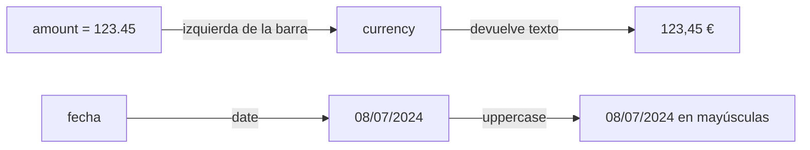
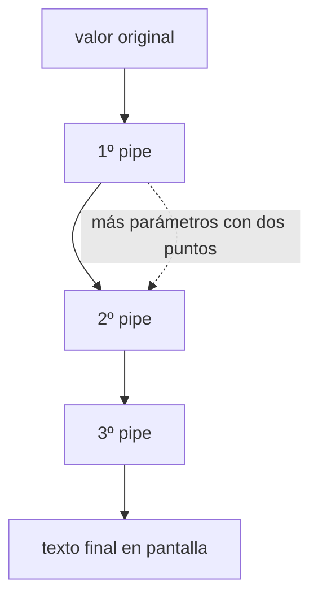

# Pipes en Angular

## 1. Definición breve

Un **pipe** es un **operador de la plantilla** que **transforma un valor** antes de
mostrarlo en pantalla. Se escribe con la barra vertical `|`:

```text
{{ amount | currency }}
```

La documentación los llama «operadores especiales en las expresiones de plantilla
de Angular que te permiten transformar datos de forma declarativa».

## 2. Explicación paso a paso

1. El símbolo es `|`, tomado de las tuberías de Unix. Ojo: en JavaScript normal la
   barra es el operador **OR bit a bit**; en las plantillas de Angular **no
   existen los operadores bit a bit**, así que la barra es siempre un pipe.
2. El pipe es un **operador binario**: a la izquierda va el valor que entra, a la
   derecha el nombre del pipe y, si hace falta, sus parámetros.
3. **Para usar un pipe hay que declararlo**: importarlo de `@angular/common` y
   ponerlo en el array `imports` del componente.
4. Se pueden **encadenar**, y Angular los ejecuta **de izquierda a derecha**:
   `{{ fecha | date | uppercase }}` primero formatea la fecha y luego la pasa a
   mayúsculas.
5. Los parámetros van **detrás de dos puntos**: `{{ fecha | date: 'hh:mm' }}`. Con
   varios parámetros, separados también por `:`.
6. Por defecto un pipe es **puro**: Angular solo lo ejecuta cuando el valor
   cambia. Es una ventaja de rendimiento, pero tiene un precio (ver sección 8).

## 3. Para qué sirve y cuándo se utiliza

- **Formatear para el usuario final**: `currency` (moneda), `date` (fechas),
  `percent`, `decimal`, `titlecase`, `uppercase`, `lowercase`.
- **Esperar datos que llegan tarde**: `async` lee el valor de una `Promise` o de
  un `Observable` de RxJS.
- **Depurar**: `json` convierte un objeto en texto.
- **Recortar**: `slice` devuelve una parte de un array o de un texto.
- **Traducir según idioma**: `i18nPlural` y `i18nSelect`.
- Escribe el pipe cuando el formato **se repite en varias plantillas**: ahí
  compensa tener la función declarada una vez.

## 4. Ejemplo práctico relacionado con DAW

Web de una tienda online que muestra un pedido:

```text
1. El componente tiene importe = 123.45 y fecha = '2024-07-08'
2. {{ importe | currency }} lo muestra como 123,45 € según el idioma del usuario
3. {{ fecha | date }} lo muestra como 8 jul 2024
4. {{ fecha | date | uppercase }} añade las mayúsculas encima
5. Los pipes los pone el navegador, no tu servidor: cada usuario lo ve en su idioma
```

## 5. Código pequeño comentado

Usar un pipe:

```ts
@Component({
  selector: 'app-total',
  imports: [CurrencyPipe],   // 1. importar y 2. declararlo en imports
  template: `<p>{{ amount | currency }}</p>`,
})
export class Total {
  amount = 123.45;           // 3. el valor entra por la izquierda de la barra
}
```

Crear uno propio, que es lo que más se pide en trabajos:

```ts
import {Pipe, PipeTransform} from '@angular/core';

@Pipe({name: 'kebabCase'})      // nombre en camelCase, sin guiones
export class KebabCasePipe implements PipeTransform {
  transform(valor: string): string {
    return valor.toLowerCase().replace(/ /g, '-');
  }
}
```

## 6. Diagrama (Mermaid)

Cómo viaja el valor a través de los pipes:



De izquierda a derecha, como los ejecuta Angular:



> Estos diagramas **no se han validado automáticamente**: ábrelos en Obsidian,
> en GitHub o en mermaid.live para comprobar que se ven bien.

## 7. Conceptos con los que se suele confundir

- **Pipe ≠ directiva**. La directiva cambia el DOM o el comportamiento de un
  elemento; el pipe **transforma un valor**. Se distinguen por el símbolo:
  `*ngIf` es directiva, `| currency` es pipe.
- **Pipe ≠ función normal**. Se parecen, pero un pipe está pensado para la
  plantilla y Angular lo memoiza si es puro.
- **Pipe ≠ *format function*** (`formatCurrency`, `formatDate`). Son funciones
  sueltas del mismo `@angular/common` para usar en TypeScript, no en la
  plantilla. La documentación recomienda las funciones fuera de la plantilla y
  **desaconseja inyectar la clase del pipe** en un servicio.
- **`{{ }}` con método de clase**: `{{ formatear(123) }}` funciona, pero no es
  idiomático: lo normal es un pipe.
- **La barra `|` no es el OR de JavaScript**. En las plantillas de Angular los
  operadores bit a bit no existen.
- **La precedencia del pipe engaña**. Tiene **menor** precedencia que `+`, `-`,
  `*`, `/`, `%`, `&&`, `||` y `??`, pero **mayor** que el operador condicional
  (ternario). Con `{{ a ? 'x' : 'y' | pipe }}` el pipe se aplica solo a `'y'`.
  Si dudo, paréntesis.

## 8. Errores frecuentes

- **Olvidar declarar el pipe** en `imports`: la plantilla no compila y el error
  no siempre nombra el pipe que falta.
- **Esperar que un pipe puro detecte cambios dentro de un array u objeto**. Al ser
  puro, solo se recalcula si cambia la referencia: si mutas `array.push(...)` en
  la misma variable, la vista puede no actualizarse. La documentación explica que
  los cambios en propiedades internas **no se detectan** salvo que se sustituya el
  objeto entero.
- **Poner `pure: false` a la primera de cambio**. La documentación avisa
  claramente: evita los pipes impuros salvo que sea imprescindible, porque tienen
  un coste de rendimiento notable. Si aun así lo usas, la convención es llamar
  `Impure` al pipe.
- **Encadenar sin paréntesis y no saber qué se aplica a qué** (ver el punto de
  precedencia en la sección 7).
- **Poner guiones en el nombre del pipe**: la convención es `camelCase` en el
  `name`; la clase va en `PascalCase` con `Pipe` detrás (`kebabCase` →
  `KebabCasePipe`).
- **Meter toda la lógica en el pipe**. Si el cálculo es un negocio, va en el
  componente o en un servicio; el pipe es para el formato.

## 9. Tres preguntas de repaso

1. ¿Qué lado de la barra va el valor y qué lado va el nombre del pipe?
2. ¿Por qué un pipe puro puede no actualizar la vista si añades un elemento a un
   array, y cuál es la salida recomendada?
3. ¿Cómo se llama el pipe que formatea un número como moneda, y qué dos pasos
   hacen falta para poder usarlo en una plantilla?

### Respuestas

1. El **valor de entrada va a la izquierda** de la barra y el **nombre del pipe a
   la derecha**. El pipe es un operador binario: `{{ amount | currency }}` pasa
   `amount` a `CurrencyPipe`. Los parámetros van después de dos puntos.
2. Porque un pipe puro solo se ejecuta cuando cambia un valor primitivo o la
   **referencia** de un objeto. Si haces `array.push(...)` sobre la misma
   referencia, Angular cree que el valor no ha cambiado. La salida recomendada
   es **sustituir el array entero** (por ejemplo con `filter`, `map` o el spread
   `[...array]`) en lugar de marcar el pipe como `pure: false`, porque la propia
   documentación desaconseja los pipes impuros.
3. Se llama **`currency`** (`CurrencyPipe`). Para usarlo hacen falta dos pasos:
   **importarlo** de `@angular/common` y **añadirlo al array `imports`** del
   componente. Sin los dos, la plantilla no compila.

## 10. Términos relacionados

- [Directivas de Angular (resumen)](directivas-angular.md) — la otra gran pieza de
  las plantillas: directivas frente a pipes.
- [Angular standalone vs Ng Module](angular-standalone-vs-ngmodule.md) — por qué los
  pipes van declarados en el array `imports` de cada componente.
- [HTTP](http.md) — los datos que luego formateas con `currency` o `date`.
- [Glosario](../Glosario.md) — índice general.

*(Pendiente de crear ficha propia para: componente de Angular, plantilla,
enlazado (*binding*), `ng-template` y formularios con `ngModel`.)*

## 11. Fuentes y límites de la explicación

- Fuentes consultadas (documentación oficial, en inglés):
  - [Pipes — angular.dev](https://angular.dev/guide/templates/pipes) (definición,
    tabla de pipes incluidos en `@angular/common`, uso del `|`, encadenado,
    parámetros con `:` y precedencia del operador; `pure` e impure pipes;
    creación de pipes propios; funciones `formatCurrency`/`formatDate` frente a
    inyectar la clase del pipe).
- Límites:
  - Documentación leída en su versión **v22**.
  - **No se ha creado ni ejecutado ningún proyecto Angular en esta sesión**: los
    fragmentos son ejemplos escritos a partir de la documentación, no plantillas
    compiladas.
  - La tabla de pipes de la sección 3 está **resumida**: la documentación lista
    más pipes incluidos de los que se mencionan aquí.
  - **No se ha verificado** si alguno de los pipes incluidos está marcado como
    obsoleto en la versión actual: la búsqueda web adicional quedó bloqueada por
    límite de peticiones, así que la ficha no afirma nada sobre su estado. Como
    referencia, sí está confirmado que `*ngIf`/`*ngFor`/`*ngSwitch` sí lo están
    (ver la ficha de [directivas](directivas-angular.md)).
  - Los pipes de formularios (`ngModel`) y los `async` con RxJS quedan
    mencionados, no explicados: merecen ficha propia.
  - Los diagramas Mermaid **no se han validado automáticamente**.

## 12. Mis notas

<!-- Sección reservada para la estudiante. No borrar ni sobrescribir. -->