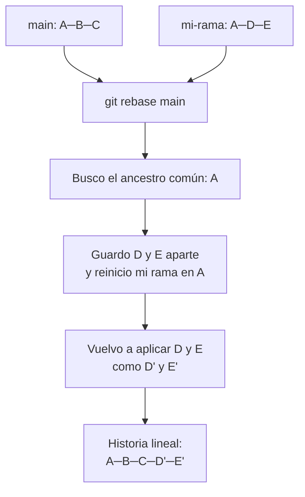

# Rebase

## 1. Definición breve

`git rebase` **vuelve a aplicar** tus commits encima de otra rama: tu historia
queda recta (lineal) y el historial **se reescribe** con commits nuevos.

## 2. Explicación paso a paso

1. Te pones en tu rama y ejecutas `git rebase main`.
2. Git busca el **ancestro común**: el último commit que tu rama y `main`
   tienen en común.
3. Guarda las diferencias que introdujeron tus commits en archivos temporales y
   **reinicia** (*reset*) tu rama hasta ese ancestro común.
4. **Vuelve a aplicar** tus cambios, uno a uno, encima de la `main` actualizada.
5. El resultado: tus commits están ahora «encima» de la `main`, sin bifurcación.
   Pero **son commits nuevos**: tienen otro identificador.

Pro Git lo describe así: *"Haciendo que Git vaya al ancestro común de ambas
ramas… guarde esas diferencias en archivos temporales, reinicie (reset) la rama
actual… y finalmente, vuelva a aplicar ordenadamente los cambios"*
([Pro Git ES](https://git-scm.com/book/es/v2/Ramificaciones-en-Git-Reorganizar-el-Trabajo-Realizado)).

Y avisa de lo que implica: *"estás abandonando las confirmaciones de cambio ya
creadas y estás creando unas nuevas; que son similares, pero diferentes"*.

## 3. Para qué sirve y cuándo se utiliza

- Sirve para tener una **historia lineal y legible**, sin ramificaciones.
- Sirve para **actualizar tu rama** con lo último de `main` sin crear un commit
  de fusión, antes de abrir una pull request o antes de publicar.
- Sirve para **ordenar y limpiar commits** gracias a `git rebase -i`: permite
  reescribir el mensaje, reordenar, dividir o combinar commits.
- Se usa en ramas **propias y todavía no publicadas**.
- **No se usa** en ramas que ya has pusheado: es la regla de oro, la dice la propia
  documentación oficial.

`git rebase -i HEAD~3` abre el editor con los últimos tres commits y una lista
para editarlos: `pick`, `reword`, `edit`, `squash`, `fixup`, `exec`
([Pro Git ES](https://git-scm.com/book/es/v2/Herramientas-de-Git-Reescribiendo-la-Historia)).

## 4. Ejemplo práctico relacionado con DAW

Estás en `formulario-login` con dos commits y `main` ya tiene un cambio tuyo:

```bash
git rebase main        # tu rama se apoya en la main actual
# si aparece un conflicto, lo resuelves y sigues:
git rebase --continue
# si te has arrepentido:
git rebase --abort
```

Resultado: 4 commits en línea recta, sin el «nudo» del merge. Y al abrir la pull
request, el resto del equipo ve una historia limpia.

## 5. Código pequeño comentado

```bash
# Estado ANTES:            main:        A─B─C
#                          mi-rama:            D─E

git rebase main        # reaplico D y E encima de B─C

# Estado DESPUÉS:         main:        A─B─C
#                          mi-rama:            D'─E'   (commits nuevos)

git rebase -i HEAD~3   # abro los últimos 3 commits para limpiarlos
# En el editor:
# pick  abc123  Arreglo el formulario
# reword def456  Mensaje mejor escrito    <- solo cambio el texto
# squash 789abc  Arreglo el estilo         <- uno encima del anterior
```

## 6. Diagrama (Mermaid)



> Este diagrama **no se ha validado automáticamente**: ábrelo en Obsidian, en
> GitHub o en mermaid.live para comprobar que se ve bien.

## 7. Conceptos con los que se suele confundir

- **Rebase ≠ [Merge](merge.md)**: merge **añade** un commit con dos padres;
  rebase **reescribe** y crea commits nuevos. Merge no toca lo publicado, rebase sí.
- **Rebase ≠ pull**: `git pull --rebase` es una forma de traer los cambios de
  `main` **sin** commit de fusión.
- **Rebase ≠ reescribir un commit suelto**: `git commit --amend` cambia solo el
  último; rebase actúa sobre una lista de commits.
- **Rebase ≠ dividir el trabajo**: `git rebase -i` con `squash`/`fixup` **combina**
  commits; para dividirlos hace falta otra técnica.
- **Rebase ≠ «arreglar» la historia**: si la historia está mal, rebase no la
  repara, solo la reescribe tal cual.

## 8. Errores frecuentes

- **Rebasear una rama ya publicada**: es el error más grave. Si alguien ya
  descargó tus commits antiguos, desaparecerán de su copia. La documentación lo
  dice con todas sus letras: *"Nunca reorganices confirmaciones de cambio (commits)
  que hayas enviado (push) a un repositorio público"*.
- **Confundir `git push` con `git push --force`**: si rebasa, el push normal será
  rechazado; la opción `--force-with-lease` puede servir, pero solo si eres la
  única persona trabajando en esa rama.
- **Hacer rebase con cambios sin confirmar**: puede fallar o perderlos. Guarda
  antes con `git commit`.
- **Usar `git rebase -i HEAD~3` creyendo que toca «los tres últimos archivos»**:
  toca **tres commits**, que pueden tener muchos archivos cada uno.
- **Abandonar a mitad un rebase sin usar `--continue` ni `--abort`**: la rama se
  queda en un estado intermedio y Git avisa.

## 9. Tres preguntas de repaso

1. ¿Por qué se dice que rebase reescribe la historia?
2. ¿Por qué no se debe hacer rebase de una rama ya publicada?
3. ¿Para qué sirve `git rebase -i` y qué significa `squash` en esa lista?

### Respuestas

1. Porque los commits que tenías se abandonan y se crean commits nuevos, con
   otro identificador, aplicados sobre otro punto de partida. El contenido es el
   mismo, pero el historial es distinto.
2. Porque tus commits antiguos están en la copia de otra persona. Si los borras
   de tu rama mediante el rebase, esa persona se queda con commits que ya no
   existen en ningún sitio y su trabajo queda huérfano.
3. Para editar la lista de commits de forma interactiva: cambiar el mensaje de
   uno, reordenarlos o ejecutar algo en cada paso. `squash` combina ese commit
   con el anterior, juntando los dos mensajes en uno solo (`fixup` los junta
   pero se queda solo con el mensaje del primero).

## 10. Términos relacionados

- [Merge](merge.md) — la otra forma de juntar ramas: conserva el historial.
- [CI/CD](ci-cd.md) — comprobar el código tras integrar los cambios.
- [Glosario](../Glosario.md) — índice general.

*(Pendiente de crear ficha propia para: rama, commit, ancestro común, historial.)*

## 11. Fuentes y límites de la explicación

- Fuentes consultadas:
  - [Pro Git (ES) — Reorganizar el trabajo realizado](https://git-scm.com/book/es/v2/Ramificaciones-en-Git-Reorganizar-el-Trabajo-Realizado)
    (definición, pasos y «Los peligros de reorganizar»).
  - [Pro Git (ES) — Reescribiendo la historia](https://git-scm.com/book/es/v2/Herramientas-de-Git-Reescribiendo-la-Historia)
    (`git rebase -i` y la lista de comandos).
  - [git-rebase — documentación de referencia](https://git-scm.com/docs/git-rebase).
    **Esta página no tiene versión en español**: la cita está en inglés.
- Límites:
  - No se ha ejecutado ningún comando de Git en esta sesión: los ejemplos de
    las secciones 4 y 5 son transcripciones de lo que describe la documentación.
  - No se ha probado el comportamiento de `--force-with-lease`, `--continue` ni
    `--abort`; solo se cita lo que indican las fuentes enlazadas.
  - El diagrama Mermaid no se ha validado automáticamente.

## 12. Mis notas

<!-- Sección reservada para la estudiante. No borrar ni sobrescribir. -->