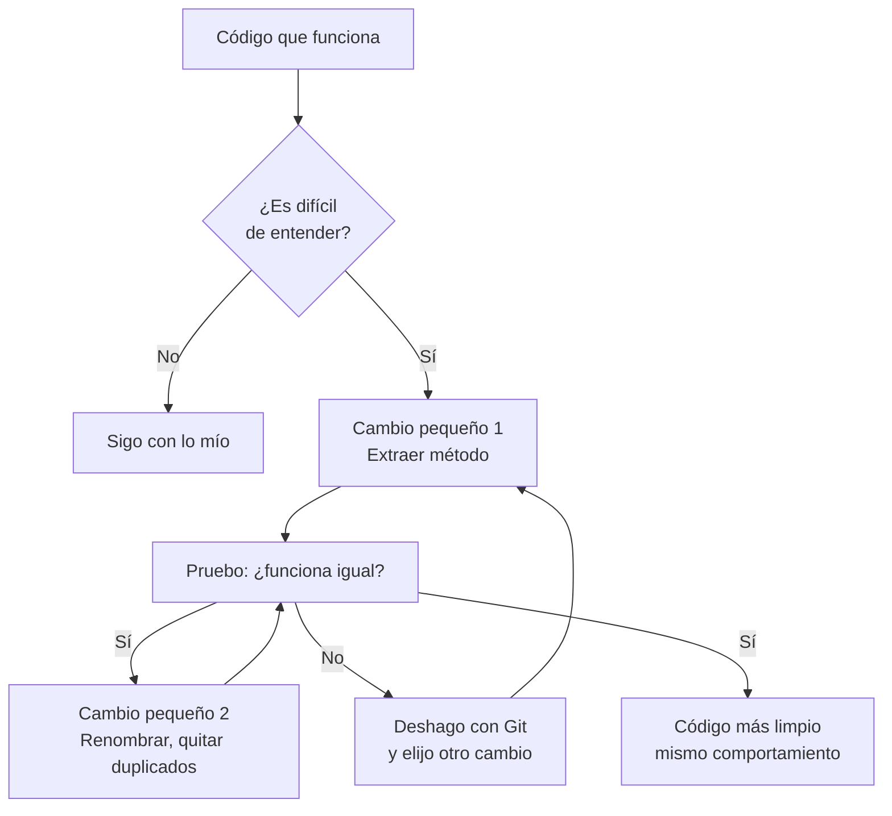

# Refactorización

## 1. Definición breve

Cambiar la **estructura interna** de un programa para que se entienda mejor y sea
más fácil de modificar, **sin cambiar lo que hace**.

## 2. Explicación paso a paso

1. El programa funciona, pero cuesta entenderlo: métodos larguísimos, nombres
   crípticos, mucho código repetido.
2. Haces un **cambio pequeño** que no altere el resultado: por ejemplo, extraes
   un bloque de 6 líneas a un método aparte con nombre descriptivo.
3. Vuelves a ejecutar el programa. Si se comporta igual, el cambio es seguro.
4. Repites el paso 2 tantas veces como haga falta, siempre en pasos pequeños.
5. El resultado es el mismo programa, pero más ordenado y más barato de ampliar.

**Idea clave:** la refactorización se hace en transformaciones pequeñas que no
rompen nada. Martin Fowler lo describe así: *"Its heart is a series of small
behavior preserving transformations"* ([refactoring.com](https://refactoring.com/)).

Ojo con un malentido frecuente: **refactorizar no es añadir funciones**. Si
mientras refactorizas añades una funcionalidad nueva, ya no es refactorización:
el programa se comporta de otra manera y no sabes qué parte ha fallado.

## 3. Para qué sirve y cuándo se utiliza

- Sirve para que el código sea **legible por ti y por los demás**.
- Sirve para **bajar el coste de ampliar** el programa más adelante.
- Se usa cuando el código **ya funciona** y ahora quieres mejorarlo, o cuando
  cuesta entender un módulo antiguo.
- Se usa justo **antes** de añadir una funcionalidad nueva: refactorizar primero
  hace que sea más fácil y menos arriesgado.
- No se usa para arreglar un error de lógica: eso es depurar, otra cosa.

## 4. Ejemplo práctico relacionado con DAW

Un `carrito.php` con 40 líneas y tres cosas mezcladas (calcular, guardar, mostrar):

```text
ANTES: una función calcularTotal() de 40 líneas que suma, aplica el IVA,
       guarda en la base de datos y hace un echo.

DESPUÉS:
  función calcularSubtotal($lineas)   → solo suma
  function aplicarIVA($subtotal)       → solo multiplica por 1,21
  function guardarPedido($pedido)      → solo guarda

La web muestra exactamente lo mismo. El código es más fácil de leer y,
si mañana cambia el IVA, solo se toca una línea.
```

## 5. Código pequeño comentado

Ejemplo mínimo de una refactorización clásica: **Extraer método**
([catálogo](https://refactoring.com/catalog/extractMethod.html)):

```php
// ANTES: una función con la lógica mezclada
function finalizar($pedido) {
    $total = $pedido['subtotal'] * 1.21;
    guardar($pedido);
    echo "Total: $total";
}

// DESPUÉS: la lógica partida en tres responsabilidades
function finalizar($pedido) {
    $total = calcularTotal($pedido['subtotal']); // 1. calcular
    guardar($pedido);                            // 2. guardar
    echo "Total: " . $total;                     // 3. mostrar
}

function calcularTotal($subtotal) {
    return $subtotal * 1.21;   // sin `return` devolvería null: bug silencioso
}
```

## 6. Diagrama (Mermaid)



> Este diagrama **no se ha validado automáticamente**: ábrelo en Obsidian, en
> GitHub o en mermaid.live para comprobar que se ve bien.

## 7. Conceptos con los que se suele confundir

- **Refactorización ≠ depurar**: refactorizar no cambia lo que hace el programa;
  depurar busca el error que hace que falle.
- **Refactorización ≠ añadir funcionalidad**: si el programa hace algo nuevo, ya
  no es refactorización (aunque a veces conviene hacer las dos cosas por separado).
- **Refactorización ≠ formateo**: dar estilos y saltos de línea es lo que hace un
  formateador; la refactorización toca la estructura.
- **Refactorización ≠ [Linter](linter.md)**: el linter *avisa* de reglas que rompes;
  la refactorización es el cambio que haces tú para limpiar el código.
- **Code smell (olor de código)**: no es un error, es una señal de que algo
  probablemente esté mal diseñado. El término lo acuñó Kent Beck. *«A code smell is a
  surface indication that usually corresponds to a deeper problem in the
  system»* ([Fowler](https://martinfowler.com/bliki/CodeSmell.html)).

## 8. Errores frecuentes

- **Refactorizar sin pruebas**: si no hay pruebas automáticas, no tienes forma
  rápida de comprobar que el comportamiento sigue igual.
- **Mezclar refactorización con funcionalidad**: haces las dos cosas en el mismo
  commit y, cuando algo falla, no sabes cuál de las dos lo causó.
- **Hacer un cambio enorme de golpe**: si el método pasa de 40 a 8 líneas de una
  vez, es imposible saber qué parte rompió el programa.
- **Confundir «código más elegante» con «mejor»**: la meta es que sea más fácil de
  entender y de cambiar, no que quede más corto.
- **Refactorizar código que va a desaparecer**: no merece la pena.

## 9. Tres preguntas de repaso

1. ¿Qué tiene que seguir siendo igual después de una refactorización?
2. ¿Por qué se hacen cambios pequeños en vez de reescribir la función entera?
3. ¿Cuál es la diferencia entre un code smell y un error?

### Respuestas

1. El **comportamiento observable**: lo que ve el usuario o el resto del programa.
   Cambiar la estructura interna es justo lo que sí puede cambiar.
2. Porque cada paso pequeño se puede probar por separado. Como ninguno rompe el
   programa, si algo falla se sabe exactamente qué cambio lo causó, y se puede
   deshacer solo ese paso (por eso ayuda tener Git).
3. Un error es un fallo comprobable: el programa hace algo mal. Un code smell es
   solo un indicio de que el diseño probablemente tiene un problema detrás; el
   código puede funcionar perfectamente.

## 10. Términos relacionados

- [Linter](linter.md) — la herramienta que te avisa de los problemas de estilo.
- [CI/CD](ci-cd.md) — las pruebas automáticas son lo que te permite refactorizar
  con seguridad.
- [Glosario](../Glosario.md) — índice general.

*(Pendiente de crear ficha propia para: pruebas automáticas, code smell,
patrón de diseño.)*

## 11. Fuentes y límites de la explicación

- Fuentes consultadas:
  - [Martin Fowler — Definition of Refactoring](https://martinfowler.com/bliki/DefinitionOfRefactoring.html)
    («a change made to the internal structure of software to make it easier to
    understand and cheaper to modify without changing its observable behavior»).
  - [refactoring.com](https://refactoring.com/) — «a series of small behavior
    preserving transformations».
  - [Catálogo de refactorizaciones](https://refactoring.com/catalog/).
  - [Martin Fowler — Code Smell](https://martinfowler.com/bliki/CodeSmell.html).
- Límites:
  - La idea de que refactorizar «no añade funcionalidad» es **inferencia propia**,
    deducida de que el comportamiento observable no cambia; no es una cita.
  - El ejemplo de PHP no se ha ejecutado: es una ilustración de la estructura,
    no un archivo probado.
  - Los diagramas Mermaid no se han validado automáticamente.

## 12. Mis notas

<!-- Sección reservada para la estudiante. No borrar ni sobrescribir. -->