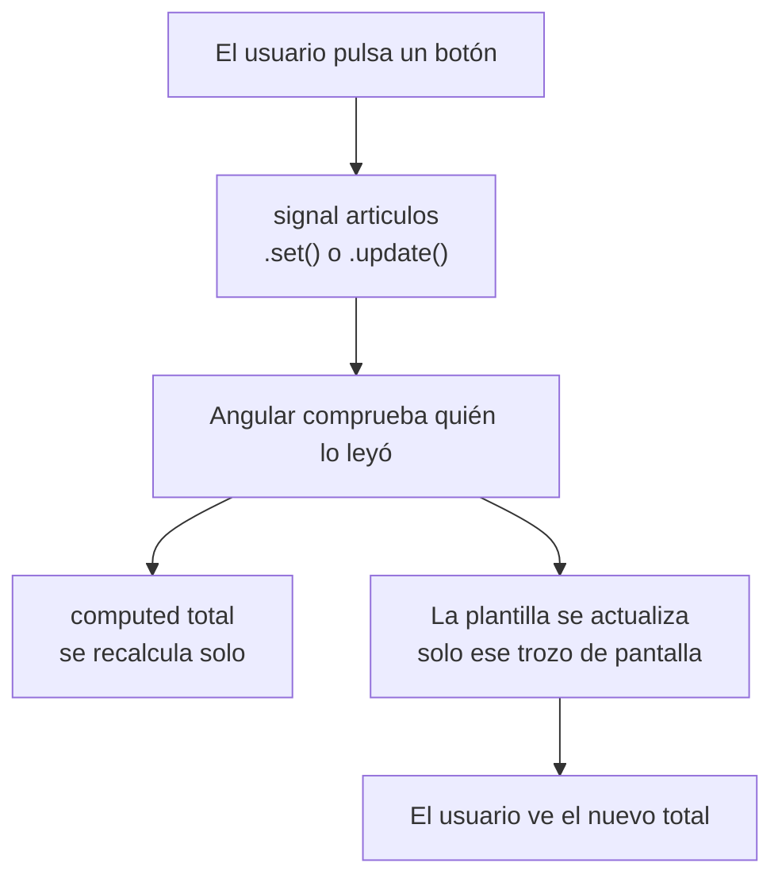
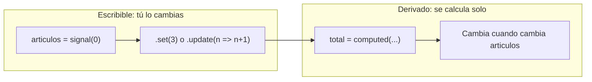

# Signals en Angular

## 1. Definición breve

Un **signal** es una **envoltorio ligera alrededor de un valor** que **avisa a
quien lo usa** cuando ese valor cambia.

La documentación lo resume así: «un signal es un envoltorio alrededor de un valor
que notifica a los consumidores interesados cuando ese valor cambia».

Con los signals gestionas el **estado** de la aplicación (los datos que cambian
con el tiempo). La capacidad de reaccionar a esos cambios se llama
**reactividad**.

## 2. Explicación paso a paso

1. **Crear**: llamas a la función `signal(valorInicial)` y te devuelve un
   signal. Puede contener cualquier cosa: un número, un texto, un array.
2. **Leer**: un signal es **una función**. Para leer su valor la llamas con
   paréntesis: `count()`. Ese detalle no es un capricho: es lo que permite a
   Angular saber **dónde** se ha usado el signal.
3. **Cambiar**: los signals son de dos tipos. Los **escribibles** tienen `.set(nuevo)`
   y `.update(v => ...)`. Los de solo lectura **no**.
4. **Encadenar**: con `computed()` creas otro signal cuyo valor **se calcula a
   partir de otros**. Es de solo lectura y se recalcula solo cuando cambia algo
   de lo que depende.
5. **Reaccionar**: dentro de una plantilla, al leer un signal, Angular registra
   una dependencia. Si el valor cambia, Angular actualiza **solo la parte de la
   pantalla** afectada. Eso se llama **contexto reactivo**.
6. **Efectos**: con `effect()` ejecutas un código cuando cambian los signals que
   leas dentro. Se reserva para Efectos secundarios (ver sección 3).

**Idea clave**: un signal por sí solo no hace magia. Lo útil es que Angular
**anota automáticamente** qué parte de la pantalla depende de cada valor.

## 3. Para qué sirve y cuándo se utiliza

- **Estado local de un componente**: el contador de un carrito, si el panel está
  abierto, el texto de un buscador.
- **Valores derivados**: un total, una cadena, un booleano que depende de
  otros signals. Para eso, `computed`.
- **Actualizar solo lo justo**: con signals, si cambia un valor, Angular repinta
  el componente que lo usa, no toda la aplicación.
- **Estado compartido**: dentro de un servicio, un signal de solo lectura
  (`asReadonly()`) para que nadie de fuera lo modifique sin permiso.
- **`effect()`**: para **efectos secundarios**, es decir, hablar con el mundo
  exterior (una API, un `console.log`, guardar en `localStorage`). La
  documentación recomienda las **derivaciones** (`computed`) siempre que puedas
  y reserva `effect` para los casos que las derivaciones no cubren.

## 4. Ejemplo práctico relacionado con DAW

Web de una tienda online, un carrito de compra:

```text
1. El carrito tiene un signal: articulos = signal(0)
2. El botón "Sumar" llama articulos.update(n => n + 1)
3. El total de la pantalla es un computed: total = computed(() => precio * articulos())
4. Al pulsar Sumar, solo se repinta el total y el contador
5. El resto de la web (cabecera, pie, filtros) no se toca
6. Con la forma antigua habría que revisar y repintar más cosas a mano
```

## 5. Código pequeño comentado

Lo mínimo para usar signals en un componente:

```ts
import {Component, signal, computed} from '@angular/core';

@Component({
  selector: 'app-carrito',
  template: `
    <p>{{ articulos() }} artículos · {{ total() }} €</p>
    <button (click)="anadir()">Sumar</button>
  `,
})
export class Carrito {
  articulos = signal(0);                          // escribible
  precio = signal(9.99);
  total = computed(() => this.precio() * this.articulos());  // derivado, solo lectura

  anadir() {
    this.articulos.update((n) => n + 1);          // usar el valor anterior
  }
}
```

Un signal de solo lectura para compartirlo sin que lo cambien:

```ts
private readonly _articulos = signal(0);
readonly articulos = this._articulos.asReadonly();  // se lee, no se modifica
```

## 6. Diagrama (Mermaid)

Cómo fluye un cambio desde el signal hasta la pantalla:



La diferencia entre un signal escribible y uno derivado:



> Estos diagramas **no se han validado automáticamente**: ábrelos en Obsidian,
> en GitHub o en mermaid.live para comprobar que se ven bien.

## 7. Conceptos con los que se suele confundir

- **Signal ≠ variable normal**. Una variable `let total = 0` no avisa a nadie.
  El signal avisa, y por eso Angular puede repintar solo.
- **Signal ≠ observable de RxJS**. Los signals son **síncronos** y orientados
  al estado: siempre tienes el valor actual a mano. Un `Observable` es asíncrono
  y representa una secuencia de valores. Se pueden mezclar, pero no son lo mismo.
- **`computed` ≠ método getter de la clase**. Un método recalcula cada vez que
  se llama; un `computed` guarda el resultado en caché y solo recalcula si
  cambió lo que lee.
- **`computed` ≠ signal escribible**. Un `computed` **no tiene** `.set()` ni
  `.update()`: olvidarlo da error de compilación.
- **`effect` ≠ `computed`**. `computed` deriva un valor; `effect` ejecuta un
  efecto secundario. La documentación recomienda `computed` siempre que puedas.
- **Signal ≠ directivas ni pipes**. Esos pertenecen a la plantilla;
  el signal vive en el TypeScript del componente.

## 8. Errores frecuentes

- **Olvidar los paréntesis al leer**: `{{ articulos }}` pinta el objeto signal en
  vez del número. Tiene que ser `{{ articulos() }}`.
- **Intentar cambiar un `computed`**: `.set()` sobre un `computed` es un error de
  compilación, no una excepción en tiempo de ejecución.
- **Meter efectos secundarios dentro de un `computed`**: un `computed` debe ser
  una función **pura**. Si dentro haces una petición a la API, el resultado
  depende de la red, no solo de los signals, y el valor en caché deja de tener
  sentido. Para eso, `effect`.
- **Leer signals después de un `await` dentro de un `effect`**: la documentación
  avisa de que el contexto reactivo **solo está activo en código síncrono**.
  Las lecturas que ocurren después de un `await` dejan de rastrearse. Solución:
  leer el signal **antes** del `await` y guardarlo en una variable.
- **Envolver todo en signals sin necesidad**: si el valor nunca lo lee la
  plantilla, no aporta nada.
- **Crear signals dentro de un método o de un bucle**: el signal debe crearse
  una vez, normalmente como propiedad del componente o del servicio.

## 9. Tres preguntas de repaso

1. ¿Por qué un signal se lee con paréntesis (`articulos()`) y una variable normal
   no? ¿Qué gana Angular con eso?
2. ¿Cuál es la diferencia entre `computed()` y `effect()`? Pon un ejemplo de
   cuándo usar cada uno.
3. Dentro de un `effect` haces `await` y luego lees un signal. ¿Qué problema hay y
   cómo lo resuelve la documentación?

### Respuestas

1. Porque un signal **es una función**: llamarla lee su valor. Ese detalle es lo
   que permite a Angular **anotar en qué punto del código** se leyó el signal, y
   así saber a qué parte de la pantalla hay que volver a pintar cuando cambie.
   Con una variable normal no hay ninguna anotación posible.
2. Un `computed` **deriva un valor** a partir de otros signals: es de solo
   lectura y se recalcula solo cuando cambia lo que lee. Ejemplo:
   `total = computed(() => precio() * articulos())`. Un `effect` ejecuta **código
   con efectos secundarios** cuando cambian los signals que lee dentro. Ejemplo:
   guardar el carrito en `localStorage` o llamar a una API. La documentación
   recomienda usar `computed` siempre que se pueda y reservar `effect` para lo
   que las derivaciones no cubren.
3. El **contexto reactivo solo está activo en código síncrono**. Cualquier
   lectura de un signal que ocurra después de un `await` deja de rastrearse, así
   que si ese signal cambia, el `effect` no se volverá a ejecutar. La solución que
   da la documentación es **leer los signals antes del `await`** y guardarlos en
   una variable, o pasarlos como argumentos de la función esperada.

## 10. Términos relacionados

- [Directivas de Angular (resumen)](directivas-angular.md) — los bloques `@if` y
  `@for` que reaccionan a los signals en la plantilla.
- [Pipes en Angular](pipes-angular.md) — formatean los valores que lees de un
  signal.
- [Angular standalone vs Ng Module](angular-standalone-vs-ngmodule.md) — los
  signals se declaran como propiedades del componente, sin módulo que los agrupe.
- [HTTP](http.md) — de dónde vienen los datos que guardas en un signal.
- [Glosario](../Glosario.md) — índice general.

*(Pendiente de crear ficha propia para: componente de Angular, estado,
reactividad, inyección de dependencias y `OnPush`.)*

## 11. Fuentes y límites de la explicación

- Fuentes consultadas (documentación oficial, en inglés):
  - [Signals — Angular Essentials — angular.dev](https://angular.dev/essentials/signals)
    (definición, `signal`, lectura con paréntesis, `set`, `update`, `computed`).
  - [Angular Signals (guía completa) — angular.dev](https://angular.dev/guide/signals)
    (signals escribibles y de solo lectura, `asReadonly()`, `computed` con
    evaluación perezosa y memorizada, dependencias dinámicas, contexto reactivo,
    `effect`, `untracked`, funciones de igualdad, `isSignal`, la nota sobre
    contexto reactivo y `await`, y el comportamiento con `OnPush`).
- Límites:
  - Documentación leída en su versión **v22**.
  - **No se ha creado ni ejecutado ningún proyecto Angular en esta sesión**: los
    fragmentos son ejemplos escritos a partir de la documentación, no código
    compilado. No se ha comprobado que los errores de la sección 8 ocurran tal
    como se describen.
  - Esta ficha es una **introducción**. La guía oficial tiene apartados enteros
    para `linkedSignal`, `resource`, `effect` y `debounced`, que quedan fuera
    porque son temas con ficha propia.
  - La comparación con RxJS es de lectura propia, apoyada en que la documentación
    describe los signals como síncronos; **no se ha consultado** la guía de
    interoperabilidad entre signals y RxJS.
  - Los diagramas Mermaid **no se han validado automáticamente**.

## 12. Mis notas

<!-- Sección reservada para la estudiante. No borrar ni sobrescribir. -->