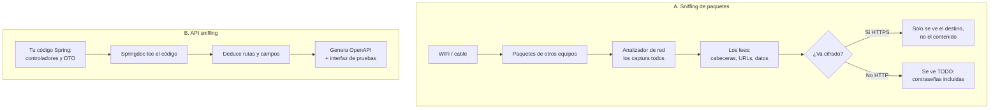

# Sniffing

> La palabra *sniffing* («olfatear») se usa en DAW con **dos significados
> distintos**. Esta ficha explica los dos, cada uno en su contexto:
> [A. Sniffing de paquetes](#a-sniffing-de-paquetes-de-red) y
> [B. API sniffing](#b-api-sniffing-generar-la-documentacion-de-una-api).

## 1. Definición breve

- **A. Sniffing de paquetes**: **capturar y leer el tráfico de red** que pasa por
  tu ordenador para ver qué datos viajan: contraseñas, cabeceras, peticiones.
- **B. API sniffing**: una herramienta **lee tu código** y **genera sola la
  documentación de la API** (qué endpoints hay, qué datos entran y salen).

Las dos tienen la misma idea: **«olfatear» algo para ver qué contiene**, pero lo
que olfatean es muy distinto.

## 2. Explicación paso a paso

### A. Sniffing de paquetes de red

1. En una red, los datos viajan **sueltos en paquetes** («trozos» de información).
2. Una tarjeta de red en modo normal solo entrega a tu sistema los paquetes que
   son para tu máquina. Un analizador de red pone la tarjeta en un modo
   distinto: **le pasa a tu sistema todos los paquetes**, incluidos los de otros.
3. Eso es **sniffing**: escuchar el cable y ver qué pasa.
4. Con los datos capturados se pueden leer las cabeceras de las peticiones, ver
   contraseñas que van sin cifrar, ver a qué direcciones IP se conecta el
   navegador…
5. **Prevención**: usar **HTTPS** (que cifra lo que viaja) y no usar redes WiFi
   públicas sin cifrar.

### B. API sniffing: generar la documentación de una API

1. En Spring, tus controladores y clases son el «código» que describe la API.
2. Una librería (como Springdoc) **lee ese código** y se deduce qué hay: qué
   rutas existen, qué datos se piden y qué se devuelven.
3. Con esa información genera **automáticamente** la documentación (esquema
   OpenAPI y una interfaz para probarla).
4. El resultado es un archivo que dice, por ejemplo: «`GET /pedidos/{id}`
   devuelve un pedido con estos campos».
5. Ventaja: la documentación no se queda vieja desactualizada, porque se
   regenera a partir del código.

## 3. Para qué sirve y cuándo se utiliza

- **A. Sniffing de paquetes**:
  - Sirve para **diagnosticar problemas de red**: ver si un paquete sale, si la
    respuesta vuelve, si algo se retransmite.
  - Sirve como **herramienta de seguridad legítima** para comprobar si tu web
    manda datos sensibles en claro.
  - Se usa con autorización explícita: capturar el tráfico de una red que no es
    tuya está prohibido por ley en muchos países.
- **B. API sniffing**:
  - Sirve para **documentar la API sin escribirla a mano**.
  - Sirve para **probar la API** desde el navegador, sin Postman ni código.
  - Se usa en fase de desarrollo y de pruebas.

## 4. Ejemplo práctico relacionado con DAW

**A.** Compruebas si tu formulario de login manda la contraseña protegida: abres
el analizador de red del navegador y haces login. Si ves `POST /login` con la
contraseña en claro, tu web necesita **HTTPS**.

**B.** En un proyecto Spring Boot, con Springdoc tienes la documentación ya
generada sin escribir nada:

```java
// Con springdoc en el pom.xml se añade solo esto:
@Bean
public OpenAPI info() {
    return new OpenAPI().info(new Info()
        .title("API de pedidos")
        .version("1.0"));
}
```

Al arrancar, la interfaz queda disponible y lista para probar.

## 5. Código pequeño comentado

```text
# A. Un paquete HTTP visto con un analizador (esquema, no son datos reales)
Origen: 192.168.1.20   Destino: 93.184.216.34
Método: POST      Ruta: /login
Host: ejemplo.com
Cookie: sesion=abc123          <-- dato sensible, va sin cifrar si es HTTP
Cuerpo: usuario=ana&clave=123  <-- ¡por eso hace falta HTTPS!

# B. Lo mismo, visto con la documentación autogenerada (API sniffing)
POST /login
  parameters: { usuario: string, clave: string }
  responses: 200 { mensaje: string }
```

## 6. Diagrama (Mermaid)



> Este diagrama **no se ha validado automáticamente**: ábrelo en Obsidian, en
> GitHub o en mermaid.live para comprobar que se ve bien.

## 7. Conceptos con los que se suele confundir

- **Sniffing de paquetes ≠ interceptación (man-in-the-middle)**: el sniffing
  normalmente **solo escucha**; el intermediario además **modifica** lo que pasa
  entre dos equipos.
- **Sniffing de paquetes ≠ [códigos de estado HTTP](codigos-estado.md)**: los
  códigos de estado (200, 404…) son un campo de la petición HTTP; el sniffing es
  capturar la petición entera.
- **API sniffing ≠ OpenAPI por escrito**: OpenAPI es el **formato**
  del archivo de descripción; el *sniffing* es el **proceso** de generarlo
  leyendo el código. Se pueden usar los dos: generarlo y editarlo a mano.
- **API sniffing ≠ [bean de Spring](beans-spring.md)**: el bean es el objeto que
  Spring gestiona; el sniffing es una técnica que lee el código entero.

## 8. Errores frecuentes

- **Creer que el sniffing de paquetes solo lo hacen los Cibervillanos**: es una
  herramienta de diagnóstico legítima; lo ilegal es usarla en redes ajenas sin
  permiso.
- **Pensar que HTTPS es «cifrar el wifi»**: HTTPS cifra **la comunicación entre
  navegador y servidor**. En una red WiFi abierta, el tráfico entre equipos de la
  misma red sigue sin proteger.
- **Devolver datos sensibles en la URL**: van en el historial, en los registros
  del servidor y en los proxies intermedios; mejor en el cuerpo de la petición.
- **Fiarte de la documentación autogenerada sin revisarla**: si el código está mal
  escrito, la documentación también. Generarla no significa que sea correcta.
- **Confundir sniffing con escaneo de puertos**: el *sniffing* lee el tráfico que
  pasa; el escaneo de puertos busca quién tiene un puerto abierto.

## 9. Tres preguntas de repaso

1. ¿Qué diferencia hay entre sniffing de paquetes y un ataque de intermediario?
2. ¿Por qué usar HTTPS evita que el sniffing revele el contenido de tus datos?
3. ¿Qué aporta el «API sniffing» frente a escribir la documentación a mano?

### Respuestas

1. El sniffing de paquetes normalmente **solo escucha**: copia lo que pasa por
   el cable sin tocarlo. El intermediario además **se coloca entre los dos
   equipos** y puede leer **y modificar** lo que pasa, que es mucho más grave.
2. HTTPS cifra la comunicación entre el navegador y el servidor. Con el cifrado,
   el analizador ve la dirección a la que se conectan y poco más, pero **no el
   contenido**. Sin HTTPS, el paquete llega en texto legible.
3. Que la documentación se genera **sola a partir del código**. No hay que
   escribirla, así que se mantiene al día de forma automática cuando cambia el
   código. Eso no garantiza que sea correcta: hay que revisarla.

## 10. Términos relacionados

- [HTTP](http.md) — el protocolo cuyo tráfico se puede capturar.
- [Códigos de estado HTTP](codigos-estado.md) — un campo concreto de la petición.
- [DTO (Data Transfer Object)](dtos.md) — de aquí saca Springdoc los datos que
  describen la API.
- [Glosario](../Glosario.md) — índice general.

*(Pendiente de crear ficha propia para: HTTPS, paquete de red, IP, firewall,
OpenAPI.)*

## 11. Fuentes y límites de la explicación

- Fuentes: **no consultadas**; la explicación está redactada a partir de
  conocimiento general y de las fichas de este glosario ([HTTP](http.md),
  [Códigos de estado HTTP](codigos-estado.md), [DTO](dtos.md)).
- Límites:
  - **No se ha ejecutado ninguna herramienta** (analizador de red ni proyecto
    Spring Boot) en esta sesión: el ejemplo de la sección 4 y el de la sección 5
    describen lo que harían esas herramientas, no una salida comprobada.
  - El ejemplo de la sección 5 con datos `usuario=ana&clave=123` es
    **inventado**, no una captura real.
  - Sobre HTTPS solo se afirma lo general: no se ha medido ni capturado nada para
    comprobarlo.
  - Las leyes sobre la ilegalidad de capturar tráfico ajeno pueden variar
    según el país.
  - El diagrama Mermaid no se ha validado automáticamente.

## 12. Mis notas

<!-- Sección reservada para la estudiante. No borrar ni sobrescribir. -->