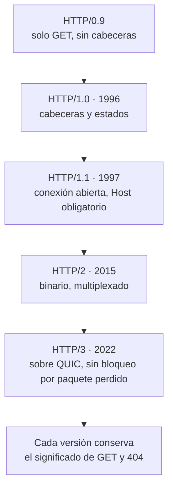

# Evolución del protocolo HTTP

## 1. Definición breve

Cómo han cambiado las versiones de HTTP (0.9, 1.0, 1.1, 2 y 3): cada versión
**mantiene lo que hacía la anterior** y añade algo nuevo, normalmente menos
esperas y más velocidad.

> Esta ficha va de las **versiones** del protocolo. Si lo que querías eran los
> **métodos** (GET, POST, PUT, DELETE…), eso es otro tema.

## 2. Explicación paso a paso

1. **HTTP/0.9**: la más simple. Solo un método (`GET`), sin cabeceras y sin
   códigos de estado. MDN lo resume así: *«no usa cabeceras HTTP, con lo cual
   únicamente es posible transmitir archivos HTML»*.
2. **HTTP/1.0** (RFC 1945, mayo de 1996): llegan las **cabeceras** y los
   **códigos de estado**, y también el método `POST`. Por primera vez una
   respuesta podía decir «voy a ser un PDF» o «te he dado un error».
3. **HTTP/1.1** (publicado en enero de 1997): se **mantiene la conexión abierta**
   para no abrirla en cada petición. El RFC 9112 dice que *«HTTP/1.1 defaults to
   the use of persistent connections»*, y que *«A client MUST send a Host header
   field in all HTTP/1.1 request messages»* (la cabecera `Host` es obligatoria).
4. **HTTP/2** (estandarizado en mayo de 2015): el mensaje deja de ser texto y
   pasa a ser **binario**, se **comprimen las cabeceras** y se pueden mandar
   **muchas peticiones a la vez por la misma conexión** (multiplexación).
5. **HTTP/3** (RFC 9114, junio de 2022): ya no viaja sobre TCP sino sobre **QUIC**,
   que va sobre UDP. La ventaja clave está en las redes móviles, donde se pierden
   paquetes: con HTTP/2, un paquete perdido **bloquea todas** las peticiones en
   curso; con HTTP/3 solo se bloquea la afectada.

**Idea clave:** HTTP/2 y HTTP/3 no cambian qué significa `GET` o `404`. Cambian
**cómo viaja el mensaje** por la red.

## 3. Para qué sirve y cuándo se utiliza

- Sirve para entender por qué una web va **lenta con muchas imágenes** aunque el
  servidor sea rápido.
- Sirve para saber **qué versión negocia** el navegador con el servidor (eso se
  llama *upgrade mechanism*).
- En DAW se usa principalmente como **conocimiento de fondo**: no escribes código
  distinto según la versión, pero entiendes por qué una petición «se atasca».
- Se comprueba en el navegador: en Chrome, la pestaña **Network** tiene una
  columna *Protocol* con valores como `h2` y `h3`
  ([documentación de Chrome DevTools](https://developer.chrome.com/docs/devtools/network/reference)).

## 4. Ejemplo práctico relacionado con DAW

Una portada con **30 imágenes**. Qué pasa en cada versión:

```text
HTTP/1.0:  30 peticiones, cada una abre y cierra su conexión.      Lento.
HTTP/1.1:  30 peticiones sobre la misma conexión abierta.          Mejor.
HTTP/2:    30 peticiones multiplexadas en una sola conexión.        Mucho mejor.
HTTP/3:    lo mismo, pero sin que un paquete perdido bloquee todas.  Igual o mejor.
```

En los cuatro casos, el resultado para el usuario es el mismo: ve la página.

## 5. Código pequeño comentado

Cómo se ve un mensaje en cada familia (ilustrativo, no son peticiones reales):

```text
HTTP/1.1                          # texto plano, se lee a ojo
GET /index.html HTTP/1.1
Host: ejemplo.com

HTTP/2 y HTTP/3                   # binario: NO se puede leer en un archivo de texto
# frames: longitud | tipo | flags | stream id | payload
```

MDN lo dice para HTTP/2: *«Es un protocolo binario, en contraposición a estar
formado por cadenas de texto»*.

## 6. Diagrama (Mermaid)



> Este diagrama **no se ha validado automáticamente**: ábrelo en Obsidian, en
> GitHub o en mermaid.live para comprobar que se ve bien.

## 7. Conceptos con los que se suele confundir

- **Versiones de HTTP ≠ métodos HTTP**: la versión es **cómo viaja** el mensaje
  (0.9, 1.1, 2, 3); los métodos son **qué pides** (GET, POST, DELETE…).
- **HTTP/2 ≠ HTTPS**: la `S` significa protocolo cifrado, es otra cosa.
- **HTTP/2 ≠ HTTP/3 por rendimiento siempre**: la diferencia grande aparece cuando
  hay pérdida de paquetes, típica de móvil. En una red de cable pueden ir igual.
- **Versión del protocolo ≠ versión de tu servidor**: Apache o Nginx pueden hablar
  HTTP/1.1 y servir también HTTP/2 o HTTP/3.
- **Navegador antiguo = versión antigua**: los navegadores que no soportan HTTP/2
  hacen *downgrade* y siguen con HTTP/1.1 sin romperse.

## 8. Errores frecuentes

- **Creer que HTTP/2 no se ve en el código**: es una diferencia de protocolo de
  transporte; tu HTML y tu PHP son idénticos.
- **Pensar que HTTP/3 arregla la lentitud de tu web**: si el problema es una
  consulta mal hecha a la base de datos, cambiar de versión no lo arregla.
- **Usar `h2` o `h3` como si fueran métodos**: son nombres internos de las
  DevTools para la versión del protocolo.
- **Confiar en la cifra de adopción que da MDN**: son porcentajes que cambian
  cada mes y la propia fuente depende de w3techs.
- **Esperar que HTTP/1.1 dé error si no mandas `Host`**: es obligatorio en esa
  versión, y por eso varios dominios pueden compartir una misma dirección IP.

## 9. Tres preguntas de repaso

1. ¿Qué dos cosas nuevas aparecen en HTTP/1.0 respecto a HTTP/0.9?
2. ¿Qué problema concreto de red sigue teniendo HTTP/2 y arregla HTTP/3?
3. ¿Tu código PHP es distinto en HTTP/1.1 y en HTTP/3?

### Respuestas

1. Las **cabeceras** (en peticiones y respuestas) y los **códigos de estado**.
   También aparece el método `POST`, según el RFC 1945.
2. El **bloqueo por cabecera** (*head-of-line blocking*): con HTTP/2, si se pierde
   un paquete, todas las peticiones multiplexadas esperando ese dato se paran. En
   HTTP/3, sobre QUIC, solo se para la petición afectada. Ojo: HTTP/2 no resolvió
   el bloqueo que produce TCP, solo el de la capa de aplicación.
3. No. Tus cabeceras HTTP siguen igual: un `GET` es un `GET` y un `404` es un
   `404` en todas las versiones. Cambia únicamente el formato del mensaje por el
   que viaja.

## 10. Términos relacionados

- [HTTP](http.md) — qué es HTTP en general (ficha de demostración).
- [CI/CD](ci-cd.md) — la automatización que hace que todo esto llegue a producción.
- [Glosario](../Glosario.md) — índice general.

*(Pendiente de crear fichas propias para: métodos HTTP, HTTPS, TCP, UDP, QUIC.)*

## 11. Fuentes y límites de la explicación

- Fuentes consultadas (comprobadas, responden 200):
  - [MDN — Evolución del protocolo HTTP](https://developer.mozilla.org/es/docs/Web/HTTP/Guides/Evolution_of_HTTP)
  - [RFC 9112 — HTTP/1.1](https://httpwg.org/specs/rfc9112.html) (conexiones
    persistentes y cabecera `Host` obligatoria).
  - [RFC 9113 — HTTP/2](https://httpwg.org/specs/rfc9113.html) (binario,
    multiplexación, compresión de cabeceras; obsoleta a la RFC 7540).
  - [RFC 9114 — HTTP/3](https://httpwg.org/specs/rfc9114.html) (viaja sobre QUIC).
  - [RFC 9000 — QUIC](https://datatracker.ietf.org/doc/html/rfc9000) (evita el
    bloqueo entre flujos al perder un paquete).
  - [RFC 1945 — HTTP/1.0](https://datatracker.ietf.org/doc/html/rfc1945) (el método
    `POST` en HTTP/1.0).
  - [Chrome DevTools — referencia de Network](https://developer.chrome.com/docs/devtools/network/reference)
    (columna *Protocol* con `h2` y `h3`).
- Límites:
  - **HTTP/1.0**: el RFC 1945 dice *«May 1996»*; MDN afirma noviembre de 1996.
    Aquí se usa mayo de 1996 porque es lo que dice el RFC.
  - **HTTP/1.1**: solo se ha confirmado la publicación inicial de enero de 1997.
    La fecha de la RFC 2616 (junio de 1999) aparece en MDN pero **no se ha
    verificado** en la fuente primaria, así que no se incluye.
  - **HTTP/0.9**: las fechas que da MDN (finales de los ochenta, principios de los
    noventa) **no se han contrastado** con ninguna fuente primaria.
  - MDN, en su página de evolución, **no menciona HTTP/3 ni QUIC**: lo de HTTP/3
    sale de los RFC.
  - **No se ha medido nada**: no hay pruebas de rendimiento hechas aquí. La ventaja de
    HTTP/3 con redes móviles es una afirmación de los RFC, no una medición propia.
  - Los diagramas Mermaid no se han validado automáticamente.

## 12. Mis notas

<!-- Sección reservada para la estudiante. No borrar ni sobrescribir. -->